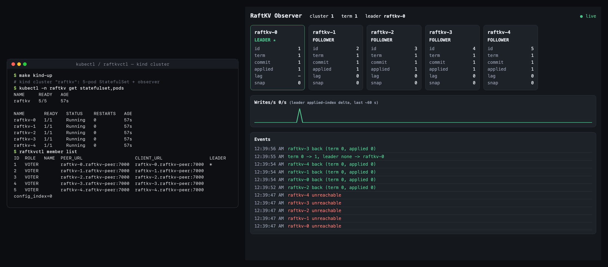
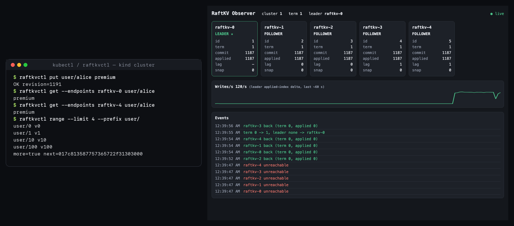
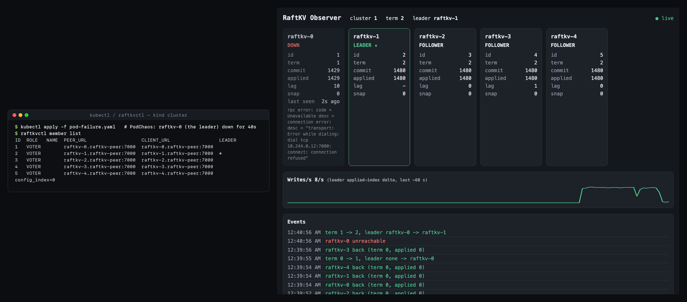
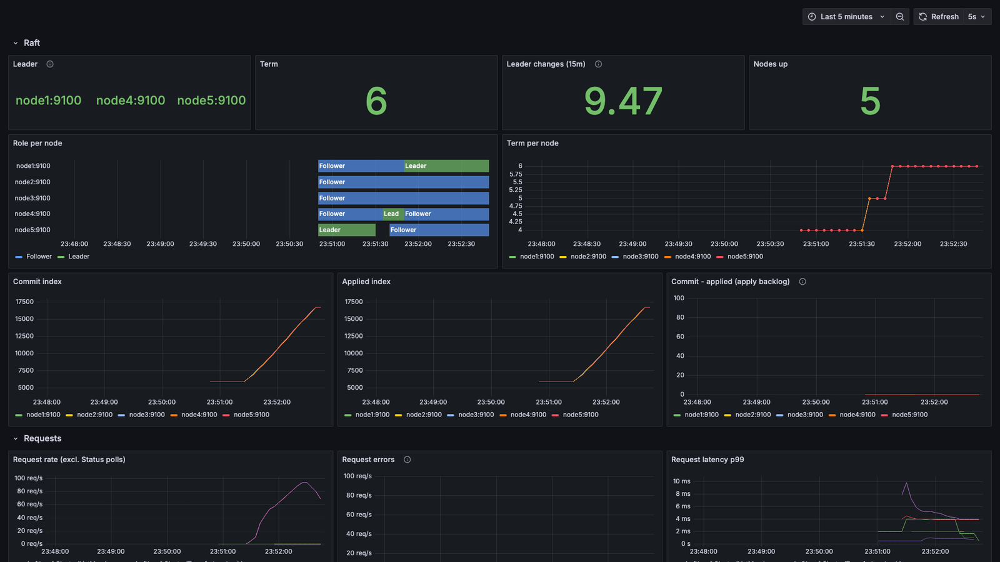

# RaftKV

A replicated key-value store built on the Raft consensus algorithm, written from scratch in Go as a learning project.

> **Status:** v1.0. All milestones (M0–M7) are built: Raft core, deterministic simulator, write-ahead log, gRPC
> transport, Pebble state machine, linearizable reads, exactly-once sessions, snapshots, membership changes,
> leadership transfer, Kubernetes on kind, the observer UI and Chaos Mesh tests. See the
> [roadmap](docs/implementation-roadmap.md) (exit evidence per milestone) and the [WBS](WBS.md).

## Overview

RaftKV runs as a 5-node cluster. The nodes elect a leader, replicate every write to a majority before acknowledging
it, and keep serving as long as any 3 nodes are up. Reads are linearizable. Correctness is checked by a deterministic
simulator, the Porcupine linearizability checker over recorded histories, and fault injection on docker-compose and
on kind with Chaos Mesh. Speed is not a goal.

## Demo: five nodes on Kubernetes

Real screenshots from a local kind cluster (`make chaos-up`), taken while a client wrote keys continuously. Left: the
commands and their real output. Right: the live observer UI (`kubectl port-forward deploy/raftkv-observer`). Nodes
were taken down with a Chaos Mesh `PodChaos` `pod-failure`, which keeps a pod down for a set time (kind never pulls
images, so a downed pod shows `ErrImageNeverPull` while Chaos Mesh holds it). Across the whole run, 3,753 writes
were sent and none failed.

**1. Start the cluster.** `make kind-up` deploys a 5-pod StatefulSet and the observer. Five voters, one leader.



**2. Insert data and watch it replicate.** A write is acknowledged once a majority has it. Every node reaches the
same commit and applied index, and any node returns the value.



**3. Kill the leader.** raftkv-0 goes down; raftkv-1 wins the election in term 2 and writes continue.



**4. Kill another node.** With raftkv-0 and raftkv-4 both down, the remaining three are still a majority: writes and
linearizable reads keep working.


**5. Restore the failed nodes.** When the fault ends, both pods restart from their volumes, catch up from the leader,
and every node is back at the same commit and applied index. The restarted nodes return the write made while they
were down.


**6. Grafana.** The "RaftKV overview" dashboard from the docker-compose stack (`make cluster-up`) after a leader kill:
leader, term, leader changes, role and term per node, commit and applied index, and request rate.



## Features

- Leader election with PreVote and CheckQuorum
- Log replication with majority commit
- Linearizable reads (ReadIndex) from any member; stale reads on request
- Exactly-once writes through client sessions
- Write-ahead log with crash recovery
- Snapshots and follower catch-up
- Online membership changes (one server at a time, learners) and leadership transfer, also on SIGTERM
- gRPC API: `Put`, `Get`, `Delete`, `CompareAndSwap`, `Range`
- Prometheus metrics, a Grafana dashboard, OpenTelemetry tracing, and a live observer UI

## Tech stack

Go · gRPC · Protocol Buffers · Pebble · Docker · Kubernetes (kind) · Chaos Mesh · Prometheus · Grafana ·
OpenTelemetry · Porcupine · GitHub Actions

## Quick start

Requires Go (the toolchain in `go.mod` is fetched automatically) and Docker with Compose v2. The kind cluster also
needs `kubectl`; `make` installs kind itself into `bin/` if it is not on your `PATH`. The chaos run also needs `helm`.

```sh
make build         # raftkvd, raftkvctl and raftkv-observer into bin/
make test          # unit tests
make sim           # deterministic simulator (SEEDS=500 FAULTS=full)
```

### docker-compose

```sh
make cluster-up    # builds the image, starts 5 nodes, Prometheus, Grafana and the observer
export RAFTKV_ENDPOINTS=127.0.0.1:17001,127.0.0.1:17002,127.0.0.1:17003,127.0.0.1:17004,127.0.0.1:17005
bin/raftkvctl put color blue
bin/raftkvctl get color
bin/raftkvctl member list
make cluster-logs  # follow the node logs (Ctrl-C to stop)
make cluster-down  # stop everything and delete the data volumes
```

While it runs (all on localhost only): observer UI http://127.0.0.1:18080, Grafana http://127.0.0.1:13000
(dashboard "RaftKV overview"), Prometheus http://127.0.0.1:19090. Try `docker kill raftkv-node1` and watch the
timeline.

`make e2e` runs the e2e suite with fault injection. It starts and stops its own compose cluster, so run it with
`make cluster-down` done first.

### Kubernetes (kind)

```sh
make kind-up       # kind cluster "raftkv", image raftkvd:kind, 5-pod StatefulSet in namespace raftkv
make kind-status
kubectl --context kind-raftkv -n raftkv exec raftkv-0 -- /usr/local/bin/raftkvctl put --endpoints raftkv:7000 color blue
kubectl --context kind-raftkv -n raftkv exec raftkv-3 -- /usr/local/bin/raftkvctl get --endpoints raftkv:7000 color
kubectl --context kind-raftkv -n raftkv port-forward deploy/raftkv-observer 18080:8080   # observer UI
kubectl --context kind-raftkv -n raftkv rollout restart statefulset/raftkv              # leaders hand over
make chaos-up && make chaos CHAOS_DURATION=5m   # Chaos Mesh fault schedule + Porcupine check
make kind-down     # delete the cluster (same as make chaos-down)
```

Run `make help` for all targets.

## Known limitations

- **One Raft group.** No sharding (D-07); every write goes through one leader.
- **No `Watch` and no transactions** (D-10). `CompareAndSwap` is the only conditional write; a multi-page `Range` is
  not one snapshot (D-34).
- **No TLS and no authentication**, on the client API, the peer RPCs, the observer and Grafana. Everything is meant
  for localhost or a local kind cluster.
- **Lease reads are off by default** (`--lease-reads`, D-25). They assume bounded clock drift and are unsafe if a
  voter restarts inside the lease; ReadIndex is the safe default.
- **Kubernetes v1 has a static membership.** Node IDs come from pod ordinals, so scaling the StatefulSet and
  replacing a lost PVC are not supported (rolling restarts are). On docker-compose or bare metal, membership changes
  work through `raftkvctl member`. See [system-design.md 7.9](docs/system-design.md).
- **Peers remember a wiped node's incarnation in memory only** (D-32). If every peer that knew the old incarnation
  restarts before the wiped node returns under its old ID, it is accepted again. Never reuse an ID on an empty disk.
- Built for learning, not production: no performance tuning, no rolling upgrades across versions, no backups.

## Documentation

- [RaftKV in 5 minutes](docs/raftkv-in-5-minutes.md): one-page overview · [Explained simply](docs/simple-guide.md)
- [Design decisions](docs/design-decisions.md)
- [Architecture](docs/architecture.md) · [System design](docs/system-design.md) (incl. how-tos: replace a node, scale,
  transfer leadership)
- [API design](docs/api-design.md) · [Storage design](docs/storage-design.md) · [Configuration reference](docs/configuration.md)
- [Testing](docs/testing.md) · [CI and e2e](docs/ci-e2e.md)
- [Roadmap](docs/implementation-roadmap.md) · [Task checklist](WBS.md) · [Changelog](CHANGELOG.md)

## Contributing

See [Agent.md](Agent.md) and [CONTRIBUTING.md](CONTRIBUTING.md) for project conventions. Log notable changes in
[CHANGELOG.md](CHANGELOG.md).

## License

[Apache-2.0](LICENSE).
