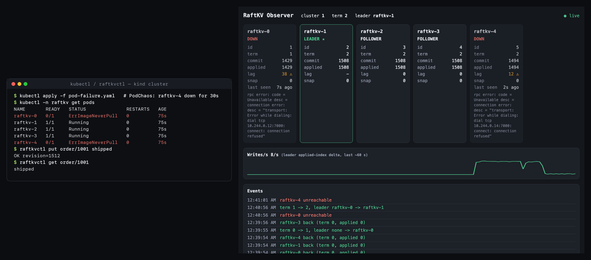
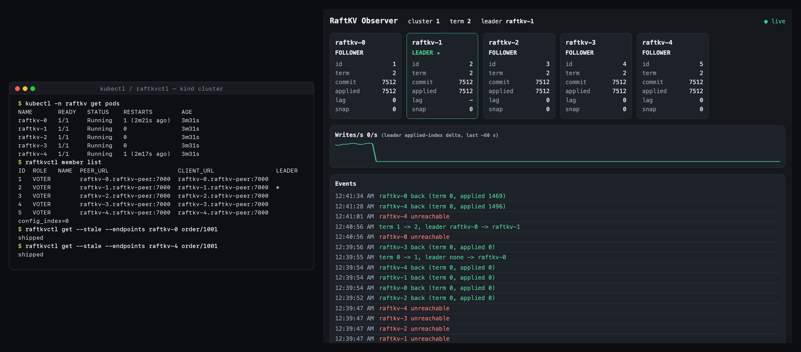
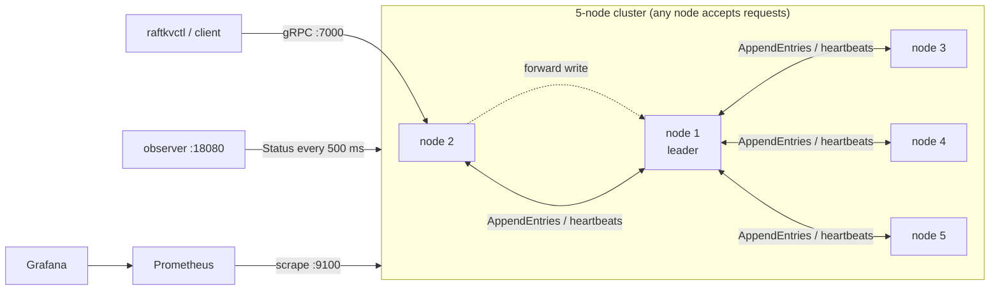
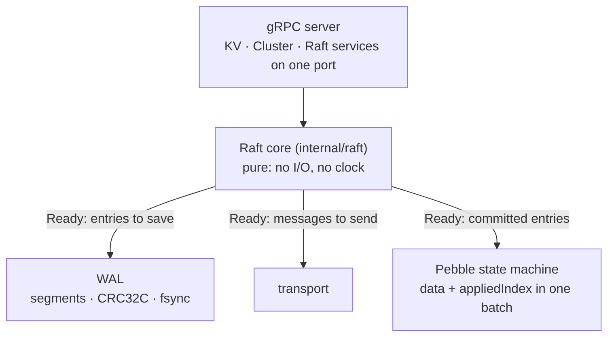

# RaftKV

[](https://github.com/bibekgupta3333/raftkv-distributed-store/actions/workflows/pr.yml)
[](go.mod)
[](LICENSE)

A linearizable, replicated key-value store with the Raft consensus algorithm written from scratch in Go: no Raft
library. Five nodes agree on one log, survive any two failures, and prove it with a deterministic simulator, a
linearizability checker and chaos tests on Kubernetes. A learning project: correctness and clarity matter, speed
does not.

[](https://youtu.be/YYRcJKwQcDQ)

▶ **[Watch the walkthrough on YouTube](https://youtu.be/YYRcJKwQcDQ)**: the problem, the architecture, the write
and read paths, and a live run where the leader is killed under load.

## Contents

[Overview](#overview) · [Demo](#demo-five-nodes-on-kubernetes) · [Features](#features) ·
[Architecture](#architecture) · [Quick start](#quick-start) · [Testing](#testing) ·
[Observability](#observability) · [Project layout](#project-layout) ·
[Known limitations](#known-limitations)

## Overview

Keeping copies of data on several machines protects against a crash, but the copies can disagree: messages get
dropped, a node dies halfway through a write, and two nodes can both believe they lead. RaftKV solves this with Raft:

- **One replicated log.** Every write is a log entry. The leader replicates it, and it is committed once a majority
  (3 of 5) has it on disk. Every node applies the same entries in the same order.
- **Linearizable operations.** A write is acknowledged only after it commits; a read is answered only after the
  serving node has confirmed it reflects every committed write (ReadIndex). Clients never see stale data.
- **Survives two failures.** Any 3 of 5 nodes keep serving. A crashed node restarts from its write-ahead log and
  catches up; one that fell too far behind receives a snapshot.

## Demo: five nodes on Kubernetes

Real screenshots from a local kind cluster (`make chaos-up`), taken while a client wrote keys continuously. Left: the
commands and their real output. Right: the live observer UI (`kubectl port-forward deploy/raftkv-observer`). Nodes
were taken down with a Chaos Mesh `PodChaos` `pod-failure`, which keeps a pod down for a set time (kind never pulls
images, so a downed pod shows `ErrImageNeverPull` while Chaos Mesh holds it). Across the whole run, 3,753 writes
were sent and none failed.

**1. Start the cluster.** `make kind-up` deploys a 5-pod StatefulSet and the observer. Five voters, one leader.


**2. Insert data and watch it replicate.** A write is acknowledged once a majority has it. Every node reaches the
same commit and applied index, and any node returns the value.


**3. Kill the leader.** raftkv-0 goes down; raftkv-1 wins the election in term 2 and writes continue.


**4. Kill another node.** With raftkv-0 and raftkv-4 both down, the remaining three are still a majority: writes and
linearizable reads keep working.



**5. Restore the failed nodes.** When the fault ends, both pods restart from their volumes, catch up from the leader,
and every node is back at the same commit and applied index. The restarted nodes return the write made while they
were down.



**6. Grafana.** The "RaftKV overview" dashboard from the docker-compose stack (`make cluster-up`) after a leader kill:
leader, term, leader changes, role and term per node, commit and applied index, and request rate.


## Features

**Consensus**
- Leader election with randomized timeouts, **PreVote** (a partitioned node can't disrupt the cluster) and
  **CheckQuorum** (an isolated leader steps down)
- Log replication over streaming gRPC, committed once a majority has the entry
- **Leadership transfer** with `TimeoutNow`; a leader hands off on `SIGTERM` before it exits
- **Membership changes** one server at a time, with learners that catch up before they get a vote
- A wiped node rejoins with a new **incarnation** and is refused, so it can never vote with an empty log

**Data and API**
- gRPC + Protobuf API: `Put`, `Get`, `Delete`, `CompareAndSwap`, `Range` (paged)
- **Linearizable reads** through ReadIndex on any member, including followers; stale reads only on request; lease
  reads available but off by default
- **Exactly-once writes** through client sessions: retries are deduplicated by `(client_id, seq)`
- Followers forward writes to the leader, so clients can call any node

**Storage**
- Segmented **write-ahead log** (64 MiB segments, CRC32C on every record), fsync before acknowledging
- **Pebble** (LSM) state machine; the applied index is written in the same batch as the data, so an entry is never
  applied twice
- **Snapshots** as Pebble checkpoints, streamed in 1 MiB chunks and swapped in atomically; the log is truncated only up
  to what is both snapshotted and durably applied

**Operations**
- Prometheus metrics, `/livez` and `/readyz`, OpenTelemetry tracing, a Grafana dashboard
- A live **observer UI** that streams every node's role, term, commit and applied index
- docker-compose stack and a Kubernetes **StatefulSet** (node ID from the pod ordinal)

## Architecture



Inside each node:



The Raft core is a pure state machine in the style of etcd/raft: it takes messages and ticks and returns a `Ready`
batch; the node loop does the disk and network I/O. That is what makes the deterministic simulator possible.

**Write path.** Client → any node (followers forward) → the leader appends the entry and fsyncs its WAL → replicates
to the followers in parallel → committed at 3 of 5 → applied to Pebble → the client gets its reply.

**Read path (ReadIndex).** The leader records its commit index, confirms it is still leader with one heartbeat round
to a majority, waits until it has applied that index, then answers. A follower serves a read the same way after
asking the leader for the index.

The design is recorded as numbered decisions (`D-01`…`D-48`) in [design-decisions.md](docs/design-decisions.md).

## Quick start

Requires Go (the toolchain in `go.mod` is fetched automatically) and Docker with Compose v2. The kind cluster also
needs `kubectl`; `make` installs kind itself into `bin/` if it is not on your `PATH`. The chaos run also needs `helm`.

```sh
make build         # raftkvd, raftkvctl and raftkv-observer into bin/
make test          # unit tests
make sim           # deterministic simulator (SEEDS=500 FAULTS=full)
```

### docker-compose

```sh
make cluster-up    # builds the image, starts 5 nodes, Prometheus, Grafana and the observer
export RAFTKV_ENDPOINTS=127.0.0.1:17001,127.0.0.1:17002,127.0.0.1:17003,127.0.0.1:17004,127.0.0.1:17005
bin/raftkvctl put color blue
bin/raftkvctl get color
bin/raftkvctl cas --expect-value blue --new-value green color
bin/raftkvctl range --prefix c
bin/raftkvctl member list
docker kill raftkv-node1   # kill a node (the leader, if it is node1) and watch the observer
make cluster-logs  # follow the node logs (Ctrl-C to stop)
make cluster-down  # stop everything and delete the data volumes
```

While it runs (all on localhost only): observer UI http://127.0.0.1:18080, Grafana http://127.0.0.1:13000
(dashboard "RaftKV overview"), Prometheus http://127.0.0.1:19090.

### Kubernetes (kind)

```sh
make kind-up       # kind cluster "raftkv", image raftkvd:kind, 5-pod StatefulSet in namespace raftkv
make kind-status
kubectl --context kind-raftkv -n raftkv exec raftkv-0 -- /usr/local/bin/raftkvctl put --endpoints raftkv:7000 color blue
kubectl --context kind-raftkv -n raftkv exec raftkv-3 -- /usr/local/bin/raftkvctl get --endpoints raftkv:7000 color
kubectl --context kind-raftkv -n raftkv port-forward deploy/raftkv-observer 18080:8080   # observer UI
kubectl --context kind-raftkv -n raftkv rollout restart statefulset/raftkv              # leaders hand over
make chaos-up && make chaos CHAOS_DURATION=5m   # Chaos Mesh fault schedule + Porcupine check
make kind-down     # delete the cluster (same as make chaos-down)
```

Run `make help` for all targets.

## Testing

Correctness is checked at four levels:

| Level | What it does | Command |
|---|---|---|
| Deterministic simulator | Drives the real Raft core with a fake network and clock; partitions, packet loss, crashes, snapshots and membership changes, replayable from one seed. Nightly CI runs 100k seeds per fault profile. | `make sim SEEDS=500 FAULTS=full` |
| Linearizability | Every recorded history is checked with [Porcupine](https://github.com/anishathalye/porcupine) (KV, CAS, Range, operations with unknown outcome). A deliberately broken build must fail the check. | `make mutation` |
| Fuzzing | 13 native Go fuzz targets over the WAL, command encoding, snapshots, sessions, Range page tokens and config parsing. | `make fuzz` |
| End to end and chaos | 5-node docker-compose suite with fault injection on every PR; kind + Chaos Mesh (pod kills, network partitions, delay and loss, rolling restarts) nightly. One chaos run: ~1.1M operations, 3 rolling restarts, 0 violations. | `make e2e`, `make chaos` |

CI: `pr.yml` (lint, unit tests, simulator, short e2e) on every pull request; `nightly.yml` (long simulator, race
detector, fuzzing, long e2e, chaos) every night. See [testing.md](docs/testing.md) and [ci-e2e.md](docs/ci-e2e.md).

## Observability

| What | Where |
|---|---|
| Observer UI: live roles, terms, commit/applied index, writes/s and an event log | http://127.0.0.1:18080 (compose) or `kubectl port-forward deploy/raftkv-observer 18080:8080` |
| Grafana dashboard "RaftKV overview" | http://127.0.0.1:13000 (compose) |
| Prometheus | http://127.0.0.1:19090 (compose); each node serves `/metrics`, `/livez`, `/readyz` on `:9100` |
| Tracing | OpenTelemetry |

## Project layout

```
api/raftkv/v1/        Protobuf + generated gRPC code (KV, Cluster, Raft services)
cmd/raftkvd/          the server
cmd/raftkvctl/        the command-line client
cmd/raftkv-observer/  the observer UI
internal/raft/        pure Raft core (election, replication, ReadIndex, membership)
internal/node/        node loop: drives the core, WAL, transport and state machine
internal/wal/         segmented write-ahead log
internal/storage/     Pebble state machine, sessions, Range
internal/snapshot/    snapshot creation, streaming and install
internal/transport/   gRPC peer transport
internal/server/      KV and Cluster gRPC services
test/sim/             deterministic simulator
test/linearizability/ Porcupine models and checks
test/e2e/             docker-compose end-to-end suite
test/chaos/           kind + Chaos Mesh suite
deploy/               docker-compose and Kubernetes manifests
docs/                 design documents
```

## Known limitations

- **One Raft group.** No sharding (D-07); every write goes through one leader.
- **No `Watch` and no transactions** (D-10). `CompareAndSwap` is the only conditional write; a multi-page `Range` is
  not one snapshot (D-34).
- **No TLS and no authentication**, on the client API, the peer RPCs, the observer and Grafana. Everything is meant
  for localhost or a local kind cluster.
- **Lease reads are off by default** (`--lease-reads`, D-25). They assume bounded clock drift and are unsafe if a
  voter restarts inside the lease; ReadIndex is the safe default.
- **Kubernetes has a static membership.** Node IDs come from pod ordinals, so scaling the StatefulSet and replacing
  a lost PVC are not supported (rolling restarts are). On docker-compose or bare metal, membership changes work
  through `raftkvctl member`. See [system-design.md 7.9](docs/system-design.md).
- **Don't force-delete RaftKV pods.** `kubectl delete pod --force` can start the replacement while the old container
  still holds the Pebble lock on the same volume; the new pod then crash-loops until the old process exits.
- **Peers remember a wiped node's incarnation in memory only** (D-32). If every peer that knew the old incarnation
  restarts before the wiped node returns under its old ID, it is accepted again. Never reuse an ID on an empty disk.
- Built for learning, not production: no performance tuning, no rolling upgrades across versions, no backups.

## License

[Apache-2.0](LICENSE).
