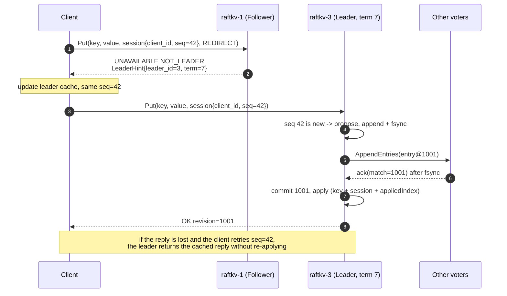

# RaftKV API Design

Builds on [design-decisions.md](design-decisions.md) (`D-xx`). Related: [architecture.md](architecture.md), [system-design.md](system-design.md), [storage-design.md](storage-design.md), [testing.md](testing.md).

This document defines the wire contracts:

1. `raftkv.v1.KV`: client data API (D-10, D-26).
2. `raftkv.v1.Cluster`: admin and membership API (D-06, D-23).
3. `raftkv.v1.Raft`: internal peer RPCs (D-36).

It also covers errors, retries, leader discovery, and the `raftkvctl` CLI. The `.proto` files under `api/raftkv/v1/` must match the protobuf shown here.

---

## 1. Conventions

| Topic | Rule |
|-------|------|
| Package | `raftkv.v1`. Go package `github.com/bibekgupta3333/raftkv-distributed-store/api/raftkv/v1;raftkvv1` (D-21) |
| Transport | gRPC (D-12). As built, one listener per node (`--listen`; `:7000` in compose and kind) serves the KV, Cluster and Raft services. Metrics and probes are on a separate HTTP port (`--metrics-addr`). The separate client/peer listeners of the original design were not built |
| Keys/values | `bytes`. Keys are non-empty and compared byte by byte |
| Integers | Term, index, revision and member IDs are `uint64`. ID `0` means "none" |
| Revision | A key's `mod_revision` is the log index of the entry that last changed it. The header `revision` is the serving node's `appliedIndex` (D-04) |
| Enums | Every enum has `*_UNSPECIFIED = 0`, which maps to the documented default |
| Compatibility | Additive changes only: never reuse or renumber a field |

---

## 2. Common messages

```protobuf
syntax = "proto3";

package raftkv.v1;

option go_package = "github.com/bibekgupta3333/raftkv-distributed-store/api/raftkv/v1;raftkvv1";

message RequestHeader {
  // Optional. If non-zero and not ours: FAILED_PRECONDITION / CLUSTER_ID_MISMATCH.
  uint64 cluster_id = 1;
  // Write routing on a non-leader (§7). Default: FORWARD (D-28).
  WriteRouting write_routing = 2;
  // Set ONLY by a server forwarding to the leader (one hop). Clients leave it false.
  bool forwarded = 3;
}

enum WriteRouting {
  WRITE_ROUTING_UNSPECIFIED = 0;  // == FORWARD
  FORWARD = 1;                    // follower forwards to leader (default)
  REDIRECT = 2;                   // follower returns NOT_LEADER + LeaderHint
}

message ResponseHeader {
  uint64 cluster_id = 1;
  uint64 member_id = 2;   // member that served the request
  uint64 raft_term = 3;   // serving member's term
  uint64 revision = 4;    // serving member's appliedIndex when served
  uint64 leader_id = 5;   // serving member's view of the leader (0 = unknown)
}

// Exactly-once writes (D-09). See §5.
message WriteSession {
  uint64 client_id = 1;       // from RegisterSession (D-26)
  uint64 sequence = 2;        // +1 per logical write, starting at 1; retries reuse it
  uint64 acked_sequence = 3;  // highest S with replies for all seqs <= S
}

enum Consistency {
  CONSISTENCY_UNSPECIFIED = 0;  // == LINEARIZABLE
  LINEARIZABLE = 1;             // ReadIndex (or lease if enabled, D-25)
  STALE = 2;                    // local state, may be old (D-05)
}

// Carried in google.rpc.Status details on NOT_LEADER (§6).
message LeaderHint {
  uint64 leader_id = 1;          // 0 if unknown
  string leader_client_url = 2;  // the leader's address from --peers, e.g. "raftkv-2.raftkv-peer:7000"
  uint64 term = 3;
}

message KeyValue {
  bytes key = 1;
  bytes value = 2;              // empty if keys_only
  uint64 create_revision = 3;
  uint64 mod_revision = 4;
  uint64 version = 5;           // modifications since creation (1 on create)
}
```

---

## 3. KV service

```protobuf
service KV {
  rpc RegisterSession(RegisterSessionRequest) returns (RegisterSessionResponse);
  rpc Put(PutRequest) returns (PutResponse);
  rpc Get(GetRequest) returns (GetResponse);
  rpc Delete(DeleteRequest) returns (DeleteResponse);
  rpc CompareAndSwap(CompareAndSwapRequest) returns (CompareAndSwapResponse);
  rpc Range(RangeRequest) returns (RangeResponse);
}

message RegisterSessionRequest  { RequestHeader header = 1; }
message RegisterSessionResponse {
  ResponseHeader header = 1;
  uint64 client_id = 2;         // log index of the RegisterSession entry (D-26)
}

message PutRequest {
  RequestHeader header = 1;
  bytes key = 2;                // 1..4096 bytes (D-11)
  bytes value = 3;              // 0..1 MiB (D-11)
  WriteSession session = 4;
  bool return_previous = 5;
}
message PutResponse {
  ResponseHeader header = 1;
  uint64 revision = 2;          // index of the applied entry
  KeyValue previous = 3;        // only if return_previous && key existed
}

message GetRequest {
  RequestHeader header = 1;
  bytes key = 2;
  Consistency consistency = 3;
  // STALE only: wait until appliedIndex >= min_revision. Gives read-your-writes.
  uint64 min_revision = 4;
}
message GetResponse {
  ResponseHeader header = 1;
  bool found = 2;
  KeyValue kv = 3;
}

message DeleteRequest {
  RequestHeader header = 1;
  bytes key = 2;
  WriteSession session = 3;
  bool return_previous = 4;
}
message DeleteResponse {
  ResponseHeader header = 1;
  uint64 revision = 2;
  bool deleted = 3;             // false if the key did not exist (still OK)
  KeyValue previous = 4;
}

message CompareAndSwapRequest {
  RequestHeader header = 1;
  bytes key = 2;
  oneof expected {
    bytes expected_value = 3;
    uint64 expected_mod_revision = 4;
    bool expect_absent = 5;           // create-if-absent
  }
  oneof action {
    bytes new_value = 6;
    bool delete = 7;
  }
  WriteSession session = 8;           // required for safe retry
}
message CompareAndSwapResponse {
  ResponseHeader header = 1;
  bool succeeded = 2;                 // a failed compare is OK, not an error
  uint64 revision = 3;                // index of the entry that evaluated the CAS
  bool found = 4;
  KeyValue current = 5;               // post-swap on success, conflicting value on failure
}

message RangeRequest {
  RequestHeader header = 1;
  bytes start_key = 2;                // [start_key, end_key); empty end = to the end
  bytes end_key = 3;
  bytes prefix = 4;                   // alternative to start/end
  uint32 limit = 5;                   // 1..1000 (D-11). 0 = 1000
  bool keys_only = 6;
  bool reverse = 7;
  Consistency consistency = 8;
  uint64 min_revision = 9;            // STALE only
  bytes page_token = 10;              // from a previous RangeResponse
}
message RangeResponse {
  ResponseHeader header = 1;
  repeated KeyValue kvs = 2;
  bool more = 3;
  bytes next_page_token = 4;          // set iff more
}
```

### 3.1 Per-RPC semantics

| RPC | Semantics | Through Raft? | Safe to retry without a session? |
|-----|-----------|---------------|----------------------------------|
| `RegisterSession` | Creates a session. Returns `client_id` | Yes | Yes (an extra unused session just expires) |
| `Put` | Upsert. Reply after the entry is **committed and applied** on the leader | Yes | **No.** A retry can overwrite a newer write |
| `Get` | Point read, `LINEARIZABLE` (default) or `STALE` | No (ReadIndex uses heartbeats) | Yes |
| `Delete` | Remove key. Missing key → OK with `deleted=false` | Yes | Mostly. A retry after a re-create deletes the new value |
| `CompareAndSwap` | Compare and act **at apply time**, serialized with all writes | Yes | **No.** A retry of a successful CAS reports `succeeded=false` |
| `Range` | Ordered scan, at most `limit` keys and 4 MiB per page (D-11) | No | Yes |

Writes go to the leader. Any member accepts them and forwards by default (D-28). Reads can be served by any member.

**CompareAndSwap.**
- `expect_absent = true` means "key must not exist". An empty `expected_value` means "exists with an empty value".
- `expected_mod_revision = 0` is `INVALID_ARGUMENT`; use `expect_absent`.
- On mismatch: gRPC `OK`, `succeeded=false`, and `current` holds the key's current state, so the caller can retry a read-modify-write loop without a separate `Get`.
- The evaluating entry always advances the revision, even when nothing changed.

**Range pages are not a snapshot** (D-34). Each page is linearizable on its own; writes between pages can appear in later pages. `next_page_token` encodes the next start key plus a checksum of the original range parameters: `version (1 byte) | CRC-32C of start_key, end_key, prefix, keys_only, reverse (4 bytes LE) | resume key`. Forward scans resume at the key just after the last one returned; reverse scans use the last key returned as the new exclusive end. `prefix` and `start_key`/`end_key` together are `MALFORMED_REQUEST`. A LINEARIZABLE page uses the same ReadIndex read point as `Get` (any member, D-05): the whole page is read by one Pebble iterator inside that read, so the page is linearizable; the header `revision` is the applied index it was read at.

**Forwarded replies.** A follower that forwards a write relays the leader's reply unchanged except `header.member_id`, which names the follower (the member the client talked to); `leader_id`, `raft_term` and `revision` are the leader's.

**Write acknowledgement.** `OK` means the entry is committed (fsynced on a quorum) and applied on the leader. A `STALE` read with `min_revision = revision` sees that write.

**Linearizable reads (D-05).** See [system-design.md §3](system-design.md#3-linearizable-reads). Any member serves them: a follower asks the leader for a read index and reads locally. A new leader queues linearizable reads until its no-op commits (they are answered then, or time out with `DEADLINE_EXCEEDED / READ_INDEX_TIMEOUT`).

### 3.2 Limits (D-11)

| Limit | Value | Error |
|-------|-------|-------|
| Key size | 1..4,096 bytes | `INVALID_ARGUMENT / KEY_TOO_LARGE` or `EMPTY_KEY` |
| Value size | 0..1 MiB | `INVALID_ARGUMENT / VALUE_TOO_LARGE` |
| Range page | ≤ 1,000 keys | `INVALID_ARGUMENT / LIMIT_TOO_LARGE` |
| Range page bytes | ≤ 4 MiB. Page is cut early with `more=true`; at least one KV is returned | none (short page) |
| gRPC max message | 8 MiB each way. A node serves the KV, Cluster and Raft peer services on one gRPC server and port, so they share this limit; `pkg/client` accepts replies up to 8 MiB (a full Range page plus framing). Requests are bounded far lower by the key and value limits above | `RESOURCE_EXHAUSTED` |
| Outstanding seqs per session | 64 (`sequence − acked_sequence`) | `FAILED_PRECONDITION / SESSION_WINDOW_EXCEEDED` |

### 3.3 Deadlines

Failover takes at least one election timeout (1–2 s, D-08). Deadlines are sized so one attempt can ride out an election.

| Operation | Per attempt | Total with retries |
|-----------|-------------|--------------------|
| `Put` / `Delete` / `CompareAndSwap` / `RegisterSession` | 3 s | 10 s |
| `Get` / `Range` LINEARIZABLE | 2 s | 10 s |
| `Get` / `Range` STALE | 500 ms | 2 s |
| Cluster admin changes | 10 s | 30 s |
| `Status` | 1 s | 1 s |

These are the intended budgets. As of M4, `pkg/client` uses one per-attempt timeout for every RPC
(`Config.AttemptTimeout`, default 2 s) and a 10 s total (`Config.DefaultTimeout`) when the caller's context has no
deadline; a caller's deadline always wins. A waiting `Get` or `Range` gives up 20 ms (at most a tenth of the budget)
before the caller's deadline, so the client sees the server's reason (`READ_INDEX_TIMEOUT`, `REVISION_NOT_REACHED`)
rather than a bare client-side timeout.

- Deadline expired **before proposing** → `DEADLINE_EXCEEDED / NOT_PROPOSED`. The write definitely did not happen.
- Deadline expired **after proposing** → `DEADLINE_EXCEEDED / OUTCOME_UNKNOWN`. The entry may still commit. With a session, retrying with the same `(client_id, sequence)` is safe.

---

## 4. Cluster admin service (D-06, D-23)

Mutating admin RPCs run on the leader (followers forward them). Only one configuration change may be in flight; a second one gets `FAILED_PRECONDITION / CONF_CHANGE_IN_PROGRESS`.

```protobuf
service Cluster {
  rpc AddLearner(AddLearnerRequest) returns (AddLearnerResponse);
  rpc PromoteLearner(PromoteLearnerRequest) returns (PromoteLearnerResponse);
  rpc RemoveMember(RemoveMemberRequest) returns (RemoveMemberResponse);
  rpc TransferLeadership(TransferLeadershipRequest) returns (TransferLeadershipResponse);
  rpc ListMembers(ListMembersRequest) returns (ListMembersResponse);
  rpc Status(StatusRequest) returns (StatusResponse);   // local only, never forwarded
}

enum MemberRole {
  MEMBER_ROLE_UNSPECIFIED = 0;
  VOTER = 1;
  LEARNER = 2;
}

message Member {
  uint64 id = 1;                    // random 64-bit, never reused (D-38)
  string name = 2;                  // e.g. "raftkv-3"
  string peer_url = 3;              // e.g. "raftkv-3.raftkv-peer:2380"
  string client_url = 4;            // e.g. "raftkv-3.raftkv-peer:2379"
  MemberRole role = 5;
}

message AddLearnerRequest {
  RequestHeader header = 1;
  string name = 2;
  string peer_url = 3;              // required
  string client_url = 4;
}
message AddLearnerResponse {
  ResponseHeader header = 1;
  Member member = 2;                // includes the assigned id
  repeated Member members = 3;
}

message PromoteLearnerRequest  { RequestHeader header = 1; uint64 member_id = 2; }
message PromoteLearnerResponse { ResponseHeader header = 1; repeated Member members = 2; }

message RemoveMemberRequest {
  RequestHeader header = 1;
  uint64 member_id = 2;
  bool force = 3;                   // allow even if the remaining voters could not form a quorum now
}
message RemoveMemberResponse { ResponseHeader header = 1; repeated Member members = 2; }

message TransferLeadershipRequest {
  RequestHeader header = 1;
  uint64 target_member_id = 2;      // 0 = leader picks the most up-to-date voter
}
message TransferLeadershipResponse {
  ResponseHeader header = 1;
  uint64 new_leader_id = 2;
  uint64 new_term = 3;
}

message ListMembersRequest {
  RequestHeader header = 1;
  Consistency consistency = 2;
}
message ListMembersResponse {
  ResponseHeader header = 1;
  repeated Member members = 2;
  uint64 config_index = 3;          // index of the config entry in effect
}

message StatusRequest { RequestHeader header = 1; }

enum RaftState {
  RAFT_STATE_UNSPECIFIED = 0;
  FOLLOWER = 1;
  PRE_CANDIDATE = 2;
  CANDIDATE = 3;
  LEADER = 4;
  LEARNER_STATE = 5;
}

message StatusResponse {
  ResponseHeader header = 1;
  RaftState state = 2;
  uint64 leader_id = 3;
  uint64 term = 4;
  uint64 commit_index = 5;
  uint64 applied_index = 6;
  uint64 last_log_index = 7;
  uint64 first_log_index = 8;
  uint64 snapshot_index = 9;
  repeated FollowerProgress followers = 10;   // leader only
}

message FollowerProgress {
  uint64 member_id = 1;
  uint64 match_index = 2;
  uint64 next_index = 3;
  bool recent_active = 4;
  bool snapshot_in_flight = 5;
}
```

`Status` feeds the observer UI (D-48). The Kubernetes probes (D-46) are plain HTTP on the metrics listener (`:9100`),
next to `/metrics`, so kubelet needs no gRPC client: `GET /livez` is 200 when the driver loop answers a ping within
1 s, and `GET /readyz` is 200 when the node knows a leader and has applied everything it knows is committed. Both
return 503 with the reason otherwise.

### 4.1 Admin RPC semantics

| RPC | Precondition | Behaviour | Retry behaviour | Typical errors |
|-----|--------------|-----------|-----------------|----------------|
| `AddLearner` | No change in flight; peer URL not in use | Assign a random ID, propose `ADD_LEARNER`, return after commit. The learner then catches up | Same peer URL already a learner → returns it with OK | `CONF_CHANGE_IN_PROGRESS`, `ALREADY_EXISTS` |
| `PromoteLearner` | Target is a learner within 1,000 entries of the leader | Propose `PROMOTE_LEARNER`. Voter count +1 | Already a voter → OK | `LEARNER_NOT_CAUGHT_UP`, `NOT_FOUND` |
| `RemoveMember` | No change in flight | Propose `REMOVE_MEMBER`. If the target is the leader, transfer leadership first | `NOT_FOUND` after an `OUTCOME_UNKNOWN` means it worked | `WOULD_LOSE_QUORUM`, `CONF_CHANGE_IN_PROGRESS` |
| `TransferLeadership` | Target is a voter | Stop proposals, catch up the target, send `TimeoutNow`, return when a new leader appears. Fail after one election timeout | Target is already leader → OK | `TRANSFER_TIMEOUT`, `NOT_FOUND`, `TARGET_IS_LEARNER` |
| `ListMembers` | none | Config at `revision` (LINEARIZABLE) or local view (STALE) | Read-only | none |
| `Status` | none | This member's local state | Read-only | none |

---

## 5. Exactly-once writes: sessions (D-09, D-26, D-27)

Without sessions, a write that times out after commit and is retried is applied **twice**. Sessions turn at-least-once retries into exactly-once (Raft dissertation §6.3).

**Registration.** The client calls `RegisterSession` once. It is a replicated entry and its log index is the `client_id`.

**Table.** Replicated in Pebble under the `s` prefix, updated in the **same batch** as the write (D-04). Per `client_id`: `last_sequence`, cached replies for `(acked_sequence, last_sequence]`, and `last_active`.

**Apply rule** for a write with `(client_id, seq, acked)`:

| Condition | Action |
|-----------|--------|
| No session for `client_id` | **Do not apply.** `FAILED_PRECONDITION / SESSION_EXPIRED`. The client registers a new session and reports the old request's outcome as unknown |
| `seq <= last_sequence` and a reply is cached | Duplicate. Return the cached reply |
| `seq <= acked` (reply already dropped) | `FAILED_PRECONDITION / SEQUENCE_STALE` (client bug) |
| `seq − acked > 64` | `FAILED_PRECONDITION / SESSION_WINDOW_EXCEEDED`, not applied |
| Otherwise | Apply, cache the reply, drop replies `<= acked` |

**TTL is 10 min (D-09).** The leader stamps its time into each command (D-27), and every replica expires sessions using that stamped time, so expiry is identical everywhere.

**Writes without a session** are accepted but are only at-least-once on retry. `raftkvctl` always uses a session.

**Implementation notes (M4).** Expiry runs at the start of every applied command, using `max(stamped time, previous session clock)`, so a write arriving after more than 10 minutes of idle time gets `SESSION_EXPIRED`. Sessions idle for exactly the TTL are still alive. The leader stamps `max(own clock, applied session clock)`. Duplicates and writes keep a session alive; refused writes (`SEQUENCE_STALE`, `SESSION_WINDOW_EXCEEDED`) do not. Static session checks (`sequence = 0`, `acked >= sequence`, window) also run before proposing. `pkg/client` counts a sequence as finished when its call returns with any outcome, and acks the highest contiguous finished sequence. On `SESSION_EXPIRED` it registers a new session and retries only if no earlier attempt of that write was indeterminate; otherwise it reports the write as indeterminate.

**Client rules:** one sequence per logical write, reused on every retry (including after a redirect); advance `acked_sequence` monotonically; keep the retry budget (10 s) far below the TTL.

---

## 6. Error model

Errors use `google.rpc.Status` with a `google.rpc.ErrorInfo` detail (`domain = "raftkv"`). Clients branch on `ErrorInfo.reason`, never on message text. Redirects also carry a `LeaderHint`.

### 6.1 Status codes

| Condition | gRPC code | `reason` | Retry? | Write outcome |
|-----------|-----------|----------|--------|---------------|
| Non-leader in `REDIRECT` mode, forwarded hop hit a non-leader, or leader is transferring | `UNAVAILABLE` | `NOT_LEADER` (+ `LeaderHint`) | Yes, to the hint | DEFINITE |
| Leader's no-op not committed yet | `UNAVAILABLE` | `LEADER_NOT_READY` | Yes, same member | DEFINITE |
| No known leader | `UNAVAILABLE` | `NO_LEADER` | Yes, other endpoint | DEFINITE |
| Leader lost quorum before proposing | `UNAVAILABLE` | `NO_QUORUM` | Yes, other endpoint | DEFINITE |
| Deadline expired before proposing | `DEADLINE_EXCEEDED` | `NOT_PROPOSED` | Yes | DEFINITE |
| Proposed, deadline expired before apply | `DEADLINE_EXCEEDED` | `OUTCOME_UNKNOWN` | Only with a session | **INDETERMINATE** |
| Proposed, then leadership lost before apply | `UNAVAILABLE` | `OUTCOME_UNKNOWN` | Only with a session | **INDETERMINATE** |
| Forwarded write failed after it was sent | `UNAVAILABLE` | `OUTCOME_UNKNOWN` | Only with a session | **INDETERMINATE** |
| Connection reset, no status from server | `UNAVAILABLE` (client-made) | none | Reads yes; writes only with a session | **INDETERMINATE** |
| Client cancelled | `CANCELLED` | none | n/a | INDETERMINATE |
| Flow-control limit hit (D-29) | `RESOURCE_EXHAUSTED` | `OVERLOADED` | Yes, with backoff | DEFINITE |
| Bad key, value, limit, or `oneof`; `min_revision` with LINEARIZABLE | `INVALID_ARGUMENT` | `EMPTY_KEY` / `KEY_TOO_LARGE` / `VALUE_TOO_LARGE` / `LIMIT_TOO_LARGE` / `MALFORMED_REQUEST` | No | DEFINITE |
| Bad `page_token` | `INVALID_ARGUMENT` | `INVALID_PAGE_TOKEN` | No | n/a |
| Linearizable read not confirmed in time (no quorum, leader not ready) | `DEADLINE_EXCEEDED` | `READ_INDEX_TIMEOUT` | Yes, other member | n/a |
| STALE `min_revision` not reached in time | `DEADLINE_EXCEEDED` | `REVISION_NOT_REACHED` | Yes, other member | n/a |
| **CAS compare failed** | **`OK`** | none | n/a (normal result) | DEFINITE (no change) |
| Session unknown or expired | `FAILED_PRECONDITION` | `SESSION_EXPIRED` | No (new session) | DEFINITE for this request |
| `seq <= acked_sequence` | `FAILED_PRECONDITION` | `SEQUENCE_STALE` | No | DEFINITE |
| Session window exceeded | `FAILED_PRECONDITION` | `SESSION_WINDOW_EXCEEDED` | After acking older replies | DEFINITE |
| `cluster_id` mismatch | `FAILED_PRECONDITION` | `CLUSTER_ID_MISMATCH` | No | DEFINITE |
| Admin: change in flight / learner behind | `FAILED_PRECONDITION` | `CONF_CHANGE_IN_PROGRESS` / `LEARNER_NOT_CAUGHT_UP` | Yes, with backoff | DEFINITE |
| Admin: removal would lose quorum | `FAILED_PRECONDITION` | `WOULD_LOSE_QUORUM` | No (needs `force`) | DEFINITE |
| Admin: unknown member / duplicate URL | `NOT_FOUND` / `ALREADY_EXISTS` | `MEMBER_NOT_FOUND` / `MEMBER_EXISTS` | No | n/a |
| Admin: transfer timed out | `ABORTED` | `TRANSFER_TIMEOUT` | Yes | DEFINITE |
| Storage corruption on a read | `DATA_LOSS` | `STORAGE_CORRUPTION` | Yes, other member | n/a (node fail-stops) |
| Server bug | `INTERNAL` | `INTERNAL` | Reads yes; writes only with a session | INDETERMINATE |

**Definite vs. indeterminate outcome.** Both the Porcupine checker ([testing.md](testing.md)) and the client rely on this.

- Every error for a `Put`, `Delete`, `CompareAndSwap`, or admin change carries `ErrorInfo.metadata["outcome"]`:
  - **`DEFINITE`**: the server can prove the request was **never proposed**, so it was not and never will be applied.
  - **`INDETERMINATE`**: the entry may have been, or may still be, committed and applied.
- Missing metadata (client-made or transport errors) means **INDETERMINATE**. The exception is gRPC's own message-size `RESOURCE_EXHAUSTED`, which never reached a handler and is DEFINITE.
- In the checker, DEFINITE errors are failed operations (droppable). INDETERMINATE ones are operations with an open-ended completion time (Porcupine's "unknown" pattern, D-18).
- Reads have no side effects, so any read error is just a failed read.

Rules:
- `UNAVAILABLE` means "maybe applied" only with reason `OUTCOME_UNKNOWN`. When unsure, the server returns `OUTCOME_UNKNOWN`.
- The server never returns `OK` for a write that has not been applied.
- A failed CAS is never an error code.

### 6.2 Client retry policy

Backoff: `sleep = rand(0, min(1 s, 25 ms × 2^attempt))`. A larger server `RetryInfo` delay wins.

| Code / reason | Reads | Writes with session | Writes without session |
|---------------|-------|---------------------|------------------------|
| `NOT_LEADER` with hint | Go to the hint | Go to the hint | Go to the hint (DEFINITE) |
| `NOT_LEADER` no hint, `NO_LEADER`, `NO_QUORUM` | Backoff, next endpoint | Same | Same |
| `OUTCOME_UNKNOWN` | Retry | Retry with the **same** seq | **Do not retry.** Report to the caller |
| `NOT_PROPOSED` | Retry | Retry | Retry |
| `OVERLOADED` | Backoff | Backoff | Backoff |
| `INVALID_ARGUMENT`, session errors, `NOT_FOUND`, `ALREADY_EXISTS` | Fail | Fail | Fail |
| Transport failure, no status | Next endpoint, retry | Retry with same seq | Fail (unknown) |

gRPC's built-in retry policy is not used for writes because it knows nothing about sessions or leader hints.

---

## 7. Leader discovery and forwarding

**Bootstrap.** The client gets a list of endpoints (in Kubernetes, the client Service or pod DNS names, D-16) and keeps a leader cache `(leader_id, url, term)`, updated from every `ResponseHeader` and `LeaderHint` with a term ≥ the cached one. An empty hint means try the next endpoint. At most 3 redirects in a row, then backoff.

**Routing.** Writes and admin changes go to the cached leader. Reads can go to any member.

**`FORWARD` (default, D-28).** A follower forwards a write or admin change to the leader with the **same session**, the remaining deadline, and `forwarded = true`, then relays the reply.
- One hop only. A non-leader receiving `forwarded=true` returns `NOT_LEADER`.
- No known leader → `NO_LEADER` (definite).
- If the forwarded call fails after it was sent → `OUTCOME_UNKNOWN`. The session makes the retry safe.

**`REDIRECT` (opt-in).** The follower returns `NOT_LEADER` with a `LeaderHint`; the client reconnects to the leader.

Reads are never forwarded as whole requests. Linearizable reads use ReadIndex (§3.1).



---

## 8. Internal Raft peer service (D-36)

Peer RPCs share the node's single gRPC listener with the client services. They are not a public API: every peer RPC
names its sender, and a sender that is not a known member is refused.

### 8.1 Messages and service

```protobuf
// ---------- Log entry (also the WAL ENTRY record payload) ----------

enum EntryType {
  ENTRY_TYPE_UNSPECIFIED = 0;
  ENTRY_NORMAL = 1;        // data = Command
  ENTRY_CONF_CHANGE = 2;   // data = ConfChange
  ENTRY_NOOP = 3;          // new leader's first entry; data empty
}

message Entry {
  uint64 term = 1;
  uint64 index = 2;
  EntryType type = 3;
  bytes data = 4;
}

message Command {
  WriteSession session = 1;
  int64 leader_time_unix_ms = 2;   // stamped by the leader; used only for session expiry (D-27)
  // Unique per proposal; the proposing node's waiter is keyed by it (M3 proposal tracker).
  // Replicas ignore it when applying.
  uint64 request_id = 3;
  oneof op {
    RegisterSessionOp register_session = 9;
    PutOp put = 10;
    DeleteOp delete = 11;
    CasOp cas = 12;
    GetOp get = 13;                // linearizable read through the log (M3)
  }
}
message RegisterSessionOp {}
message PutOp    { bytes key = 1; bytes value = 2; bool return_previous = 3; }
message DeleteOp { bytes key = 1; bool return_previous = 2; }
message GetOp    { bytes key = 1; }
message CasOp {
  bytes key = 1;
  oneof expected { bytes expected_value = 2; uint64 expected_mod_revision = 3; bool expect_absent = 4; }
  oneof action   { bytes new_value = 5; bool delete = 6; }
}

enum ConfChangeType {
  CONF_CHANGE_TYPE_UNSPECIFIED = 0;
  ADD_LEARNER = 1;
  PROMOTE_LEARNER = 2;
  REMOVE_MEMBER = 3;
}
message ConfChange {
  ConfChangeType type = 1;
  Member member = 2;          // full Member for ADD_LEARNER; id only otherwise
}

message ClusterConfig {
  repeated Member members = 1;
  uint64 config_index = 2;
}

// ---------- AppendEntries (on the Replicate stream) ----------

message AppendEntriesRequest {
  uint64 cluster_id = 1;
  uint64 term = 2;
  uint64 leader_id = 3;
  uint64 prev_log_index = 4;
  uint64 prev_log_term = 5;
  repeated Entry entries = 6;       // may be empty (a probe append)
  uint64 leader_commit = 7;
  bytes read_context = 8;           // ReadIndex context (D-05), echoed back
  bool heartbeat = 9;               // the per-tick heartbeat; empty entries alone cannot tell it from a probe
}

message AppendEntriesResponse {
  uint64 term = 1;
  uint64 from = 2;
  bool success = 3;
  uint64 match_index = 4;           // on success: follower's match index; on reject: the rejected prev_log_index
  // On reject: conflict_term = follower's term at prev_log_index (0 if log too short);
  // conflict_index = first index of that term, or last_index+1 if too short.
  uint64 conflict_index = 5;
  uint64 conflict_term = 6;
  bytes read_context = 7;
  bool heartbeat = 8;               // answers a heartbeat request
}

// ---------- RequestVote (incl. PreVote, D-08) ----------

message RequestVoteRequest {
  uint64 cluster_id = 1;
  uint64 term = 2;                  // for pre_vote: the term it WOULD use (current+1)
  uint64 candidate_id = 3;
  uint64 last_log_index = 4;
  uint64 last_log_term = 5;
  bool pre_vote = 6;
  bool leadership_transfer = 7;     // set after TimeoutNow; skips the leader-stickiness check
}
message RequestVoteResponse {
  uint64 term = 1;
  bool vote_granted = 2;
  bool pre_vote = 3;
  uint64 from = 4;
}

// ---------- InstallSnapshot (client stream, D-14) ----------

message SnapshotFile {
  string name = 1;                  // e.g. "000123.sst"
  uint64 size = 2;
  fixed32 crc32c = 3;
}

message SnapshotMetadata {
  uint64 cluster_id = 1;
  uint64 leader_id = 2;
  uint64 term = 3;                  // leader's current term
  uint64 last_included_index = 4;
  uint64 last_included_term = 5;
  ClusterConfig config = 6;
  repeated SnapshotFile files = 7;  // streamed in this order
  uint32 format_version = 8;        // snapshot layout version (1 = Pebble checkpoint)
  // CRC32C of this message, deterministically encoded with checksum,
  // leader_id and term zeroed: covers index, term, config and the file list.
  fixed32 checksum = 9;
}

message SnapshotChunk {
  uint32 file_index = 1;            // index into SnapshotMetadata.files
  uint64 offset = 2;
  bytes data = 3;                   // <= 1 MiB (D-14)
  fixed32 crc32c = 4;
  bool last = 5;                    // final chunk of the snapshot
}

message InstallSnapshotRequest {
  oneof msg {
    SnapshotMetadata metadata = 1;  // MUST be first
    SnapshotChunk chunk = 2;
  }
}
message InstallSnapshotResponse {
  uint64 term = 1;
  uint64 from = 2;
  bool installed = 3;
}

// ---------- TimeoutNow and ReadIndex ----------

message TimeoutNowRequest  { uint64 cluster_id = 1; uint64 term = 2; uint64 leader_id = 3; }
message TimeoutNowResponse { uint64 term = 1; bool accepted = 2; }

message ReadIndexRequest  { uint64 cluster_id = 1; uint64 from = 2; bytes request_ctx = 3; }
message ReadIndexResponse { uint64 term = 1; uint64 read_index = 2; bytes request_ctx = 3; }

service Raft {
  // One long-lived stream per (leader, follower), opened by the leader (D-12).
  rpc Replicate(stream AppendEntriesRequest) returns (stream AppendEntriesResponse);
  rpc RequestVote(RequestVoteRequest) returns (RequestVoteResponse);
  rpc InstallSnapshot(stream InstallSnapshotRequest) returns (InstallSnapshotResponse);
  rpc TimeoutNow(TimeoutNowRequest) returns (TimeoutNowResponse);
  rpc ReadIndex(ReadIndexRequest) returns (ReadIndexResponse);
}
```

### 8.2 Peer RPC semantics

| RPC | Direction | Semantics | Must be durable before reply |
|-----|-----------|-----------|------------------------------|
| `Replicate` | Leader → each follower/learner | Leader sends up to 256 unacked appends (D-29). Follower acks the highest index it has made durable. A wrong `cluster_id` closes the stream. On stream error the leader drops that follower to Probe and reconnects with backoff. A higher term in a reply makes the leader step down | Appended entries and any term change. Heartbeats with no entries and no term change need no fsync |
| `RequestVote` (`pre_vote=false`) | Candidate → voters | Grant per [system-design.md §1.2](system-design.md#12-term-rules) (T3, T5) | `(term, votedFor)` before granting; a term bump before replying with it |
| `RequestVote` (`pre_vote=true`) | PreCandidate → voters | Same checks. Does **not** change the receiver's term or vote | Nothing |
| `InstallSnapshot` | Leader → lagging follower/learner | Metadata, then chunks in order. Receiver checks each chunk's CRC and offset, stages to a temp dir, then installs atomically. Snapshot at or below the receiver's commit index → acked without install. If the stream breaks, the leader starts over (D-14) | Snapshot files, the dir swap, and the WAL marker + hard state, before `installed=true` |
| `TimeoutNow` | Leader → transfer target | Target starts an election at `term+1` at once, skipping PreVote, with `leadership_transfer=true`. Ignored if stale or a learner | Nothing until the election |
| `ReadIndex` | Follower → leader | Leader runs ReadIndex and returns `read_index` (queued until its no-op commits). `UNAVAILABLE` on a non-leader or if it loses leadership first; `DEADLINE_EXCEEDED` if it cannot confirm within 1 s. The follower retries either way | Nothing |

---

## 9. CLI: `raftkvctl`

The exact flags of every command are in [configuration.md](configuration.md#raftkvctl), which tests keep in sync with
`--help`. Common flags: `--endpoints` (default `$RAFTKV_ENDPOINTS`, else `localhost:2379`), `--timeout` (default
`10s`), `--cluster-id`. Reads are linearizable unless `--stale` is given. There is no `--output` or
`--client-id-file` yet.

Each write run registers a session and uses the next sequence, so a retry inside one run is exactly-once.

| Command | RPC | Flags | Exit code |
|---------|-----|-------|-----------|
| `put <key> <value>` | `KV.Put` | `--value-file`, `--prev` | 0 |
| `get <key>` | `KV.Get` | `--stale`, `--min-revision`, `--hex` | 0 found, **3 not found** |
| `del <key>` | `KV.Delete` | `--prev` | 0 |
| `cas <key>` | `KV.CompareAndSwap` | one of `--expect-value` / `--expect-revision` / `--expect-absent`, plus `--new-value` or `--delete` | 0 succeeded, **4 compare failed** |
| `range <start> [<end>]` | `KV.Range` | `--prefix`, `--limit`, `--keys-only`, `--reverse`, `--all`, `--stale`, `--min-revision`, `--page-token` | 0 |
| `debug state-hash` | none (reads a stopped node's data dir) | `--data-dir` | 0 |
| `debug wal-dump` | none (reads a stopped node's data dir) | `--data-dir`, `--from`, `--to`, `--max-data` | 0 |
| `member list` | `Cluster.ListMembers` | `--consistency` | 0 |
| `member add-learner <name>` | `Cluster.AddLearner` | `--peer-url` (required), `--client-url` | 0 |
| `member promote <id>` | `Cluster.PromoteLearner` | `--wait` | 0; 5 if not caught up without `--wait` |
| `member remove <id>` | `Cluster.RemoveMember` | `--force` | 0 |
| `leader transfer [<id>]` | `Cluster.TransferLeadership` | | 0 |
| `status` | `Cluster.Status` on **each** endpoint | | 0 if all replied, 2 otherwise |

Other exit codes: `1` usage / `INVALID_ARGUMENT`, `2` unavailable or deadline, `6` `FAILED_PRECONDITION`, `7` outcome unknown (the write may or may not have applied; the message says so).
