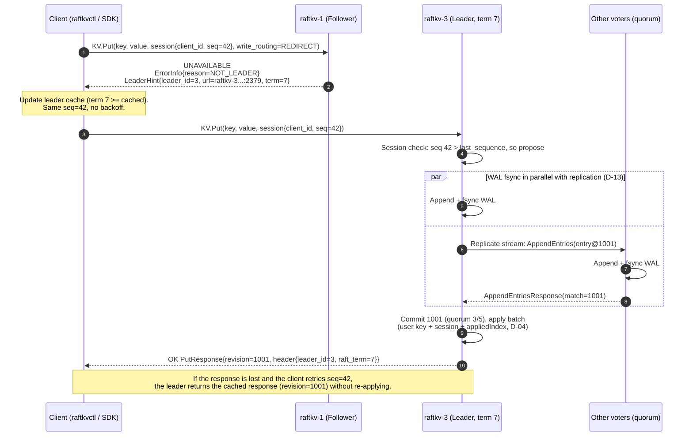

# RaftKV API Design

Status: Draft v0.1. This doc depends on [design-decisions.md](design-decisions.md), which is binding. Decision IDs (`D-xx`) are cited where this doc relies on them.
Related docs: [architecture.md](architecture.md), [system-design.md](system-design.md), [storage-design.md](storage-design.md), [testing-benchmarks.md](testing-benchmarks.md), [implementation-roadmap.md](implementation-roadmap.md), [WBS.md](WBS.md).

This document defines the **wire contracts** of RaftKV:

1. `raftkv.v1.KV`: the client data API (D-10).
2. `raftkv.v1.Cluster`: the admin and membership API (D-06, D-23).
3. `raftkv.v1.Raft`: the internal peer-to-peer consensus transport (D-08, D-12, D-14).

It also covers the error model, retry and leader-discovery rules, how the protos may evolve, and the `raftkvctl` CLI contract.
The protobuf shown here is the **normative contract**. The `.proto` files under `api/raftkv/v1/` will be generated from this doc during M4 and must match it field for field.

---

## 1. Conventions

| Topic | Rule |
|-------|------|
| Package | `raftkv.v1`. Go package `github.com/<owner>/raftkv/api/raftkv/v1;raftkvv1` (owner is still open, D-21). |
| Transport | gRPC over HTTP/2 for both the client API and the peer API (D-12). Client and peer traffic use **separate listeners**: default client port `2379`, default peer port `2380`. This lets each listener have its own TLS policy and NetworkPolicy, and keeps peer traffic away from client load balancers. |
| Security | mTLS is still **Open** (D-15). The contracts here are TLS-agnostic. No AuthN/AuthZ fields are defined in v1. |
| Keys/values | `bytes`. Keys are opaque, compared lexicographically by unsigned byte, and must be non-empty. The empty key is reserved. |
| Integers | Raft term, index, revision and member IDs are `uint64`. Member ID `0` means "none/unknown". |
| Revision | A key's **revision** is the Raft log index of the entry that last modified it (`mod_revision`). The cluster revision returned in headers is the state machine's `appliedIndex` when the request was served (D-04). Revisions only go up while one cluster lives. They are not comparable across clusters, so always check `cluster_id`. |
| Enums | Every enum has `*_UNSPECIFIED = 0`. Servers map `UNSPECIFIED` to the documented default. |
| Sharding | No shard or range fields exist in v1 (D-07). The key space is flat, and nothing here assumes a single group except `ResponseHeader.raft_term`. That field would become per-group under Multi-Raft, which needs a v2 field and is not a breaking change. |

---

## 2. Common messages

```protobuf
syntax = "proto3";

package raftkv.v1;

option go_package = "github.com/<owner>/raftkv/api/raftkv/v1;raftkvv1";

// Attached to every KV and Cluster request.
message RequestHeader {
  // Optional. If non-zero, the server rejects the request with
  // FAILED_PRECONDITION / CLUSTER_ID_MISMATCH when it belongs to another cluster.
  // Clients learn cluster_id from any ResponseHeader and should pin it.
  uint64 cluster_id = 1;

  // Optional client-chosen trace correlation ID (also propagated via W3C traceparent
  // metadata by OpenTelemetry, D-17). Logged, never interpreted.
  string request_id = 2;

  // Write routing when the request lands on a non-leader (§7).
  // Default (UNSPECIFIED == FORWARD): the receiving follower forwards the
  // write to the leader and relays the leader's response.
  WriteRouting write_routing = 3;

  // Set ONLY by a server when it forwards a request to the leader (hop limit 1).
  // A leader that is no longer leader and receives forwarded=true returns
  // NOT_LEADER instead of forwarding again. Clients must leave it false.
  bool forwarded = 4;
}

enum WriteRouting {
  WRITE_ROUTING_UNSPECIFIED = 0;  // == FORWARD
  FORWARD = 1;                    // follower proxies to leader (default)
  REDIRECT = 2;                   // follower returns UNAVAILABLE/NOT_LEADER + LeaderHint
}

// Returned on every KV and Cluster response.
message ResponseHeader {
  uint64 cluster_id = 1;
  // Member that served the request (may be a follower for reads, D-05).
  uint64 member_id = 2;
  // Raft term observed by the serving member at response time.
  uint64 raft_term = 3;
  // Cluster revision = serving member's appliedIndex at the moment the
  // request was served. For writes, this is >= the entry's own index.
  uint64 revision = 4;
  // Serving member's current view of the leader (0 if unknown). Advisory:
  // lets clients update their leader cache on every response, not only on errors.
  uint64 leader_id = 5;
}

// Client session for exactly-once writes (D-09). See §5.
message WriteSession {
  // 16 bytes, client-generated (UUIDv4 or crypto-random). Must be stable for
  // the lifetime of one logical client.
  bytes client_id = 1;
  // Strictly increasing per client_id, starting at 1. One sequence number per
  // logical write; retries of the SAME write reuse the SAME sequence.
  uint64 sequence = 2;
  // Highest sequence S such that the client has received responses for all
  // sequences <= S. Lets the server discard cached responses. 0 = none.
  uint64 acked_sequence = 3;
}

enum Consistency {
  CONSISTENCY_UNSPECIFIED = 0;  // == LINEARIZABLE
  // ReadIndex by default; lease read if the server has lease reads enabled (D-05).
  // Followers may serve it by forwarding a ReadIndex request to the leader.
  LINEARIZABLE = 1;
  // Served from the local state machine of whichever member receives it,
  // without contacting the leader. May return data that is arbitrarily old
  // unless bounded by min_revision. Opt-in only (D-05).
  STALE = 2;
}

// Leader hint carried in google.rpc.Status details on NOT_LEADER errors (§6).
message LeaderHint {
  uint64 leader_id = 1;          // 0 if unknown (election in progress)
  string leader_client_url = 2;  // e.g. "raftkv-2.raftkv-peer.ns.svc:2379"; empty if unknown
  uint64 term = 3;               // term in which leader_id is believed to lead
}

message KeyValue {
  bytes key = 1;
  bytes value = 2;              // empty when keys_only was requested
  uint64 create_revision = 3;   // index of the entry that created the key
  uint64 mod_revision = 4;      // index of the entry that last modified the key
  uint64 version = 5;           // number of modifications since creation (1 on create)
}
```

---

## 3. KV service

```protobuf
service KV {
  rpc Put(PutRequest) returns (PutResponse);
  rpc Get(GetRequest) returns (GetResponse);
  rpc Delete(DeleteRequest) returns (DeleteResponse);
  rpc CompareAndSwap(CompareAndSwapRequest) returns (CompareAndSwapResponse);
  rpc Range(RangeRequest) returns (RangeResponse);
}

message PutRequest {
  RequestHeader header = 1;
  bytes key = 2;                // 1..4096 bytes (D-11)
  bytes value = 3;              // 0..1 MiB (D-11)
  WriteSession session = 4;     // strongly recommended; see §5
  bool return_previous = 5;     // if true, PutResponse.previous is populated
}
message PutResponse {
  ResponseHeader header = 1;
  uint64 revision = 2;          // raft index of the applied entry (= new mod_revision)
  KeyValue previous = 3;        // set only if return_previous && key existed
}

message GetRequest {
  RequestHeader header = 1;
  bytes key = 2;
  Consistency consistency = 3;
  // STALE only: the server waits (bounded by the RPC deadline) until its
  // appliedIndex >= min_revision, then serves. Gives read-your-writes on
  // stale reads when the client passes the revision from its last write.
  // Rejected with INVALID_ARGUMENT if set with LINEARIZABLE.
  uint64 min_revision = 4;
}
message GetResponse {
  ResponseHeader header = 1;
  bool found = 2;
  KeyValue kv = 3;              // unset when found == false
}

message DeleteRequest {
  RequestHeader header = 1;
  bytes key = 2;
  WriteSession session = 3;
  bool return_previous = 4;
}
message DeleteResponse {
  ResponseHeader header = 1;
  uint64 revision = 2;          // raft index of the applied entry
  bool deleted = 3;             // false if the key did not exist (still a success)
  KeyValue previous = 4;
}

message CompareAndSwapRequest {
  RequestHeader header = 1;
  bytes key = 2;
  // Exactly one comparison must be set.
  oneof expected {
    bytes expected_value = 3;         // current value must equal these bytes
    uint64 expected_mod_revision = 4; // current mod_revision must equal this
    bool expect_absent = 5;           // must be true; key must not exist (create-if-absent)
  }
  // Action if comparison succeeds.
  oneof action {
    bytes new_value = 6;              // put new_value (0..1 MiB)
    bool delete = 7;                  // must be true; delete the key
  }
  WriteSession session = 8;           // REQUIRED for safe retry; see §5
}
message CompareAndSwapResponse {
  ResponseHeader header = 1;
  // A failed comparison is a NORMAL outcome (gRPC OK), not an error.
  bool succeeded = 2;
  uint64 revision = 3;   // raft index of the entry that evaluated the CAS
  // Current state of the key at evaluation time: post-swap on success,
  // the conflicting value on failure. found=false if the key is absent.
  bool found = 4;
  KeyValue current = 5;
}

message RangeRequest {
  RequestHeader header = 1;
  // Half-open interval [start_key, end_key). Empty end_key = "to end of keyspace".
  // Mutually exclusive with prefix.
  bytes start_key = 2;
  bytes end_key = 3;
  // Convenience: equivalent to [prefix, prefix_successor(prefix)).
  bytes prefix = 4;
  // 1..1000 (D-11). 0 = server default (1000). >1000 is INVALID_ARGUMENT.
  uint32 limit = 5;
  bool keys_only = 6;
  bool reverse = 7;               // descending order; page_token semantics mirror
  Consistency consistency = 8;
  uint64 min_revision = 9;        // STALE only; as in GetRequest
  // Opaque continuation token from a previous RangeResponse. When set, the
  // range fields (start/end/prefix/reverse) must be identical to the first call.
  bytes page_token = 10;
}
message RangeResponse {
  ResponseHeader header = 1;
  repeated KeyValue kvs = 2;
  bool more = 3;                  // true if further keys exist in the interval
  bytes next_page_token = 4;      // set iff more == true
}
```

### 3.1 Per-RPC semantics

| RPC | Semantics | Consistency | Goes through Raft? | Idempotent without session? | Served by |
|-----|-----------|-------------|--------------------|-----------------------------|-----------|
| `Put` | Upsert `key → value`. Response is sent after the entry is **committed and applied** on the leader. | Linearizable (all writes) | Yes | **No.** A blind retry can overwrite a newer concurrent write, and `version` is bumped twice. | Leader. Any member accepts it and forwards to the leader by default (§7). |
| `Get` | Point read. | `LINEARIZABLE` (default) or `STALE` | No (ReadIndex uses heartbeats, not a log entry, D-05) | Yes | Any voter or learner. Followers forward ReadIndex to the leader. |
| `Delete` | Remove key. Deleting a missing key succeeds with `deleted=false`. | Linearizable | Yes | Mostly. A retry after a concurrent re-create would delete the new value. | Leader. Any member accepts it and forwards to the leader by default (§7). |
| `CompareAndSwap` | Atomically evaluate the comparison and apply the action if it holds. Evaluation happens **inside the state machine at apply time**, so it is serialized with all other writes. | Linearizable | Yes | **No.** A retried CAS whose first attempt succeeded would report `succeeded=false`. Clients must use a session. | Leader. Any member accepts it and forwards to the leader by default (§7). |
| `Range` | Ordered scan of `[start,end)` or `prefix`, at most `limit` keys per page. | `LINEARIZABLE` or `STALE`, **per page** | No | Yes | Any member |

**CompareAndSwap contract.**

* "Expected key absent" is expressed explicitly with `expect_absent = true` (create-if-absent). An empty `expected_value` means "the key exists with an empty value", **not** "absent".
* `expected_mod_revision` compares against `KeyValue.mod_revision`. Since revisions start at 1, `0` is not a valid expectation and is rejected with `INVALID_ARGUMENT`. Use `expect_absent` instead.
* On **mismatch**, the response is gRPC `OK` with `succeeded=false`, and `found` plus `current` carry the key's current value, `mod_revision`, `create_revision`, and `version` as of the evaluating entry. On success, `current` is the post-swap state (or `found=false` after a delete action).
* The caller can therefore retry a read-modify-write loop without a separate `Get`.
* The evaluating entry still advances the cluster revision. `CompareAndSwapResponse.revision` is that entry's index, even when nothing was modified.

**Range pagination is not a snapshot.** v1 has no MVCC (D-07, D-10), so each page is linearizable on its own but pages are not consistent with one another. Writes committed between pages can show up in later pages. `next_page_token` encodes the next start key (exclusive) plus a checksum of the original range parameters. Clients that need a consistent multi-key view must wait for transactions/MVCC, which are deferred (D-10).

**Write acknowledgement.** A write's response means its entry is committed (fsynced on a quorum, see [storage-design.md](storage-design.md)) and applied on the leader. `PutResponse.revision` is that entry's index. A client that reads `STALE` with `min_revision = revision` sees its own write.

**Linearizable read path (D-05).** The leader records `readIndex = commitIndex`, confirms leadership with one heartbeat round to a quorum (or checks a valid lease when lease reads are enabled), waits until `appliedIndex >= readIndex`, then reads Pebble. A follower sends `Raft.ReadIndex` to the leader, waits until its own `appliedIndex >= readIndex`, then serves. `ResponseHeader.revision` is the appliedIndex used.

**A new leader serves no linearizable reads until it has committed an entry in its current term** (the no-op entry, Raft §8). Until then it returns `UNAVAILABLE / LEADER_NOT_READY`, which is retryable.

### 3.2 Limits (D-11)

| Limit | Value | Enforcement point | Error |
|-------|-------|-------------------|-------|
| Key size | 1 .. 4,096 bytes | Server handler, before proposing | `INVALID_ARGUMENT / KEY_TOO_LARGE` or `EMPTY_KEY` |
| Value size | 0 .. 1,048,576 bytes | Server handler | `INVALID_ARGUMENT / VALUE_TOO_LARGE` |
| Raft entry batch | ≤ 4 MiB per `AppendEntries` / per proposal batch | Raft core, proposal batcher (D-13) | Internal. A single client entry always fits. |
| Range page | ≤ 1,000 keys | Server handler | `INVALID_ARGUMENT / LIMIT_TOO_LARGE` |
| Range response bytes | **Proposed:** ≤ 4 MiB soft cap. The page is cut early with `more=true`, and at least one KV is always returned. | Server handler | No error, short page. See New open questions. |
| gRPC max receive (client listener) | 2 MiB (fits 1 MiB value + 4 KiB key + overhead) | gRPC server option | `RESOURCE_EXHAUSTED` (gRPC native) |
| gRPC max send (client listener) | 8 MiB | gRPC server option | n/a |
| gRPC max message (peer listener) | 8 MiB (4 MiB batch + framing). Snapshot chunks are 1 MiB (D-14). | gRPC server option | `RESOURCE_EXHAUSTED` |
| Outstanding sequences per session | 128 (proposed). The window is `sequence − acked_sequence`. | State machine | `FAILED_PRECONDITION / SESSION_WINDOW_EXCEEDED` |

### 3.3 Deadlines and timeouts

Raft failover time is bounded below by the election timeout of 1–2 s plus PreVote (D-08). Client deadlines must be sized so that one attempt does not burn the whole budget while the cluster is mid-election.

| Operation | Per-attempt deadline (recommended default) | Overall budget incl. retries | Notes |
|-----------|-------------------------------------------|------------------------------|-------|
| `Put` / `Delete` / `CompareAndSwap` | 3 s | 10 s | ≥ 1.5× max election timeout, so one attempt can survive a leader change already in progress. |
| `Get` / `Range` LINEARIZABLE | 2 s | 10 s | ReadIndex costs one heartbeat RTT on top of the apply wait. |
| `Get` / `Range` STALE | 500 ms | 2 s | Pure local read. With `min_revision`, the deadline caps the wait. |
| Cluster admin mutations | 10 s | 30 s | Config changes wait for commit. `PromoteLearner` may wait for catch-up. |
| `Status` | 1 s | 1 s | Local-only, so no retry is needed. |

Server-side deadline handling:

* If the deadline has **already expired before proposing**, the server returns `DEADLINE_EXCEEDED` and nothing is proposed. This outcome is known: the write did not happen.
* If the deadline expires **after proposing**, the entry may still commit. The server returns `DEADLINE_EXCEEDED` with `ErrorInfo.reason = "OUTCOME_UNKNOWN"`. With a session, retrying with the same `(client_id, sequence)` is safe and returns the original result once the entry applies (§5).
* gRPC deadline propagation is honoured on forwarded follower ReadIndex calls. The forwarded call's deadline is `min(client deadline − 50 ms, 2 s)`.

---

## 4. Cluster admin service (D-06, D-23)

All mutating admin RPCs must run on the leader. A follower returns `UNAVAILABLE / NOT_LEADER` with a `LeaderHint`. Raft dissertation §4.1 requires **at most one configuration change in flight at a time** (D-06). A second one returns `FAILED_PRECONDITION / CONF_CHANGE_IN_PROGRESS`.

```protobuf
service Cluster {
  rpc AddLearner(AddLearnerRequest) returns (AddLearnerResponse);
  rpc PromoteLearner(PromoteLearnerRequest) returns (PromoteLearnerResponse);
  rpc RemoveMember(RemoveMemberRequest) returns (RemoveMemberResponse);
  rpc TransferLeadership(TransferLeadershipRequest) returns (TransferLeadershipResponse);
  rpc ListMembers(ListMembersRequest) returns (ListMembersResponse);
  // Local node status. NOT redirected to the leader.
  rpc Status(StatusRequest) returns (StatusResponse);
}

enum MemberRole {
  MEMBER_ROLE_UNSPECIFIED = 0;
  VOTER = 1;
  LEARNER = 2;
}

message Member {
  uint64 id = 1;
  string name = 2;                   // human label, e.g. StatefulSet pod name "raftkv-3"
  repeated string peer_urls = 3;     // e.g. "raftkv-3.raftkv-peer.ns.svc:2380"
  repeated string client_urls = 4;   // e.g. "raftkv-3.raftkv-peer.ns.svc:2379"
  MemberRole role = 5;
}

message AddLearnerRequest {
  RequestHeader header = 1;
  string name = 2;
  repeated string peer_urls = 3;     // required, non-empty
  repeated string client_urls = 4;
}
message AddLearnerResponse {
  ResponseHeader header = 1;
  Member member = 2;                 // includes the server-assigned id
  repeated Member members = 3;       // full membership after the change
}

message PromoteLearnerRequest {
  RequestHeader header = 1;
  uint64 member_id = 2;
}
message PromoteLearnerResponse {
  ResponseHeader header = 1;
  repeated Member members = 2;
}

message RemoveMemberRequest {
  RequestHeader header = 1;
  uint64 member_id = 2;
  // Removing a voter when the resulting voter set could not tolerate the
  // currently unreachable voters is refused unless force=true.
  bool force = 3;
}
message RemoveMemberResponse {
  ResponseHeader header = 1;
  repeated Member members = 2;
}

message TransferLeadershipRequest {
  RequestHeader header = 1;
  // 0 = leader picks the most up-to-date healthy voter.
  uint64 target_member_id = 2;
}
message TransferLeadershipResponse {
  ResponseHeader header = 1;
  uint64 new_leader_id = 2;
  uint64 new_term = 3;
}

message ListMembersRequest {
  RequestHeader header = 1;
  Consistency consistency = 2;       // default LINEARIZABLE (served via ReadIndex)
}
message ListMembersResponse {
  ResponseHeader header = 1;
  repeated Member members = 2;
  uint64 config_index = 3;           // log index of the configuration entry in effect
}

message StatusRequest {
  RequestHeader header = 1;
}

enum RaftState {
  RAFT_STATE_UNSPECIFIED = 0;
  FOLLOWER = 1;
  PRE_CANDIDATE = 2;
  CANDIDATE = 3;
  LEADER = 4;
  LEARNER_STATE = 5;
}

message StatusResponse {
  ResponseHeader header = 1;
  string server_version = 2;          // semver of the raftkvd binary
  uint32 peer_protocol_version = 3;   // see §8.3
  RaftState state = 4;
  uint64 leader_id = 5;
  uint64 term = 6;
  uint64 commit_index = 7;
  uint64 applied_index = 8;
  uint64 last_log_index = 9;
  uint64 first_log_index = 10;        // first index still in the WAL
  uint64 snapshot_index = 11;         // latest local snapshot
  uint64 wal_bytes = 12;
  uint64 db_bytes = 13;               // Pebble on-disk size
  // Leader only: per-follower replication progress.
  repeated FollowerProgress followers = 14;
  repeated string alarms = 15;        // e.g. "DISK_PRESSURE", "FSYNC_SLOW"
}

message FollowerProgress {
  uint64 member_id = 1;
  uint64 match_index = 2;
  uint64 next_index = 3;
  bool recent_active = 4;             // heard from within election timeout (CheckQuorum, D-08)
  bool snapshot_in_flight = 5;
}
```

### 4.1 Admin RPC semantics

| RPC | Precondition | Behaviour | Idempotency | Typical errors |
|-----|--------------|-----------|-------------|----------------|
| `AddLearner` | No conf change in flight. The peer URL is not used by an existing member. | Leader assigns a random non-zero 64-bit member ID and proposes `ConfChange{ADD_LEARNER}`. Returns after commit. The learner then catches up through AppendEntries or InstallSnapshot. It never votes and is not counted for quorum or CheckQuorum. | If a **learner** with identical `peer_urls` exists, that member is returned with OK (safe retry). If a **voter** with those URLs exists: `ALREADY_EXISTS`. | `CONF_CHANGE_IN_PROGRESS`, `ALREADY_EXISTS`, `NOT_LEADER` |
| `PromoteLearner` | Target is a learner. Its `match_index` is within `promote_max_lag` entries of the leader's last index (proposed default 1,000) and it was recently active. | Proposes `ConfChange{PROMOTE}`. The voter set grows by one (single-server change, D-06). | Promoting an existing voter returns OK with the current membership. | `FAILED_PRECONDITION / LEARNER_NOT_CAUGHT_UP` (retryable after backoff), `NOT_FOUND` |
| `RemoveMember` | No conf change in flight. | Proposes `ConfChange{REMOVE}`. If the target is the leader, the leader commits the change in the new configuration, then steps down. Operators should `TransferLeadership` first. | Removing a non-existent ID gives `NOT_FOUND`. Clients that retried should treat `NOT_FOUND` after an `OUTCOME_UNKNOWN` as success. | `FAILED_PRECONDITION / WOULD_LOSE_QUORUM` (when `force=false`), `CONF_CHANGE_IN_PROGRESS` |
| `TransferLeadership` | Target is a voter and is not the leader. | Leader stops accepting new proposals (they get `NOT_LEADER`, retryable), waits until the target's `match_index == last_index` (bounded by one election timeout), sends `Raft.TimeoutNow`, and returns when it observes the new leader's higher term. If the target does not win within an election timeout, proposals resume and the RPC fails with `ABORTED / TRANSFER_TIMEOUT`. | Transfer to the current leader is a no-op OK. | `ABORTED / TRANSFER_TIMEOUT`, `NOT_FOUND`, `FAILED_PRECONDITION / TARGET_IS_LEARNER` |
| `ListMembers` | none | Returns the configuration **applied** at `revision` (LINEARIZABLE via ReadIndex), or the local view (STALE). | Read-only | `NOT_LEADER` never; followers serve it via ReadIndex forwarding |
| `Status` | none | Local snapshot of this member's state. It is never forwarded, and K8s readiness/liveness probes use it. | Read-only | none |

---

## 5. Exactly-once writes: client sessions (D-09)

Without sessions, a write that times out after commit and is then retried gets applied **twice**. Sessions turn at-least-once retries into exactly-once application, as described in Raft dissertation §6.3.

**State-machine table.** The table is replicated, so it lives in Pebble under the `sessions` prefix, updated in the **same apply batch** as the write (D-04). See [storage-design.md](storage-design.md). Each entry is keyed by `client_id` and holds `last_sequence`, the cached responses for sequences in `(acked_sequence, last_sequence]`, and `last_active` (see TTL below).

**Apply rule** for a write entry carrying `(client_id, seq, acked)`:

| Condition at apply time | Action |
|-------------------------|--------|
| No session for `client_id` and `seq == 1` | Create the session, apply the write, cache the response. |
| No session for `client_id` and `seq > 1` | **Do not apply.** Result is `FAILED_PRECONDITION / SESSION_EXPIRED`. The session was evicted (TTL), so the server cannot tell whether this is a duplicate. The client must start a new `client_id` and tell the application the outcome is unknown. |
| `seq <= last_sequence` and a response is cached | Duplicate. Do not apply. Return the cached response, including the original `revision` and CAS `succeeded`. |
| `seq <= acked` (response already discarded) | `FAILED_PRECONDITION / SEQUENCE_STALE`. This is a client bug. |
| `seq > last_sequence` | Apply, set `last_sequence = seq`, cache the response, drop cached responses `<= acked`. Gaps are allowed so that pipelined requests can apply out of order. |
| `seq − acked > 128` | `FAILED_PRECONDITION / SESSION_WINDOW_EXCEEDED`. Not applied. |

**Session TTL is 10 min (D-09).** A session is evicted when no write has touched it for 10 minutes. Eviction must be **deterministic across replicas**, so it cannot use each node's local clock. The proposed approach is in New open questions (Q-A2).

**Writes without a session** are accepted and proposed normally (at-least-once on retry). The server sets the metric `raftkv_sessionless_writes_total`. `raftkvctl` and the reference Go client always use sessions. `CompareAndSwap` without a session is accepted but documented as unsafe to retry.

**Client obligations:**
* Generate `client_id` once per process or logical client with a CSPRNG.
* Use one sequence per logical write, and reuse it on every retry of that write, including retries sent to a different member after a redirect.
* Advance `acked_sequence` monotonically.
* Keep the overall retry budget for a write well below the TTL. With 10 s ≪ 10 min this holds by default.

---

## 6. Error model

Errors use the standard gRPC `google.rpc.Status`. A **machine-readable reason** is always included as a `google.rpc.ErrorInfo` detail with `domain = "raftkv.io"`. Clients must branch on `ErrorInfo.reason`, never on message text. Leader redirects also carry a `raftkv.v1.LeaderHint` detail and `google.rpc.RetryInfo` where backoff is advised.

### 6.1 Status code mapping

| Condition | gRPC code | `ErrorInfo.reason` | Extra details | Retryable? | Write outcome (`outcome` metadata) |
|-----------|-----------|--------------------|---------------|------------|--------------------|
| Request reached a follower, learner, or a leader that is transferring leadership | `UNAVAILABLE` | `NOT_LEADER` | `LeaderHint` (may be empty) | Yes. Redirect to the hint (§7). Only returned in `REDIRECT` mode or on a forwarded hop. | DEFINITE (not applied) |
| Leader elected but has not committed its term's no-op yet | `UNAVAILABLE` | `LEADER_NOT_READY` | `RetryInfo` (≈50 ms) | Yes, same member | DEFINITE (not applied) |
| No known leader (election in progress, partitioned minority) | `UNAVAILABLE` | `NO_LEADER` | `RetryInfo` (≈ heartbeat×5) | Yes, rotate endpoints | DEFINITE (not applied) |
| Leader lost quorum (CheckQuorum stepped down, D-08) **before** proposing | `UNAVAILABLE` | `NO_QUORUM` | `LeaderHint` (empty) | Yes, rotate endpoints | DEFINITE (not applied) |
| Proposal accepted, deadline expired before apply | `DEADLINE_EXCEEDED` | `OUTCOME_UNKNOWN` | none | Yes, **only with a session** (same seq) | **INDETERMINATE** |
| Leader stepped down or lost leadership after proposing, before apply | `UNAVAILABLE` | `OUTCOME_UNKNOWN` | `LeaderHint` | Yes, only with a session | **INDETERMINATE** |
| Follower forwarded the write (§7) and the hop to the leader failed after the request was sent (reset, deadline) | `UNAVAILABLE` / `DEADLINE_EXCEEDED` | `OUTCOME_UNKNOWN` | `LeaderHint` | Yes, only with a session | **INDETERMINATE** |
| Client-side transport failure with no gRPC status from the server (connection reset mid-RPC) | `UNAVAILABLE` (client-synthesized) | none | none | Reads yes. Writes only with a session. | **INDETERMINATE** (no `outcome` metadata present) |
| Deadline expired before proposing | `DEADLINE_EXCEEDED` | `NOT_PROPOSED` | none | Yes | DEFINITE (not applied) |
| Client cancelled | `CANCELLED` | (none) | none | n/a | INDETERMINATE (client cannot know whether the proposal had been made) |
| Proposal queue full or apply lag above threshold (backpressure) | `RESOURCE_EXHAUSTED` | `OVERLOADED` | `RetryInfo` | Yes, with backoff | DEFINITE (not applied) |
| Local disk pressure, proposals refused ([storage-design.md](storage-design.md)) | `UNAVAILABLE` | `DISK_PRESSURE` | `LeaderHint` (leader transfers away if possible) | Yes, after backoff | DEFINITE (not applied) |
| Key empty, key > 4 KiB, value > 1 MiB, limit > 1000, malformed `oneof` | `INVALID_ARGUMENT` | `EMPTY_KEY` / `KEY_TOO_LARGE` / `VALUE_TOO_LARGE` / `LIMIT_TOO_LARGE` / `MALFORMED_REQUEST` | `google.rpc.BadRequest` (field violations) | **No** | DEFINITE (not applied) |
| gRPC message exceeds max receive size | `RESOURCE_EXHAUSTED` | (set by gRPC, none) | none | No | DEFINITE (not applied) |
| Bad or mismatched `page_token` | `INVALID_ARGUMENT` | `INVALID_PAGE_TOKEN` | none | No | n/a |
| `min_revision` set with LINEARIZABLE | `INVALID_ARGUMENT` | `MALFORMED_REQUEST` | none | No | n/a |
| STALE read with `min_revision` not reached before deadline | `DEADLINE_EXCEEDED` | `REVISION_NOT_REACHED` | none | Yes, other member | n/a |
| **CAS comparison failed** | **`OK`** | none | `succeeded=false`, `current` populated | n/a, this is a normal result | DEFINITE (applied, no mutation) |
| Session evicted / unknown with `seq > 1` | `FAILED_PRECONDITION` | `SESSION_EXPIRED` | none | No (new `client_id` required) | DEFINITE for this request (an earlier attempt with the same seq stays INDETERMINATE) |
| `seq <= acked_sequence` | `FAILED_PRECONDITION` | `SEQUENCE_STALE` | none | No (client bug) | DEFINITE (not applied) |
| Session window exceeded | `FAILED_PRECONDITION` | `SESSION_WINDOW_EXCEEDED` | none | After acking older responses | DEFINITE (not applied) |
| `cluster_id` mismatch | `FAILED_PRECONDITION` | `CLUSTER_ID_MISMATCH` | none | No | DEFINITE (not applied) |
| Admin: conf change already in flight | `FAILED_PRECONDITION` | `CONF_CHANGE_IN_PROGRESS` | `RetryInfo` | Yes, with backoff | DEFINITE (not applied) |
| Admin: learner not caught up | `FAILED_PRECONDITION` | `LEARNER_NOT_CAUGHT_UP` | `RetryInfo` | Yes | DEFINITE (not applied) |
| Admin: removal would lose quorum | `FAILED_PRECONDITION` | `WOULD_LOSE_QUORUM` | none | No (needs `force`) | DEFINITE (not applied) |
| Admin: unknown member | `NOT_FOUND` | `MEMBER_NOT_FOUND` | none | No | n/a |
| Admin: duplicate peer URL on a voter | `ALREADY_EXISTS` | `MEMBER_EXISTS` | none | No | n/a |
| Admin: leadership transfer timed out | `ABORTED` | `TRANSFER_TIMEOUT` | none | Yes | DEFINITE (no config change) |
| Server shutting down (SIGTERM drain) | `UNAVAILABLE` | `SHUTTING_DOWN` | `LeaderHint` | Yes, other member | DEFINITE (not applied) |
| Storage corruption detected on a read path (Pebble checksum) | `DATA_LOSS` | `STORAGE_CORRUPTION` | none | Yes, other member | n/a. The node fail-stops ([storage-design.md](storage-design.md)). |
| Unexpected server bug | `INTERNAL` | `INTERNAL` | none | Reads: yes. Writes: only with a session. | INDETERMINATE |
| Unimplemented RPC (version skew) | `UNIMPLEMENTED` | none | none | No | n/a |

**Write-outcome certainty.** The linearizability checker in [testing-benchmarks.md](testing-benchmarks.md) and the SDK both depend on this.

* Every error returned for a `Put`, `Delete`, `CompareAndSwap`, or Cluster mutation carries `ErrorInfo.metadata["outcome"]`, set to `"DEFINITE"` or `"INDETERMINATE"`.
  * **`DEFINITE`** means the server can prove the request was **never proposed** to Raft, so it was not applied and never will be. This covers validation failures, `NOT_LEADER`/`NO_LEADER`/`NO_QUORUM`/`LEADER_NOT_READY`/`DISK_PRESSURE`/`OVERLOADED`/`SHUTTING_DOWN` raised before proposal, `NOT_PROPOSED`, session rejections, and gRPC-native oversize `RESOURCE_EXHAUSTED`.
  * **`INDETERMINATE`** means the entry may have been, or may still be, committed and applied. In practice the reason is `OUTCOME_UNKNOWN`, `INTERNAL`, or `CANCELLED` after proposal.
* Absent metadata (client-synthesized errors, transport failures, or gRPC-native errors raised outside our handlers) must be treated as **INDETERMINATE**. The one exception is `RESOURCE_EXHAUSTED` returned by the gRPC message-size check: the RPC never reached a handler, so it is DEFINITE.
* For the checker, `DEFINITE` errors are recorded as failed operations, which can be dropped from the history. `INDETERMINATE` errors are recorded as operations with an open-ended completion time, the Porcupine "info"/unknown pattern (D-18).
* Reads (`Get`, `Range`, `ListMembers`) have no side effects, so any read error is a failed read.

Rules:
* `UNAVAILABLE` never means "maybe applied" unless the reason is `OUTCOME_UNKNOWN`. A server must only return a non-`OUTCOME_UNKNOWN` `UNAVAILABLE` when it can prove the request was not proposed. When in doubt, the server returns `OUTCOME_UNKNOWN`.
* The server never returns `OK` for a write that has not been applied.
* `ABORTED` is reserved for admin conflicts. CAS failure is **never** `ABORTED` or `FAILED_PRECONDITION`.

### 6.2 Client retry policy

The reference client uses capped exponential backoff with full jitter: `sleep = rand(0, min(cap, base × 2^attempt))`, with `base = 25 ms` and `cap = 1 s`. `RetryInfo.retry_delay` from the server overrides the computed delay when it is larger.

| Code / reason | Reads (`Get`, `Range`, `ListMembers`) | Writes **with** session | Writes **without** session |
|---------------|--------------------------------------|-------------------------|----------------------------|
| `UNAVAILABLE / NOT_LEADER` with hint (REDIRECT mode, or a forwarded hop that hit a stale leader) | Redirect immediately (no backoff). LINEARIZABLE reads need no redirect, since followers serve them. | Redirect immediately | Redirect immediately (DEFINITE, so this is safe) |
| `UNAVAILABLE / NOT_LEADER` no hint, `NO_LEADER`, `NO_QUORUM` | Backoff, rotate endpoint | Backoff, rotate | Backoff, rotate |
| `UNAVAILABLE / OUTCOME_UNKNOWN`, `DEADLINE_EXCEEDED / OUTCOME_UNKNOWN` | Retry | Retry with **same** seq | **Do not retry automatically.** Surface the error to the caller. |
| `DEADLINE_EXCEEDED / NOT_PROPOSED` | Retry if budget allows | Retry | Retry |
| `RESOURCE_EXHAUSTED / OVERLOADED`, `DISK_PRESSURE` | Backoff | Backoff | Backoff |
| `INVALID_ARGUMENT`, `FAILED_PRECONDITION` (session errors), `NOT_FOUND`, `ALREADY_EXISTS`, `UNIMPLEMENTED` | Fail | Fail | Fail |
| Transport-level failure (connection refused or reset, no status) | Rotate endpoint, retry | Retry with same seq | Fail (unknown) |

The gRPC built-in `retryPolicy` service config is **not** used for writes, because it is blind to sessions and leader hints. The client implements retries explicitly.

---

## 7. Leader discovery and redirect

**Bootstrap.** The client is configured with a list of endpoints. In Kubernetes this is the client Service DNS name or the pod DNS names behind the headless Service (D-16). The client keeps a `leader cache = (leader_id, url, term)`.

**On every response** the client reads `ResponseHeader.leader_id` and `raft_term`, and updates the cache if the term is greater than or equal to the cached term. It resolves `leader_id → client_url` from the most recent `ListMembers` result (refreshed lazily) or from `LeaderHint.leader_client_url`.

**Routing.**
* Writes and admin mutations go to the cached leader.
* LINEARIZABLE reads may go to any member. The default is the leader, to avoid forwarding cost. The `--read-from=any` option spreads read load across followers (D-05).
* STALE reads go to any member, nearest first.

**Hint precedence.** A `LeaderHint` with a higher `term` beats the cache. A hint with a lower term is ignored. An empty hint triggers endpoint rotation.

**Redirect loop guard.** At most 3 consecutive redirects without progress. After that the client falls back to backoff plus rotation. This prevents ping-pong when two nodes briefly disagree about the leader during a partition (PreVote and CheckQuorum, D-08, make this rare).

**Write forwarding is the default; client redirect is opt-in.** This aligns with [architecture.md](architecture.md).

* **`FORWARD` mode (default).** A follower or learner that receives a write or an admin mutation forwards it to the leader's client listener over a pooled gRPC connection. The forwarded request carries the **same `WriteSession`**, the remaining client deadline minus 50 ms, the trace context (D-17), and `RequestHeader.forwarded = true`. The follower relays the leader's response or status verbatim, so `ResponseHeader.leader_id` still tells the client who the leader is.
  * Forwarding is **one hop only**. If the receiver of a `forwarded=true` request is not the leader, it returns `UNAVAILABLE / NOT_LEADER` with a hint and does not forward again.
  * The follower forwards nothing if it knows no leader. It returns `UNAVAILABLE / NO_LEADER` (definitely not applied).
  * If the forwarded call fails after its bytes were sent (transport reset, deadline), the follower returns `OUTCOME_UNKNOWN` (indeterminate). The session makes the client's retry safe.
* **`REDIRECT` mode (opt-in, `write_routing = REDIRECT`).** The follower returns `UNAVAILABLE / NOT_LEADER` with a `LeaderHint`, and the client reconnects to the leader. This saves the follower one hop of bandwidth and lets latency-sensitive clients talk to the leader directly. The reference SDK switches to the leader endpoint after the first `leader_id` it learns in either mode.
* Reads are never proxied as whole requests. LINEARIZABLE reads use ReadIndex forwarding (§3.1, D-05).
* A leader that is transferring leadership (§4.1) answers with `NOT_LEADER`. A follower in `FORWARD` mode retries that once against the new leader, provided the error was a definite `NOT_LEADER` (not proposed).

The sequence diagram below shows **`REDIRECT` mode**. In `FORWARD` mode, steps 1–3 are replaced by the follower calling the leader on the client's behalf.



---

## 8. Internal Raft peer service

Peer RPCs run on the peer listener only (default `:2380`). The service is **not** a public API. Its compatibility rules (§9.3) are stricter about mixed versions and looser about permanence.

### 8.1 Messages and service

```protobuf
// ---------- Persisted log entry (also the WAL "entry" record payload) ----------

enum EntryType {
  ENTRY_TYPE_UNSPECIFIED = 0;
  ENTRY_NORMAL = 1;        // data = serialized Command
  ENTRY_CONF_CHANGE = 2;   // data = serialized ConfChange
  ENTRY_NOOP = 3;          // leader's first entry in a new term; data empty
}

message Entry {
  uint64 term = 1;
  uint64 index = 2;
  EntryType type = 3;
  bytes data = 4;
}

// State-machine command. Field numbers are permanent: entries live forever in WAL/snapshots.
message Command {
  WriteSession session = 1;
  // Leader wall-clock at proposal time (ms since epoch); used ONLY for
  // deterministic session-TTL eviction. See New open questions Q-A2.
  int64 proposed_at_unix_ms = 2;
  oneof op {
    PutOp put = 10;
    DeleteOp delete = 11;
    CasOp cas = 12;
  }
}
message PutOp    { bytes key = 1; bytes value = 2; bool return_previous = 3; }
message DeleteOp { bytes key = 1; bool return_previous = 2; }
message CasOp {
  bytes key = 1;
  oneof expected { bytes expected_value = 2; uint64 expected_mod_revision = 3; bool expect_absent = 4; }
  oneof action   { bytes new_value = 5; bool delete = 6; }
}

enum ConfChangeType {
  CONF_CHANGE_TYPE_UNSPECIFIED = 0;
  ADD_LEARNER = 1;
  PROMOTE_LEARNER = 2;
  REMOVE_MEMBER = 3;
}
message ConfChange {
  ConfChangeType type = 1;
  Member member = 2;          // full Member for ADD_LEARNER; id-only otherwise
  bytes request_id = 3;       // correlates the admin RPC waiting on commit
}

// Configuration snapshot (stored in snapshots and in the WAL membership record).
message ClusterConfig {
  repeated Member members = 1;   // voters + learners, role set per member
  uint64 config_index = 2;       // index of the entry that produced this config
}

// ---------- Stream framing ----------

message PeerHello {
  uint64 cluster_id = 1;
  uint64 from = 2;
  uint64 to = 3;
  uint32 protocol_version = 4;      // §9.3
  string server_version = 5;
}

// ---------- AppendEntries (carried on the Replicate stream) ----------

message AppendEntriesRequest {
  uint64 term = 1;
  uint64 leader_id = 2;
  uint64 prev_log_index = 3;
  uint64 prev_log_term = 4;
  repeated Entry entries = 5;       // empty = heartbeat; total bytes <= 4 MiB (D-11)
  uint64 leader_commit = 6;
  // Monotonic per-stream sequence; echoed back so the leader can match
  // responses to in-flight requests in its pipeline window (D-12, D-13).
  uint64 msg_seq = 7;
  // Non-empty on heartbeats issued to confirm leadership for ReadIndex (D-05);
  // echoed in the response so the leader can count acks per read batch.
  bytes read_context = 8;
}

message AppendEntriesResponse {
  uint64 term = 1;
  uint64 from = 2;
  bool success = 3;
  // On success: highest index known to match the leader (prev_log_index + len(entries)).
  uint64 match_index = 4;
  // On reject: fast back-off hint (dissertation §5.3 optimization).
  // conflict_term = term of the follower's entry at prev_log_index (0 if log too short);
  // conflict_index = first index of conflict_term in the follower's log, or
  // follower last_index+1 when the log is too short.
  uint64 conflict_index = 5;
  uint64 conflict_term = 6;
  uint64 msg_seq = 7;
  bytes read_context = 8;
  // Follower's last log index; lets the leader detect the need for a snapshot.
  uint64 last_log_index = 9;
}

message ReplicateRequest {
  oneof msg {
    PeerHello hello = 1;                     // MUST be the first message on the stream
    AppendEntriesRequest append = 2;
  }
}
message ReplicateResponse {
  oneof msg {
    PeerHello hello = 1;                     // follower's reply hello
    AppendEntriesResponse append = 2;
  }
}

// ---------- RequestVote (incl. PreVote, D-08) ----------

message RequestVoteRequest {
  uint64 cluster_id = 1;
  // For pre_vote=true this is the term the candidate WOULD use (current+1);
  // receivers do NOT update their own term on a pre-vote.
  uint64 term = 2;
  uint64 candidate_id = 3;
  uint64 last_log_index = 4;
  uint64 last_log_term = 5;
  bool pre_vote = 6;
  // Set when the election was triggered by TimeoutNow; receivers then bypass
  // the "I heard from a leader within election timeout" vote-denial check
  // (leader stickiness / CheckQuorum lease).
  bool leadership_transfer = 7;
}
message RequestVoteResponse {
  uint64 term = 1;                 // responder's current term (or echoed term for granted pre-votes)
  bool vote_granted = 2;
  bool pre_vote = 3;               // echoes request
  uint64 from = 4;
}

// ---------- InstallSnapshot (client-streaming, D-14) ----------

message SnapshotFile {
  string name = 1;                 // relative path inside the checkpoint, e.g. "000123.sst"
  uint64 size = 2;
  fixed32 crc32c = 3;              // whole-file CRC32C (Castagnoli)
}

message SnapshotMetadata {
  uint64 cluster_id = 1;
  uint64 leader_id = 2;
  uint64 term = 3;                 // leader's current term
  // Globally unique per snapshot attempt: "<index>-<term>-<random64 hex>".
  string snapshot_id = 4;
  uint64 last_included_index = 5;
  uint64 last_included_term = 6;
  ClusterConfig config = 7;
  repeated SnapshotFile files = 8; // manifest; files are streamed in this order
  uint64 total_bytes = 9;
  uint32 format_version = 10;      // snapshot on-disk format (storage-design.md)
}

message SnapshotChunk {
  uint32 file_index = 1;           // index into SnapshotMetadata.files
  uint64 offset = 2;               // byte offset within that file
  bytes data = 3;                  // <= 1 MiB (D-14)
  fixed32 crc32c = 4;              // CRC32C of data
  bool last = 5;                   // true on the final chunk of the whole snapshot
}

message InstallSnapshotRequest {
  oneof msg {
    SnapshotMetadata metadata = 1; // MUST be first; repeated (identical) on resume
    SnapshotChunk chunk = 2;
  }
}
message InstallSnapshotResponse {
  uint64 term = 1;
  uint64 from = 2;
  bool installed = 3;              // true once swapped in and durable
  uint64 bytes_received = 4;
}

message SnapshotProgressRequest  { uint64 cluster_id = 1; string snapshot_id = 2; }
message SnapshotProgressResponse {
  uint64 term = 1;
  bool known = 2;                  // false => receiver has no partial state; start from 0
  uint32 next_file_index = 3;      // resume point (first file not fully verified)
  uint64 next_offset = 4;          // byte offset within next_file_index
}

// ---------- TimeoutNow (leadership transfer, D-06) ----------

message TimeoutNowRequest  { uint64 cluster_id = 1; uint64 term = 2; uint64 leader_id = 3; }
message TimeoutNowResponse { uint64 term = 1; bool accepted = 2; }

// ---------- ReadIndex forwarding (follower -> leader, D-05) ----------

message ReadIndexRequest  { uint64 cluster_id = 1; uint64 from = 2; bytes request_ctx = 3; }
message ReadIndexResponse { uint64 term = 1; uint64 read_index = 2; bytes request_ctx = 3; }

service Raft {
  // One long-lived stream per (leader, follower) pair, opened BY THE LEADER (D-12).
  rpc Replicate(stream ReplicateRequest) returns (stream ReplicateResponse);
  rpc RequestVote(RequestVoteRequest) returns (RequestVoteResponse);
  rpc InstallSnapshot(stream InstallSnapshotRequest) returns (InstallSnapshotResponse);
  rpc SnapshotProgress(SnapshotProgressRequest) returns (SnapshotProgressResponse);
  rpc TimeoutNow(TimeoutNowRequest) returns (TimeoutNowResponse);
  rpc ReadIndex(ReadIndexRequest) returns (ReadIndexResponse);
}
```

### 8.2 Peer RPC semantics

| RPC | Direction | Semantics | Durability before reply (see [storage-design.md](storage-design.md)) | Deadline / timeout |
|-----|-----------|-----------|-------------------------------------------------------------------------|--------------------|
| `Replicate` | Leader opens the stream to each follower and learner. | The first frame is `PeerHello` both ways. Mismatched `cluster_id`, or a `protocol_version` outside the supported range, closes the stream with `FAILED_PRECONDITION`. The leader pipelines up to `max_inflight_msgs` (proposed 256) or `max_inflight_bytes` (proposed 32 MiB) unacknowledged `AppendEntriesRequest`s (D-12). Responses may be coalesced. A follower acknowledges the highest contiguous `match_index` it has made durable. On stream error, the leader resets that follower's progress to probe mode (one in-flight message) and reconnects with backoff (100 ms → 2 s). A higher `term` in any response makes the leader step down. | Follower must fsync appended entries **and** any term change before sending `success=true`. Heartbeats with no entries and no term change need no fsync. | No per-stream deadline (long-lived). HTTP/2 keepalive is 10 s ping with a 5 s timeout. The leader treats a follower with no response within an election timeout as inactive for CheckQuorum (D-08). |
| `RequestVote` (`pre_vote=false`) | Candidate → all voters | Standard Raft vote. Grant only if `term >= currentTerm`, not voted for someone else in this term, the candidate's log is at least as up-to-date, and (unless `leadership_transfer`) no leader has been heard from within the minimum election timeout. | Voter must fsync `(term, votedFor)` **before** replying `vote_granted=true`. It must also fsync a term bump before replying with any higher term. | 500 ms per RPC. The candidate retries in the next election round, not inside the RPC. |
| `RequestVote` (`pre_vote=true`) | PreCandidate → all voters | Same up-to-date and leader-stickiness checks. **Does not** change the receiver's term or vote. | **No persistence.** | 500 ms |
| `InstallSnapshot` | Leader → lagging follower or learner | `SnapshotMetadata` first, then `SnapshotChunk`s in manifest order. The receiver verifies each chunk's CRC and offset continuity, writes to a staging dir, verifies each completed file's CRC, and after the `last` chunk installs atomically and replies `installed=true`. A snapshot whose `last_included_index <= receiver's commitIndex` is acknowledged without installing. Only one inbound snapshot per receiver at a time; others get `RESOURCE_EXHAUSTED`. | Snapshot files fsynced, swap durable, and WAL snapshot marker plus hard state fsynced, all before `installed=true`. | Progress-based: the stream aborts if no chunk arrives for 10 s (receiver) or no flow-control progress for 10 s (sender). There is no total deadline, because snapshots can be large. The sender rate-limits to `snapshot_send_rate` (proposed 100 MiB/s, tunable) to protect foreground replication. |
| `SnapshotProgress` | Leader → receiver, before resuming | Returns the resume point for `snapshot_id`. The leader then reopens `InstallSnapshot`, resends identical `SnapshotMetadata`, and continues from `(next_file_index, next_offset)`. If the leader no longer holds that snapshot (GC'd) it starts a new `snapshot_id`, and the receiver discards stale partial state. | The receiver fsyncs staging files before reporting a progress offset beyond them. | 1 s |
| `TimeoutNow` | Leader → transfer target | The target immediately starts an election at `term+1`, **skipping PreVote**, with `leadership_transfer=true`. It is ignored if `term` is stale or the target is a learner. | None until the election itself (vote persistence applies). | 500 ms |
| `ReadIndex` | Follower → leader | The leader runs the ReadIndex protocol (heartbeat quorum or lease) and returns `read_index = commitIndex` at receipt. The follower waits for local apply to reach it. Returns `UNAVAILABLE / NOT_LEADER` if called on a non-leader, and `LEADER_NOT_READY` before the no-op is committed. | None | Inherits the client deadline (§3.3). |

**Batching on the stream.** The Raft core decides entry batching (≤ 4 MiB, D-11). The transport does not re-batch. Heartbeats are sent every 100 ms (D-08) only when no `AppendEntries` went to that follower in the last heartbeat interval.

---

## 9. Versioning and backward compatibility

### 9.1 Public API (`KV`, `Cluster`)

1. **Additive only within `v1`.** You may add new fields with new numbers, new RPCs, new enum values, and new `ErrorInfo.reason` strings.
2. **Never** renumber, reuse, or change the type or cardinality of an existing field. When a field is removed, list its number and name under `reserved`.
3. **Never** change the semantics of an existing field or the default meaning of `*_UNSPECIFIED`. For example, the default consistency stays LINEARIZABLE forever in v1.
4. New fields must default safely. A server that does not understand a new optional field must behave as if it were unset. Clients must not assume a server honours a field newer than its reported `server_version`, which they can check via `Status`.
5. Clients must treat unknown enum values and unknown `ErrorInfo.reason` values conservatively: non-retryable unless the gRPC code alone implies retryability (`UNAVAILABLE`).
6. Renaming a field is wire-compatible but breaks generated code, so it is treated as breaking for the Go SDK and needs a major SDK release.
7. Breaking changes ship as package `raftkv.v2`, served **side by side** with `v1` for at least one minor release.
8. CI runs `buf breaking --against` the last release tag on every PR (D-19). A failure blocks merge.

### 9.2 Persisted protos (`Entry`, `Command`, `ConfChange`, `ClusterConfig`, snapshot metadata)

These are stored in the WAL and snapshots **indefinitely** and replayed by future binaries, so the rules are stricter:

* A binary must decode every `Command`/`ConfChange` shape ever written by any earlier release. Fields are never removed, only deprecated.
* **New `Command.op` variants or new semantics are feature-gated by a cluster version.** The leader must not propose an entry type until every voter and learner reports a `peer_protocol_version` that supports it. A follower that applies an unknown `op` must **fail-stop** rather than skip it, because skipping would make its state diverge. The cluster-version mechanism is not yet decided (see New open questions Q-A5).

### 9.3 Peer protocol

* `peer_protocol_version` is a single integer exchanged in `PeerHello` and reported in `Status`. Each binary supports `[min_supported, current]`.
* **Rolling upgrades** (one pod at a time, PDB `maxUnavailable: 1`, D-16) require binary N to interoperate with N−1 and N+1 in both directions. Peer messages follow the same additive rules as §9.1.
* Downgrade is supported only if no gated feature has been enabled since the upgrade.

---

## 10. CLI contract: `raftkvctl`

Global flags apply to every command:

* `--endpoints` (comma list, default `localhost:2379`)
* `--timeout` (overall budget, default per §3.3)
* `--consistency linearizable|stale` (reads)
* `--output table|json|proto-json` (default `table`)
* `--cluster-id` (optional pin)
* `--cacert/--cert/--key` (reserved until D-15 is resolved)
* `--client-id-file` (persist the session `client_id` across invocations. The default is ephemeral per invocation.)

Each write invocation creates a session and uses `sequence=1`, so a retry inside one invocation is exactly-once.

| Command | RPC | Arguments / flags | Output (table mode) | Exit code |
|---------|-----|-------------------|---------------------|-----------|
| `raftkvctl put <key> <value>` | `KV.Put` | `--value-file <path>` (instead of arg), `--prev` | `OK revision=<n>` (+ previous KV with `--prev`) | 0 ok |
| `raftkvctl get <key>` | `KV.Get` | `--consistency`, `--min-revision`, `--print-value-only`, `--hex` | key, value, create/mod revision, version | 0 found, **3 not found** |
| `raftkvctl del <key>` | `KV.Delete` | `--prev` | `deleted=true|false revision=<n>` | 0 |
| `raftkvctl cas <key>` | `KV.CompareAndSwap` | One of `--expect-value <v>` / `--expect-revision <n>` / `--expect-absent`, plus one of `--new-value <v>` / `--delete` | `succeeded=true|false revision=<n>` + current KV | 0 succeeded, **4 compare failed** |
| `raftkvctl range <start> [<end>]` | `KV.Range` | `--prefix <p>`, `--limit <n≤1000>`, `--keys-only`, `--reverse`, `--all` (follow page tokens), `--consistency` | One row per KV, then `more=<bool>` | 0 |
| `raftkvctl member list` | `Cluster.ListMembers` | `--consistency` | id, name, role, peer URLs, client URLs | 0 |
| `raftkvctl member add-learner <name>` | `Cluster.AddLearner` | `--peer-urls` (required), `--client-urls` | New member ID + full membership | 0 |
| `raftkvctl member promote <id>` | `Cluster.PromoteLearner` | `--wait` (poll until caught up, honours `--timeout`) | Updated membership | 0. 5 if not caught up and `--wait` not set. |
| `raftkvctl member remove <id>` | `Cluster.RemoveMember` | `--force` | Updated membership | 0 |
| `raftkvctl leader transfer [<id>]` | `Cluster.TransferLeadership` | (none) | `new_leader=<id> term=<t>` | 0 |
| `raftkvctl status` | `Cluster.Status` on **each** endpoint | `--endpoints` (all members recommended) | One row per member: id, state, term, leader, commit, applied, first/last log index, snapshot index, WAL/DB bytes, alarms | 0 if every endpoint responded. 2 if any failed. |
| `raftkvctl endpoint health` | `Cluster.Status` + linearizable `KV.Get` of a reserved probe key | (none) | Per-endpoint `healthy=<bool> took=<ms>` | 0 all healthy, 2 otherwise |

Common exit codes: `1` usage or `INVALID_ARGUMENT`, `2` unavailable or deadline, `6` `FAILED_PRECONDITION`, `7` outcome unknown (a write may or may not have applied; the message says so explicitly).

The `endpoint health` probe key is a read of a key that never exists. It uses the user keyspace, so it needs no special server support.

---

## New open questions

| ID | Question | Proposed default | Affects |
|----|----------|------------------|---------|
| Q-A1 | **Session registration.** Should sessions be created implicitly (first write with `seq=1`, as in this doc) or through an explicit `RegisterSession` RPC (dissertation §6.3)? Implicit mode has one residual hole: a `seq=1` retry that arrives after the session was TTL-evicted is re-applied. | Implicit. The hole is acceptable because retry budgets (≤ 10 s) are ≪ the TTL (10 min). Revisit if multi-hour clients appear. | D-09, D-10 |
| Q-A2 | **Deterministic session TTL vs D-24.** Eviction needs a time every replica agrees on. Proposal: the leader stamps `Command.proposed_at_unix_ms`, and replicas evict on apply when `last_active + TTL < entry timestamp`. This adds a wall-clock use that D-24 does not list. The alternative is index-based TTL (evict after N applied entries), which is clock-free but load-dependent. | Leader timestamp, enforced monotonic (max of previous entry's timestamp). Needs a D-24 amendment. | D-09, D-24 |
| Q-A3 | **`Status` RPC** is not in the D-23 list. It is added here as a local-only diagnostic and probe RPC. | Accept as an additive amendment to D-23. | D-23 |
| Q-A4 | **Range response byte cap.** D-11 caps a page at 1,000 keys but not bytes, so 1,000 × 1 MiB values could produce a 1 GB response. | Add a 4 MiB soft byte cap to D-11. | D-11 |
| Q-A5 | **Cluster version / feature gating** for new persisted entry types during rolling upgrades. Where is the agreed cluster version stored, and how is it bumped (a replicated entry the leader proposes once all members report support, as etcd does)? | Replicated `cluster_version` key in internal metadata, bumped by the leader. | D-01, M8 |
| Q-A6 | **Peer RPCs beyond the brief.** `SnapshotProgress` (needed because a client-streaming RPC cannot return a resume offset before it ends) and `ReadIndex` (needed for the follower reads in D-05) are additions to the listed peer RPCs. | Accept both. | D-05, D-12, D-14 |
| Q-A7 | **Write forwarding default.** Following [architecture.md](architecture.md), this doc makes follower→leader write forwarding the default, with `REDIRECT` opt-in. No D-xx entry covers this yet. Should D-12 or D-10 be amended to record it, together with the one-hop limit? | Amend D-12: forward by default, one hop, redirect opt-in. | D-10, D-12, D-16 |
| Q-A8 | **Member ID assignment.** The leader assigns a random 64-bit ID in this doc. Alternatively, derive it deterministically from the name and peer URLs (etcd-style), which makes initial bootstrap simpler. | Random for `AddLearner`; deterministic hash for the initial 5 bootstrap members. | D-06, D-16 |
| Q-A9 | **Client and peer ports and TLS split** depend on D-15. Can peer mTLS be required while client TLS stays optional? | Separate listeners (as specified), with TLS policy per listener. | D-15 |
