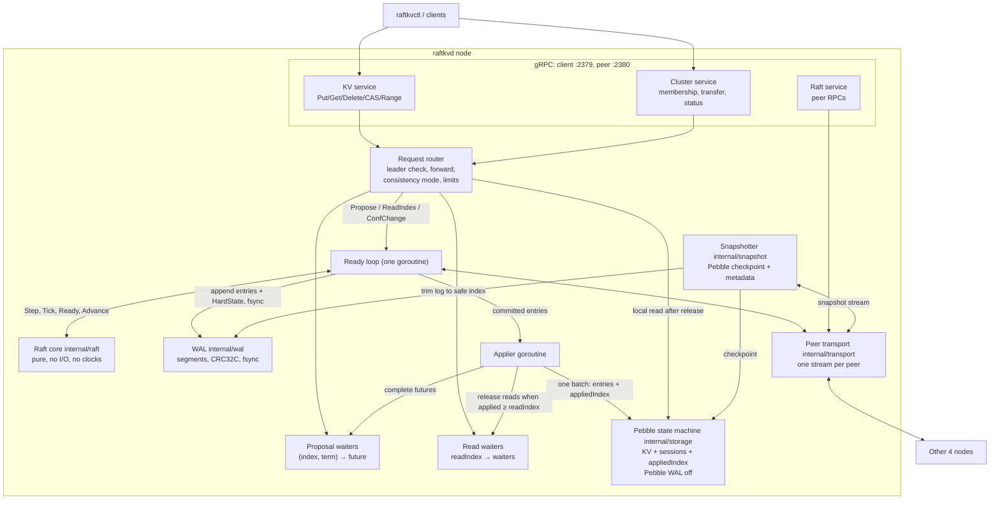
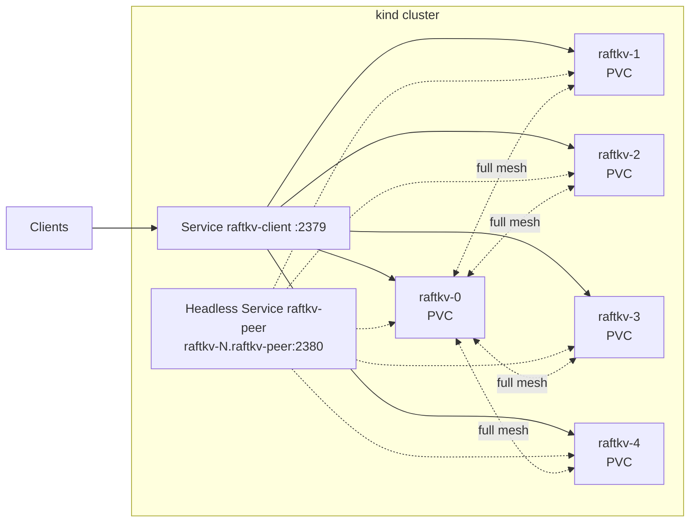
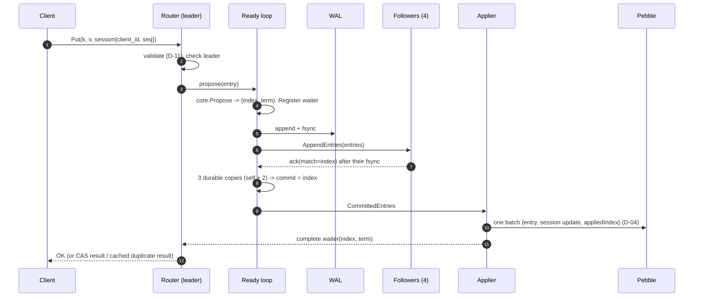
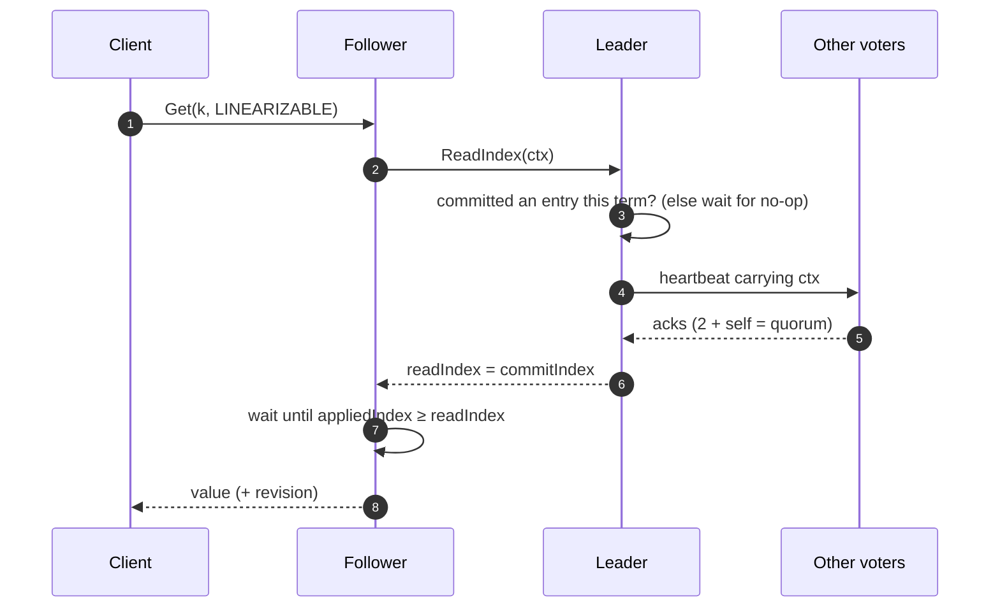
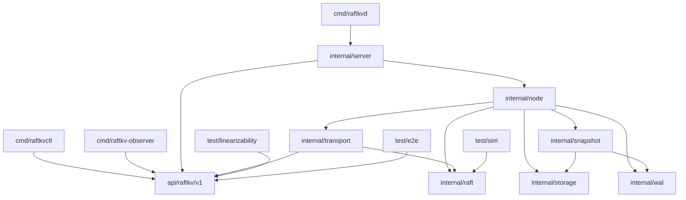

# RaftKV Architecture

> Builds on [`design-decisions.md`](design-decisions.md); decision IDs (`D-xx`) refer to it.
> Protocol behaviour: [`system-design.md`](system-design.md). API shapes: [`api-design.md`](api-design.md).
> On-disk formats: [`storage-design.md`](storage-design.md). Tests: [`testing.md`](testing.md).
> Delivery plan: [`implementation-roadmap.md`](implementation-roadmap.md).
>
> RaftKV is a learning project. Numbers below are configuration defaults, not performance targets.

---

## 1. Goals and non-goals

### 1.1 Goals

| # | Goal | Decision |
|---|------|----------|
| G1 | **Linearizable** `Put`, `Get`, `Delete`, `CompareAndSwap`, and linearizable `Range` pages | D-05, D-10 |
| G2 | **Exactly-once** application of retried client writes | D-09 |
| G3 | Survive the loss of any **2 of 5** nodes without losing committed data | 5 voters, quorum 3 |
| G4 | Automatic failover: a new leader is elected without operator action | D-08 |
| G5 | Online membership change (add, remove, replace one node at a time) | D-06, D-23 |
| G6 | Restart cost bounded by the snapshot interval, not total history | D-14 |
| G7 | Verified correctness: Porcupine finds zero linearizability violations under injected faults | D-18 |
| G8 | Our own Raft with a deterministic, I/O-free core | D-01, D-24 |

### 1.2 Non-goals

| Non-goal | Why |
|----------|-----|
| Performance targets, benchmarks | Learning project. Speed is not a goal |
| Sharding / multi-Raft | D-07. One Raft group |
| Transactions, `Watch` | D-10 |
| Joint-consensus membership changes | D-06. One server at a time is enough |
| Byzantine faults | Crash-stop and crash-recovery only |
| TLS, authentication, multi-tenancy | Out of scope for a local learning cluster |
| Cross-region deployment | Timeouts (D-08) assume one local network |
| Repairing silent corruption | We detect it (CRC32C, D-03) and stop; we do not repair |

### 1.3 Fault model

- **Processes** can crash, restart, or pause for any length of time (GC, SIGSTOP).
- **Network** can drop, delay, duplicate, reorder, and partition messages, including one-way partitions.
- **Disks** can lose writes that were not fsynced or tear the last write. An fsync that returned success is durable.
- **Clocks**: safety never depends on clocks. Only the optional lease read (D-25) assumes a bounded clock drift rate. All Raft timing uses logical ticks (D-24).

---

## 2. Component view of a node

Every node runs the same `raftkvd` binary. Any node can be leader, follower, or learner.



### 2.1 Component responsibilities

| Component | Package | Responsibility | Must never |
|-----------|---------|----------------|------------|
| KV / Cluster services | `internal/server` | Validate requests (D-11), call the router, map errors to gRPC codes | Read Pebble for a linearizable read before the router releases it |
| Raft service | `internal/transport` | Server side of peer RPCs (D-36) | Run Raft logic itself |
| Request router | `internal/node` | Local vs forward, consistency mode, waiters, deadlines | Block the Ready loop |
| Ready loop (driver) | `internal/node` (D-35) | Own the core, do all I/O for it in the right order | Call `Advance()` before the Ready is fully handled |
| Raft core | `internal/raft` | Elections, replication, commit, ReadIndex, conf changes, leader transfer | Do I/O, read clocks, start goroutines |
| WAL | `internal/wal` | Durable entries and `HardState`, torn-tail detection | Return from `Save` before fsync |
| Applier | `internal/node` (D-35) | Apply committed entries in order, session dedup, notify waiters | Apply out of order or skip an index |
| State machine | `internal/storage` | User keys, sessions, `appliedIndex`, membership | Use wall clock or randomness during apply |
| Snapshotter | `internal/snapshot` | Create, send, receive, install snapshots; pick the log trim point | Trim the log past what Pebble has flushed (D-30) |
| Transport | `internal/transport` | Peer connections, per-peer queues, in-flight limit (D-29) | Reorder messages within a stream |

Metrics, traces, and logs (D-17) are wired in by `internal/node` and `internal/server`.

---

## 3. Cluster topology (5 nodes)

Deployment follows D-16: a 5-replica StatefulSet on kind, a headless Service for peer DNS, one PVC per pod.



- **Quorum = 3.** Any 2 nodes may fail.
- **Full mesh.** Each node keeps one long-lived gRPC stream to each peer (D-12). In steady state only the leader's streams carry replication; the rest carry votes and transfer traffic.
- **Client routing.** Clients can talk to any pod. Followers forward writes to the leader (D-28). Reads follow §6.2.

---

## 4. Raft core and the Ready loop

### 4.1 Pure core vs. I/O driver (D-01, D-24)

The core is a deterministic state machine. Its inputs are method calls and its only output is a `Ready` struct. It never does I/O, reads a clock, sleeps, or starts goroutines. Randomized election timeouts come from a seeded PRNG, so a simulator run can be replayed exactly (D-18).

```
// Inputs (all called from ONE goroutine: the driver)
core.Tick()                         // one logical tick (100 ms)
core.Step(msg)                      // inbound peer message
core.Propose(data) -> (index, term) | ErrNotLeader | ErrProposalDropped
core.ProposeConfChange(cc)
core.ReadIndex(ctx []byte)          // request a linearizable read point
core.TransferLeader(target)
core.HasReady() bool
core.Ready() Ready
core.Advance(Ready)                 // the Ready was fully handled

// Output
type Ready struct {
    SoftState        *SoftState     // leader id, role (not persisted)
    HardState        HardState      // term, vote, commit (persist if changed)
    Entries          []Entry        // to append to the WAL
    Snapshot         *SnapshotMeta  // incoming snapshot to install, if any
    CommittedEntries []Entry        // ready to apply, in index order
    Messages         []Message      // to send to peers
    ReadStates       []ReadState    // {readIndex, ctx} confirmed by quorum
    MustSync         bool           // term/vote or entries changed
}
```

Heartbeat = 1 tick. Election timeout is random in [10, 20) ticks, i.e. 1–2 s (D-08). The driver turns a `time.Ticker` into `Tick()` calls; the core never sees wall time.

### 4.2 The Ready loop

The driver is a single goroutine that owns the core, so the core needs no locks.

```
loop:
  select {
    case <-ticker.C:             core.Tick()
    case m := <-transport.Inbox: core.Step(m)
    case p := <-proposeCh:       p.reply(core.Propose(p.data))   // router registers waiter by (index, term)
    case r := <-readIndexCh:     core.ReadIndex(r.ctx)
    case cc := <-confChangeCh:   core.ProposeConfChange(cc)
    case <-stop:                 return
  }
  if !core.HasReady() { continue }
  rd := core.Ready()

  // (1) Persist: snapshot (if any) -> entries -> HardState, one fsync.
  if rd.Snapshot != nil { snapshotter.Install(rd.Snapshot); wal.SaveSnapshotMarker(rd.Snapshot) }
  wal.Save(rd.HardState, rd.Entries, sync = rd.MustSync)

  // (2) Only now send messages. A node never acknowledges state it has not made durable.
  transport.Send(rd.Messages)

  // (3) Hand committed entries to the applier (bounded queue, strict index order, D-04).
  applier.Enqueue(rd.CommittedEntries)

  // (4) Release confirmed read points (served when appliedIndex >= readIndex).
  readWaiters.Confirm(rd.ReadStates)

  core.Advance(rd)
```

Driver invariants:

1. **Durability before acknowledgement.** Vote grants and append acks are sent only after the fsync that made them true. The leader also fsyncs its own entries before counting itself toward commit.
2. **Apply never runs ahead of commit.** `CommittedEntries` only holds entries at or below the commit index.
3. **No core call while a Ready is outstanding.** This rules out reentrancy bugs.
4. **The applier is asynchronous.** A slow Pebble write does not delay heartbeats and cause spurious elections. When its queue is full, the driver stops taking proposals but keeps ticking and stepping messages.

### 4.3 Why this split

The simulator (D-18) can replace the driver and inject drops, partitions, and crashes between any two steps. The `Ready`/`Step`/`Advance` contract matches `go.etcd.io/raft/v3` (D-01), and the ordering rules above are one small unit with crash-point tests.

---

## 5. Goroutines

| Goroutine | Count | Notes |
|-----------|-------|-------|
| gRPC handlers | 1 per RPC | Wait on waiter futures or the deadline |
| Ready loop | 1 | **Sole owner** of Raft state |
| Applier | 1 | Strictly sequential |
| Transport sender | 1 per peer | Bounded queue; on overflow the message is dropped and Raft retries |
| Transport receiver | 1 per inbound stream | Checks the sender is a known member (D-31), then forwards to the driver |
| Snapshot sender / receiver / creator | ≤ 1 each | Receiver stages to a temp dir and hands over only after checksums verify |

Rules:

- **No shared mutable Raft state.** Others read an atomically published `Status` (role, term, leader, commit, applied).
- **All queues are bounded.** Overflow becomes `RESOURCE_EXHAUSTED` to clients (D-29) or a dropped peer message that Raft retransmits.

---

## 6. Request paths

### 6.1 Write path (Put / Delete / CAS)



- The waiter is keyed by `(index, term)`. If a different term ends up at that index (leadership was lost), the waiter fails with an indeterminate error. The client retries with the **same** `(client_id, seq)`, and session dedup (D-09) makes that safe.
- On a follower, the router forwards the write to the leader (D-28). See [`api-design.md`](api-design.md) §7.

### 6.2 Read path (Get / Range)

| Mode | Served by | Mechanism | Decision |
|------|-----------|-----------|----------|
| `LINEARIZABLE` (default) | Leader, or follower via ReadIndex | Confirm leadership with a heartbeat quorum, wait until `appliedIndex ≥ readIndex`, read Pebble | D-05 |
| `LINEARIZABLE` + lease | Leader only | If the lease is valid, `readIndex = commitIndex` with no round trip | D-25, off by default |
| `STALE` | Any node | Read local Pebble at the current `appliedIndex` | D-05, opt-in |



Details and the safety argument: [`system-design.md` §3](system-design.md#3-linearizable-reads).

---

## 7. Package map

Matches the repository layout in `design-decisions.md`. Arrows mean "imports".



| Package | Contents | Key rule |
|---------|----------|----------|
| `api/raftkv/v1` | `.proto` for `KV`, `Cluster`, `Raft`, plus generated Go (committed, D-43) | Field numbers never reused |
| `internal/raft` | Roles, step functions, log view, progress (Probe/Replicate/Snapshot), ReadIndex, conf changes | **No `net`, `os`, `time`, `sync`, or other `internal/*` imports** |
| `internal/wal` | Segment files, record framing, `HardState`, snapshot markers, torn-tail repair | Never ack before fsync |
| `internal/storage` | Pebble wrapper (WAL off, D-03), apply logic, key encoding, sessions, `appliedIndex` | Apply is deterministic and atomic per batch (D-04) |
| `internal/snapshot` | Checkpoint, manifest, chunked send/receive, install, retention | Keep the last good snapshot until the new one is durable |
| `internal/transport` | Peer streams, per-peer queues, in-flight limit, reconnect | Preserve per-stream order |
| `internal/node` | Ready loop, applier, router, waiters, node lifecycle (D-35) | The only package that wires I/O to the core |
| `internal/server` | gRPC handlers only | Thin |
| `cmd/*` | `raftkvd`, `raftkvctl`, `raftkv-observer` (D-48) | Thin |
| `test/sim`, `test/linearizability`, `test/e2e`, `test/chaos` | Simulator, Porcupine, fault harnesses | See [`testing.md`](testing.md) |

---

## 8. Key design tradeoffs

| Area | Chosen | Alternatives | Why |
|------|--------|--------------|-----|
| Consensus (D-01) | Own Raft, etcd/raft-style pure core | `go.etcd.io/raft/v3`, `hashicorp/raft` | Writing Raft is the point. hashicorp/raft does its own I/O, which makes deterministic simulation hard |
| Core structure | Pure state machine + Ready loop | Goroutine per role, internal timers | Internal timers and I/O break determinism (D-24) |
| Storage engine (D-02) | Pebble | RocksDB (cgo), bbolt, Badger | Pure Go, no cgo, has checkpoints |
| Raft log (D-03) | Own segmented WAL, Pebble WAL off | Log inside Pebble | A log that is appended and trimmed from the front fits files better than an LSM. Cost: we must respect D-30 |
| Apply durability (D-04) | `appliedIndex` in the same batch | Separate file; idempotent re-apply | A separate file can drift. Re-apply without an index breaks CAS and sessions |
| Apply concurrency | Async applier | Apply inside the Ready loop | Slow applies would delay heartbeats |
| Reads (D-05) | ReadIndex default, lease opt-in | Reads through the log; lease only | Log reads need a disk write per read. Lease-only makes safety depend on clocks |
| Membership (D-06) | Learner catch-up + one server at a time | Joint consensus | Simpler and enough for add/remove/replace |
| Transport (D-12) | gRPC stream per peer | Unary RPC per append; raw TCP | Streams keep order and avoid reconnect per message. Raw TCP means rebuilding framing |
| Elections (D-08) | PreVote + CheckQuorum | Plain Raft | Plain Raft lets rejoining nodes bump terms and lets an isolated leader linger |
| Snapshots (D-14) | Pebble checkpoint | Logical key dump | Checkpoint is hard links plus metadata, and installs by swapping a directory |
| Exactly-once (D-09) | Replicated session table | No dedup | A retried CAS or Put could otherwise apply twice |

