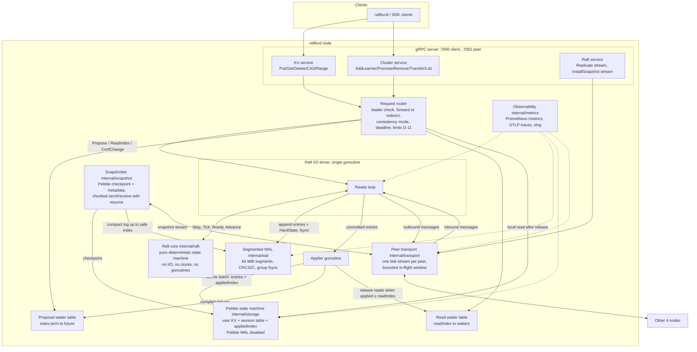
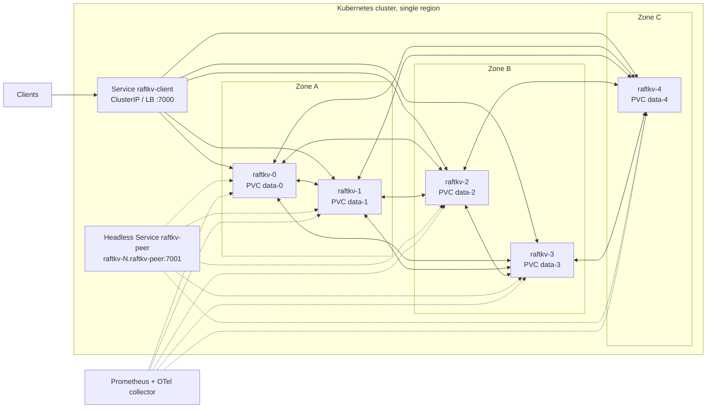
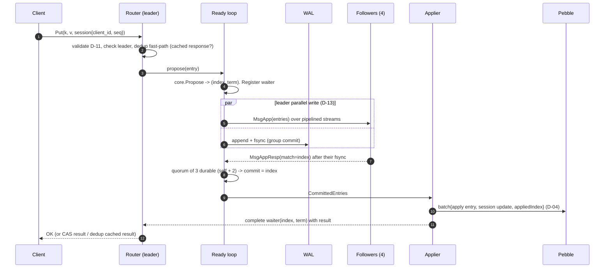
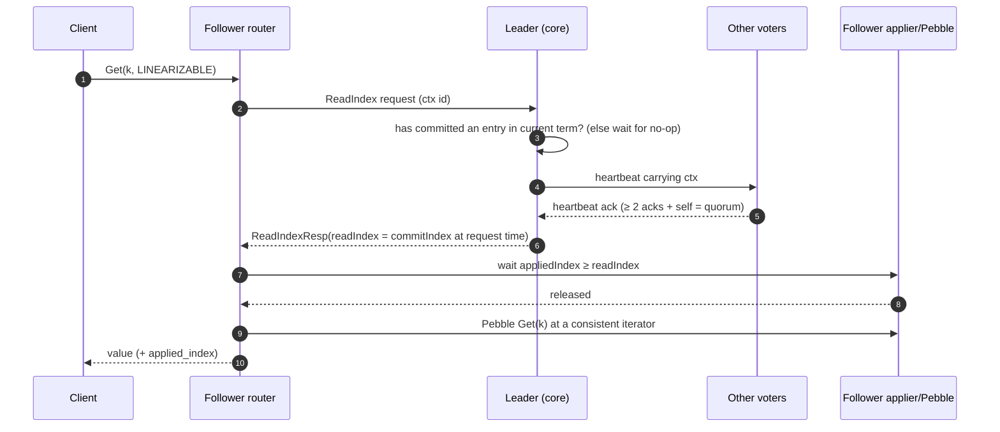
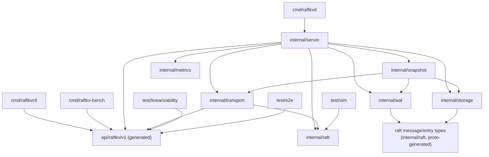

# RaftKV Architecture

> Status: Draft v1. Builds on the baseline in [`design-decisions.md`](design-decisions.md); decision IDs (`D-xx`) refer to it.
> Detailed protocol behaviour is in [`system-design.md`](system-design.md). API shapes: [`api-design.md`](api-design.md).
> On-disk formats: [`storage-design.md`](storage-design.md). Test strategy: [`testing-benchmarks.md`](testing-benchmarks.md).
> Delivery plan: [`implementation-roadmap.md`](implementation-roadmap.md), [`WBS.md`](WBS.md).
>
> All numbers in this document are **targets or configuration defaults**, never measured results.

---

## 1. Goals and non-goals

### 1.1 Goals

| # | Goal | Notes / decision |
|---|------|------------------|
| G1 | **Linearizable** single-key reads and writes (`Put`, `Get`, `Delete`, `CompareAndSwap`) and linearizable `Range` scans | D-05, D-10 |
| G2 | **Exactly-once** application of retried client writes | D-09 |
| G3 | Tolerate the loss of any **2 of 5** nodes with no loss of committed data and continued availability | 5 voters, quorum 3 |
| G4 | Automatic failover: a new leader is elected without operator action after a leader failure | D-08 |
| G5 | Online membership change (replace / add / remove a node) without downtime | D-06, D-23 |
| G6 | Bounded recovery: restart cost is bounded by the snapshot interval, not total history | D-14 |
| G7 | Performance targets on reference hardware: ≥ 38k writes/s, ≥ 92k linearizable reads/s, ≥ 30% p99 write-latency improvement from D-13 | Targets only; hardware is D-20 (Open) |
| G8 | Verified correctness: ≥ 40M ops checked by Porcupine across ≥ 1,500 injected faults with 0 violations | D-18 |
| G9 | First-class operability: Prometheus metrics, OTel traces, structured logs, Kubernetes-native deployment | D-16, D-17 |
| G10 | Own, auditable Raft implementation with a deterministic, I/O-free core | D-01, D-24 |

### 1.2 Non-goals (v1)

| Non-goal | Why / where tracked |
|----------|---------------------|
| Sharding / multi-Raft / horizontal write scaling | D-07. Throughput is bounded by one leader. API stays shard-agnostic. |
| Multi-key transactions, `Watch` | D-10, deferred |
| Joint-consensus membership changes (arbitrary multi-node reconfiguration in one step) | D-06, deferred |
| Byzantine fault tolerance | Crash-stop / crash-recovery faults only. Nodes are assumed honest. |
| AuthN/AuthZ, multi-tenancy | D-15 (Open). mTLS is at most optional in v1. |
| Cross-region / WAN deployment | Timeouts (D-08) assume single-region, sub-10 ms RTT |
| Values > 1 MiB, keys > 4 KiB | D-11 |
| Surviving silent data corruption beyond CRC detection | We detect (CRC32C, D-03) and fail-stop; we do not repair in place |

### 1.3 Fault model

- **Processes** can crash, restart, or pause for any length of time (GC, SIGSTOP, VM freeze).
- **Network** can drop, delay, duplicate and reorder messages, and partition in any shape, including asymmetric partitions.
- **Disks** can lose writes that were not fsynced, tear the last write, fill up, or become slow. An fsync that returned success is durable.
- **Clocks**: the safety of the protocol never depends on clocks. Only the optional lease read (D-05) relies on a **bounded clock drift rate**. Wall-clock jumps are tolerated because all timing uses logical ticks (D-24) and Go's monotonic clock.

---

## 2. Component view of a node

Every node runs the same `raftkvd` binary. Any node can be leader, follower, or learner.



### 2.1 Component responsibilities

| Component | Package | Responsibility | Owns state | Must never |
|-----------|---------|----------------|------------|------------|
| KV service | `internal/server` | Validate requests (D-11), map gRPC to router calls, map errors to gRPC codes | none | Touch Pebble directly for linearizable reads without router release |
| Cluster service | `internal/server` | Admin API (D-23): build `ConfChange` proposals, trigger `TransferLeadership` | none | Allow more than one pending conf change |
| Raft service | `internal/transport` | Server side of peer streams: `Replicate` (bidi) and `InstallSnapshot` (client-stream) | none | Run Raft logic itself |
| Request router | `internal/server` | Decide local vs forward vs redirect, attach consistency mode, register waiters, enforce deadlines and back-pressure | waiter tables | Block the Ready loop |
| Raft I/O driver | `internal/server` (see open question Q-A1) | Own the core; run the Ready loop; perform all I/O on the core's behalf in the required order | none durable | Call `Advance()` before the Ready has been fully handled |
| Raft core | `internal/raft` | Elections, replication, commit, ReadIndex, conf changes, leader transfer, flow-control state | in-memory Raft state | Do I/O, read clocks, spawn goroutines, allocate randomness from a global source |
| WAL | `internal/wal` | Durable log entries, `HardState{term, vote, commit}`, snapshot markers; torn-tail detection | Raft log | Return from `Save` before fsync (except where documented for leader-parallel write) |
| Applier | `internal/server` | Apply committed entries in order to Pebble; session dedup; notify waiters | none | Apply out of order or skip an index |
| State machine | `internal/storage` | User keyspace, session table, `appliedIndex`, membership; deterministic apply | applied state | Depend on wall clock or local randomness during apply |
| Snapshotter | `internal/snapshot` | Create checkpoint, decide log-compaction point, stream out/in, install | snapshot files | Compact the log beyond what Pebble has durably flushed |
| Transport | `internal/transport` | Peer connections, per-peer queues, in-flight window (D-12), snapshot bandwidth limit | per-peer queues | Reorder messages within a stream |
| Observability | `internal/metrics` | Metrics registry, tracer provider, log setup (D-17) | none | Sit on the hot path with locks or allocations per entry beyond counters |

---

## 3. Cluster topology (5 nodes)

Deployment follows D-16: a 5-replica StatefulSet, one PVC per pod, anti-affinity across nodes and zones, PDB `maxUnavailable: 1`.



Properties of this layout:

- **Quorum = 3.** Any 2 nodes may fail. A 2/2/1 zone split means losing any single zone leaves ≥ 3 voters, so **a full zone outage is survivable**.
- **Full mesh peer links.** Each node keeps one long-lived bidirectional gRPC stream to each peer (D-12). Only the leader's outbound streams carry replication traffic in steady state. The other links carry votes and transfer traffic.
- **Client routing.** Clients may connect to any pod through the client Service. Non-leaders forward writes to the leader (or return a redirect hint, depending on client mode; see [`api-design.md`](api-design.md)). Reads follow §6.2.
- **Rolling upgrades.** PDB `maxUnavailable: 1` together with leadership transfer before pod termination (a `preStop` hook calls `TransferLeadership` if the pod is leader) keeps planned restarts down to one short unavailability window, below one election timeout (target).

---

## 4. Raft core and the Ready loop

### 4.1 Pure core vs. I/O driver (D-01, D-24)

The Raft core is a **deterministic state machine**. Its only inputs are method calls, and its only outputs are a `Ready` struct. It never performs I/O, reads a clock, sleeps, or starts goroutines. Randomized election timeouts come from a seeded PRNG injected at construction, so a simulation run can be replayed bit-for-bit (D-18).

```
// Inputs (all called from ONE goroutine: the driver)
core.Tick()                         // one logical tick (default 100 ms wall time per tick)
core.Step(msg)                      // inbound peer message or local message
core.Propose(data) -> (index, term) | ErrNotLeader | ErrProposalDropped
core.ProposeConfChange(cc)
core.ReadIndex(ctx []byte)          // request a linearizable read point
core.TransferLeader(target)
core.HasReady() bool
core.Ready() Ready
core.Advance(Ready)                 // acknowledge that the Ready was fully handled

// Output
type Ready struct {
    SoftState        *SoftState     // leader id, role (not persisted)
    HardState        HardState      // term, vote, commit (persist if changed)
    Entries          []Entry        // to append to the WAL (unstable tail)
    Snapshot         *SnapshotMeta  // incoming snapshot to install, if any
    CommittedEntries []Entry        // ready to apply, in index order
    Messages         []Message      // to send to peers
    ReadStates       []ReadState    // {readIndex, ctx} confirmed by quorum
    MustSync         bool           // HardState.term/vote or Entries changed
}
```

Tick mapping: heartbeat = 1 tick (100 ms). Election timeout is randomized per term in [10, 20) ticks, which is 1000–2000 ms (D-08). Ticks are produced by the driver from a `time.Ticker`. The core never sees wall time.

### 4.2 The Ready loop

The driver is a single goroutine that owns the core. All core calls are serialized through it, so the core needs no locks.

```
loop:
  select {
    case <-ticker.C:            core.Tick()
    case m := <-transport.Inbox: core.Step(m)
    case p := <-proposeCh:      p.reply(core.Propose(p.data))    // router registers waiter by (index,term)
    case r := <-readIndexCh:    core.ReadIndex(r.ctx)
    case cc := <-confChangeCh:  core.ProposeConfChange(cc)
    case a := <-applyDoneCh:    // applier progress (appliedIndex), used for snapshot triggers
    case <-stop:                return
  }
  if !core.HasReady() { continue }
  rd := core.Ready()

  // (1) Leader only: send MsgApp to followers BEFORE the local fsync (D-13, dissertation §10.2.1).
  //     Safe because the leader counts itself toward commit only after its own fsync completes
  //     (self-ack is fed back via Step(MsgAppResp from self) after step 2).
  if isLeader(rd) { transport.Send(appendMessages(rd.Messages)) }

  // (2) Persist. Order matters: snapshot marker -> entries -> HardState, one fsync (group commit).
  if rd.Snapshot != nil { snapshotter.InstallFromStaged(rd.Snapshot); wal.SaveSnapshotMarker(rd.Snapshot) }
  wal.Save(rd.HardState, rd.Entries, sync = rd.MustSync)

  // (3) Send all other messages ONLY after persistence: vote grants, MsgAppResp, MsgHeartbeatResp.
  //     A node must never acknowledge state it has not made durable.
  transport.Send(remaining(rd.Messages))

  // (4) Hand committed entries to the applier (non-blocking, bounded queue gives back-pressure).
  //     Entries are applied in strict index order. The applier persists appliedIndex atomically (D-04).
  applier.Enqueue(rd.CommittedEntries)

  // (5) Release confirmed read points to the read waiter table (served when appliedIndex >= readIndex).
  readWaiters.Confirm(rd.ReadStates)

  // (6) Leader self-ack, then Advance.
  if isLeader(rd) { core.Step(selfAppendAck(lastIndex(rd.Entries))) }
  core.Advance(rd)
```

Invariants of the driver:

1. **Durability before acknowledgement.** Any message that tells another node "I have stored X" or "I voted for Y" is sent only after the fsync that made X/Y durable. Vote responses and `MsgAppResp` are in step 3 for this reason.
2. **Leader parallelism is bounded.** The leader may send entries before its own fsync, but it never counts itself in the commit quorum until its fsync completes (step 6). Commit still requires 3 durable copies.
3. **Apply never runs ahead of commit.** `CommittedEntries` contains only entries whose index ≤ the commit index known in this Ready, and ≤ the locally persisted last index.
4. **No core call while a Ready is outstanding,** except through the select loop after `Advance`. This rules out reentrancy bugs.
5. **The applier is asynchronous** (etcd style), so a slow Pebble batch does not stall heartbeats. The applier queue is bounded (target: 64 Ready batches or 64 MiB, whichever is hit first). When it is full, the driver stops pulling new proposals (back-pressure to the router) but keeps ticking and stepping messages, so leadership stays stable.

### 4.3 Why this split

| Concern | Benefit of pure core + driver |
|---------|-------------------------------|
| Deterministic simulation (D-18) | The simulator replaces the driver: it delivers messages, ticks, and "fsync completions" in a seeded order, and can inject drops, partitions, and crashes between any two steps |
| Swapability (D-01) | The `Ready`/`Step`/`Advance` contract matches `go.etcd.io/raft/v3`, so the core can be swapped behind one interface |
| Testability of I/O ordering | The driver's ordering rules (§4.2) are a small, separately reviewed unit with crash-point tests |
| Performance (D-13) | Batching falls out naturally: one Ready can carry many proposals and one fsync covers them all (group commit) |

---

## 5. Threading and goroutine model

| Goroutine | Count | Blocks on | Communicates via | Notes |
|-----------|-------|-----------|------------------|-------|
| gRPC client handlers | 1 per in-flight RPC | waiter futures, ctx deadline | `proposeCh`, `readIndexCh`, waiter tables | Bounded by gRPC `MaxConcurrentStreams` plus a router admission semaphore |
| Raft driver (Ready loop) | 1 | `select` | channels listed in §4.2 | **Sole owner** of `internal/raft` state |
| WAL group-commit | 0 or 1 | fsync | called synchronously by the driver in v1 | Moving fsync to a dedicated goroutine with a completion channel is a D-13 optimization, measured separately |
| Applier | 1 | Pebble batch commit | `applier` queue in, `applyDoneCh` + waiter tables out | Strictly sequential. Applies are batched (many entries per Pebble batch) |
| Transport sender | 1 per peer (4) | stream `Send`, in-flight window | per-peer bounded queue | A slow peer fills only its own queue. On overflow, messages for that peer are dropped and Raft retries (the core moves the peer to Probe) |
| Transport receiver | 1 per inbound stream (≤ 4) | stream `Recv` | `transport.Inbox` (bounded) | Validates sender is a known member, then forwards to the driver |
| Snapshot sender | ≤ 1 per lagging peer (cap 1 concurrent cluster-wide by default) | stream, rate limiter | snapshotter | Bandwidth-capped (default target 64 MiB/s) so it does not starve replication |
| Snapshot receiver | ≤ 1 | stream `Recv`, disk | snapshotter, then `Step(MsgSnap)` | Stages to a temp dir and hands over only after the full checksum verifies |
| Snapshot creator | ≤ 1 | Pebble checkpoint, flush | snapshotter, then WAL compaction | Triggered by D-14 thresholds |
| Metrics / pprof HTTP | 1 + handlers | HTTP | read-only atomics | Never takes driver locks |

Rules:

- **No shared mutable Raft state.** Other goroutines see Raft status only through an atomically published `Status` snapshot (role, term, leader, commit, applied), which the driver refreshes after each Ready.
- **All cross-goroutine queues are bounded.** Overflow turns into back-pressure (`RESOURCE_EXHAUSTED` / `UNAVAILABLE` to clients) or a dropped peer message, which Raft repairs by retransmission. Memory never grows without bound.
- **Context propagation.** Each client RPC carries an OTel span. The proposal's trace context rides along in memory (not in the replicated entry) until apply, so traces show `router → propose → wal.fsync → quorum → apply` (D-17).

---

## 6. Request paths

### 6.1 Write path (Put / Delete / CAS)



Notes:

- The waiter is keyed by `(index, term)`. If the entry applied at `index` has a different term (the leader lost leadership and the entry was overwritten), the waiter fails with `UNAVAILABLE / leadership lost`. The client retries with the **same** `(client_id, seq)`, and session dedup (D-09) makes the retry safe.
- On a follower, the router forwards to the leader over the peer gRPC connection (default), or returns `NOT_LEADER` with a leader hint (client-selectable). See [`api-design.md`](api-design.md).
- Batching (D-13): the driver drains `proposeCh` before calling `Ready()`, so one Ready, one fsync and one `MsgApp` carry many proposals. Batch cap is 4 MiB (D-11).

### 6.2 Read path (Get / Range)

| Consistency mode | Served by | Mechanism | Cost | Decision |
|------------------|-----------|-----------|------|----------|
| `LINEARIZABLE` (default) | Leader, or follower via forwarding | ReadIndex: confirm leadership with a heartbeat quorum, wait until `appliedIndex ≥ readIndex`, read local Pebble | 1 heartbeat round trip (batched across concurrent reads), no disk write | D-05 |
| `LINEARIZABLE` with lease enabled | Leader only | Lease read: if lease is valid, `readIndex = commitIndex` with no round trip | Local only | D-05, behind a flag + configured max drift |
| `STALE` | Any node | Read local Pebble at current `appliedIndex`. Response includes `applied_index` | Local only | D-05, opt-in per request |



Full protocol detail, lease safety argument, and edge cases are in [`system-design.md` §3](system-design.md#3-linearizable-reads).

---

## 7. Package map

Matches the "Planned repository layout" section of `design-decisions.md`. Arrows mean "imports".



| Package | Contents | Depends on | Key rule |
|---------|----------|------------|----------|
| `api/raftkv/v1` | `.proto` for `KV`, `Cluster`, `Raft` services and generated Go | protobuf, gRPC | Wire compatibility: field numbers never reused |
| `internal/raft` | Core: `raft.go` (roles, step functions), `log.go` (unstable + storage view), `progress.go` (Probe/Replicate/Snapshot, inflights), `readonly.go` (ReadIndex queue), `confchange.go`, `Storage` interface (read-only view of stable log), Raft entry/message types | stdlib only | **No imports of `net`, `os`, `time` (except `time.Duration` types), `sync`, or any other `internal/*`.** Enforced by a lint rule |
| `internal/wal` | Segment files, record framing (`len, type, crc32c, payload`), `HardState` records, snapshot markers, repair-on-open of torn tail, compaction | stdlib | Exposes `raft.Storage` for the stable log |
| `internal/storage` | Pebble wrapper (WAL disabled, D-03), apply logic, key encoding (user vs system prefixes), session table, `appliedIndex`, membership record | Pebble | Apply is deterministic and atomic per batch (D-04) |
| `internal/snapshot` | Checkpoint creation, manifest, chunked send/receive with resume, install, retention | storage, wal, transport | Never deletes the last good snapshot before the new one is installed and durable |
| `internal/transport` | Peer stream manager, per-peer queues, in-flight window, reconnect/backoff, snapshot stream endpoints, optional mTLS (D-15) | gRPC, api | Preserve per-stream order. Drop rather than block when full |
| `internal/server` | `KV`/`Cluster` handlers, router, waiter tables, Ready-loop driver, applier, node lifecycle (bootstrap/join/restart) | everything above | The only package that wires I/O to the core |
| `internal/metrics` | Prometheus registry and metric definitions, OTel tracer provider, slog setup | prometheus, otel | Metric names stable and documented |
| `cmd/*` | Flags/config, signal handling, main | server / api | Thin |
| `test/sim` | Deterministic multi-node simulator over `internal/raft` | raft | Seeded and replayable |
| `test/linearizability` | History recorder, Porcupine KV model | api | Model includes CAS and sessions |
| `test/e2e`, `test/chaos`, `deploy/k8s` | Fault-injection harnesses, manifests | — | See [`testing-benchmarks.md`](testing-benchmarks.md) |

---

## 8. Key design tradeoffs

| Area | Chosen | Alternatives considered | Why rejected / tradeoff accepted |
|------|--------|-------------------------|----------------------------------|
| Consensus library (D-01) | Own Raft, etcd/raft-style pure core | `go.etcd.io/raft/v3`. `hashicorp/raft` | etcd/raft: battle-tested, but owning the core is a project goal. Same interface is kept so it can be swapped back in. hashicorp/raft: does its own I/O and goroutines internally, which makes deterministic simulation and fine I/O ordering control (D-13) much harder. Accepted cost: about 3–4 weeks of extra work and correctness risk, mitigated by D-18 |
| Core structure | Pure state machine + Ready loop | Goroutine-per-role, internal timers, actor model | Internal timers and I/O break determinism (D-24) and make crash-point testing impractical |
| State machine engine (D-02) | Pebble | RocksDB (cgo), BoltDB/bbolt, Badger | RocksDB: cgo build and profiling pain. bbolt: single writer with B+tree page rewrites and fsync per txn, which is a poor fit for a high write rate. Badger: value-log GC complexity. Pebble: pure Go, LSM, used by CockroachDB |
| Raft log storage (D-03) | Dedicated segmented WAL, Pebble WAL disabled | Store Raft log in Pebble. Keep Pebble WAL on as well | Log-in-Pebble: an append-mostly, sequentially truncated log is a poor fit for an LSM (write amplification, tombstones on truncation). Double WAL: two fsyncs per write for nothing. Tradeoff accepted: Pebble memtable contents are lost on crash and must be re-applied from the Raft WAL. This is safe because of D-04, but WAL compaction must respect Pebble's **flushed** applied index (see system-design §6) |
| Apply durability (D-04) | `appliedIndex` in same Pebble batch | Separate `appliedIndex` file. Idempotent re-apply without an index | A separate file can diverge from data. Pure idempotent re-apply breaks CAS and session semantics |
| Apply concurrency | Asynchronous applier goroutine | Apply inline in Ready loop | Inline apply lets slow Pebble writes delay heartbeats and causes spurious elections. Cost: one extra queue and waiter bookkeeping |
| Linearizable reads (D-05) | ReadIndex default, lease opt-in | Reads through the log. Lease-only | Log reads cost a disk write per read and would miss the 92k reads/s target. Lease-only makes safety depend on clocks, so it is only offered as an opt-in |
| Follower reads | ReadIndex forwarding | Followers serve local reads (stale). Followers with their own leases | Local follower reads are not linearizable (offered only as `STALE`). Follower leases need more clock assumptions |
| Membership (D-06) | Learner catch-up + single-server change | Joint consensus | Joint consensus is more general but more complex to get right. Single-server change is enough to replace or add/remove one node at a time, which covers every v1 operation |
| Sharding (D-07) | Single Raft group | Multi-Raft with range splits | Big complexity jump (range routing, splits, cross-range txns). Throughput ceiling of one leader accepted for v1 |
| Transport (D-12) | gRPC bidi stream per peer + pipelining | Unary RPC per AppendEntries. Raw TCP + custom framing | Unary: one RTT per batch, which caps throughput. Raw TCP: we would have to rebuild flow control, TLS and observability ourselves |
| Election stability (D-08) | PreVote + CheckQuorum | Plain Raft | Plain Raft lets partitioned or rejoining nodes inflate terms and depose healthy leaders. It also lets an isolated leader stay "leader" indefinitely |
| Time (D-24) | Logical ticks | `time.Timer` inside core | Wall timers inside the core make tests nondeterministic |
| Snapshot format (D-14) | Pebble checkpoint (hard-linked SSTs) + metadata | Logical dump (iterate all keys) | Checkpoint is O(files) and nearly free locally. Logical dump is O(data), CPU heavy, and would need a second format. Tradeoff: snapshot is tied to Pebble's on-disk format, so all nodes must run compatible Pebble versions |
| Client exactly-once (D-09) | Replicated session table | Client-side idempotency keys only. No dedup | Without replicated dedup, a retried non-idempotent op (CAS, or Put after a lost response) can apply twice and break linearizability |

---

## 9. Configuration defaults (targets, tunable)

| Parameter | Default | Source |
|-----------|---------|--------|
| Tick interval | 100 ms | D-08, D-24 |
| Heartbeat | 1 tick | D-08 |
| Election timeout | random in [10, 20) ticks, re-drawn each term | D-08 |
| Max in-flight `MsgApp` per follower | 256 messages | D-12 (window size not fixed there; see system-design Q-S3) |
| Max bytes per `MsgApp` | 1 MiB (batches up to 4 MiB proposal cap D-11) | D-11, D-12 |
| WAL segment size | 64 MiB | D-03 |
| Snapshot trigger | 100k entries or 512 MiB WAL since last snapshot | D-14 |
| Snapshot chunk | 1 MiB | D-14 |
| Session TTL | 10 min | D-09 |
| Lease reads | off | D-05 |

---

## 10. New open questions

These came up while writing this document. Each one needs a `D-xx` entry in `design-decisions.md`.

| ID | Question | Recommendation |
|----|----------|----------------|
| Q-A1 | The planned layout has no package for the Raft I/O driver and applier. Should they live in `internal/server` (as assumed here) or in a new `internal/node` package? | New `internal/node` package: it keeps gRPC handlers separate from the driver and lets `test/e2e` and in-process tests reuse the node without gRPC. This changes the layout, so it needs sign-off |
| Q-A2 | Follower write handling: forward to the leader internally (proxy) or always return `NOT_LEADER` + hint? | Support both. Default to forwarding for simple clients. Benchmarks use leader-direct (the forwarding hop must be counted separately). Coordinate with `api-design.md` |
| Q-A3 | Snapshot/apply compatibility across Pebble versions during rolling upgrades (the checkpoint format is engine-specific) | Pin the Pebble format major version per release. Add a format version to the snapshot manifest and reject snapshots with an incompatible format |
| Q-A4 | Peer-port admission: should the transport reject messages from node IDs not in the current configuration (tombstoned / removed IDs)? | Yes. Keep a persisted tombstone set of removed IDs. Rejected messages get a `REMOVED` error so the removed node shuts down its Raft loop (see system-design §7.4–7.5 and failure scenario F-17) |
| Q-A5 | Back-pressure thresholds (applier queue, proposal queue, router admission) are not in the baseline | Make them config values. Default proposal queue is 4,096 entries / 64 MiB. Tune in M7 against D-20 hardware |
