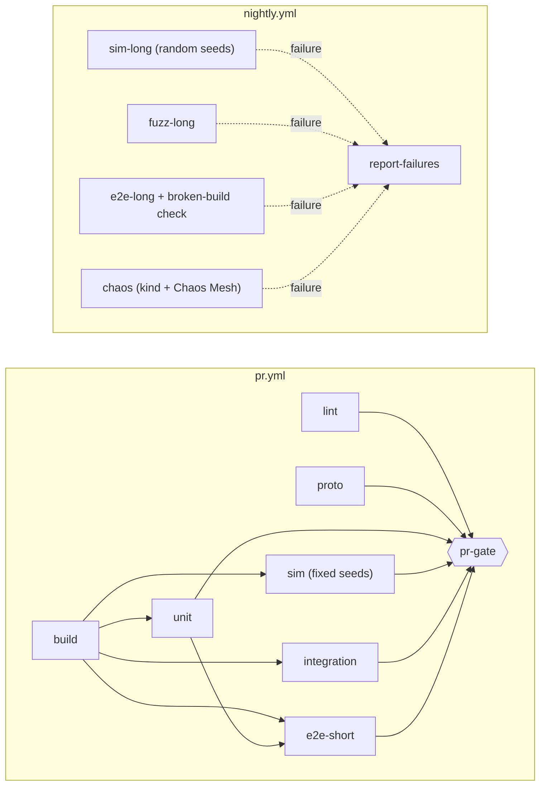

# CI & End-to-End Testing (GitHub Actions)

Status: **Draft design**. No files under `.github/workflows/` exist yet. The YAML below is a **sketch** to be turned
into real workflow files during implementation.

Based on **D-19** (CI) and **D-18** (simulation + Porcupine + fault injection). What the tests do is described in
`testing.md`; this document only says how CI runs them. Durations and counts are starting parameters.

---

## 1. Workflows

There are two workflows. That's all.

| Workflow | Trigger | What it runs | Blocks merge? |
|---|---|---|---|
| `pr.yml` | `pull_request` to `main` | Lint, proto checks, unit + race, simulator with fixed seeds, integration, short 5-node docker-compose e2e with faults + Porcupine | **Yes** (via `pr-gate`) |
| `nightly.yml` | Daily `schedule` + `workflow_dispatch` | Long simulator run with random seeds, longer fuzzing, longer e2e + broken-build check, kind + Chaos Mesh; files an issue on failure | No |

Both run on standard GitHub-hosted Linux runners. If kind + Chaos Mesh doesn't fit, the chaos job can move to a
larger runner.

### 1.1 `pr.yml` jobs

| Job | Needs | What it does | Timeout |
|---|---|---|---|
| `lint` | — | `golangci-lint` (incl. `forbidigo` banning `time.Now`, `time.Sleep` and global `math/rand` in `internal/raft`, to protect determinism, D-24) and a `go mod tidy` diff check | 10 min |
| `proto` | — | `buf lint`, `buf format`, `buf breaking` against `main`; regenerate and `git diff --exit-code` (generated code is committed, D-43) | 5 min |
| `build` | — | `go build ./...`, build the `raftkvd` image once and pass it to e2e as an artifact | 15 min |
| `unit` | `build` | `make test`: `-race -shuffle=on -count=1`, short fuzz | 20 min |
| `sim` | `build` | Fixed seed list (`test/sim/seeds/pr.txt`) + `regressions.txt`, split over 4 shards; one seed run twice to check determinism | 20 min |
| `integration` | `build` | In-process multi-node tests | 20 min |
| `e2e-short` | `build`, `unit` | `make e2e E2E_PROFILE=pr`: 5 nodes, ~10 min workload, at least one each of leader kill, follower kill, pause, partition and packet loss; Porcupine check; convergence check | 30 min |
| `pr-gate` | all above | Fails if any job above failed. The **only required check** | 2 min |

A new push to the same PR cancels the old run (`concurrency` with `cancel-in-progress: true`).

### 1.2 `nightly.yml` jobs

| Job | What it does | Timeout |
|---|---|---|
| `sim-long` | 4 shards of random seeds for ~2 h each, all profiles (`nightly`, `membership`, `disk`, `snapshot`). Base seed = run ID, logged | 150 min |
| `fuzz-long` | `make fuzz FUZZTIME=3m`: each of the 13 fuzz targets for 3 min (WBS 7.5.1); crasher inputs uploaded as an artifact | 75 min |
| `e2e-long` | 30 min docker-compose run with the full fault mix, then one run against the deliberately broken build, which **must** fail with a violation (`testing.md` §3.4) | 90 min |
| `chaos` | Create kind (pinned), install Chaos Mesh (pinned chart), deploy `deploy/k8s/`, run a seeded `PodChaos` + `NetworkChaos` schedule for 15 min (`chaos_duration` input) under the workload, check the history with Porcupine; artifacts uploaded on failure | 60 min |
| `report-failures` | On failure: open or update a GitHub issue with the repro command | 10 min |

Nightly jobs run in parallel and are never cancelled mid-run. The image is built locally and loaded into kind with `kind load docker-image`,
so nothing is pushed to a registry.

---

## 2. Job diagram



---

## 3. Results and artifacts

- **Pass rule:** every e2e and chaos run must report **0 linearizability violations** (harness exit code 0). A checker
  timeout (exit code 3) is not a pass.
- **On failure, CI uploads:** seed + repro command, histories and fault log, the Porcupine HTML visualization, node
  logs and data directories (and for chaos, `kubectl get events` and pod logs). Kept 30 days. Histories and the seed
  are uploaded on every e2e/chaos run, pass or fail.
- Go module/build cache via `actions/setup-go`; Docker layers via the GHA cache. Caches never hold test results.

---

## 4. Flake policy

- **No blind retries on correctness tests.** A Porcupine violation, invariant failure or divergence fails the job,
  full stop. Never re-run with a new seed to "get green".
- **A failing seed becomes an issue with a repro command**, e.g. `make sim SEED=8472910345 SIM_PROFILE=membership` or
  `make e2e E2E_SEED=...`. The nightly `report-failures` job adds a comment instead of a duplicate if the same failure
  is already open.
- The fix PR adds the seed to `test/sim/seeds/regressions.txt` (or a new test), so the bug is re-checked on every PR.
- Pure infrastructure steps (pulling images, creating the kind cluster) may retry up to 2 times. The test itself is
  not re-run.

---

## 5. Required check and permissions

- `main` is protected; **`pr-gate` is the single required check**.
- Workflows use `permissions: contents: read`; only `report-failures` gets `issues: write`. No other secrets are
  needed (the built-in `GITHUB_TOKEN` is enough). Third-party actions are pinned by commit SHA.

---

## 6. YAML sketches

> **Sketch, not a workflow file.** `@<sha>` stands for a pinned action version.

### 6.1 `pr.yml`

```yaml
name: pr
on:
  pull_request:
    branches: [main]
permissions:
  contents: read
concurrency:
  group: pr-${{ github.event.pull_request.number }}
  cancel-in-progress: true

jobs:
  lint:
    runs-on: ubuntu-24.04
    timeout-minutes: 10
    steps:
      - uses: actions/checkout@<sha>
      - uses: actions/setup-go@<sha>
        with: { go-version-file: go.mod, cache: true }
      - uses: golangci/golangci-lint-action@<sha>
      - run: make tidy-check

  build:
    runs-on: ubuntu-24.04
    timeout-minutes: 15
    steps:
      - uses: actions/checkout@<sha>
      - uses: actions/setup-go@<sha>
        with: { go-version-file: go.mod, cache: true }
      - run: make build
      - run: docker build -t raftkvd:ci . && docker save raftkvd:ci -o /tmp/raftkvd.tar
      - uses: actions/upload-artifact@<sha>
        with: { name: raftkvd-image, path: /tmp/raftkvd.tar, retention-days: 1 }

  unit:
    needs: build
    runs-on: ubuntu-24.04
    timeout-minutes: 20
    steps:
      - uses: actions/checkout@<sha>
      - uses: actions/setup-go@<sha>
        with: { go-version-file: go.mod, cache: true }
      - run: make test

  sim:
    needs: build
    runs-on: ubuntu-24.04
    timeout-minutes: 20
    strategy:
      fail-fast: false
      matrix: { shard: [0, 1, 2, 3] }
    steps:
      - uses: actions/checkout@<sha>
      - uses: actions/setup-go@<sha>
        with: { go-version-file: go.mod, cache: true }
      - run: make sim-pr SHARD=${{ matrix.shard }} SHARDS=4
      - if: failure()
        uses: actions/upload-artifact@<sha>
        with: { name: sim-failure-${{ matrix.shard }}, path: out/sim/ }

  # proto (make proto-check) and integration (make integration) look just like unit.

  e2e-short:
    needs: [build, unit]
    runs-on: ubuntu-24.04
    timeout-minutes: 30
    steps:
      - uses: actions/checkout@<sha>
      - uses: actions/download-artifact@<sha>
        with: { name: raftkvd-image, path: /tmp }
      - run: docker load -i /tmp/raftkvd.tar
      - run: make e2e E2E_PROFILE=pr E2E_SEED=${{ github.event.pull_request.number }} IMAGE=raftkvd:ci
      - if: always()
        uses: actions/upload-artifact@<sha>
        with: { name: e2e, path: out/e2e/, retention-days: 30 }

  pr-gate:
    if: always()
    needs: [lint, proto, build, unit, sim, integration, e2e-short]
    runs-on: ubuntu-24.04
    steps:
      - if: contains(needs.*.result, 'failure') || contains(needs.*.result, 'cancelled')
        run: exit 1
```

### 6.2 `nightly.yml`

```yaml
name: nightly
on:
  schedule:
    - cron: "17 2 * * *"
  workflow_dispatch:
    inputs:
      base_seed: { type: string, default: "" }
permissions:
  contents: read
concurrency:
  group: nightly
  cancel-in-progress: false
env:
  BASE_SEED: ${{ inputs.base_seed || github.run_id }}

jobs:
  sim-long:
    runs-on: ubuntu-24.04
    timeout-minutes: 150
    strategy:
      fail-fast: false
      matrix: { shard: [0, 1, 2, 3] }
    steps:
      - uses: actions/checkout@<sha>
      - uses: actions/setup-go@<sha>
        with: { go-version-file: go.mod, cache: true }
      - run: make sim-random BASE_SEED=$BASE_SEED SHARD=${{ matrix.shard }} SHARDS=4 DURATION=120m
      - if: always()
        uses: actions/upload-artifact@<sha>
        with: { name: sim-long-${{ matrix.shard }}, path: out/sim/ }

  fuzz-long:
    runs-on: ubuntu-24.04
    timeout-minutes: 120
    steps:
      - uses: actions/checkout@<sha>
      - uses: actions/setup-go@<sha>
        with: { go-version-file: go.mod, cache: true }
      - uses: actions/cache@<sha>
        with: { path: out/fuzz-corpus, key: "fuzz-${{ github.run_id }}", restore-keys: "fuzz-" }
      - run: make fuzz FUZZTIME=10m

  e2e-long:
    runs-on: ubuntu-24.04
    timeout-minutes: 90
    steps:
      - uses: actions/checkout@<sha>
      - run: make e2e E2E_PROFILE=nightly E2E_SEED=$BASE_SEED
      - run: make mutation   # the checker must detect the planted read-path bug (testing.md 3.4)
      - if: always()
        uses: actions/upload-artifact@<sha>
        with: { name: e2e-long, path: out/e2e/, retention-days: 30 }

  chaos:
    runs-on: ubuntu-24.04
    timeout-minutes: 60
    steps:
      - uses: actions/checkout@<sha>
      - run: GOBIN=$PWD/bin go install sigs.k8s.io/kind@v0.30.0   # pinned kind
      - run: make chaos-up               # kind + Chaos Mesh + image loaded with `kind load`
      - run: make chaos CHAOS_DURATION=15m CHAOS_SEED=$BASE_SEED
      - if: failure()
        uses: actions/upload-artifact@<sha>
        with: { name: chaos, path: out/chaos/, retention-days: 30 }
      - if: always()
        run: make chaos-down

  report-failures:
    if: failure()
    needs: [sim-long, fuzz-long, e2e-long, chaos]
    runs-on: ubuntu-24.04
    permissions: { contents: read, issues: write }
    steps:
      - uses: actions/checkout@<sha>
      - uses: actions/download-artifact@<sha>
        with: { path: in/ }
      - run: ./scripts/ci/file-issues.sh in/   # one issue per failure, with repro command
        env: { GH_TOKEN: "${{ secrets.GITHUB_TOKEN }}" }
```

---

## 7. Reproducing CI locally

CI calls only these Makefile targets (to be created), so local and CI commands are the same.

| Target | Does | CI job |
|---|---|---|
| `make test` | `go test -race -shuffle=on -count=1 ./...` plus short fuzz | `unit` |
| `make sim SEED=<n> [SIM_PROFILE=...]` | Replays one simulator seed exactly | failing `sim` / `sim-long` seed |
| `make e2e [E2E_PROFILE=pr\|nightly] [E2E_SEED=]` | 5-node docker-compose cluster + faults + Porcupine | `e2e-short`, `e2e-long` |
| `make mutation` | Linearizability check against a `-tags raftkv_mutation` build whose followers serve "linearizable" reads locally; must report a violation (testing.md 3.4) | `check`, `e2e-long` |
| `make chaos-up` | Create a kind cluster, install Chaos Mesh, deploy RaftKV | `chaos` |
| `make chaos [CHAOS_DURATION=10m] [CHAOS_SEED=]` | Against a `make chaos-up` cluster: build and load the workload image, run the seeded fault schedule under the in-cluster workload, check the history with Porcupine (`out/chaos/`) | `chaos` |
| `make chaos-down` | Delete the kind cluster | — |

Helper targets used by CI: `make lint`, `make tidy-check`, `make proto-check`, `make build`, `make integration`,
`make sim-pr`, `make sim-random`, `make fuzz`.

**Steps to reproduce a failure**

1. Copy the repro command from the issue or job log, and `git checkout` the commit it names.
2. **Simulator failure:** `make sim SEED=<seed> SIM_PROFILE=<profile>`. It is deterministic, so it must reproduce on
   any machine; if it doesn't, that's a simulator bug.
3. **E2E / chaos failure:** download the history artifact and open the Porcupine HTML to see the bad key. Re-running
   `make e2e E2E_SEED=<seed>` repeats the same fault plan, but real timing differs, so it may not hit the same
   interleaving. The saved history and logs are the main evidence; if possible, turn the bug into a simulator seed or
   integration test.
4. **Fix PR:** add the seed to `test/sim/seeds/regressions.txt` (or a new test) and link the issue.

Local needs: Go, Docker with Compose v2, about 4 vCPU / 8 GiB for `make e2e` and 8 vCPU / 16 GiB for `make chaos`.
