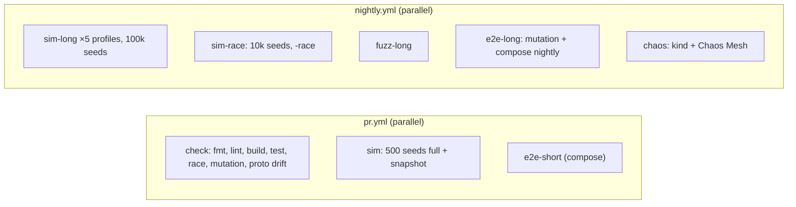

# CI & End-to-End Testing (GitHub Actions)

Status: **Implemented** (M0–M5, M7 chaos). The workflow files are the source of truth:
[`.github/workflows/pr.yml`](../.github/workflows/pr.yml) and [`.github/workflows/nightly.yml`](../.github/workflows/nightly.yml).
This document says how CI runs the tests; what the tests do is described in `testing.md`.

Based on **D-19** (CI) and **D-18** (simulation + Porcupine + fault injection).

---

## 1. Workflows

| Workflow | Trigger | What it runs |
|---|---|---|
| `pr.yml` | `pull_request`, and `push` to `main` | fmt-check, lint, build, unit tests, race, the broken-build check, the proto drift check, the simulator with 500 seeds per profile, and the short 5-node docker-compose e2e with faults + Porcupine |
| `nightly.yml` | Daily `schedule` (`17 3 * * *`) + `workflow_dispatch` | Long simulator runs, a race-enabled simulator run, fuzzing, the long docker-compose e2e, and kind + Chaos Mesh |

Both run on standard GitHub-hosted `ubuntu-latest` runners. Jobs in a workflow run in parallel; there are no `needs`
edges.

### 1.1 `pr.yml` jobs

| Job | What it does |
|---|---|
| `check` | `make fmt-check lint build test race` (golangci-lint includes the `forbidigo` ban on `time.Now` in `internal/raft`, D-24); `make mutation` (the checker must catch a deliberately broken read path, testing.md 3.4); proto drift check `make proto && git diff --exit-code` (D-43) |
| `sim` | `make sim SEEDS=500 FAULTS=full` and `make sim SEEDS=500 FAULTS=snapshot`. Every run also replays `test/sim/regressions/seeds.txt`. Failing-seed traces (`out/sim/`) are uploaded |
| `e2e-short` | `make e2e E2E_PROFILE=pr E2E_SEED=<PR number>` (30 min timeout): the 5-node compose cluster and the `test/e2e` suite at PR sizes (table 1.3). `out/e2e/` is always uploaded (30 days) |

The proto drift check was proven once with a throwaway PR that hand-edited a generated file (M0 exit criterion 3;
see the M0 exit evidence in implementation-roadmap.md).

### 1.2 `nightly.yml` jobs

`workflow_dispatch` inputs: `seeds` (per profile, default 100,000), `base_seed` (default derived from the run ID),
`jobs` (`all`, or a comma-separated subset of `sim-long,sim-race,fuzz-long,e2e-long,chaos`), `chaos_duration`
(default `15m`). A scheduled run has no inputs, so every job runs.

| Job | What it does | Timeout |
|---|---|---|
| `sim-long` | Matrix over the `full`, `lossy`, `partition`, `crash` and `snapshot` profiles, 100,000 seeds each. First seed = `(run ID mod 10^6) × 10^6` (logged), so each night covers a new range | 120 min |
| `sim-race` | 10,000 seeds of the `full` profile with `-race` (`make sim SIMRACE=-race`), WBS 1.9.1 | 90 min |
| `fuzz-long` | `make fuzz FUZZTIME=3m`: every native fuzz target for 3 min (WBS 7.5.1); crashers uploaded | 75 min |
| `e2e-long` | `make mutation`, then `make e2e E2E_PROFILE=nightly E2E_SEED=<run ID>` at nightly sizes (table 1.3). `out/e2e/` always uploaded | 90 min |
| `chaos` | Pinned kind v0.30.0, `make chaos-up` (Chaos Mesh 2.8.8), `make chaos CHAOS_DURATION=15m CHAOS_SEED=<run ID>`: an in-cluster workload pod records a mixed KV history under a seeded PodChaos/NetworkChaos schedule, then Porcupine checks it. `out/chaos/` uploaded on failure; `make chaos-down` always | 60 min |

The e2e image is built locally on the runner; for kind it is loaded with `kind load docker-image`. Nothing is pushed
to a registry.

### 1.3 e2e profiles (`test/e2e`)

| Test | pr | nightly | Override |
|---|---|---|---|
| `TestLeaderElectedOnStart`, `TestNewLeaderAfterLeaderKill`, `TestMinorityStopsCommittingAndLogsMatchAfterHeal` | once | once | — |
| `TestKillRestartRoundsLoseNoCommittedEntry` (kill -9 a random node, often the leader; every acked entry in all 5 WALs) | 20 rounds | 200 rounds | `E2E_ROUNDS` |
| `TestSeededFaultSchedule` (kill, SIGSTOP, partition, netem delay/loss; nightly adds follower wipe) | 6 steps | 40 steps | `E2E_STEPS` |
| `TestWipedFollowerRejoinsViaSnapshot` (state hash of all 5 replicas) | 2 runs | 20 runs | `E2E_WIPE_RUNS` |
| `TestLinearizableKVUnderFaults` (Put/Get/Delete/CAS/Range, leader + follower reads, Porcupine) | 1 cycle | 6 cycles | `E2E_LIN_CYCLES` |
| `TestOldLeaderServesNoStaleRead` (partitioned and SIGSTOPped old leader) | once | once | — |

`E2E_SEED` fixes victim choice and the fault schedule; `E2E_OUT` sets the artifact directory; `E2E_KEEP` keeps the
cluster running. Container names, ports and volumes are fixed, so only one compose e2e can run per Docker host.

---

## 2. Job diagram

---

## 3. Results and artifacts

- **Pass rule:** every e2e and chaos run must report **0 linearizability violations**. A checker timeout is a failure,
  not a pass.
- **Uploaded:** `out/e2e/<test>/` (fault log, node logs, WAL dumps, `history.jsonl`, the Porcupine HTML on failure) on
  every e2e run; failing-seed JSONL traces (`out/sim/`) when a simulator job fails; fuzz crashers when `fuzz-long`
  fails; `out/chaos/` (seed, fault log, history, pod logs, events) when `chaos` fails. Kept 30 days.
- Go module/build cache via `actions/setup-go`. Caches never hold test results.

---

## 4. Flake policy

- **No blind retries on correctness tests.** A Porcupine violation, invariant failure or divergence fails the job.
  Never re-run with a new seed to "get green".
- A failing simulator seed prints its repro command. The fix PR adds the seed to `test/sim/regressions/seeds.txt`
  (replayed on every sim run) or a directed test.

---

## 5. Not built (planned in the original design)

These were in the draft and are not in the workflow files: a single required `pr-gate` job, `concurrency` groups,
explicit `permissions:` blocks, SHA-pinned actions, a `report-failures` job that files issues, `buf breaking`, and a
`go mod tidy` check. Today a nightly failure is seen in the Actions tab only.

---

## 6. Reproducing CI locally

CI calls only Makefile targets, so local and CI commands are the same.

| Target | Does | CI job |
|---|---|---|
| `make fmt-check lint build test race` | Formatting, golangci-lint, build, unit tests, unit tests with `-race` | `check` |
| `make proto && git diff --exit-code` | Regenerate protobuf code and fail on drift | `check` |
| `make mutation` | Linearizability check against a `-tags raftkv_mutation` build whose followers serve "linearizable" reads locally; must report a violation | `check`, `e2e-long` |
| `make sim SEEDS=<n> SEED=<first> FAULTS=<profile> [SIMRACE=-race]` | Simulator over a seed range; a failing seed prints its repro command and writes a JSONL trace to `out/sim/` | `sim`, `sim-long`, `sim-race` |
| `make fuzz [FUZZTIME=60s] [FUZZ=<target>]` | Every native fuzz target, or one | `fuzz-long` |
| `make e2e [E2E_PROFILE=pr\|nightly] [E2E_SEED=n]` | Build the e2e image, run `test/e2e` against the 5-node compose cluster | `e2e-short`, `e2e-long` |
| `make chaos-up` | Create a kind cluster, deploy RaftKV, install Chaos Mesh | `chaos` |
| `make chaos [CHAOS_DURATION=10m] [CHAOS_SEED=n]` | Build and load the workload image, run the seeded fault schedule under the in-cluster workload, check the history with Porcupine (`out/chaos/`) | `chaos` |
| `make chaos-down` | Delete the kind cluster | `chaos` |

**Steps to reproduce a failure**

1. Copy the seed or repro command from the job log and `git checkout` the commit the run used.
2. **Simulator failure:** `make sim SEEDS=1 SEED=<seed> FAULTS=<profile>`. It is deterministic, so it must reproduce on
   any machine; if it doesn't, that's a simulator bug. `go run ./test/sim/cmd/simtrace <trace>` pretty-prints the trace.
3. **E2E / chaos failure:** download the artifact and open the Porcupine HTML to see the bad key. Re-running with the
   same seed repeats the same fault plan, but real timing differs, so it may not hit the same interleaving. If
   possible, turn the bug into a simulator seed or an in-process test.
4. **Fix PR:** add the seed to `test/sim/regressions/seeds.txt` (or a new test).

Local needs: Go, Docker with Compose v2, about 4 vCPU / 8 GiB for `make e2e` and 8 vCPU / 16 GiB for `make chaos`.
