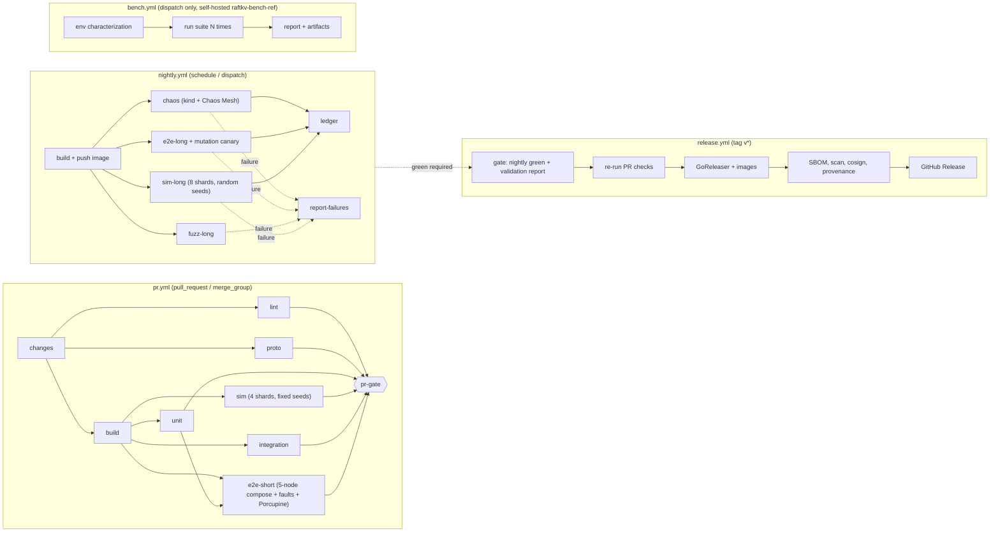

# CI & End-to-End Testing Design (GitHub Actions)

Status: **Draft design**. This document describes workflows. It does **not** create them. No files under
`.github/workflows/` exist yet. All YAML below is labelled **design sketch**, to be turned into real workflow files
during implementation (see `implementation-roadmap.md` / `WBS.md`).

Baseline decisions: **D-19** (E2E CI: unit + race on every PR, short docker-compose 5-node e2e with fault injection on
every PR, kind + Chaos Mesh nightly), **D-18** (simulation + Porcupine + fault injection), **D-20** (benchmark hardware,
**Open**), **D-21** (Go version and module path, **Open**), **D-15** (mTLS, **Open**). Test design details are in
`testing-benchmarks.md`. Section references like "TB §3" point there.

> Every duration, size and count below is a **parameter or budget**, not a measurement.

---

## 1. Workflow overview

| Workflow | Trigger | Purpose | Runner | Blocks merge? |
|---|---|---|---|---|
| `pr.yml` | `pull_request` (to `main`), `merge_group` | Fast correctness gate: lint, proto checks, unit + race, sim with fixed seeds, integration, short 5-node docker-compose e2e with faults + linearizability check | GitHub-hosted Linux | **Yes** (required checks §8) |
| `nightly.yml` | `schedule` (daily, off-peak UTC), `workflow_dispatch` | Long sim with random seeds, long docker-compose e2e, kind + Chaos Mesh campaign, long fuzzing, validation-ledger append, auto-file issues on failure | GitHub-hosted Linux (larger runner for kind, §4) | No (but red nightly blocks release, §2.4) |
| `bench.yml` | `workflow_dispatch` **only** (plus optional `workflow_call` from release) | Benchmarks on the D-20 reference environment | **Self-hosted reference runners only** (label `raftkv-bench-ref`) | No |
| `release.yml` | Tag push `v*.*.*` | Build, verify, sign and publish binaries + container images, attach reports | GitHub-hosted Linux | n/a |
| `codeql.yml` *(optional)* | PR + weekly | Static security analysis | GitHub-hosted | Advisory |

**Policy: benchmark numbers never come from shared (GitHub-hosted) runners.** Shared runners vary in CPU, disk and
neighbours, so their numbers can't be compared. `pr.yml` may run `go test -bench` **only** to check that benchmark code
compiles and runs (`-benchtime=1x`). Its timings are thrown away.

---

## 2. Workflow details

### 2.1 `pr.yml`

| Job | Depends on | What it does | Timeout *(param)* |
|---|---|---|---|
| `lint` | — | `golangci-lint` (pinned version, config `.golangci.yml`: `govet`, `staticcheck`, `errcheck`, `gosec`, `revive`, `gofumpt`, `goimports`, `ineffassign`, `unused`, `bodyclose`, `contextcheck`, `forbidigo` (bans `time.Now`/`time.Sleep`/`math/rand` global in `internal/raft` to protect D-24 determinism)). Also `go mod tidy` diff check | 10 min |
| `proto` | — | `buf lint`, `buf format --diff --exit-code`, `buf breaking --against '.git#branch=main'` on `api/raftkv/v1/`. `buf generate` + `git diff --exit-code` to check generated code is committed (or not, per `api-design.md`) | 5 min |
| `build` | — | `go build ./...` for linux/amd64 + linux/arm64. `go vet`. Build the `raftkvd` container image once with buildx, export as tarball artifact for e2e | 15 min |
| `unit` | `build` | `go test -race -shuffle=on -count=1 -coverprofile ./...` (excluding `test/e2e`, `test/chaos`). Fuzz targets run briefly (TB §2.1). Benchmarks compile-check `-run=^$ -bench=. -benchtime=1x` | 20 min |
| `sim` | `build` | `make sim-pr`: fixed seed list `test/sim/seeds/pr.txt` (e.g. 500 seeds *(param)*) + `regressions.txt`, sharded into 4 matrix shards. Plus a determinism check: 1 seed run twice, trace hash compared | 20 min per shard |
| `integration` | `build` | In-process multi-node tests (TB §2.4) with `-race` | 20 min |
| `e2e-short` | `build`, `unit` | `make e2e E2E_PROFILE=pr`: docker-compose 5 nodes from the image artifact, 10 min *(param)* checked workload at reduced rate, faults from a fixed PR fault plan (≥ 1 each of F-01 leader kill, F-02 kill, F-04 pause, F-06 partition, F-09 loss, F-13 disk-full, TB §4), Porcupine check, convergence + digest check. Seed = fixed per PR plus the PR number, logged | 30 min |
| `pr-gate` | all above | Summary job (`if: always()`) that fails if any needed job did not succeed. **Single required check** for branch protection, so the required-check list doesn't need editing when jobs change | 2 min |

`e2e-short` depends on `unit` so broken builds don't spend e2e minutes. `lint`/`proto` run in parallel and are not
dependencies of tests, so developers get every failure in one CI round.

`concurrency: group: pr-${{ github.event.pull_request.number }}, cancel-in-progress: true`: a new push cancels the
outdated run.

**Path filters**: docs-only PRs (`docs/**`, `*.md`) skip `sim`, `integration` and `e2e-short`. The jobs still report
success through `pr-gate` using a `changes` detection step (e.g. `dorny/paths-filter`, SHA-pinned), so required checks are
never left "pending".

### 2.2 `nightly.yml`

| Job | What it does | Timeout *(param)* |
|---|---|---|
| `build` | As in PR, image pushed to GHCR with tag `nightly-<sha>` (needed by kind) | 20 min |
| `sim-long` | 8 shards × random seeds for 150 min each. Base seed = `run_id`, per-shard seed stream logged. All profiles (`nightly`, `membership`, `disk`, `snapshot`) | 180 min |
| `fuzz-long` | Each fuzz target for 10 min *(param)*. Corpus cached and restored | 120 min |
| `e2e-long` | docker-compose, 30-min run with the full E fault mix (TB §5.3 "E campaign run" parameters) + one mutation-canary run (must detect a violation, TB §3.4) | 90 min |
| `chaos` | kind cluster (≥ 5 workers), install Chaos Mesh (pinned Helm chart version), deploy `deploy/k8s/` with test overlay, run the C campaign workflow from `test/chaos/` (default 2 h nightly *(param)*, 4 h on dispatch with `long=true`), collect history, run Porcupine | 330 min (GitHub-hosted job limit is 6 h. Long campaigns longer than that go to self-hosted, Q-C3) |
| `ledger` | Appends ledger rows (TB §5.5) from all jobs to long-term storage (TB Q-10) and posts a run summary to `$GITHUB_STEP_SUMMARY` | 10 min |
| `report-failures` | `if: failure()`. Files/updates GitHub issues per failure fingerprint (§7) | 10 min |

`concurrency: group: nightly, cancel-in-progress: false`: never cancel a running campaign.

### 2.3 `bench.yml`

- Trigger: `workflow_dispatch` with inputs `ref` (SHA/tag), `suite` (`headline` | `full` | `ab-d13` | `smoke`),
  `runs` (N, default 5), `notes`. **No** `pull_request` trigger. Self-hosted runners must never run untrusted fork
  code.
- `runs-on: [self-hosted, linux, raftkv-bench-ref]`. The label is assigned only to the D-20 reference controller host.
  The controller provisions/cleans the 5 server + loadgen machines (Ansible/Terraform, described in `system-design.md`
  or a future `bench-infra.md`).
- Steps: environment characterization (fio/iperf3, TB §6.1) → refuse to continue if a node fails the threshold →
  run the suite per TB §6 → upload HdrHistogram logs, Prometheus snapshots, manifests, pprof profiles → generate the
  report from the TB §9 templates. Results are **appended to a results branch / storage, never committed by hand**.
- `concurrency: group: bench-ref, cancel-in-progress: false`: one benchmark at a time on the reference cluster.
- Until D-20 is resolved, `bench.yml` can only run `suite=smoke` on a developer-provided self-hosted runner, and its
  output is watermarked **"NON-REFERENCE: not comparable to targets"**.

### 2.4 `release.yml`

1. Trigger on tag `v*.*.*`. Verify the tag is on `main` and is signed (Q-C5).
2. **Gate**: the latest `nightly.yml` run on the tagged SHA (or a descendant with only non-reset-path changes, TB §5.4)
   is green. For a non-pre-release tag, the validation campaign report for the validation SHA must exist with
   0 violations (TB §8). Checked by a script that queries the Actions API and the ledger.
3. Re-run `pr.yml` jobs via `workflow_call` (lint, unit, sim, e2e-short) on the tag.
4. Build with GoReleaser (pinned): `raftkvd`, `raftkvctl`, `raftkv-bench` for linux/darwin × amd64/arm64,
   `-trimpath`, reproducible `ldflags` with version/commit, `CGO_ENABLED=0` (Pebble is pure Go, D-02).
5. Container images (distroless/static base) multi-arch → GHCR. SBOM (Syft, SPDX + CycloneDX). Vulnerability scan
   (`govulncheck` + Grype) blocking on critical.
6. Sign images and checksums with **cosign keyless** (GitHub OIDC). Attach SLSA provenance
   (`actions/attest-build-provenance`).
7. Create the GitHub Release with changelog, checksums, SBOMs, links to the validation campaign report and the latest
   reference benchmark report (if any, clearly dated and SHA-tagged).
8. Verify that mutation-canary build tags are not compiled into release binaries (`go version -m` / build-tag check,
   TB Q-8).

---

## 3. Job dependency diagram



---

## 4. Runner sizing and timeouts

| Job | Runner *(param)* | Why | Job timeout |
|---|---|---|---|
| lint, proto | `ubuntu-24.04` standard | Light | 10 / 5 min |
| build, unit, integration | `ubuntu-24.04` standard. Larger runner (8 vCPU) if `-race` unit time exceeds budget | `-race` adds a lot of CPU and memory overhead | 15 / 20 / 20 min |
| sim (PR) | standard × 4 matrix shards | Embarrassingly parallel over seeds | 20 min |
| e2e-short | standard runner (≥ 4 vCPU / 16 GiB) | 5 nodes + harness in Docker. Faults are timing-sensitive, so starved runners cause liveness noise (not safety failures) | 30 min |
| sim-long | standard × 8 shards | | 180 min |
| e2e-long | larger runner 8 vCPU / 32 GiB | Longer, denser workload | 90 min |
| chaos | larger runner 16 vCPU / 64 GiB *(param)* | kind with ≥ 5 workers + Chaos Mesh + Prometheus | 330 min |
| bench | self-hosted `raftkv-bench-ref` controller | D-20 | 480 min |
| release | standard | | 60 min |

Every job sets `timeout-minutes` explicitly. A timeout is classified as an **infra** failure unless the harness had
already reported exit code 1 or 4 (TB §2.5). Steps that wait on cluster state use bounded waits with explicit deadlines,
never unbounded `sleep` loops.

Larger runners cost money and need org configuration (Q-C1).

---

## 5. Caching

| Cache | Mechanism | Key |
|---|---|---|
| Go module + build cache | `actions/setup-go` with `cache: true` (`go-version-file: go.mod`, D-21) | `go.sum` hash + OS + Go version |
| golangci-lint cache | `golangci/golangci-lint-action` built-in | lint version + `go.sum` |
| Tool binaries (buf, golangci-lint, kind, kubectl, helm, Porcupine is a Go dep) | `actions/cache` on `./bin/tools`, installed by `make tools` from a pinned versions file `tools/versions.env` | hash of versions file |
| Docker layers | `docker/build-push-action` with `cache-from/to: type=gha` | Dockerfile + `go.sum` |
| kind node image + Chaos Mesh images | Pre-pull and `docker save` into `actions/cache`. Load with `kind load` | kind version + chart version |
| Fuzz corpus | `actions/cache` restore/save per fuzz target (nightly writes, PR reads) | target name + date bucket |
| Sim seed lists | Checked into repo (not cached) | — |

Caches never hold test **results**. A cache miss slows a run down but never changes a verdict.

---

## 6. Artifacts and retention

| Artifact | Produced by | When uploaded | Retention *(param)* |
|---|---|---|---|
| JUnit XML + coverage | unit, integration | always | 14 days |
| Sim failure bundle: seed, profile, SHA, event trace, invariant report | sim, sim-long | on failure | 30 days |
| E2E bundle: manifest, histories, fault log, Porcupine HTML, node logs, metrics dump, data dirs tarball | e2e-short, e2e-long | always for histories (small) and manifest. Full bundle on failure | 30 days (failure) / 7 days (pass) |
| Chaos bundle: same + `kubectl get events`, Chaos Mesh experiment status, pod logs, PVC tarballs | chaos | histories + ledger always. Full bundle on failure | 30 days. Ledgers + histories also copied to long-term storage (TB Q-10) |
| Validation ledger rows | nightly | always | long-term storage |
| Benchmark reports + raw data | bench | always | long-term storage (results are permanent records) |
| Release SBOM, provenance, signatures | release | always | attached to Release |

Upload uses `actions/upload-artifact` with `if: always()` for "always" rows and `if: failure()` for failure bundles.
Artifacts are compressed with zstd before upload. Data-dir tarballs are capped *(param: 2 GiB per job)*.

---

## 7. Flake policy

**Principle: a correctness test that fails is reporting a possible safety bug. It is not retried blindly.**

| Failure class (from harness exit code, TB §2.5) | Action |
|---|---|
| **1: correctness violation** (linearizability, invariant, divergence, data loss) | **No retry.** Job fails. Nightly: auto-file a `P0 correctness` issue. PR: failure stays visible. The PR may not merge until it is shown to be pre-existing (then tracked by the issue) or fixed |
| **4: liveness failure** | No automatic retry. Auto-file `liveness` issue. May be marked **quarantined** (see below) only with an owner and a linked issue |
| **3: checker inconclusive** | Not a pass. Re-run the **checker only** on the same history with a larger timeout (deterministic, no new execution). If still inconclusive, fail and file `checker-tractability` issue |
| **2: infra error** (image pull, Docker daemon, kind create, runner lost) | The **infra step** may retry with backoff (max 2 attempts, step-level, e.g. pulling images, creating the kind cluster). The test itself is not re-executed on a new seed to "get green" |
| Unit test failure | No `-count`/rerun plugins. A test proven nondeterministic is fixed or quarantined |

**Auto-filed issues** (nightly `report-failures` job; needs `issues: write`):
- Fingerprint = `sha256(job + test/profile + failure signature)`, where the signature is the invariant ID or "linearizability
  key partition" kind, not the seed. If an open issue with that fingerprint exists, a comment is added (new seed,
  SHA, link) instead of opening a duplicate.
- Issue body includes the **exact reproduction command**, e.g.
  `make sim SEED=8472910345 SIM_PROFILE=membership GIT_SHA=3f2c1ab`, or
  `make e2e E2E_PROFILE=nightly E2E_SEED=... GIT_SHA=...`, or
  `make check-history HISTORY=<artifact-url>` (re-checks a downloaded history without rerunning the cluster), plus
  artifact links and the run URL.
- Labels: `ci-failure`, one of `correctness|liveness|checker|infra`, component guess from the invariant/path.
- Failing sim seeds are added to `test/sim/seeds/regressions.txt` as part of the fix PR (enforced by PR template
  checklist), so every past bug is re-checked on every PR.

**Quarantine** (non-correctness tests only): a `quarantine.yml` list with test name, issue link, owner and expiry date
(max 14 days *(param)*). Quarantined tests still run and report, but don't fail `pr-gate`. An expired entry fails CI.
Correctness checks (Porcupine verdict, INV-1..INV-10) **can never be quarantined**.

---

## 8. Required status checks and branch protection

- `main` protected: PR required, ≥ 1 approving review (2 for changes under `internal/raft`, `internal/wal`,
  `internal/storage` via CODEOWNERS), linear history, signed commits *(Q-C5)*, no force-push, merge queue enabled
  (`merge_group` trigger in `pr.yml`).
- **Required check: `pr-gate`** (aggregates `lint`, `proto`, `build`, `unit`, `sim`, `integration`, `e2e-short`).
- Advisory checks: `codeql`, coverage delta comment.
- Nightly red on `main` → `release.yml` gate refuses tags (§2.4). It does not block PR merges, but a `P0 correctness`
  issue blocks merges to the affected component by team policy until triaged (Q-C4).

---

## 9. Secrets and permissions

- Default `permissions: contents: read` at workflow top level. Jobs raise only what they need: `issues: write`
  (report-failures), `packages: write` (nightly image push, release), `id-token: write` (cosign keyless, OIDC to object
  storage), `attestations: write` (release).
- **No long-lived cloud credentials.** Object-storage writes (ledger, histories, bench results) use OIDC federation to a
  role scoped to one bucket prefix (TB Q-10).
- `pull_request` workflows from forks get **no secrets** and a read-only token. `pr.yml` needs no secrets by design: the
  image is built locally and passed as an artifact, not pushed. `pull_request_target` is **not used**.
- Self-hosted bench runners: `workflow_dispatch` only, restricted to maintainers via a GitHub **environment**
  (`bench-ref`) with required reviewers. Runners are ephemeral (fresh VM or cleaned workspace per job). They hold no
  repo secrets other than what the environment injects.
- All third-party actions pinned by **full commit SHA**, updated by Dependabot/Renovate. Tool versions pinned in
  `tools/versions.env`.
- mTLS test certificates (D-15, if enabled) are generated per run inside the job (`raftkvctl` or `cfssl`), never stored
  as secrets.

---

## 10. YAML design sketches

> **DESIGN SKETCH, not a workflow file.** Action versions shown as `@<sha>` placeholders. Exact versions are pinned at
> implementation time. Make targets are the ones defined in §11 (to be created).

### 10.1 `pr.yml` (design sketch)

```yaml
# DESIGN SKETCH: pr.yml (do not copy verbatim; pin SHAs, verify syntax at implementation)
name: pr
on:
  pull_request:
    branches: [main]
  merge_group:
permissions:
  contents: read
concurrency:
  group: pr-${{ github.event.pull_request.number || github.ref }}
  cancel-in-progress: true
env:
  GOFLAGS: -mod=readonly
  SIM_SEED_FILE: test/sim/seeds/pr.txt

jobs:
  changes:
    runs-on: ubuntu-24.04
    outputs:
      code: ${{ steps.f.outputs.code }}
    steps:
      - uses: actions/checkout@<sha>
      - id: f
        uses: dorny/paths-filter@<sha>
        with:
          filters: |
            code: ['**/*.go', 'go.mod', 'go.sum', 'api/**', 'test/**', 'deploy/**', 'Makefile', 'Dockerfile']

  lint:
    needs: changes
    if: needs.changes.outputs.code == 'true'
    runs-on: ubuntu-24.04
    timeout-minutes: 10
    steps:
      - uses: actions/checkout@<sha>
      - uses: actions/setup-go@<sha>
        with: { go-version-file: go.mod, cache: true }
      - uses: golangci/golangci-lint-action@<sha>
        with: { version: "<pinned>" }
      - run: make tidy-check

  proto:
    needs: changes
    if: needs.changes.outputs.code == 'true'
    runs-on: ubuntu-24.04
    timeout-minutes: 5
    steps:
      - uses: actions/checkout@<sha>
        with: { fetch-depth: 0 }          # buf breaking needs main
      - uses: bufbuild/buf-action@<sha>
        with:
          lint: true
          format: true
          breaking: true
          breaking_against: ".git#branch=origin/main,subdir=api"

  build:
    needs: changes
    if: needs.changes.outputs.code == 'true'
    runs-on: ubuntu-24.04
    timeout-minutes: 15
    steps:
      - uses: actions/checkout@<sha>
      - uses: actions/setup-go@<sha>
        with: { go-version-file: go.mod, cache: true }
      - run: make build
      - uses: docker/setup-buildx-action@<sha>
      - uses: docker/build-push-action@<sha>
        with:
          context: .
          tags: raftkvd:ci
          outputs: type=docker,dest=/tmp/raftkvd.tar
          cache-from: type=gha
          cache-to: type=gha,mode=max
      - uses: actions/upload-artifact@<sha>
        with: { name: raftkvd-image, path: /tmp/raftkvd.tar, retention-days: 1 }

  unit:
    needs: build
    runs-on: ubuntu-24.04
    timeout-minutes: 20
    steps:
      - uses: actions/checkout@<sha>
      - uses: actions/setup-go@<sha>
        with: { go-version-file: go.mod, cache: true }
      - run: make test            # -race -shuffle=on -count=1, short fuzz, bench compile-check
      - if: always()
        uses: actions/upload-artifact@<sha>
        with: { name: unit-reports, path: out/test/, retention-days: 14 }

  sim:
    needs: build
    runs-on: ubuntu-24.04
    timeout-minutes: 20
    strategy:
      fail-fast: false            # report every failing shard
      matrix: { shard: [0, 1, 2, 3] }
    steps:
      - uses: actions/checkout@<sha>
      - uses: actions/setup-go@<sha>
        with: { go-version-file: go.mod, cache: true }
      - run: make sim-pr SHARD=${{ matrix.shard }} SHARDS=4   # pr.txt + regressions.txt; determinism check on shard 0
      - if: failure()
        uses: actions/upload-artifact@<sha>
        with: { name: sim-failure-${{ matrix.shard }}, path: out/sim/, retention-days: 30 }

  integration:
    needs: build
    runs-on: ubuntu-24.04
    timeout-minutes: 20
    steps:
      - uses: actions/checkout@<sha>
      - uses: actions/setup-go@<sha>
        with: { go-version-file: go.mod, cache: true }
      - run: make integration

  e2e-short:
    needs: [build, unit]
    runs-on: ubuntu-24.04
    timeout-minutes: 30
    steps:
      - uses: actions/checkout@<sha>
      - uses: actions/setup-go@<sha>
        with: { go-version-file: go.mod, cache: true }
      - uses: actions/download-artifact@<sha>
        with: { name: raftkvd-image, path: /tmp }
      - run: docker load -i /tmp/raftkvd.tar
      - name: Run 5-node e2e with faults + linearizability check
        run: make e2e E2E_PROFILE=pr E2E_SEED=${{ github.event.pull_request.number || 0 }} IMAGE=raftkvd:ci
        # harness exit codes: 0 pass, 1 violation, 2 infra, 3 inconclusive, 4 liveness (no blind retry)
      - if: always()
        uses: actions/upload-artifact@<sha>
        with:
          name: e2e-${{ github.run_attempt }}
          path: out/e2e/              # manifest + histories always; logs/data dirs added by harness on failure
          retention-days: 30

  pr-gate:
    if: always()
    needs: [changes, lint, proto, build, unit, sim, integration, e2e-short]
    runs-on: ubuntu-24.04
    timeout-minutes: 2
    steps:
      - name: Fail unless every needed job succeeded or was skipped for a docs-only change
        run: |
          echo '${{ toJSON(needs) }}' > needs.json
          # design: fail if any result is 'failure' or 'cancelled';
          # allow 'skipped' only when needs.changes.outputs.code != 'true'
          ./scripts/ci/gate.sh needs.json "${{ needs.changes.outputs.code }}"
```

### 10.2 `nightly.yml` (design sketch)

```yaml
# DESIGN SKETCH: nightly.yml
name: nightly
on:
  schedule:
    - cron: "17 2 * * *"          # off-peak, non-round minute
  workflow_dispatch:
    inputs:
      long:      { type: boolean, default: false, description: "4h chaos campaign instead of 2h" }
      base_seed: { type: string,  default: "",    description: "override random base seed" }
      ref:       { type: string,  default: "main" }
permissions:
  contents: read
concurrency:
  group: nightly
  cancel-in-progress: false
env:
  BASE_SEED: ${{ inputs.base_seed || github.run_id }}

jobs:
  build:
    runs-on: ubuntu-24.04
    timeout-minutes: 20
    permissions: { contents: read, packages: write }
    outputs:
      image: ${{ steps.meta.outputs.image }}
    steps:
      - uses: actions/checkout@<sha>
        with: { ref: "${{ inputs.ref || 'main' }}" }
      - uses: docker/login-action@<sha>
        with: { registry: ghcr.io, username: "${{ github.actor }}", password: "${{ secrets.GITHUB_TOKEN }}" }
      - id: meta
        run: echo "image=ghcr.io/${{ github.repository }}/raftkvd:nightly-${{ github.sha }}" >> "$GITHUB_OUTPUT"
      - uses: docker/build-push-action@<sha>
        with: { push: true, tags: "${{ steps.meta.outputs.image }}", cache-from: type=gha, cache-to: "type=gha,mode=max" }

  sim-long:
    needs: build
    runs-on: ubuntu-24.04
    timeout-minutes: 180
    strategy:
      fail-fast: false
      matrix: { shard: [0, 1, 2, 3, 4, 5, 6, 7] }
    steps:
      - uses: actions/checkout@<sha>
      - uses: actions/setup-go@<sha>
        with: { go-version-file: go.mod, cache: true }
      - run: make sim-random BASE_SEED=$BASE_SEED SHARD=${{ matrix.shard }} SHARDS=8 DURATION=150m
        # every seed executed is logged to out/sim/seeds.log; failures write a bundle with repro command
      - if: always()
        uses: actions/upload-artifact@<sha>
        with: { name: sim-long-${{ matrix.shard }}, path: out/sim/, retention-days: 30 }

  fuzz-long:
    needs: build
    runs-on: ubuntu-24.04
    timeout-minutes: 120
    steps:
      - uses: actions/checkout@<sha>
      - uses: actions/setup-go@<sha>
        with: { go-version-file: go.mod, cache: true }
      - uses: actions/cache@<sha>
        with: { path: out/fuzz-corpus, key: "fuzz-${{ github.run_id }}", restore-keys: "fuzz-" }
      - run: make fuzz FUZZTIME=10m

  e2e-long:
    needs: build
    runs-on: [ubuntu-24.04-8core]       # larger runner label, org-configured (Q-C1)
    timeout-minutes: 90
    steps:
      - uses: actions/checkout@<sha>
      - run: make e2e E2E_PROFILE=nightly E2E_SEED=$BASE_SEED IMAGE=${{ needs.build.outputs.image }}
      - run: make e2e E2E_PROFILE=mutation-canary E2E_SEED=$BASE_SEED   # must exit 1 (violation detected)
      - if: always()
        uses: actions/upload-artifact@<sha>
        with: { name: e2e-long, path: out/e2e/, retention-days: 30 }

  chaos:
    needs: build
    runs-on: [ubuntu-24.04-16core]
    timeout-minutes: 330
    steps:
      - uses: actions/checkout@<sha>
      - run: make tools                  # kind, kubectl, helm at pinned versions
      - name: Create kind cluster + install Chaos Mesh (infra step; bounded retry allowed)
        run: make chaos-up RETRIES=2
      - name: Run chaos campaign (no retry)
        run: |
          make chaos IMAGE=${{ needs.build.outputs.image }} \
                     CHAOS_DURATION=${{ inputs.long && '4h' || '2h' }} CHAOS_SEED=$BASE_SEED
      - if: always()
        run: make chaos-collect          # histories, ledger row, events, pod logs, experiment status
      - if: always()
        uses: actions/upload-artifact@<sha>
        with: { name: chaos, path: out/chaos/, retention-days: 30 }

  ledger:
    if: always()
    needs: [sim-long, e2e-long, chaos]
    runs-on: ubuntu-24.04
    timeout-minutes: 10
    permissions: { contents: read, id-token: write }   # OIDC to object storage (TB Q-10)
    steps:
      - uses: actions/download-artifact@<sha>
        with: { path: in/ }
      - run: ./scripts/ci/ledger-append.sh in/ >> "$GITHUB_STEP_SUMMARY"

  report-failures:
    if: failure()
    needs: [sim-long, fuzz-long, e2e-long, chaos]
    runs-on: ubuntu-24.04
    timeout-minutes: 10
    permissions: { contents: read, issues: write }
    steps:
      - uses: actions/checkout@<sha>
      - uses: actions/download-artifact@<sha>
        with: { path: in/ }
      - name: File or update one issue per failure fingerprint, with repro command
        run: ./scripts/ci/file-issues.sh in/ "${{ github.server_url }}/${{ github.repository }}/actions/runs/${{ github.run_id }}"
        env: { GH_TOKEN: "${{ secrets.GITHUB_TOKEN }}" }
```

---

## 11. Reproducing a CI failure locally

The Makefile targets below **are to be created**. CI calls **only** these targets, so the local and CI command lines
are the same. Every harness prints its own reproduction command on failure.

| Target | Does | CI equivalent |
|---|---|---|
| `make tools` | Installs pinned tool versions into `./bin/tools` | all jobs |
| `make lint` / `make tidy-check` / `make proto-check` | golangci-lint, `go mod tidy` diff, buf lint/format/breaking | `lint`, `proto` |
| `make test` | `go test -race -shuffle=on -count=1 ./...` (unit + short fuzz + bench compile-check) | `unit` |
| `make integration` | In-process multi-node tests | `integration` |
| `make sim SEED=<n> [SIM_PROFILE=pr\|nightly\|membership\|disk\|snapshot] [TRACE=1]` | Replays one simulation seed deterministically. `TRACE=1` writes the full event trace | failing `sim` / `sim-long` seed |
| `make sim-pr [SHARD= SHARDS=]` / `make sim-random BASE_SEED= DURATION=` | Seed-list / random-seed runs | `sim`, `sim-long` |
| `make e2e [E2E_PROFILE=pr\|nightly\|mutation-canary] [E2E_SEED=] [IMAGE=]` | docker-compose 5 nodes + faults + Porcupine. Builds the image locally if `IMAGE` unset | `e2e-short`, `e2e-long` |
| `make check-history HISTORY=<path-or-url>` | Re-runs only the Porcupine check on a recorded history and opens the HTML visualization | inspecting any e2e/chaos failure |
| `make chaos-up` / `make chaos [CHAOS_DURATION= CHAOS_SEED=]` / `make chaos-collect` / `make chaos-down` | kind + Chaos Mesh lifecycle and campaign | `chaos` |
| `make fuzz [FUZZTIME=]` | Runs every fuzz target | `fuzz-long` |
| `make bench SUITE=smoke\|headline\|full\|ab-d13 [RUNS=N]` | Runs the benchmark suite against a target cluster defined in `bench/env.yaml`. Off the reference environment, output is watermarked NON-REFERENCE | `bench.yml` |

**Reproduction workflow**

1. Open the auto-filed issue or the failed job summary. Copy the repro command (it includes `GIT_SHA`).
2. `git checkout <GIT_SHA>`.
3. **Sim failure**: `make sim SEED=<seed> SIM_PROFILE=<profile> TRACE=1`. This is deterministic, so it must reproduce on
   any machine. If it does not, that is itself a P0 bug in simulator determinism.
4. **E2E / chaos violation**: first `make check-history HISTORY=<artifact-url>` to see the violating partition in the
   Porcupine visualization, then correlate `trace_id`s with node logs from the bundle. Re-execution with
   `make e2e E2E_SEED=<seed>` repeats the **same fault plan and workload schedule**, but real-process timing is not
   deterministic, so it may not reproduce the same interleaving. The recorded history and data dirs are the primary
   evidence. If possible, the bug is then turned into a deterministic sim seed or integration test before fixing.
5. **Fix PR**: add the seed to `test/sim/seeds/regressions.txt` (or a new integration test) and reference the issue.

Local prerequisites: Go (D-21), Docker with Compose v2, ≥ 4 vCPU / 8 GiB for `make e2e`, ≥ 8 vCPU / 16 GiB for
`make chaos` *(params)*. `make e2e` needs Linux or Docker Desktop with `NET_ADMIN` support (macOS Docker Desktop works
for compose. `tc netem` runs inside the Linux VM).

---

## 12. New open questions

| ID | Question | Recommendation | Relates to |
|---|---|---|---|
| Q-C1 | Are GitHub larger runners (8/16 vCPU) budgeted, or must nightly e2e-long/chaos run on self-hosted ephemeral runners? | Larger hosted runners for nightly. Self-hosted only for bench | D-19 |
| Q-C2 | Repository visibility (public vs private) changes standard runner size and minute budgets | Decide with D-21/D-22 | D-19, D-21 |
| Q-C3 | Chaos campaigns longer than the 6 h hosted-job limit (TB §5.3 4 h runs fit; longer soaks do not): self-hosted runner or split campaigns? | Split into ≤ 5 h jobs with independent histories | D-18, D-19 |
| Q-C4 | Does an open `P0 correctness` issue formally block merges (automation) or only by team policy? | Policy first, automate later via a required "no open P0 on component" check | D-19 |
| Q-C5 | Signed commits/tags required? | Yes for tags (release gate). Commits optional | D-22 |
| Q-C6 | Where do benchmark result records live (results branch vs object storage vs both)? | Object storage + a generated summary page. No hand edits | D-20 |
| Q-C7 | Who owns and pays for the D-20 reference cluster, and is it permanent or provisioned per run? | Provisioned per run via IaC, to control cost. Requires consistent instance type | D-20 |
| Q-C8 | Should `e2e-short` also run under mTLS once D-15 is decided (doubling e2e cost)? | Alternate: PR runs plaintext, nightly runs both | D-15 |
| Q-C9 | Is generated protobuf code committed (affects `proto` job diff check)? | Defer to `api-design.md` | D-10 |
