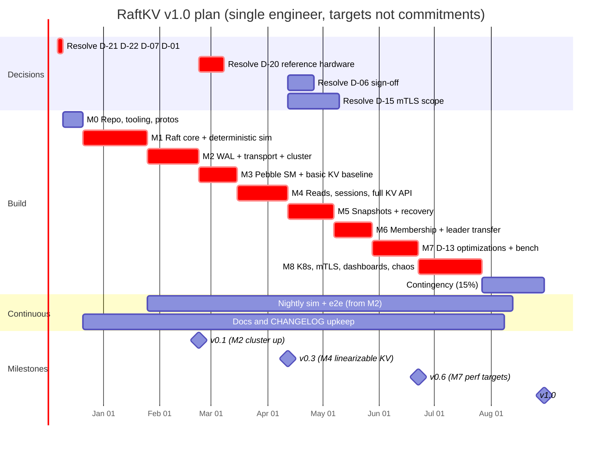
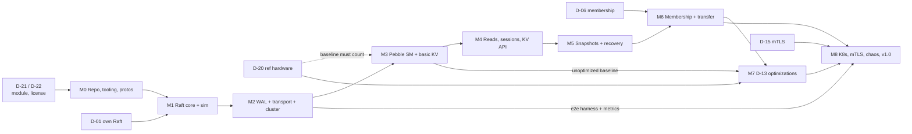

# Implementation Roadmap

This document turns the decisions in [design-decisions.md](design-decisions.md) into a sequence of milestones (M0–M8)
with testable exit criteria. The task-level breakdown is in [WBS.md](../WBS.md) at the repo root. Each WBS leaf is about
one day of work and points back to a milestone here.

Related documents: [architecture.md](architecture.md), [system-design.md](system-design.md),
[api-design.md](api-design.md), [storage-design.md](storage-design.md),
[testing-benchmarks.md](testing-benchmarks.md), [ci-e2e.md](ci-e2e.md).

> **Ground rules**
> 1. A milestone does not start until every `Open` decision it depends on is resolved and every `Proposed` decision it
>    depends on is signed off as `Decided` in `design-decisions.md` (the rule at the top of that file).
> 2. Every performance number here is a **target** from design-decisions.md "Performance targets". Nothing has been
>    measured. A result only counts if it was measured on the D-20 reference hardware and committed under `bench/results/`.
> 3. Exit criteria are pass/fail gates. A milestone is closed only when every exit criterion has a linked CI run or a
>    committed artifact, and the milestone's WBS section is fully ticked.
> 4. Effort is in **engineer-weeks for one engineer**, assuming focused work. A 15% contingency is added on top in the
>    schedule.

---

## 1. Milestone overview

| Milestone | Theme | Key decisions (must be Decided) | Blocking `Open` decisions | Effort (wk) |
|-----------|-------|----------------------------------|---------------------------|-------------|
| **M0** | Repo, tooling, proto skeleton | D-07, D-21, D-22 (D-01 recommended early) | **D-21, D-22** | 1.5 |
| **M1** | Raft core + deterministic simulation | D-01, D-08, D-18, D-24 | none | 5.0 |
| **M2** | WAL + gRPC transport + real multi-process cluster | D-03, D-12, D-17, D-19 | none | 4.0 |
| **M3** | Pebble state machine + basic KV (unoptimized baseline) | D-02, D-04 | **D-20** (needed to record a baseline that counts; see M3) | 3.0 |
| **M4** | Linearizable reads, client sessions, full KV API | D-05, D-09, D-10, D-11 | none | 4.0 |
| **M5** | Snapshots + follower recovery | D-14 | none | 3.5 |
| **M6** | Membership changes + leadership transfer | D-06, D-23 | none | 3.0 |
| **M7** | Write-path optimizations (D-13) + benchmarks | D-13 | **D-20** | 3.5 |
| **M8** | Kubernetes, mTLS, dashboards, chaos campaign, v1.0 hardening | D-16 | **D-15** | 5.0 |
| | | | **Total** | **32.5** (≈ 37.5 with 15% contingency) |

D-17 (observability) applies from M2 onward. D-18 and D-19 (correctness testing, CI) apply from M1/M2 onward. Every
later milestone adds tests to those harnesses and never removes any.

### Decision resolution schedule

| Decision | Status today | Must be resolved by | Why that early |
|----------|--------------|---------------------|----------------|
| D-21 Go version & module path | Open | Start of M0 | Module path is baked into every import and into the generated proto `go_package`. |
| D-22 License | Open | Start of M0 | LICENSE file and SPDX headers go in the first commit. |
| D-07 Single Raft group | Proposed | Start of M0 | Keeps the proto key space and API shard-agnostic from day one (no `range_id` fields that get retrofitted later). |
| D-01 Own Raft core | Proposed | Start of M0 (hard gate: M1) | Shapes the `Raft` peer proto service and the `internal/raft` interface written in M0. |
| D-20 Reference hardware | Open | **Before M3 exit** (hard gate: M7) | D-13's "≥ 30% p99 improvement vs the M3 baseline" only means something if the M3 baseline ran on the same hardware. |
| D-15 mTLS scope | Open | Before M6 exit (hard gate: M8) | TLS affects transport config and cert rotation design. Deciding late means rework in M8. |
| D-06 Single-server vs joint consensus | Proposed | Before M5 exit (hard gate: M6) | Joint consensus would add about 2 weeks to M6 and change the membership log-entry format. |

---

## 2. Gantt chart

Single engineer, sequential critical path. The start date is a placeholder (first Monday after kickoff). Durations are in
calendar days at 7 days per engineer-week, with contingency shown as its own bar.

---

## 3. Milestone dependency graph

Why the order is fixed:
- **M5 before M6.** A new learner (D-06) usually cannot catch up from the log alone once the log has been compacted. It
  needs snapshot install (D-14).
- **M6 before M7.** D-13 pipelining and parallel WAL write change the replication hot path. Doing them after membership
  is stable means the optimization PRs are benchmarked against a feature-complete path, and membership changes don't
  have to be re-validated against a moving target.
- **M3 baseline before M7.** D-13 requires each optimization to be measured on its own against the M3 unoptimized
  baseline.

---

## 4. Milestones

Every milestone has the same structure: **Goal, Scope, Deliverables, Dependencies, Entry criteria, Exit/acceptance
criteria, Risks & mitigations, Effort**. Exit criteria that need "N seeds" or "N ops" refer to harnesses defined in
[testing-benchmarks.md](testing-benchmarks.md). CI jobs are defined in [ci-e2e.md](ci-e2e.md).

### M0 — Repository, tooling, proto skeleton

**Goal.** A repository where any contributor can clone, run `make all`, and get lint, build, test, and proto generation
passing in CI. All later work lands into this structure.

**Scope**
- Go module (D-21), LICENSE (D-22), the directory layout from design-decisions.md "Planned repository layout".
- Makefile, golangci-lint config, `buf` (lint + breaking-change check), pre-commit hooks.
- Proto skeletons in `api/raftkv/v1/`: `kv.proto` (KV service, D-10 messages), `cluster.proto` (D-23), `raft.proto` (peer
  RPC: Append stream, Vote, PreVote, InstallSnapshot stream, TimeoutNow). Messages are defined, handlers are not.
- `pr.yml` GitHub Actions workflow (lint, build, unit, race) per [ci-e2e.md](ci-e2e.md).
- `CHANGELOG.md` (Keep a Changelog format), `memory.md` (running project memory: decisions taken, gotchas), `CONTRIBUTING.md`.

**Out of scope.** Any Raft logic, server binaries beyond a `main` that prints its version.

**Deliverables**
- `go.mod`, `Makefile`, `.golangci.yml`, `buf.yaml`, `buf.gen.yaml`, `.pre-commit-config.yaml`, `.github/workflows/pr.yml`.
- `api/raftkv/v1/{kv,cluster,raft}.proto` with generated code committed or generated in CI (choose in 0.3; see WBS).
- `cmd/raftkvd`, `cmd/raftkvctl`, `cmd/raftkv-bench` stubs that print a version stamped through `-ldflags`.

**Dependencies.** None.

**Entry criteria.** D-21 and D-22 resolved. D-07 and D-01 signed off (recommended, so the protos don't churn).

**Exit / acceptance criteria**
1. `make all` (fmt-check, lint, buf-lint, build, test) exits 0 on a clean clone on macOS and Linux.
2. `pr.yml` is green on the default branch and required by branch protection.
3. `buf breaking --against` the default branch runs in CI and fails a PR that deliberately renames a field (checked once by a throwaway PR).
4. `pre-commit run --all-files` passes and is documented in CONTRIBUTING.md.
5. `raftkvd --version` prints module version, git SHA, and Go version.

**Risks & mitigations**
- *Proto churn after M0.* Mitigation: `buf breaking` from day one, protos stay at `v1` with a "pre-1.0, may break"
  comment until M4 exit. After that, breaking changes need a design-decisions entry.
- *Tool version drift.* Mitigation: pin golangci-lint, buf, and protoc-gen-go versions in a `tools.go` / `go tool`
  directive and in CI.

**Effort.** 1.5 weeks.

---

### M1 — Raft core + deterministic simulation

**Goal.** A pure, deterministic Raft state machine (D-01: etcd/raft-style `Step`/`Tick`/`Ready`/`Advance`, no I/O) that
is shown correct under a deterministic simulator exploring message loss, reordering, duplication, partitions, and
crash/restart.

**Scope**
- Leader election with randomized timeouts and PreVote and CheckQuorum (D-08). Logical `Tick()` time (D-24).
- Log replication: AppendEntries consistency check, conflict resolution with fast backtracking (`reject_hint` term/index),
  commit rule (only commit entries from the current term by counting replicas), leader no-op on election.
- In-memory `Storage` interface (log + HardState) used by the core. WAL comes in M2.
- `Ready` struct: entries to persist, messages to send, committed entries to apply, HardState changes. `Advance()` contract.
- Proposal forwarding hook (or a "not leader" error carrying a leader hint), proposal drop when there is no leader.
- `Raft` interface so `go.etcd.io/raft/v3` could be swapped in (D-01).
- Deterministic simulator in `test/sim/`: seeded PRNG, virtual network, fault schedule, invariant checker.
- Invariants checked after every step: Election Safety, Log Matching, Leader Completeness, State Machine Safety,
  Leader Append-Only, plus "committed index never decreases" and "at most one leader per term".

**Out of scope.** Snapshots (stub `InstallSnapshot` handling only), membership changes, ReadIndex, durable storage.

**Deliverables**
- `internal/raft/` with ≥ 85% statement coverage.
- `test/sim/` simulator with a CLI: `go test ./test/sim -seeds=N -start=S`. Every failure prints a reproducible seed.
- Golden-trace tests for the canonical Raft paper figure scenarios (Figure 7 log divergence, Figure 8 commit hazard).
- `sim-long` job added to `nightly.yml` (see [ci-e2e.md](ci-e2e.md)).

**Dependencies.** M0.

**Entry criteria.** D-01, D-08, D-18 (simulation part), D-24 Decided.

**Exit / acceptance criteria**
1. Simulator passes **10,000 consecutive seeds with 0 invariant violations** at 5 nodes, with a fault mix including
   ≥ 10% message drop, reordering, duplication, random partitions, and crash/restart (in-memory state preserved for
   persisted fields only).
2. Failure replay is deterministic: running the same seed twice produces byte-identical event traces (checked by a test).
3. Figure 8 scenario test: an entry from a previous term is **not** committed by counting replicas alone.
4. Liveness check: with faults stopped, a leader is elected within 10 election timeouts in ≥ 99.9% of seeds, and all
   proposals submitted after healing commit.
5. PreVote test: a partitioned node that rejoins does not raise the cluster term (no disruptive election).
6. CheckQuorum test: a leader isolated from a majority steps down within one election timeout.
7. `go test -race ./internal/raft/...` is clean. Coverage ≥ 85%.
8. PR CI runs 500 seeds (≤ 3 min). Nightly runs ≥ 100,000 seeds.

**Risks & mitigations**
- *Subtle safety bugs in own Raft (D-01's stated cost).* Mitigation: invariant checker on every step, paper figure
  scenarios as tests, a review against the TLA+ spec rules (`raft.tla`) as a checklist, and optional differential
  testing against `etcd/raft` on the same message schedules (stretch goal).
- *Simulator not exploring enough.* Mitigation: measure coverage of rare branches (log conflict truncation, term bump on
  PreVote rejection) and make sure each is hit by ≥ 1% of seeds. Add targeted fault schedules where it isn't.
- *Effort overrun (core is the hardest part).* Mitigation: 5 weeks budgeted, the largest milestone after M8. If the
  week 4 checkpoint shows < 70% of WBS section 1 done, re-plan before starting M2.

**Effort.** 5.0 weeks.

---

### M2 — WAL + gRPC transport + real multi-process cluster

**Goal.** Five real `raftkvd` processes, each with a durable segmented WAL (D-03), replicating over gRPC bidirectional
streams (D-12), surviving process kills with no loss of committed entries. Metrics and traces are wired in (D-17). An
e2e harness with fault injection runs in PR CI (D-19).

**Scope**
- **WAL (D-03):** 64 MiB segments, record framing `[len|type|crc32c|payload]`, CRC32C per record, group-commit fsync,
  HardState and entries record types, torn-write detection on the tail (truncate a partial last record, fail hard on
  mid-segment corruption), segment preallocation, `fsync` of the directory on segment create/rename, truncation API for
  compaction (used in M5).
- **Transport (D-12):** one long-lived bidirectional `Append` stream per follower, bounded in-flight window, reconnect
  with exponential backoff and jitter, message size limits from D-11, Vote/PreVote as unary RPCs, peer address book from
  static config.
- **Node loop:** goroutine driving `Tick`/`Step`/`Ready`: persist (WAL) → send → apply → `Advance`, in that order. This
  is the unoptimized order. D-13 changes it in M7.
- **State machine:** temporary in-memory/no-op applier plus a debug-only `Propose` endpoint (behind a build tag) so the
  cluster can be tested before M3.
- **Observability (D-17):** `log/slog` JSON logs, Prometheus `/metrics`, OTel tracer provider with OTLP exporter, first
  metric set (see §6).
- **E2E harness:** `test/e2e/` docker-compose 5-node cluster, a fault-injection driver (kill -9, SIGSTOP/SIGCONT,
  iptables partition, `tc netem` latency/loss), `make e2e-short`.
- `pr.yml` gains the e2e-short job. `nightly.yml` gains e2e-long.

**Deliverables.** `internal/wal/`, `internal/transport/`, node loop in `internal/server/`, `deploy/compose/`,
`test/e2e/`, Dockerfile (distroless, non-root), configuration file plus flags plus env schema.

**Dependencies.** M1.

**Entry criteria.** D-03, D-12, D-17, D-19 Decided.

**Exit / acceptance criteria**
1. WAL crash tests: a fault-injecting filesystem shim truncates or corrupts at **every byte offset** of the last 2
   records across 1,000 randomized logs. Recovery either returns exactly the fsync-acknowledged prefix or fails with a
   typed corruption error. **0 cases of silently returning corrupted or unacknowledged data.**
2. Process-level durability: 1,000 iterations of "propose N entries, `kill -9` a random node (leader in ≥ 30% of
   iterations), restart": every entry acknowledged as committed is present on every node after restart.
3. 5-process cluster on docker-compose elects a leader within 3 s of start (p99 over 100 starts).
4. Leader kill: a new leader is elected and accepts proposals within **3 s** (p99 over 200 kills; election timeout
   1–2 s per D-08).
5. Partition test: a minority-side leader stops committing. The majority side elects a new leader. After heal, logs
   converge (Log Matching checked by a dump-and-compare tool).
6. `/metrics` exposes every metric listed for M2 in §6. Traces for propose→commit show up in a local Jaeger/Tempo
   (manual check plus an automated test that asserts spans in an in-memory exporter).
7. `e2e-short` (≤ 10 min) is green in PR CI. `e2e-long` (≥ 60 min of mixed faults) green 5 nights in a row.
8. Simulator still passes 10,000 seeds. The M1 core is unchanged or re-verified.

**Risks & mitigations**
- *fsync semantics differ on macOS (`F_FULLFSYNC`) vs Linux.* Mitigation: build-tagged `fsync` wrapper. Durability
  tests that count run on Linux CI only.
- *Docker networking makes partitions flaky.* Mitigation: run iptables inside each container's network namespace with
  `NET_ADMIN`. Every fault is logged with a timestamp next to the history so failures can be diagnosed.
- *Head-of-line blocking on a single stream (large entries).* Mitigation: in-flight window by bytes as well as count.
  Snapshot uses a separate stream (M5).

**Effort.** 4.0 weeks.

---

### M3 — Pebble state machine + basic KV (unoptimized baseline)

**Goal.** A working replicated KV store: `Put`, `Get`, `Delete` through the Raft log, applied to Pebble with exact
crash recovery (D-04). Record the **unoptimized performance baseline** that M7 is measured against.

**Scope**
- `internal/storage/`: Pebble opened with **its WAL disabled** (D-03). The Raft WAL is the source of truth. Applied
  entries plus `appliedIndex` are written in one Pebble batch (D-04).
- Recovery: on start, read `appliedIndex` from Pebble and replay WAL entries `(appliedIndex, commitIndex]`.
- **Flush/WAL-truncation coordination:** because Pebble's WAL is off, unflushed memtable state is lost on crash. The
  Raft WAL must not be truncated past the **durably flushed** applied index. Expose `DurableAppliedIndex()` (via a Pebble
  flush event listener) and gate WAL truncation on it. Details in [storage-design.md](storage-design.md).
- Key encoding with namespace prefixes (user data, sessions, raft metadata) so M4 can add a session table without
  migrating data.
- KV gRPC service: `Put`, `Get`, `Delete`. `Get` goes through the log in M3 (linearizable but slow). ReadIndex comes in M4.
- Follower → leader redirect: `NOT_LEADER` error with leader hint, client library retries.
- `raftkv-bench` load generator: closed-loop and open-loop modes, fixed value size, key distribution (uniform/zipf),
  HDR histogram output, JSON results.
- Porcupine history recorder plus a KV model in `test/linearizability/`, wired into e2e.
- `bench.yml` workflow (manual dispatch plus weekly) per [ci-e2e.md](ci-e2e.md).

**Deliverables.** Pebble state machine, KV service (3 RPCs), client library `pkg/client` (retry, leader cache),
`raftkv-bench`, linearizability recorder/checker, `bench/results/m3-baseline.json`.

**Dependencies.** M2.

**Entry criteria.** D-02 and D-04 Decided. **D-20 must be resolved before the baseline task (WBS 3.7)** so the baseline
is valid for the M7 comparison.

**Exit / acceptance criteria**
1. Crash-recovery test: 1,000 iterations of `kill -9` at random points during apply. After restart, the Pebble state
   equals a reference model built from the committed log (full-state hash compare). Torn applies: 0.
2. Truncation-safety test: force WAL truncation attempts while memtables are unflushed. Truncation never passes
   `DurableAppliedIndex`, and recovery after `kill -9` is exact.
3. **e2e linearizability check passes** (Porcupine, 0 violations) on ≥ 1M operations across ≥ 100 histories, under
   leader kill, follower kill, and partition faults.
4. Clients see **no acknowledged write lost** across 200 leader kills.
5. Baseline recorded on D-20 hardware: write throughput, p50/p99/p999 write latency, through-log read throughput for 256 B
   values, 5 nodes, fsync on. Committed as `bench/results/m3-baseline.json` with hardware fingerprint, git SHA, and
   config. **No target applies to the baseline.** It is the reference point.
6. `bench.yml` reproduces the baseline within ±10% across 3 runs (noise check). If it doesn't, fix noise before M7.

**Risks & mitigations**
- *Pebble-WAL-off durability gap (see Scope).* Mitigation: explicit `DurableAppliedIndex` contract, dedicated crash
  tests (exit criterion 2). Fallback: re-enable Pebble WAL with `Sync=false` and note the cost in design-decisions.
- *Porcupine checking time blows up on long histories.* Mitigation: partition histories by key (KV model is
  per-key-partitionable), cap per-history length (~10k ops), set a checker timeout, and treat a timeout as "unknown"
  (fails CI, re-run with shorter history), never as a pass.
- *D-20 not resolved in time.* Mitigation: run the baseline on interim hardware and mark it `provisional`. M7 cannot
  close until a baseline exists on the final D-20 hardware (re-run at the same git SHA, tag `m3-baseline`).

**Effort.** 3.0 weeks.

---

### M4 — Linearizable reads, client sessions, full KV API

**Goal.** Fast linearizable reads (ReadIndex default, optional lease, D-05), exactly-once writes via client sessions
(D-09), and the full v1 API (D-10) with enforced limits (D-11).

**Scope**
- **ReadIndex (D-05):** leader records `commitIndex`, confirms leadership with a heartbeat quorum round (batched across
  concurrent reads), waits for `appliedIndex ≥ readIndex`, then serves from Pebble. Requires the leader to have
  committed an entry in its current term first (the no-op from M1).
- **Follower reads:** follower asks leader for ReadIndex, waits for local apply, serves locally.
- **Lease reads (flag, off by default):** lease = election timeout minus `max_clock_drift`. Refuse to enable lease
  reads if `max_clock_drift` is unset. Lease is revoked on leadership transfer (M6 must honor this).
- **Stale reads:** `consistency=STALE` served locally with no guarantees. Response includes the applied index.
- **Sessions (D-09):** `RegisterClient` creates a session through the log. Writes carry `(client_id, sequence)`. The
  dedup table lives in Pebble under the session prefix and is updated in the same batch as the write. Cached responses
  are returned for duplicates. TTL 10 min, expiry driven by **leader-assigned timestamps inside log entries**
  (deterministic on all replicas, never local wall clock at apply time).
- **API (D-10):** `CompareAndSwap`, `Range` (prefix/range, limit ≤ 1,000, continuation token), plus everything from M3.
- **Limits (D-11):** key ≤ 4 KiB, value ≤ 1 MiB, entry batch ≤ 4 MiB, rejected with `INVALID_ARGUMENT` /
  `RESOURCE_EXHAUSTED` before proposing.
- gRPC error model and status details per [api-design.md](api-design.md). Deadlines propagated.
- `raftkvctl` client subcommands (`put/get/del/cas/range`).

**Deliverables.** Read path in `internal/server/`, session table in `internal/storage/`, full KV service, client library
with sessions plus automatic retry, Porcupine models for CAS and Range.

**Dependencies.** M3.

**Entry criteria.** D-05, D-09, D-10, D-11 Decided. The lease-read `max_clock_drift` default is agreed (see open
questions in §9).

**Exit / acceptance criteria**
1. **e2e linearizability check passes under leader kill, process pause (SIGSTOP), and partition** with reads at
   `LINEARIZABLE` (ReadIndex, on leader and on followers): ≥ 5M operations, ≥ 300 injected faults, **0 violations**.
2. Stale-leader test: a leader partitioned away (SIGSTOP or partition) never serves a ReadIndex read once a new leader
   exists. Checked by a targeted sim test plus an e2e test.
3. Lease reads: with the flag on and simulated clock drift within the configured bound, linearizability holds (sim plus
   e2e). With drift beyond the bound, the sim **finds** the violation (proves the test can detect it). Lease reads stay
   off by default.
4. Exactly-once: a fault-injected client that retries every write 1–3 times after random connection drops, over
   1M writes, results in each `(client_id, seq)` applied exactly once (counter-model check).
5. Session expiry is deterministic: replicas agree on the session table hash after 10,000 sim seeds with TTL crossing.
6. Every limit in D-11 has a boundary test (exact limit accepted, limit+1 rejected) on every RPC.
7. ReadIndex batching: under 64 concurrent readers, heartbeat rounds for reads ≤ 1 per heartbeat interval plus 1
   (asserted via metric).
8. API frozen: `buf breaking` is enforced as a required check against tag `v0.3.0` from here on.

**Risks & mitigations**
- *ReadIndex correctness right after an election* (serving before the leader commits in its term). Mitigation: explicit
  guard plus a sim test that elects and reads immediately.
- *Session table growth.* Mitigation: TTL eviction, a `raftkv_sessions_active` gauge, a cap on sessions (reject new
  registrations with `RESOURCE_EXHAUSTED`). The cap value is an open question.
- *Lease reads being unsafe under clock jumps.* Mitigation: monotonic clock for lease timing, off by default, documented
  operational requirements.

**Effort.** 4.0 weeks.

---

### M5 — Snapshots + follower recovery

**Goal.** Bounded disk use through log compaction, and the ability to bring a lagging or wiped follower back via
snapshot transfer (D-14).

**Scope**
- Snapshot creation: Pebble checkpoint (hard-linked SSTs) plus metadata `{index, term, membership, session table
  included}`. Trigger: every 100k entries or 512 MiB of WAL (D-14), configurable. Runs without blocking the apply loop
  beyond the checkpoint call.
- WAL compaction: truncate segments wholly below `min(snapshotIndex, DurableAppliedIndex)` minus a configurable
  retention tail for slow followers.
- Snapshot send: separate `InstallSnapshot` gRPC client stream, 1 MiB chunks, per-chunk CRC plus whole-snapshot
  checksum, **resume from last acknowledged offset**, bandwidth throttle, at most 1 concurrent send per follower.
- Snapshot install: stage to a temp directory, verify checksum, atomic swap of the Pebble directory (rename plus dir
  fsync), reset Raft log to the snapshot index, crash-safe at every step.
- Raft core: `InstallSnapshot` handling, `Progress` states (Probe/Replicate/Snapshot), sim support for snapshots.
- Retention of old snapshots (keep last 2), cleanup of orphaned temp directories on start.

**Deliverables.** `internal/snapshot/`, core snapshot support, WAL compaction, metrics, runbook section "follower wiped
disk" in [system-design.md](system-design.md) / operations docs.

**Dependencies.** M4 (the session table must be in the snapshot).

**Entry criteria.** D-14 Decided.

**Exit / acceptance criteria**
1. Sim passes **10,000 seeds with 0 invariant violations** with snapshots enabled (low threshold, e.g. 50 entries, so
   snapshots happen often) and crash points inside snapshot install.
2. Wiped-follower test: delete a follower's data directory, restart it. It catches up via snapshot plus log and its
   state hash matches the leader at the same applied index. Run 50 times, 100% pass.
3. Resume test: kill the sender or receiver mid-transfer at random chunk offsets (100 iterations). The transfer resumes
   from the last acked offset, no restart from zero when the snapshot is unchanged, final checksum matches.
4. Crash-during-install test: `kill -9` at each install step (staged, verified, swapped, log reset). The node always
   restarts into either the old state plus log or the new snapshot state, never a mix.
5. Disk bounded: a 2-hour sustained-write run keeps WAL disk use ≤ 2× (512 MiB + retention tail) per node (target).
6. e2e linearizability still passes (≥ 2M ops, faults include follower wipe), 0 violations.
7. Sessions survive snapshot: exactly-once test from M4 passes when the snapshot boundary falls between retries.

**Risks & mitigations**
- *Snapshot and apply race (checkpoint taken at a different index than the metadata says).* Mitigation: take the
  checkpoint on the apply goroutine between batches, so metadata index equals Pebble `appliedIndex` read from inside the
  checkpoint.
- *Large snapshot transfer starves replication.* Mitigation: separate stream, throttle, metric on replication lag
  during transfer.
- *Disk-full during snapshot.* Mitigation: pre-check free space ≥ 2× estimated size, fail the snapshot cleanly with a
  metric/alert. The disk-full fault is in the M8 chaos campaign.

**Effort.** 3.5 weeks.

---

### M6 — Membership changes + leadership transfer

**Goal.** Safe online cluster reconfiguration via learners plus single-server changes (D-06), leadership transfer via
`TimeoutNow`, all exposed through the `Cluster` admin service (D-23).

**Scope**
- Membership as a log entry type. A configuration takes effect **when appended** (dissertation §4.1), not when
  committed. Only one uncommitted config change at a time.
- Learners: receive replication, don't vote, not counted in quorum, no elections.
- Promotion guard: `PromoteLearner` refused unless the learner's match index is within a threshold of the leader's
  (configurable, default e.g. 1,000 entries or one snapshot).
- Removal of the current leader: the leader steps down after committing the config that removes it.
- Leadership transfer: leader stops accepting proposals, brings the target up to date, sends `TimeoutNow`, aborts after
  one election timeout. Lease (if enabled) is invalidated before transfer.
- `Cluster` service: `AddLearner`, `PromoteLearner`, `RemoveMember`, `TransferLeadership`, `ListMembers` (D-23).
  `raftkvctl member ...` subcommands.
- Persisted membership in snapshots (from M5) and WAL. Peer address book updates at runtime in transport.
- Graceful shutdown: on SIGTERM a leader transfers leadership first (needed for K8s rolling updates in M8).

**Deliverables.** Core membership support, Cluster service, transport dynamic peers, CLI, sim scenarios for
reconfiguration, runbook "replace a node", "scale 3→5".

**Dependencies.** M5.

**Entry criteria.** D-06 Decided (single-server confirmed **or** joint consensus chosen, in which case re-estimate M6
to about 5 weeks). D-23 Decided.

**Exit / acceptance criteria**
1. Sim: **10,000 seeds, 0 invariant violations** with random membership changes (add learner, promote, remove,
   including removing the leader) interleaved with crashes and partitions. Extra invariant: no two disjoint majorities
   exist across any pair of configurations that overlap in time.
2. Replace-a-node e2e: add learner → catch up via snapshot → promote → remove old node, under continuous load, with
   **0 linearizability violations** and no client-visible unavailability beyond one election (≤ 3 s target).
3. Scale 3 → 5 → 3 e2e under load, 20 iterations, 0 violations.
4. Leadership transfer: target becomes leader in ≤ 1 election timeout in ≥ 99% of 500 attempts on a healthy cluster.
   Failed transfers abort and the old leader resumes.
5. Rolling restart of all 5 nodes (graceful SIGTERM with transfer) under load: 0 violations, write unavailability per
   restart ≤ 1 s p99 (target).
6. Concurrent config change requests: the second is rejected with `FAILED_PRECONDITION` while the first is uncommitted.

**Risks & mitigations**
- *Single-server change bug (the dissertation's known bug, fixed by requiring the leader to commit an entry in its term
  before the first config change).* Mitigation: implement the fix explicitly plus a sim scenario reproducing the bug
  without the fix.
- *Removed node disrupts the cluster (keeps campaigning).* Mitigation: PreVote plus CheckQuorum (D-08). Removed nodes
  shut themselves down when they see their removal. Sim test.
- *Address book / DNS mismatch in K8s.* Mitigation: members identified by stable node ID, address is separate, mutable
  metadata.

**Effort.** 3.0 weeks.

---

### M7 — Performance optimizations (D-13) + benchmarks

**Goal.** Apply the D-13 write-path optimizations **one at a time**, measure each against the M3 baseline on D-20
hardware, and reach the performance targets.

**Scope (each item is a separate PR with its own benchmark result, per D-13)**
1. **Proposal batching:** coalesce concurrent proposals into one Raft entry batch (≤ 4 MiB, D-11), with a max-wait
   bound.
2. **Group-commit fsync:** one fsync covers all records appended since the last fsync (WAL already supports it from M2.
   Here the node loop actually batches across `Ready` iterations).
3. **Parallel leader WAL write** (dissertation §10.2.1): the leader sends AppendEntries before or while its own fsync
   happens. The leader counts itself toward quorum only after its fsync. Followers still persist before acking.
4. **Pipelined replication:** multiple in-flight AppendEntries per follower in Replicate state, bounded window by
   count and bytes, correct rollback to Probe on reject.
5. Read-path tuning: ReadIndex batching, Pebble block cache sizing, `Get` without allocations on the hot path.
6. Profiling pass: pprof CPU/alloc/mutex/block on the benchmark workload, fix the top 3 hotspots.

**Deliverables.** One PR per optimization with a before/after `bench/results/*.json` and a short write-up in
[testing-benchmarks.md](testing-benchmarks.md). Benchmark report `bench/results/m7-report.md` with hardware
fingerprint. `bench.yml` regression gate (fail if throughput drops > 10% or p99 rises > 15% vs last release on the
bench runner).

**Dependencies.** M3 baseline (on D-20 hardware), M6.

**Entry criteria.** **D-20 resolved** and the reference environment provisioned. D-13 Decided. M3 baseline exists on
D-20 hardware.

**Exit / acceptance criteria** (all on D-20 hardware, 5 nodes, 3-of-5 quorum, 256 B values, fsync on)
1. Sustained writes **≥ 38,000 ops/s** for ≥ 10 min (target from design-decisions.md).
2. Sustained linearizable reads (ReadIndex) **≥ 92,000 ops/s** for ≥ 10 min (target).
3. p99 write latency **≥ 30% lower** than the M3 baseline at the same offered load (target). The offered load is
   chosen as the baseline's max sustainable throughput at p99 under its SLO, recorded in the report.
4. Each D-13 optimization has its own measured delta (throughput, p50, p99) recorded. No optimization is merged without one.
5. Correctness is unchanged: sim 10,000 seeds, e2e linearizability ≥ 5M ops with faults, 0 violations, run **after**
   each optimization PR.
6. Results reproducible: 3 runs within ±10%.

If a target is missed, the milestone records the measured number honestly, opens a design-decisions entry with
analysis, and the decision to ship v1.0 below target is made explicitly. Numbers are never adjusted.

**Risks & mitigations**
- *Targets not reachable on the chosen hardware.* Mitigation: early smoke benchmark at M3. If the baseline is more than
  5× below target, flag it in M3 exit review, not at the end of M7.
- *Parallel WAL write breaks safety.* Mitigation: sim models the leader's self-ack only after persist. A dedicated
  invariant: an entry is never considered committed using the leader's vote before the leader's fsync completes.
- *Benchmark noise on cloud VMs.* Mitigation: dedicated hosts or same-placement-group VMs, CPU governor pinned, 3-run
  median, report variance.
- *Load generator bottleneck.* Mitigation: run `raftkv-bench` from ≥ 2 separate client machines and verify the client
  CPU is < 70%.

**Effort.** 3.5 weeks.

---

### M8 — Kubernetes, mTLS, dashboards, chaos campaign, v1.0 hardening

**Goal.** Production deployment on Kubernetes (D-16), mTLS per D-15, operator-grade observability, a long chaos
campaign that meets the correctness-validation target, and a v1.0 release.

**Scope**
- **K8s (D-16):** StatefulSet (5 replicas, `podManagementPolicy: Parallel` for initial bootstrap, `OrderedReady`
  considered for upgrades), headless Service for peer DNS, client Service, PVC per pod, PDB `maxUnavailable: 1`,
  anti-affinity across nodes/zones, readiness probe (has applied up to leader commit within a lag threshold), liveness
  probe (process loop alive, **not** "is leader"), `preStop` hook triggering leadership transfer (M6), resource
  requests/limits, ServiceMonitor. Kustomize base plus overlays (`kind`, `prod`). A Helm chart is optional, see open
  questions.
- **Bootstrap and recovery in K8s:** initial cluster from ordinal 0..4, a pod that rejoins with an existing PVC keeps its
  node ID, a pod with a lost PVC rejoins as a learner via the M6 runbook (automated or documented, see open questions).
- **Security (D-15, outcome-dependent):** if mTLS is optional or required, TLS 1.3 on client and peer gRPC, cert loading
  from files with hot reload, cert-manager `Certificate` manifests, peer identity check (SAN = node ID). AuthN/AuthZ
  stays deferred.
- **Observability:** Grafana dashboards (cluster overview, Raft internals, storage/WAL, client API), Prometheus alert
  rules (no leader, leader flapping, follower lag, WAL fsync p99, disk usage, snapshot failures), trace sampling config,
  log fields standard.
- **Chaos campaign:** Chaos Mesh on kind nightly (D-19) plus a long campaign on D-20 hardware or a real cluster:
  PodKill, PodFailure, NetworkChaos (partition, loss, delay), StressChaos, IOChaos (fsync latency, disk-full via fill),
  clock skew (TimeChaos, relevant if lease reads are tested).
- **Hardening:** fuzz tests (WAL decoder, proto handlers, snapshot chunk decoder) on the nightly run, `govulncheck`,
  container image scanning, SBOM, signed images, upgrade test (v0.x → v1.0 rolling), on-disk format version and
  compatibility statement.
- **Release:** `release.yml` (tag → build multi-arch images, binaries, checksums, SBOM, signatures, GitHub Release with
  CHANGELOG section) per [ci-e2e.md](ci-e2e.md).
- Docs: operations runbook, configuration reference, upgrade guide, final pass over all docs.

**Deliverables.** `deploy/k8s/`, `test/chaos/`, `deploy/grafana/`, `deploy/prometheus/rules/`, TLS support,
`release.yml`, v1.0.0 tag.

**Dependencies.** M6 (graceful transfer, membership), M7 (perf targets met or explicitly waived), M2 (e2e harness,
metrics).

**Entry criteria.** **D-15 resolved.** D-16 Decided.

**Exit / acceptance criteria**
1. `kubectl apply -k deploy/k8s/overlays/kind` brings up a 5-node cluster that passes the e2e smoke suite. Nightly on
   kind is green 7 nights in a row.
2. Rolling update of the StatefulSet under load: 0 linearizability violations, PDB respected, each pod transfers
   leadership on `preStop`.
3. **Correctness validation target met (cumulative across the chaos campaign): ≥ 40M operations checked, ≥ 1,500
   injected faults (leader kill, process kill/pause, partition), 0 linearizability violations.** Tracked in a committed
   ledger `test/chaos/ledger.csv` (date, git SHA, ops checked, faults by type, violations, link to CI run). Counts only
   come from the release-candidate code line (no fixes to Raft/storage after counting starts without restarting the
   count for affected fault types, see open questions).
4. Disk-full chaos: the node fails writes cleanly (no corruption), recovers after space is freed, and its state hash
   matches the cluster.
5. If mTLS is enabled per D-15: peer connection with an untrusted cert is rejected (test). Cert rotation without
   restart works (test). Clients without certs are rejected when `required`.
6. Dashboards import cleanly (JSON lint plus Grafana provisioning test in CI). Every alert rule has a unit test
   (`promtool test rules`).
7. `govulncheck` reports 0 known vulnerabilities in called code. Image scan reports 0 critical/high with an available fix.
8. Fuzzers run ≥ 1 CPU-hour each nightly with 0 open crashers.
9. v0.x → v1.0 rolling upgrade test passes on kind.
10. Definition of Done for v1.0 (§8) fully satisfied.

**Risks & mitigations**
- *40M-op / 1,500-fault target takes longer than the milestone.* Mitigation: start accumulating in the M4-onward
  nightly runs on frozen-subsystem code. Run the campaign in parallel with dashboard and docs work. Budget about 2
  calendar weeks of continuous chaos runtime (machine time, not engineer time).
- *K8s-specific liveness issues (DNS lag on pod restart, PVC attach delays).* Mitigation: transport retries with
  backoff and DNS re-resolution, tested via PodKill chaos.
- *Chaos Mesh on kind cannot do real disk-full or fsync faults.* Mitigation: IOChaos where supported, plus a dedicated
  e2e test with a size-limited tmpfs/loop device in docker-compose.

**Effort.** 5.0 weeks engineer time (+ about 2 weeks of overlapping machine time for the campaign).

---

## 5. Cross-cutting tracks

| Track | Starts | Rule |
|-------|--------|------|
| Deterministic simulation (D-18) | M1 | Every Raft-core change adds or extends a sim scenario. PR: 500 seeds. Nightly: ≥ 100k seeds. Failing seeds are committed as regression cases in `test/sim/regressions/`. |
| Linearizability checking (D-18) | M3 | Every new client-visible op gets a Porcupine model before its milestone exits. |
| Fault injection e2e (D-19) | M2 | `e2e-short` in PR, `e2e-long` nightly, Chaos Mesh on kind nightly from M8 (earlier if time allows). |
| Observability (D-17) | M2 | Each milestone adds the metrics listed for it in §6. A feature isn't done without its metrics. |
| Docs | M0 | Each milestone updates the affected design docs, `CHANGELOG.md` (Unreleased section), and `memory.md`. |
| Benchmarks | M3 | `bench.yml` runs weekly from M3 and on demand. Results committed only from the reference runner. |

---

## 6. Metrics introduced per milestone

All metrics are prefixed `raftkv_`. The full catalogue with labels and units lives in
[system-design.md](system-design.md) (observability section). This table only fixes **when** each group must exist.

| Milestone | Metrics |
|-----------|---------|
| M2 | `raft_term`, `raft_state` (0 follower/1 candidate/2 leader/3 learner), `raft_leader_changes_total`, `raft_commit_index`, `raft_applied_index`, `raft_proposals_total{result}`, `raft_elections_total{type=prevote,vote}`, `wal_fsync_duration_seconds` (histogram), `wal_append_bytes_total`, `wal_segments`, `transport_messages_sent_total{type,peer}`, `transport_send_failures_total{peer}`, `transport_stream_reconnects_total{peer}`, `transport_inflight{peer}`, `raft_follower_match_index{peer}` (leader only), standard gRPC server metrics, Go runtime/process metrics |
| M3 | `apply_duration_seconds`, `apply_batch_entries` (histogram), `storage_durable_applied_index`, Pebble metrics (compactions, L0 files, memtable size, block cache hit ratio), `kv_requests_total{method,code}`, `kv_request_duration_seconds{method}` |
| M4 | `read_index_duration_seconds`, `read_index_batch_size`, `read_requests_total{consistency}`, `lease_valid` (gauge), `sessions_active`, `session_duplicates_total`, `session_expired_total`, `requests_rejected_total{reason=limit}` |
| M5 | `snapshot_create_duration_seconds`, `snapshot_size_bytes`, `snapshot_send_bytes_total{peer}`, `snapshot_send_duration_seconds`, `snapshot_install_total{result}`, `snapshot_last_index`, `wal_truncated_segments_total`, `wal_disk_bytes` |
| M6 | `cluster_members{role=voter,learner}`, `config_changes_total{type,result}`, `leadership_transfers_total{result}`, `leadership_transfer_duration_seconds`, `learner_lag_entries{peer}` |
| M7 | `proposal_batch_size` (histogram), `proposal_batch_wait_seconds`, `wal_group_commit_records` (histogram), `transport_pipeline_depth{peer}` |
| M8 | `tls_cert_expiry_timestamp_seconds{kind}`, `tls_handshake_failures_total`, build info gauge `build_info{version,sha,go}` |

Traces (OTel): M2 `raft.propose` → `wal.append` → `wal.fsync` → `raft.commit` → `apply`. M3 adds `kv.Put/Get/Delete`
server spans with propagation from the client library. M4 adds `read_index.confirm` and `read_index.wait_apply`. M5 adds
`snapshot.create/send/install`.

---

## 7. Risk register

Likelihood (L) and impact (I) on a 1–3 scale. Score = L × I. Review at every milestone exit.

| ID | Risk | L | I | Score | Milestone | Mitigation | Trigger / early warning |
|----|------|---|---|-------|-----------|------------|-------------------------|
| R-01 | Safety bug in own Raft core reaches later milestones | 2 | 3 | 6 | M1–M6 | Invariant-checking sim (≥ 100k seeds nightly), paper-figure tests, TLA+ checklist review, optional differential test vs etcd/raft | Any sim or Porcupine violation. Stop-the-line: no feature work until root-caused |
| R-02 | Pebble WAL disabled leaves a durability gap between memtable and Raft WAL truncation | 2 | 3 | 6 | M3, M5 | `DurableAppliedIndex` gating truncation, crash tests at truncation points, fallback to Pebble WAL `Sync=false` | Crash-recovery hash mismatch |
| R-03 | D-20 hardware not chosen in time, making M3 baseline and M7 targets invalid | 2 | 3 | 6 | M3, M7 | Resolve D-20 before M3 exit, provisional baseline re-run at the same SHA | D-20 still Open at M2 exit |
| R-04 | Performance targets (38k w/s, 92k r/s, −30% p99) not reached | 2 | 2 | 4 | M7 | Early smoke bench at M3, per-optimization measurement, profiling pass, honest reporting plus explicit waiver | M3 baseline < 20% of target |
| R-05 | Porcupine checking does not scale to 40M ops | 2 | 2 | 4 | M3, M8 | Per-key partitioning, short histories, timeouts counted as failure, parallel checking | Checker p99 time per history > 60 s |
| R-06 | Chaos campaign (1,500 faults, 40M ops) takes longer than M8 | 3 | 2 | 6 | M8 | Start ledger in M4 nightly runs, automate campaign, run alongside docs/dashboards | Ledger < 50% at M8 midpoint |
| R-07 | Flaky e2e tests erode trust in CI | 3 | 2 | 6 | M2+ | Quarantine label with a 7-day fix SLA, record fault timeline with history, deterministic seeds for fault schedules | Flake rate > 2% of PR runs over a week |
| R-08 | Single-engineer bus factor / schedule overrun | 2 | 3 | 6 | All | 15% contingency, `memory.md` and design docs kept current, weekly WBS progress update | Milestone > 25% over estimate |
| R-09 | Lease reads unsafe under clock skew | 2 | 3 | 6 | M4, M8 | Off by default, required drift config, monotonic clock, TimeChaos tests | Any violation with lease on within configured drift |
| R-10 | Joint consensus becomes a requirement late (D-06) | 1 | 2 | 2 | M6 | Get D-06 signed off before M5 exit. Membership entry format versioned | Stakeholder request after M5 |
| R-11 | Proto/API churn after clients exist | 2 | 2 | 4 | M0–M4 | `buf breaking` from M0, API freeze at M4 exit | > 2 breaking proto PRs after M3 |
| R-12 | mTLS scope (D-15) decided late, causing transport rework | 2 | 2 | 4 | M8 | Transport takes `credentials.TransportCredentials` from M2 (insecure by default). Decide by M6 exit | D-15 Open at M6 exit |
| R-13 | K8s environment issues (DNS, PVC, PDB) cause availability gaps | 2 | 2 | 4 | M8 | Stable node IDs, DNS re-resolution, preStop transfer, kind nightly | Rolling-update unavailability > 3 s |
| R-14 | Dependency vulnerability or incompatible upgrade (gRPC, Pebble) | 2 | 1 | 2 | All | Renovate/Dependabot, govulncheck in PR CI, pinned versions | govulncheck finding |
| R-15 | Disk-full or slow-disk behavior corrupts state | 1 | 3 | 3 | M2, M5, M8 | Pre-checks, typed errors, fsync errors are fatal (no retry after fsync failure), IOChaos tests | Any fsync error path untested |

---

## 8. Definition of Done for v1.0

v1.0.0 is tagged only when **all** of the following hold, each backed by a linked artifact:

**Decisions & scope**
- [ ] Every D-xx in [design-decisions.md](design-decisions.md) is `Decided` (or explicitly deferred past v1 with a note). No `Open` items remain.
- [ ] M0–M8 exit criteria all met, WBS fully ticked (or remaining items moved to a `post-1.0` section with justification).

**Correctness**
- [ ] Deterministic sim: ≥ 100,000 seeds on the release SHA, 0 invariant violations, covering elections, replication, snapshots, membership, and leader transfer.
- [ ] Linearizability: **≥ 40M operations checked, ≥ 1,500 injected faults (leader kill, process kill/pause, partition), 0 violations** (ledger committed).
- [ ] Exactly-once write semantics verified under client retries (M4 test) on the release SHA.
- [ ] Crash recovery, WAL corruption, snapshot-install crash, and disk-full tests green on the release SHA.

**Performance** (on D-20 reference hardware, report committed)
- [ ] Writes ≥ 38,000 ops/s, linearizable reads ≥ 92,000 ops/s, p99 write latency ≥ 30% better than M3 baseline. **Or** a signed-off waiver entry in design-decisions.md with the measured numbers.
- [ ] Benchmark is reproducible from docs ([testing-benchmarks.md](testing-benchmarks.md)) by someone other than the author, within ±10%.

**Operability**
- [ ] K8s manifests deploy a 5-node cluster from scratch. Rolling update, node replacement, and scale 3↔5 runbooks have been executed and documented.
- [ ] Dashboards and alert rules shipped and tested. Every alert links to a runbook entry.
- [ ] Graceful shutdown transfers leadership. PDB respected.
- [ ] mTLS behaves per D-15. Cert rotation documented and tested (if in scope).

**Quality & supply chain**
- [ ] CI: `pr.yml`, `nightly.yml`, `bench.yml`, `release.yml` green. Nightly green 7 consecutive nights before tag.
- [ ] Unit coverage: `internal/raft` ≥ 85%, `internal/wal` ≥ 85%, overall ≥ 75%. Race detector clean.
- [ ] govulncheck clean. Image scan: 0 critical/high with available fix. SBOM and signed images and binaries published.
- [ ] On-disk format versioned (WAL, snapshot metadata, Pebble key schema) with a documented compatibility promise.
- [ ] Public API (`api/raftkv/v1`) frozen. `buf breaking` enforced against v1.0.0.

**Documentation**
- [ ] All docs in `docs/` reflect the shipped system. README quick start works from a clean machine.
- [ ] CHANGELOG.md has a complete `1.0.0` section. `memory.md` is current. Known limitations listed (single Raft group per D-07, no Watch/txn per D-10, no AuthZ per D-15).

---

## 9. Open questions raised by this roadmap

These are new questions that should be added to design-decisions.md as `D-25+` entries once triaged.

1. **Lease-read clock drift bound:** what default `max_clock_drift` (e.g. 100 ms?) and which time-sync requirement (chrony/NTP) is documented? Blocks M4 exit (lease part only).
2. **Session cap:** maximum concurrent client sessions before `RESOURCE_EXHAUSTED` (e.g. 100k?) and the memory/snapshot cost. Blocks M4.
3. **Chaos ledger counting rules:** does a fix to Raft/storage code during the M8 campaign reset the 40M/1,500 counters (fully, or only for affected fault types)? Blocks M8 start.
4. **Generated proto code:** committed to the repo or generated in CI only? Affects `go install` usability. Blocks M0.
5. **Lost-PVC rejoin in K8s:** automated (init container calls `AddLearner`/`RemoveMember`) or a manual runbook in v1? Blocks M8 design.
6. **Helm chart:** required for v1 or Kustomize only? Blocks M8 scope.
7. **Go version:** D-21 says ≥ 1.23. As of late 2026, pin to the current stable toolchain (1.25/1.26) instead? Blocks M0.
8. **Bench regression gate thresholds** (proposed −10% throughput / +15% p99): agree on values and whether the gate blocks merges or only alerts. Blocks M7.
9. **Release artifact signing:** cosign keyless (GitHub OIDC) acceptable? Container registry (GHCR under the D-21 owner)? Blocks M8 release work.
10. **Durability default:** is `fsync on` mandatory in all modes, or is an unsafe `--no-fsync` dev flag allowed (never in benchmarks)? Blocks M2.
