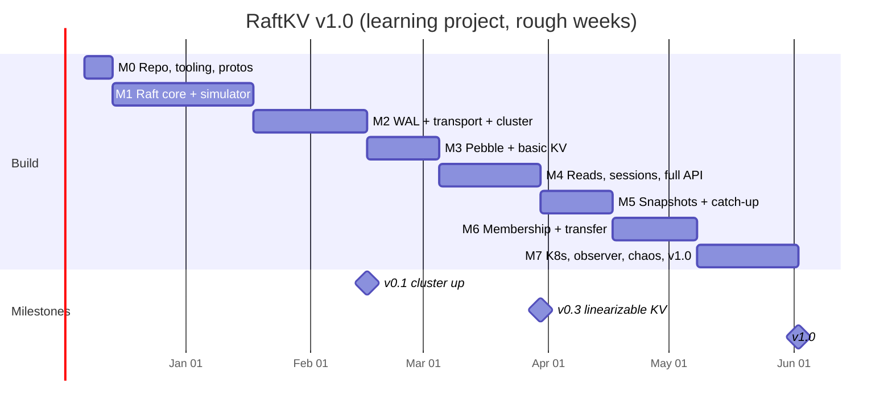
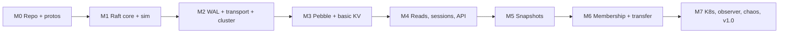

# Implementation Roadmap

RaftKV is a **learning project**: build Raft and a replicated key-value store from scratch, watch it survive failures,
and prove it correct. Speed is not a goal, so there are no performance targets anywhere in this plan.

This document splits the work into eight milestones (M0–M7). Each one has a goal, what you build, what you'll learn,
testable exit criteria, and a rough size in weeks. The task-level checklist is [WBS.md](../WBS.md) at the repo root.
Decisions are cited by ID from [design-decisions.md](design-decisions.md), which is binding.

Related: [architecture.md](architecture.md), [system-design.md](system-design.md), [api-design.md](api-design.md),
[storage-design.md](storage-design.md), [testing.md](testing.md), [ci-e2e.md](ci-e2e.md).

> **Ground rules**
> 1. A milestone is done when every exit criterion passes and has a linked CI run or committed artifact.
> 2. Correctness tests are never removed. Each milestone adds to the simulator, the e2e suite, and the
>    linearizability checks.
> 3. Weeks are rough, for one person working steadily. D-22 (license) is the only open decision, needed in M0.

---

## 1. Overview

| Milestone | Theme | Key decisions | Weeks |
|-----------|-------|---------------|-------|
| **M0** | Repo setup, tooling, protos | D-21, D-22, D-43 | 1 |
| **M1** | Raft core + deterministic simulator | D-01, D-08, D-18, D-24, D-35 | 5 |
| **M2** | WAL + gRPC transport + real 5-process cluster | D-03, D-12, D-17, D-19, D-29, D-33 | 4 |
| **M3** | Pebble state machine + basic KV | D-02, D-04, D-30 | 2.5 |
| **M4** | Linearizable reads, client sessions, full KV API | D-05, D-09, D-10, D-11, D-25–D-28, D-34 | 3.5 |
| **M5** | Snapshots + follower catch-up | D-14, D-30 | 2.5 |
| **M6** | Membership changes + leadership transfer | D-06, D-23, D-31, D-32, D-38 | 3 |
| **M7** | Kubernetes (kind), observer UI, chaos tests, v1.0 | D-16, D-46, D-47, D-48 | 3.5 |
| | | **Total** | **25** |

---

## 2. Schedule

Why this order:
- **M4 before M5.** The session table must be inside the snapshot.
- **M5 before M6.** A new learner usually can't catch up from the log alone once it has been compacted. It needs a
  snapshot.
- **M6 before M7.** Kubernetes rolling restarts rely on leadership transfer at shutdown.

---

## 3. Milestones

Exit criteria that mention seeds, histories, or faults use the harnesses described in [testing.md](testing.md). CI jobs
are in [ci-e2e.md](ci-e2e.md).

### M0 — Repo setup, tooling, protos (1 week)

**Goal.** Clone, run `make all`, and get lint, build, tests, and proto generation passing locally and in CI.

**What you build.** Go module (D-21) and license (D-22), the directory layout from design-decisions.md, Makefile,
golangci-lint, `buf`, `.proto` files for the KV, Cluster, and Raft services (messages only, no handlers), generated code
committed (D-43), `pr.yml`, `CHANGELOG.md`, `memory.md`, stub binaries.

**What you'll learn.**
- How to lay out a Go project and make protobuf part of the build.
- Why committed generated code needs a drift check in CI.

**Exit criteria**
1. `make all` passes on a clean clone.
2. `pr.yml` is green on `main`.
3. CI fails if the generated proto code is out of date (checked once with a throwaway change).
4. `raftkvd --version` prints the version and git SHA.

### M1 — Raft core + deterministic simulator (5 weeks)

**Goal.** A pure Raft state machine (D-01: `Tick`/`Step`/`Ready`/`Advance`, no I/O) shown to be correct by a
deterministic simulator that drops, delays, reorders, and duplicates messages, partitions nodes, and crashes them.

**What you build.** Leader election with PreVote and CheckQuorum (D-08) on a logical clock (D-24). Log replication with
the consistency check, conflict truncation, fast backtracking, and the current-term commit rule. Leader no-op on
election. In-memory storage. `test/sim/` with a seeded PRNG, virtual network, crash model, and an invariant checker
(Election Safety, Log Matching, Leader Completeness, Leader Append-Only, State Machine Safety). Paper Figure 7 and
Figure 8 tests. `nightly.yml` with a long sim run.

**What you'll learn.**
- Why each Raft rule exists. The Figure 8 test shows what goes wrong without the current-term commit rule.
- How deterministic simulation turns a rare race into a seed you can replay.

**Exit criteria**
1. Sim passes **10,000 seeds with 0 invariant violations** at 5 nodes, with drops, reordering, duplication, partitions,
   and crash/restart.
2. Running the same seed twice gives an identical trace.
3. Figure 8 test: an old-term entry is not committed by counting replicas alone.
4. After faults stop, a leader is elected and every new proposal commits (liveness check, all seeds).
5. PreVote test: a rejoining partitioned node does not raise the term. CheckQuorum test: an isolated leader steps down.
6. `go test -race ./internal/raft/...` is clean.

### M2 — WAL + gRPC transport + real 5-process cluster (4 weeks)

**Goal.** Five real `raftkvd` processes, each with a durable WAL (D-03), replicating over gRPC streams (D-12), that lose
no committed entries when killed.

**What you build.** Segmented WAL with CRC32C records, fsync, tail repair, and fail-on-corruption (D-33). gRPC peer
transport with one stream per follower, flow control (D-29), and reconnect with backoff. The node driver loop in
`internal/node` (D-35): persist, send, apply, advance. A temporary in-memory applier. Logs, metrics, and traces (D-17).
Dockerfile and a 5-node docker-compose cluster. An e2e harness with kill, pause, and partition faults, run in `pr.yml`
(D-19).

**What you'll learn.**
- What "durable" really means: fsync, directory fsync, and torn writes.
- How a pure state machine is wired to real disks and networks without losing determinism in the core.

**Exit criteria**
1. WAL crash test: corrupting or truncating the last records at every byte offset never returns bad or unacknowledged
   data. Recovery gives the synced prefix or a clear corruption error.
2. 200 rounds of "propose, `kill -9` a random node, restart": no committed entry is lost.
3. The compose cluster elects a leader on start, and elects a new one after the leader is killed.
4. Partition test: the minority side stops committing, and logs match after the partition heals.
5. `/metrics` shows term, leader, commit index, and fsync timing.
6. The short e2e job with faults is green in `pr.yml`. Sim still passes 10,000 seeds.

### M3 — Pebble state machine + basic KV (2.5 weeks)

**Goal.** A working replicated KV store: `Put`, `Get`, `Delete` go through the Raft log into Pebble (D-02) with exact
crash recovery.

**What you build.** Pebble with its own WAL off. `appliedIndex` written in the same batch as the data (D-04). Recovery
by replaying the WAL from `appliedIndex`. The WAL truncation rule (D-30): flush Pebble first, never trim past what is
durably applied. Key prefixes for data, sessions, and metadata. KV gRPC service (Get goes through the log for now).
A client library with leader hints and retry. `raftkvctl put/get/del`. The Porcupine history recorder and checker,
wired into e2e.

**What you'll learn.**
- Why the applied index must be written atomically with the data, and what breaks if it isn't.
- How a linearizability checker turns "it seems to work" into a yes/no answer.

**Exit criteria**
1. 500 rounds of `kill -9` during apply: after restart, the Pebble state hash equals a reference model built from the
   committed log.
2. Truncation-safety test: with unflushed memtables, the WAL is never trimmed past the durable applied index, and
   recovery is exact.
3. **e2e linearizability check passes** (Porcupine, 0 violations) under leader kill, follower kill, and partition.
4. No acknowledged write is lost across 100 leader kills.

### M4 — Linearizable reads, client sessions, full KV API (3.5 weeks)

**Goal.** Linearizable reads without writing to the log (ReadIndex, D-05), exactly-once writes (D-09), and the full API
(D-10) with limits (D-11).

**What you build.** ReadIndex on the leader and on followers, batched per heartbeat. Stale reads as an opt-in. Optional
lease reads, off by default (D-25). Sessions: `RegisterSession` (D-26), `(client_id, sequence)` dedup in the state
machine, expiry using leader-stamped time (D-27). Follower forwards writes to the leader (D-28). `CompareAndSwap` and
`Range` with pages (D-34). Limits and gRPC error codes per [api-design.md](api-design.md). `raftkvctl cas/range`.
Porcupine models for CAS and Range.

**What you'll learn.**
- Why a leader can't just read its own state: the stale-leader problem and how ReadIndex fixes it.
- How retries cause duplicate writes, and how a replicated dedup table stops them.

**Exit criteria**
1. **e2e linearizability check passes under leader kill, pause, and partition**, with linearizable reads served by the
   leader and by followers. 0 violations.
2. Stale-leader test: a partitioned old leader never serves a linearizable read once a new leader exists (sim and e2e).
3. A sim test with clock drift beyond the lease bound **finds** a violation (shows the check works). Lease reads stay off
   by default.
4. Exactly-once: a client that retries every write 1–3 times ends up with each `(client_id, seq)` applied exactly once.
5. Session expiry is deterministic: all replicas have the same session table hash across 10,000 sim seeds.
6. Every limit in D-11 has a boundary test (at the limit passes, one over fails).

### M5 — Snapshots + follower catch-up (2.5 weeks)

**Goal.** Keep disk use bounded with log compaction, and bring a lagging or wiped follower back with a snapshot (D-14).

**What you build.** Snapshot = Pebble checkpoint plus `{index, term, membership}`, taken every 100k entries (configurable).
WAL compaction under the D-30 rule. `InstallSnapshot` stream in 1 MiB chunks with a checksum. An interrupted transfer
just starts over. Install by staging to a temp directory and swapping atomically. Raft core support for sending and
receiving snapshots, plus sim support.

**What you'll learn.**
- How log compaction and snapshots work together, and why the truncation rule matters.
- How to make a multi-step on-disk swap crash-safe.

**Exit criteria**
1. Sim passes **10,000 seeds with 0 invariant violations** with a low snapshot threshold and crashes during install.
2. Wiped-follower test: delete a follower's data directory and restart it. It catches up and its state hash matches the
   leader. 20 runs, all pass.
3. `kill -9` at each install step always restarts into the old state or the new one, never a mix.
4. Under steady writes, the WAL stays bounded (old segments are deleted after snapshots).
5. e2e linearizability still passes with follower-wipe faults. Exactly-once holds across a snapshot boundary.

### M6 — Membership changes + leadership transfer (3 weeks)

**Goal.** Change the cluster online with learners and one-server-at-a-time changes (D-06), and move leadership on
purpose, all through the `Cluster` admin service (D-23).

**What you build.** Config-change log entries that take effect when appended (D-31). One pending change at a time,
and only after the leader commits in its term. Learners that replicate but don't vote. Leader removal. Removed nodes
ignored. Random never-reused member IDs (D-38). A node with an empty disk can't reuse its old ID (D-32).
`TransferLeadership` with `TimeoutNow`. Leader transfers on SIGTERM. Dynamic peers in the transport.
`raftkvctl member ...`.

**What you'll learn.**
- Why changing membership is the trickiest part of Raft, and the known single-server bug.
- How leadership transfer makes planned restarts nearly invisible to clients.

**Exit criteria**
1. Sim passes **10,000 seeds with 0 invariant violations** with random membership changes (including removing the
   leader) mixed with crashes and partitions.
2. Replace-a-node e2e (add learner, catch up, promote, remove old) under load: 0 linearizability violations.
3. Scale 3 → 5 → 3 under load: 0 violations.
4. Leadership transfer moves the leader to the target, and a failed transfer aborts cleanly.
5. A second config change while one is pending is rejected with `FAILED_PRECONDITION`.

### M7 — Kubernetes, observer UI, chaos tests, v1.0 (3.5 weeks)

**Goal.** Run the cluster on Kubernetes locally (kind), watch it live in the observer UI, break it with Chaos Mesh, and
tag v1.0.

**What you build.** StatefulSet (5 replicas), headless Service, PVC per pod, readiness and liveness probes (D-46),
`preStop` leadership transfer (D-16). The read-only observer `cmd/raftkv-observer` (D-48): polls `Cluster.Status`, shows
node cards and an event timeline over SSE. One simple Grafana dashboard. Chaos Mesh pod-kill and network faults on kind
(D-47) with the linearizability checker. The kind + chaos job in `nightly.yml`. A few fuzz tests. Docs and a README quick
start.

**What you'll learn.**
- How a stateful, quorum-based system maps onto StatefulSets, probes, and stable identity.
- What chaos testing finds that unit tests don't.

**Exit criteria**
1. `kubectl apply -k deploy/k8s/overlays/kind` brings up 5 nodes that pass the e2e smoke test.
2. Rolling restart of the StatefulSet under load: 0 linearizability violations, and each pod hands off leadership
   before it stops.
3. Chaos run on kind (pod kill, partition, delay, loss) with checked histories: 0 violations.
4. The observer shows all 5 nodes, and a leader kill appears in its timeline.
5. `nightly.yml` (long sim, long e2e, kind + chaos) is green 3 nights in a row.
6. The v1.0 Definition of Done (§5) is met.

---

## 4. Risks

| Risk | What to do about it |
|------|---------------------|
| A safety bug in our own Raft core | Invariant checker on every sim step, paper-figure tests. Any violation stops feature work until it's fixed. |
| Durability gap from Pebble's WAL being off | Follow the D-30 truncation rule and keep the M3/M5 crash tests in CI. |
| Flaky e2e tests | Log every injected fault with a timestamp, use seeded fault plans, never "retry until green" on a correctness failure. |
| Porcupine runs too slowly on long histories | Split histories by key, keep them short, and treat a checker timeout as a failure. |
| M1 takes longer than planned (it is the hardest part) | It is fine to stretch it. Don't start M2 until the 10,000-seed criterion passes. |
| Losing context between work sessions | Keep `memory.md` and `CHANGELOG.md` up to date at the end of every milestone. |

---

## 5. Definition of Done for v1.0

v1.0.0 is tagged when all of these hold, each with a link to a CI run or artifact:

- [ ] M0–M7 exit criteria all met, and WBS.md fully ticked (or leftover items moved to `post-1.0` with a reason).
- [ ] D-22 decided. No open decisions remain.
- [ ] Sim: 10,000+ seeds on the release commit with 0 invariant violations, covering elections, replication, snapshots,
      membership, and leadership transfer.
- [ ] Linearizability: e2e and kind chaos runs with leader kill, pause, and partition show 0 violations.
- [ ] Exactly-once writes verified under client retries.
- [ ] WAL corruption, crash recovery, and snapshot-install crash tests green.
- [ ] Runs on kind from scratch. Rolling restart, node replacement, and scale 3 ↔ 5 tried and written up.
- [ ] Observer UI works against compose and kind.
- [ ] `pr.yml` and `nightly.yml` green.
- [ ] Docs match what was built. README quick start works on a clean machine. Known limitations listed (one Raft
      group, no Watch or transactions, no TLS or auth).
- [ ] `CHANGELOG.md` has a `1.0.0` section. `memory.md` has a lessons-learned section.
