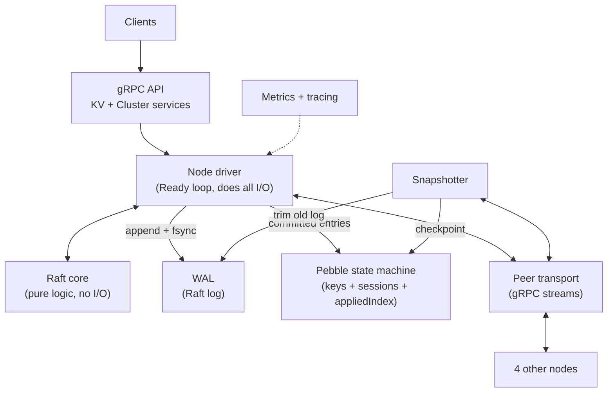
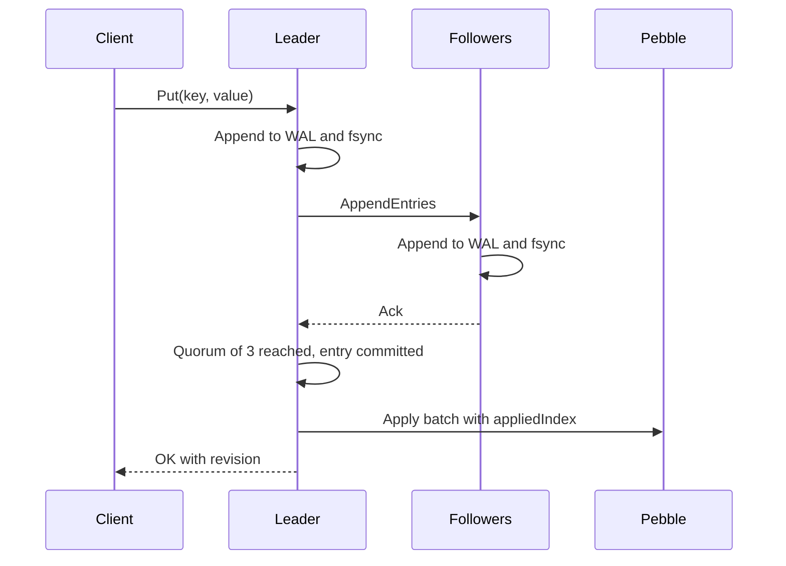
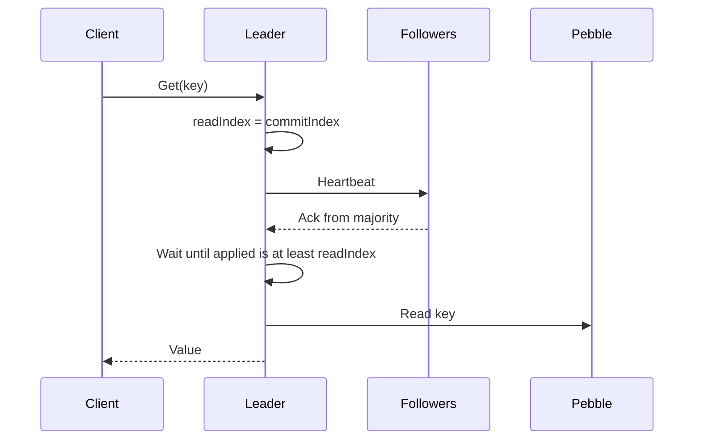
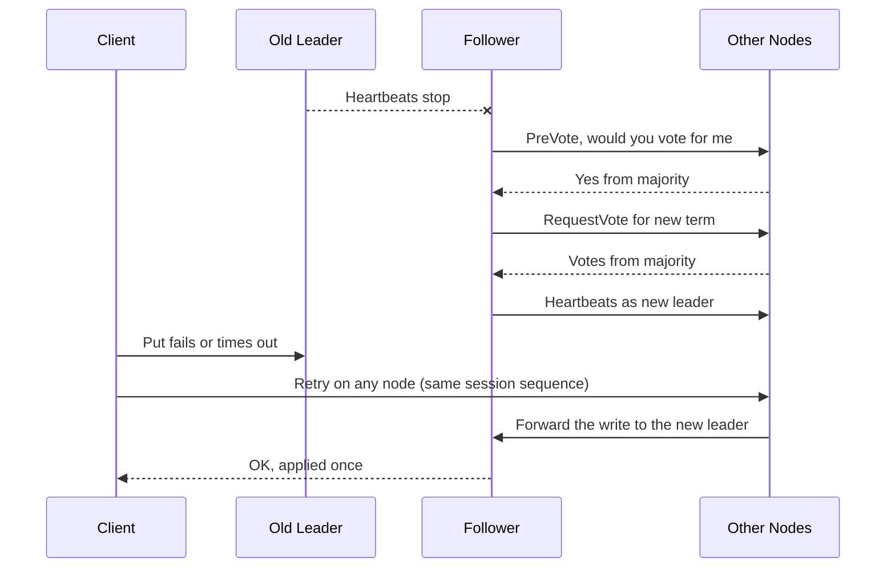
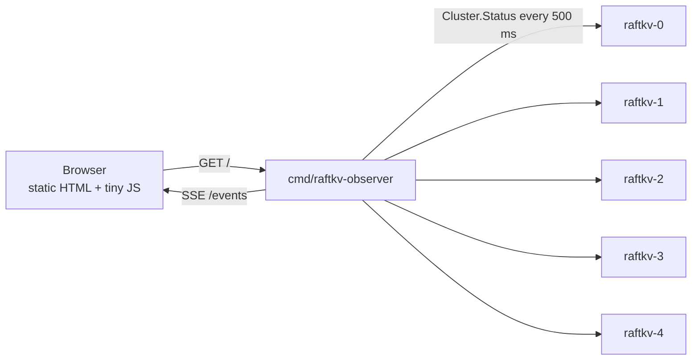

# RaftKV in 5 Minutes

A learning project: a key-value database with Raft built from scratch. It runs on **5 nodes** (all on your laptop), keeps working when **any 2 fail**, and never loses an acknowledged write or returns a stale read.
Status: **v1.0, built and tested** (milestones M0–M7). Speed is not a goal. Details live in the other files in [docs/](.).

**Contents:** [Features](#1-features) · [Architecture](#2-architecture) · [System Design](#3-system-design) · [Database](#4-database-design) · [Sequences](#5-sequence-design) · [Observer UI](#6-observer-frontend) · [E2E Testing](#7-simple-e2e-testing)

---

## 1. Features

- `Put`, `Get`, `Delete`, `CompareAndSwap`, `Range` over gRPC.
- Linearizable reads by default (ReadIndex); stale reads opt-in.
- Exactly-once retries via a `(client_id, seq)` session table.
- Automatic leader election (PreVote + CheckQuorum).
- Survives any 2 of 5 nodes failing, no acked writes lost.
- Snapshots so restarted or lagging nodes catch up.
- Online membership changes: add learner, promote, remove, transfer leader.
- Prometheus metrics, OpenTelemetry traces, structured logs.
- Runs on a laptop: docker-compose or Kubernetes (kind), one disk per node.
- Out of scope: sharding, transactions, `Watch`, auth, performance tuning.

## 2. Architecture



Requests enter through the gRPC API and reach the node driver. The Raft core only decides what should happen; the driver does the work: fsync to the WAL, send to peers, apply committed entries to Pebble. The snapshotter checkpoints Pebble so the old log can be trimmed.

**Topology:** 5 nodes as docker-compose containers or a 5-pod StatefulSet on kind. Any 2 can fail and 3 still form a quorum.

## 3. System Design

| Concern | How |
|---|---|
| Leader election | Randomized 1–2 s timeout, majority vote |
| Replication / commit | Committed once 3 of 5 nodes fsync it |
| Reads | Leader confirms it still leads, waits for apply, reads locally |
| Writes to followers | Forwarded to leader, or redirect hint |
| Snapshots | Pebble checkpoint every 100k entries, streamed in 1 MiB chunks |
| Crash recovery | Load snapshot, replay WAL after Pebble's `appliedIndex` |
| Membership | Join as learner, catch up, promote; one change at a time |
| Failure tolerance | 2 of 5 down: still serving. 3 down: stops, loses nothing |

**Key rules**

- Never trim the WAL past Pebble's flushed `appliedIndex`.
- The Raft core has no I/O, clocks, or goroutines, so tests are deterministic.
- Pause rather than return wrong answers: no quorum means `UNAVAILABLE`; fsync errors crash the node.
- An empty-disk node never rejoins under its old ID.


---

## 4. Database Design

Each node keeps two stores on one disk.

| Store | What it is | What it holds |
|---|---|---|
| **Raft WAL** | Append-only segment files, 64 MiB each, fsynced | The Raft log entries, votes and term (hard state), snapshot markers. This is the source of truth. |
| **Pebble** | The state machine, with Pebble's own WAL turned off | The current key-value data, plus `appliedIndex`, membership and client sessions. Can always be rebuilt by replaying the WAL. |

Pebble keys start with a one-byte prefix, so user keys can never clash with internal ones:

| Prefix | Holds | Example |
|---|---|---|
| `u` (0x75) | User keys and values | `u` + `user:42` |
| `m` (0x6D) | Metadata | `m/appliedIndex`, `m/appliedTerm`, `m/membership` |
| `s` (0x73) | Client sessions (for exactly-once writes) | `s` + client_id |
| `t` (0x74) | Session expiry index | `t` + last_active_ms + client_id |

```text
data/
├── IDENTITY           # node_id, cluster_id, incarnation
├── wal/
│   └── wal-<seq>-<firstIndex>.seg
├── sm/
│   ├── CURRENT        # points at the live Pebble dir
│   └── db-<index>/
└── snap/              # last 2 snapshots (Pebble checkpoints)
```

**Key rules:**
- `appliedIndex` is written in the **same Pebble batch** as the data it covers, so a crash never leaves one without the other.
- The WAL is trimmed only up to `min(snapshotIndex, durable appliedIndex)`. Anything Pebble hasn't flushed yet can still be replayed.
- A torn write at the very end of the WAL is cut off, which is safe because it was never acked. Corruption anywhere else means the node **refuses to start**.

## 5. Sequence Design


*A write is acked only after 3 of 5 nodes have it on disk.*


*ReadIndex proves the leader is still the leader before reading, without writing to the log.*


*PreVote stops a cut-off node from disrupting the cluster. Followers forward writes to the leader, and the session
sequence makes the retry apply only once.*


---

## 6. Observer Frontend

A read-only live view of Raft state: who leads, terms, elections, per-node commit/applied, lagging followers, snapshots, and nodes going up or down. Built for watching e2e and chaos runs as faults land (**D-48**).



```text
RaftKV Observer   cluster 7f3a   term 7   leader raftkv-2   ● live
+-----------+-----------+-----------+-----------+-----------+
| raftkv-0  | raftkv-1  | raftkv-2  | raftkv-3  | raftkv-4  |
| FOLLOWER  | FOLLOWER  | LEADER ★  | FOLLOWER  |   DOWN    |
| term 7    | term 7    | term 7    | term 7    | term 6    |
| commit    | commit    | commit    | commit    | last seen |
|  10482    |  10482    |  10482    |  10479    |  12s ago  |
| applied   | applied   | applied   | applied   |           |
|  10482    |  10481    |  10482    |  10471    |           |
| lag 0     | lag 1     | -         | lag 11 ⚠  | lag 1830  |
| snap 10000| snap 10000| snap 10000| snap 9000 | snap 8000 |
+-----------+-----------+-----------+-----------+-----------+
Writes/s  ▁▂▃▅▇▇▆▇▅▁▁▃▆▇   412/s (applied-index delta)
Events
 12:04:31  raftkv-4 unreachable
 12:04:33  term 6 -> 7, leader raftkv-0 -> raftkv-2
 12:04:40  raftkv-3 snapshot installed @ 9000
```

| Panel | Shows | Source |
|-------|-------|--------|
| Header | Cluster id, term, leader | `Cluster.Status` header, majority view |
| Node cards | Role, term, commit, applied, lag, snapshot index, alarms | Each node's `Status`; lag from the leader's `followers[].match_index` |
| Writes/s sparkline | Write throughput, last ~60 s | Delta of the leader's `applied_index` between polls |
| Event timeline | Elections, leader changes, snapshots, node up/down | The observer diffs successive polls (term, `leader_id`, `snapshot_index`, failed RPC) |

- **Read-only, polling only.** The observer calls nothing except `Cluster.Status`, polling at a fixed 500 ms (flag-configurable), and needs no server changes. Events are inferred by diffing polls, so very short blips (< 500 ms) can be missed. Grafana keeps metrics history and alerting; the observer gives a live, per-node picture of Raft state that dashboards built on scraped metrics show poorly.
- **One Go binary, no build step.** It embeds the page with `embed` and pushes snapshots over SSE. It runs as a 1-replica k8s Deployment and as a docker-compose service in the e2e stack.
- **No auth in v1.** It binds to localhost; reach it in k8s with
  `kubectl -n raftkv port-forward deploy/raftkv-observer 18080:8080`.
- **Running it.** `make cluster-up` starts it with the compose cluster at http://127.0.0.1:18080 (Grafana, with
  the provisioned "RaftKV overview" dashboard, at http://127.0.0.1:13000). Against any cluster:
  `raftkv-observer --endpoints=name=host:port,... --listen=127.0.0.1:18080 --interval=500ms`. `/api/state` returns
  the current view as JSON.
- **Lag and writes/s.** A node's lag is the leader's last log index minus that node's `match_index`. Writes/s is the
  leader's applied-index delta, so it also counts no-op entries and session registrations.


---

## 7. Simple E2E Testing

**Setup:** docker-compose starts 5 nodes. A test client records every op; the Porcupine checker confirms the history is linearizable.
It runs in GitHub Actions on every PR. The observer UI (section 6) runs in the same compose stack, so you can watch faults land.

| Scenario | Fault | Pass condition |
|---|---|---|
| Happy path | None | History linearizable, nodes match |
| Kill leader | `kill -9` on the leader | New leader, no acked write lost |
| Freeze a follower | `SIGSTOP`, then `SIGCONT` | Cluster serves; follower catches up |
| Network partition | Split 2 \| 3 | Majority serves, minority can't write, heals cleanly |
| Restart and catch up | Stop, then restart a node | Node catches up to leader |
| Add/remove node | Membership change under load | No lost writes, correct config |

**Commands:**
- `make e2e`: 5-node docker-compose e2e suite.
- `make sim SEEDS=1 SEED=… FAULTS=…`: replay one deterministic simulation.
- `make chaos-up && make chaos`: Chaos Mesh fault campaign on kind.

Nightly CI runs a longer kind + Chaos Mesh run. Pass = 0 linearizability violations; failing histories and seeds are saved for replay.
