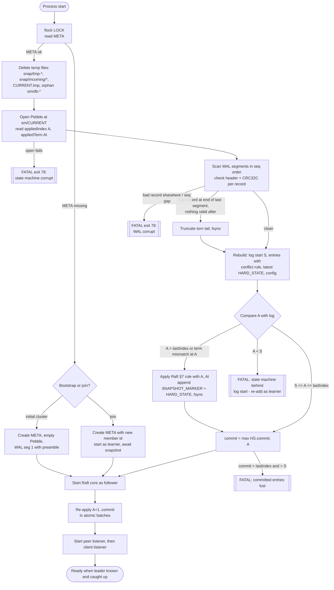

# RaftKV Storage Design

Builds on [design-decisions.md](design-decisions.md) (`D-xx`). Related: [architecture.md](architecture.md), [system-design.md](system-design.md), [api-design.md](api-design.md), [testing.md](testing.md).

Each member keeps three things on disk:

| Artifact | Role | Package | Decision |
|----------|------|---------|----------|
| **WAL** (segment files) | Source of truth for the Raft log and hard state | `internal/wal` | D-03 |
| **State machine** (Pebble, WAL off) | KV data + `appliedIndex` + membership + sessions | `internal/storage` | D-02, D-04 |
| **Snapshots** (Pebble checkpoints + metadata) | Log trimming, follower catch-up | `internal/snapshot` | D-14 |

**Durability rule in one sentence.** Everything Raft promises (votes, accepted entries, installed snapshots) is **fsynced to the WAL or snapshot files before the reply leaves the node**. Pebble needs no WAL of its own, because any Pebble state lost in a crash is rebuilt by re-applying WAL entries above the durable `appliedIndex` (D-03, D-04).

---

## 1. Write-ahead log (WAL)

### 1.1 Segments

- The WAL is a sequence of append-only **segment files** of up to 64 MiB (D-03). A full segment is sealed and never changed.
- **Naming:** `wal-<seq:016x>-<firstIndex:016x>.seg`. `seq` starts at 1 with no gaps. `firstIndex` is the first entry index the segment may hold. Sorting by name sorts by `seq`; a gap is fatal (§5).
- **Rotation**, when the next write would pass 64 MiB (a write is never split across segments):
  1. fsync the active segment (now sealed).
  2. Create the next segment, write its header and preamble (§1.4), fsync it.
  3. fsync the `wal/` directory so the new file is durable.

  A crash during rotation leaves either the old segment last, or a new segment with a torn preamble that the tail rule handles.

### 1.2 Segment header (64 bytes)

Little-endian.

| Offset | Size | Field | Description |
|--------|------|-------|-------------|
| 0 | 8 | `magic` | ASCII `RKVWAL01`: `RKVWAL` plus the format version as two digits (§10) |
| 8 | 8 | `seq` | must match the file name |
| 16 | 8 | `first_index` | must match the file name |
| 24 | 8 | `cluster_id` | must match `META` |
| 32 | 8 | `member_id` | must match `META` |
| 40 | 20 | `reserved` | zero |
| 60 | 4 | `header_crc` | CRC32C over bytes `[0, 60)` |

A header mismatch is corruption (§1.5).

### 1.3 Record format

Records start at offset 64 and are **8-byte aligned**.

| Offset | Size | Field | Description |
|--------|------|-------|-------------|
| 0 | 4 | `length` | payload length `L`. Must be ≤ 8 MiB; larger is corruption |
| 4 | 4 | `crc` | CRC32C over `length ‖ type ‖ reserved ‖ term ‖ index ‖ payload` |
| 8 | 1 | `type` | record type (§1.4). `0` is invalid |
| 9 | 3 | `reserved` | zero |
| 12 | 8 | `term` | Raft term (meaning depends on type) |
| 20 | 8 | `index` | Raft index (meaning depends on type) |
| 28 | `L` | `payload` | protobuf |
| 28+`L` | 0–7 | padding | zeros to the next 8-byte boundary |

The CRC covers `length`, so a flipped length bit is caught. `term` and `index` are in the fixed header, so recovery can scan without decoding protobuf.

### 1.4 Record types

| `type` | Name | `term` / `index` | Payload | Written when |
|--------|------|------------------|---------|--------------|
| 1 | `ENTRY` | entry term / index | `raftkv.v1.Entry` ([api-design.md](api-design.md) §8.1) | Each appended log entry |
| 2 | `HARD_STATE` | term / commit | `HardState{term, voted_for, commit}` | When term or vote changes, and with any Ready that advanced commit |
| 3 | `SNAPSHOT_MARKER` | snapshot term / index | 8-byte flags: bit 0 = reset (install). `config` joins with M6 | After a snapshot is installed (reset: drop every entry) or the log is trimmed (drop entries ≤ index) |
| 4 | `MEMBERSHIP` | config entry's term / index | `ClusterConfig` | In every segment preamble, so deleting old segments never loses the config |
| 5–255 | reserved | | | Unknown type is corruption, never skipped |

**Segment preamble.** Every new segment starts with `SNAPSHOT_MARKER` (current log start), `MEMBERSHIP` (latest config, M6), and `HARD_STATE`, written and fsynced together. Each segment describes itself, so older ones can be deleted. A preamble's log start may lie below the segment's first entry (the entries between were in segments since deleted); the trim marker written before that deletion closes the gap, and replay checks that the surviving log starts right after the final log start.

### 1.5 Writing a Ready

For each `Ready` the driver:

1. Encodes all new `ENTRY` records, plus a `HARD_STATE` record if term, vote, or commit changed, into one buffer.
2. Writes it to the active segment.
3. Calls **one fsync** for the whole buffer.
4. Only then sends replies that depend on it, and calls `Advance` (see [architecture.md §4.2](architecture.md#42-the-ready-loop)).

While one fsync runs, new work collects in the next Ready, so one fsync can cover many entries. There is no "fsync off" mode outside the simulator.

### 1.6 Torn writes and corruption

Each segment is read from offset 64. A record is bad if: fewer than 28 bytes remain or `28+L` runs past the file end; `length > 8 MiB` or an unknown `type`; the CRC does not match; or entry indexes/terms go backwards in an impossible way.

**Torn tail (recoverable)** only if **both** hold:

1. The bad record is in the **last** segment.
2. No valid record follows it in that segment.

Then the WAL truncates the file at the last good record, fsyncs, and logs how many bytes were dropped. This is safe: a torn record was never fsynced, so no ack, vote, or commit was based on it. The leader re-sends lost entries.

**Anything else is fatal corruption** (D-33): a bad record followed by valid ones, a bad sealed segment, a header mismatch, a `seq` gap. The node **refuses to start** (exit code 78) and logs the segment, offset, and reason. It never truncates silently, because that could drop entries it already acknowledged. Fix: remove the member, wipe its data, re-add it as a learner (D-06, D-32).

### 1.7 Log conflict truncation

When a follower gets entries that conflict with its suffix (same index, different term), it **does not rewrite old segments**. It appends the new entries to the active segment. On replay, an `ENTRY` with index `i` discards all earlier replayed entries with index ≥ `i`. Committed entries can never conflict (Log Matching), so replay asserts `i > commitIndex` and treats a violation as fatal.

### 1.8 Trimming the WAL after a snapshot (D-30)

Segments are deleted whole. Segment `s` may be deleted only when:

- `s.lastIndex ≤ min(snapshotIndex, durableAppliedIndex) − retain_entries`, where
  - `snapshotIndex` is the newest **complete, fsynced** local snapshot,
  - `durableAppliedIndex` is the `appliedIndex` that Pebble has **flushed to disk** (§2.4),
  - `retain_entries` (10,000) lets briefly lagging followers catch up from the log;
- `s` is not the active segment;
- the leader is not currently reading `s` to send entries.

Procedure:

1. `db.Flush()`, update `durableAppliedIndex`, compute the bound.
2. Write a `SNAPSHOT_MARKER` to the active segment and fsync.
3. Delete eligible segments in `seq` order.
4. fsync `wal/`.

A crash midway leaves a prefix deleted, which recovery accepts.

---

## 2. Hard state and apply durability

`HardState = {currentTerm, votedFor, commitIndex}` is stored as `HARD_STATE` records in the WAL; **the last valid one wins**. It goes in the same fsync as the entries of the same Ready, so there is no ordering problem between files.

### 2.1 What must be durable before which reply

| Event | Must be fsynced **before** | Why |
|-------|---------------------------|-----|
| Granting a vote | `HARD_STATE{term, votedFor=candidate}` | A voter that forgot its vote could vote twice, allowing two leaders |
| Any message carrying a **higher term** than persisted | `HARD_STATE{term, votedFor=0}` | The term must never go backwards after a restart |
| Becoming candidate | `HARD_STATE{term+1, votedFor=self}` before sending votes | Same |
| Append ack (`success=true`) | The appended `ENTRY` records and any term change | The leader counts this ack toward commit |
| Leader counting itself toward commit | Its own `ENTRY` records | Commit means durable on a majority |
| `InstallSnapshot` `installed=true` | Snapshot files + `sm/CURRENT` swap + `SNAPSHOT_MARKER` + `HARD_STATE` (§4.4) | The leader advances `match` to the snapshot index |
| PreVote grant or reject | **Nothing.** PreVote changes no state (D-08) | |
| Heartbeat with no entries or term change | Nothing | |
| Client write `OK` | Nothing extra. Already quorum-durable at commit | |
| Advancing `commitIndex` | Not required. Written lazily | Re-learned from the leader after restart |

### 2.2 Recovery checks

- `commitIndex ≤ lastLogIndex` (or `≤ snapshotIndex` if the log is empty). Otherwise entries were lost: fatal.
- If `durableAppliedIndex > commitIndex`, raise commit to it (only committed entries are ever applied).

### 2.3 Pebble with its WAL off (D-03, D-04)

- Pebble is opened with `DisableWAL = true`. Apply batches are committed without sync.
- Pebble state is durable **only after a memtable flush** (Pebble fsyncs SSTs and the MANIFEST then).
- After a crash Pebble reopens at the last flush. That state is consistent, because each batch carried its own `appliedIndex` (D-04). The node re-applies WAL entries `(durableAppliedIndex, commitIndex]`.

### 2.4 Critical rule: never trim past the durable appliedIndex (D-30)

> **INV-TRUNC:** `WAL.firstIndex − 1 ≤ min(snapshotIndex, durableAppliedIndex)` at all times, **on disk**.

If this breaks, a crash loses unflushed applies and the WAL entries needed to redo them are already gone. Recovery would find a gap (`A < S`). With Pebble's WAL off, this rule is what keeps applied state safe.

How it is enforced:

1. **`durableAppliedIndex` is only raised by things we control:**
   - at startup, to the `appliedIndex` Pebble opened with;
   - after our own synchronous `db.Flush()`: read the last applied batch's index `a` first, flush, then set `durableAppliedIndex = max(durableAppliedIndex, a)`.

   Pebble's background flushes are not counted. That is conservative and simple.
2. **Trimming computes its own bound.** It always does flush → update → compute → delete. `wal.Truncate(upTo)` asserts `upTo ≤ durableAppliedIndex` and `upTo ≤ snapshotIndex` and **panics** otherwise, so a caller bug cannot delete needed entries.
3. **Snapshot install** sets both values to the installed index. The installed Pebble dir is fully on disk.
4. **Backstop.** Recovery checks `A ≥ S` (§5 step 6). A violation is fatal and points straight at an INV-TRUNC bug.
5. **Tests.** The simulator and fault tests kill the process around flush and trim and assert recovery never hits `A < S` ([testing.md](testing.md)).

---

## 3. Pebble state machine

### 3.1 Key layout

A one-byte prefix separates namespaces. Client keys can never collide with internal keys, and `Range` only iterates inside `u`.

| Prefix | Namespace | Key | Value |
|--------|-----------|-----|-------|
| `0x6D` `'m'` | Internal metadata | `m` ‖ name | see below |
| `0x73` `'s'` | Sessions (D-09) | `s` ‖ client_id (8 B big-endian) | Session record, 24 bytes LE: `last_sequence`, `acked_sequence`, `last_active_unix_ms` |
| `0x73` `'s'` | Cached replies | `s` ‖ client_id ‖ sequence (8 B BE) | The reply for that sequence (kind, flags, index, value, previous). One key per reply, so a write never rewrites the other cached replies; dropped when `acked_sequence` passes it or the session expires |
| `0x74` `'t'` | Session expiry index | `t` ‖ last_active_unix_ms (8 B BE) ‖ client_id | empty. Lets apply expire old sessions by scanning in order |
| `0x75` `'u'` | **User keys** | `u` ‖ user key (1–4096 bytes) | value header + value |
| others | reserved | | never written |

**User value** (fixed header, so a `Get` needs no protobuf decode):

| Offset | Size | Field |
|--------|------|-------|
| 0 | 8 | `create_revision` (uint64 LE) |
| 8 | 8 | `mod_revision` (uint64 LE) |
| 16 | 8 | `version` (uint64 LE) |
| 24 | n | user value (0–1 MiB, D-11) |

**Metadata keys:**

| Key | Value | Updated |
|-----|-------|---------|
| `m/appliedIndex` | uint64 LE | **Every apply batch** (D-04) |
| `m/appliedTerm` | uint64 LE | Every apply batch |
| `m/sessionClock` | uint64 LE | When a command's leader-stamped time (D-27) is above it. The session "now": the max stamped time applied, so it never goes backwards across leaders |
| `m/membership` | `ClusterConfig` | In the batch of a conf-change entry |
| `m/removedMembers` | list of IDs | In the batch of a `REMOVE_MEMBER` (D-31, D-38) |
| `m/clusterID` | uint64 LE | Once, at bootstrap |
| `m/schemaVersion` | uint64 LE | Once, when the database is first opened; checked on every open (§10) |

`mod_revision` is the index of the entry being applied. A failed CAS still advances `appliedIndex` but changes no user key.

### 3.2 The atomic apply batch (D-04)

> **For each committed range `(a, b]` handed to the applier, one Pebble batch holds all user-key changes, session and
> expiry-index updates, any membership change for entries `a+1..b`, plus `m/appliedIndex = b` and `m/appliedTerm`.**

- Pebble never contains an entry's effects without the matching `appliedIndex`, or the reverse. Replay starts at `appliedIndex + 1`: no double apply, no gap. This is what keeps sessions exactly-once across crashes.
- Apply is **deterministic**: no local clock (session expiry uses the leader-stamped time, D-27), no map-order iteration, no randomness. An indexed batch gives read-your-writes inside the batch, which CAS and session lookups need.
- Any error building or committing the batch crashes the node (§6). A partial batch is never acknowledged.
- The applier may split a large range into several batches; each is complete with its own `appliedIndex`.

**Why Pebble's WAL is off (D-03).** The Raft WAL already makes every committed entry durable, and the atomic batch makes re-apply exact, so a second WAL adds nothing. The price is that Pebble's durable point lags, hence INV-TRUNC (§2.4) and replay of the unflushed tail (§5).

---

## 4. Snapshots (D-14)

### 4.1 Creation

Trigger: every 100k applied entries, or on demand when a follower needs one and none is recent enough.

1. The applier finishes its current batch.
2. `db.Flush()`. **Required**: with the WAL off, a checkpoint would not include unflushed memtable data.
3. `db.Checkpoint(snap/tmp-<index>-<term>/)`: hard-links SSTs and copies the MANIFEST. `snap/` and `sm/` must be on the same filesystem.
4. Open the checkpoint read-only and read `m/appliedIndex`, `m/appliedTerm`, `m/membership` **from it**. That avoids racing the live applier.
5. Compute each file's CRC32C and write `snapshot.meta` (`SnapshotMetadata`, [api-design.md](api-design.md) §8.1).
6. fsync every file, the directory, and `snap/`.
7. Rename to `snap/<index:016x>-<term:016x>`, fsync `snap/`. The snapshot now exists.
8. Update `snapshotIndex`. WAL trimming (§1.8) may run.

### 4.2 Streaming

- `Raft.InstallSnapshot` is a client stream: first the `SnapshotMetadata` with the file list, then `SnapshotChunk{file_index, offset, data ≤ 1 MiB, crc32c, last}` (D-14). Files go in list order, each from offset 0. A chunk never spans two files.
- The receiver checks each chunk's position (else `INVALID_ARGUMENT`) and CRC (else `DATA_LOSS`), aborts the stream on error, and writes into `snap/incoming/<index>-<term>/`. When a file completes, it checks the whole-file CRC.
- **No resume.** If the stream breaks, the receiver deletes the staging dir and the leader starts again from chunk 0 (D-14).
- The sender holds a reference on the snapshot during the transfer so GC skips it.

### 4.3 Layout

```
snap/
  0000000000186a00-0000000000000007/      # complete snapshot (index 0x186a00, term 7)
    snapshot.meta                          # SnapshotMetadata with file CRCs
    MANIFEST-000412                        # Pebble checkpoint
    000398.sst  000405.sst  ...
  tmp-.../                                 # in-progress creation (deleted on startup)
  incoming/<index>-<term>/                 # in-progress inbound transfer (deleted on startup)
```

### 4.4 Install (follower / learner)

After the `last=true` chunk with every file verified:

1. **Stale check.** If `last_included_index ≤ commitIndex`, reply `installed=true` without installing and delete staging.
2. Pause the applier and local reads (reads return `UNAVAILABLE`).
3. fsync the staging files and dir, `rename(snap/incoming/<id> → sm/db-<index:016x>)`, fsync `sm/`.
4. **Atomic swap.** Write `sm/CURRENT.tmp` with the new dir name, fsync, rename to `sm/CURRENT`, fsync `sm/`. **This rename is the commit point.**
5. Close the old Pebble, open the new one. Check `m/appliedIndex == last_included_index` and the cluster ID; mismatch is fatal.
6. Append `SNAPSHOT_MARKER{index, term, config}` and `HARD_STATE{commit = max(commit, index)}` to the WAL, fsync.
7. Reset the in-memory log: if the WAL has an entry at `index` with the snapshot's term, keep what follows (Raft §7); otherwise discard it all.
8. Reply `installed=true`. Resume apply and reads. Delete the old `sm/db-*` in the background.

**Crash windows:** before step 4 the old db is still live. Between steps 4 and 6, recovery sees `appliedIndex` ahead of the WAL's log start and writes the missing marker (§5 step 6). After step 6, done.

**As built (M5).** The core only asks for an install when the snapshot is above its commit index and its last entry is not in the log (otherwise it just moves commit, Raft §7), so step 7 always discards the whole log: the marker is written with the reset flag. Steps 3-5 and 8 are `snapshot.Manager.Install`; step 6 is `walstore.ApplySnapshot` followed by the Ready's single fsync, before the `MsgAppResp` acknowledging the snapshot is sent. The installed directory becomes the live database, so the node immediately takes a local snapshot (hard links) to serve others if it becomes leader. If recovery finishes an install (§5 step 6) it also raises the persisted term to the snapshot's term, clearing the vote, so the log never holds a term newer than `currentTerm`. Tests: `internal/snapshot` kills the install after each step and checks the restarted state is old or new; `internal/server` restarts a node whose `CURRENT` was swapped without a WAL marker.

### 4.5 Retention

- Keep the **2 newest** snapshots, unless an outgoing transfer holds a reference.
- On startup delete `snap/tmp-*`, `snap/incoming/*`, and any `sm/db-*` not named in `sm/CURRENT`.
- A fresh `sm/` starts as `sm/db-0000000000000000` with `CURRENT` pointing at it. A pre-M5 data directory (Pebble directly in `sm/`) is refused (`ErrLegacyStateDir`); wipe it and let the member catch up.

---

## 5. Crash recovery

1. **Lock and identity.** `flock(LOCK)` so two processes never share a data dir. Read and check `META` (`cluster_id`, `member_id`). If `META` is missing: bootstrap or join as configured, but an empty data dir **never** reuses a member ID that may have voted (D-32).
2. **Clean up** temp files (§4.5, `sm/CURRENT.tmp`).
3. **Open Pebble** at `sm/<CURRENT>`. Read `A = m/appliedIndex`, `At = m/appliedTerm`, `Cfg_sm = m/membership`. If Pebble cannot open, exit 78.
4. **Scan the WAL** in `seq` order, checking headers and CRCs:
   - `ENTRY`: apply the conflict rule (§1.7).
   - `HARD_STATE`: keep the latest.
   - `SNAPSHOT_MARKER`: set log start `(S, St)`, drop entries ≤ S.
   - `MEMBERSHIP`: set the base config.

   The torn-tail rule (§1.6) applies only to the last segment. Anything else is fatal.
5. **Derive the log.** `firstIndex = S + 1`; `lastIndex` = last surviving `ENTRY`; the config is the last conf-change entry in the log, otherwise the latest `MEMBERSHIP`; `HS` = latest `HARD_STATE`.
6. **Reconcile Pebble and the WAL.**
   - `A > lastIndex`, or the entry at `A` has a term other than `At`: a snapshot was installed but its marker is missing. Apply the Raft §7 rule with `(A, At)`, then append and fsync `SNAPSHOT_MARKER` + `HARD_STATE`.
   - `A < S`: entries `(A, S]` are gone. **Should be impossible** (INV-TRUNC). Fail-stop; re-add as a learner.
7. **Commit.** `commit = max(HS.commit, A)`. If `commit > max(lastIndex, S)`, committed entries were lost: fatal.
8. **Start the Raft core** as a follower with `HardState`, the log, the snapshot `(S, St)`, and the config.
9. **Re-apply** `(A, commit]` in atomic batches. Sessions make this exact.
10. **Serve.** Start the peer listener, then the client listener. Ready once the node knows a leader and has caught up (D-46).



---

## 6. Disk errors: fail-stop (D-33)

**Rule:** any error from fsync, a WAL write, a directory fsync, a Pebble batch commit, or a Pebble flush or compaction makes the process **log it and exit at once with code 75**. It never retries the fsync and sends no further replies. A full disk (`ENOSPC`) is handled the same way.

**Why: fsyncgate (2018).** PostgreSQL developers found that on Linux, after a failed writeback the kernel may report the error to one `fsync` caller and then mark the pages clean. A retried `fsync` then "succeeds" even though the data never reached disk. For RaftKV that would mean acknowledging votes or entries that are not durable, which breaks election safety (double votes) and durability (a "committed" entry on fewer than a quorum of disks). The only state we can trust after an I/O error is what a fresh process reads back from disk, so we exit and let recovery (§5) rebuild.

After exit, Kubernetes restarts the pod and recovery cuts any torn tail. If the disk keeps failing, the pod crash-loops; replace the volume and re-add the member as a learner. The cluster keeps working with 4 of 5 nodes.

Summary:

- fsync or write error, including disk full → crash.
- Torn last record → cut off during recovery.
- Corruption anywhere else → refuse to start.

---

## 7. Data directory layout

```
/var/lib/raftkv/                         # PVC mount (one per pod, D-16)
├── LOCK                                 # flock; one raftkvd per dir
├── META                                 # {cluster_id, member_id}; written once, CRC'd, fsynced
├── wal/
│   ├── wal-0000000000000027-00000000004a1c21.seg   # sealed
│   ├── wal-0000000000000028-00000000004b9e7f.seg   # sealed
│   └── wal-0000000000000029-00000000004c4b41.seg   # active
├── sm/
│   ├── CURRENT                          # name of the live Pebble dir (atomic-swap pointer)
│   └── db-0000000000186a00/             # live Pebble (DisableWAL=true, so no *.log files)
│       ├── MANIFEST-000412
│       └── 000398.sst  000405.sst  ...
└── snap/
    ├── 0000000000186a00-0000000000000007/   # newest snapshot
    ├── 0000000000124f80-0000000000000006/   # previous (keep 2)
    ├── tmp-*/                               # in-progress creation
    └── incoming/<index>-<term>/             # in-progress inbound transfer
```

`sm/` and `snap/` **must** be on the same filesystem (hard links and rename).

---

## 8. Storage failure scenarios

| # | Scenario | Detection | Handling | Outcome | Operator action |
|---|----------|-----------|----------|---------|-----------------|
| 1 | Power loss / `kill -9` mid-write | Bad record at the end of the last segment | Truncate torn tail (§1.6) | Safe: never acked | None |
| 2 | Crash during rotation | New segment with torn preamble | Torn-tail rule | Safe | None |
| 3 | Crash before Pebble flush | `appliedIndex` < commit | Re-apply `(A, commit]` from the WAL | Safe and exact (D-04) | None |
| 4 | Crash mid-snapshot creation | `snap/tmp-*` present | Deleted on startup | Safe; previous snapshot still valid | None |
| 5 | Crash mid-install, before `CURRENT` swap | Staging dir in `incoming/` | Deleted; old db stays live; leader resends | Safe | None |
| 6 | Crash after swap, before WAL marker | `A > lastIndex` or term mismatch at `A` | Reconcile (§5 step 6) | Safe | None |
| 7 | Corruption in a sealed segment | CRC mismatch not at the tail | **Refuse to start** (exit 78) | Node untrusted; cluster fine (3/5) | Remove member, wipe PVC, add as learner, promote |
| 8 | Pebble SST corruption | Pebble checksum error | Read returns `DATA_LOSS`, then fail-stop | Same as #7 | Same as #7 |
| 9 | fsync / write error, or disk full | Syscall error | **Crash** (exit 75), restart, recover | Safe: nothing acked after the error | If it repeats, replace the volume |
| 10 | PVC lost; pod restarts empty under the same name | `META` missing for an existing member | **Refuse to bootstrap** | Prevents vote amnesia | Remove old ID, re-add as learner (D-32) |
| 11 | Data dir from another cluster or member | `cluster_id`/`member_id` mismatch | Refuse to start | Prevents mixing logs | Fix the volume binding |
| 12 | Disk that lies about fsync | Undetectable locally | None | Raft safety breaks only if a **majority** lie | Out of scope |
| 13 | Two processes on one dir | `flock(LOCK)` fails | Second process exits | Safe | Fix the deployment |
| 14 | Data dir written by a newer (or older, incompatible) release | Unknown WAL, schema or snapshot format version (§10) | **Refuse to start** (exit 78) | Nothing misread | Run the release that wrote it |

---

## 9. Tradeoffs

### 9.1 Own WAL vs. Raft log in Pebble

| Aspect | Own segmented WAL (chosen, D-03) | Raft log as Pebble keys |
|--------|----------------------------------|-------------------------|
| Write path | One append + one fsync per Ready | Through Pebble's WAL, memtable, then flushed and compacted |
| Trimming | Delete whole segment files | `DeleteRange` tombstones and compaction work |
| Pebble WAL | Can be off (D-03) | Must stay on for the log |
| Log + hard state atomic | Same file, same fsync | Same Pebble batch |
| What you learn | Record framing, CRCs, torn writes, recovery | Little: Pebble does it |
| Risk | Bugs in our durability code, covered by D-18 fault tests and WAL fuzzing | Fewer custom bugs |

### 9.2 Pebble vs. RocksDB (D-02)

| Aspect | Pebble (chosen) | RocksDB (cgo) |
|--------|-----------------|---------------|
| Build | Pure Go, `-race` works everywhere | cgo plus a C++ toolchain; `-race` and pprof cannot see inside |
| Features | Batches, indexed batches, checkpoints, `DisableWAL` | Many more we would not use |
| Fit | Everything RaftKV needs | More moving parts |

### 9.3 Checkpoint vs. logical snapshot

| Aspect | Pebble checkpoint (chosen, D-14) | Logical dump (iterate all keys) |
|--------|----------------------------------|---------------------------------|
| Creation | Flush + hard links | Full scan of the data |
| Consistency | Point-in-time; `appliedIndex` read from the checkpoint | Needs an iterator snapshot held open |
| Install | Move files, swap `CURRENT` | Re-write every key |
| Coupling | Tied to Pebble's file format (all nodes run the same binary) | Independent of the engine |

---

## 10. On-disk format versions (WBS 7.5.2)

Every persistent structure carries a format version. A node that finds a version it does not read **refuses to start**
with exit code 78 and an error naming the version found and the version it reads (D-33 style: never guess at bytes).
Rolling back to an older binary over a newer data directory is therefore stopped at startup instead of misreading
data. There is no in-place upgrade path yet: every version below is 1, and a change to any layout must bump its
version and add a migration or a refusal test.

| Structure | Where the version lives | This build | On an unknown version |
|-----------|-------------------------|------------|-----------------------|
| WAL segment (and its records) | Last two bytes of the header magic: `RKVWAL01` (§1.2). Checked before the header CRC, since a newer layout may move it | `wal.SegmentFormatVersion` = 1 | `wal.ErrFormatVersion` (distinct from `wal.ErrCorrupt`: the data may be fine, the binary is wrong). A magic that is not `RKVWAL` + two digits is corruption |
| Pebble state machine | `m/schemaVersion` (uint64 LE, §3.1), written in the first open of an empty database and flushed at once | `storage.SchemaVersion` = 1 | `storage.ErrSchemaVersion`. A read-only open (`raftkvctl debug state-hash`, snapshot checks) of a database with no version is refused too |
| Snapshot | `format_version` in `snapshot.meta` (`SnapshotMetadata`, covered by its checksum) | `snapshot.FormatVersion` = 1 | `snapshot.ErrFormat`. At startup the snapshot is kept and the node refuses to start (a snapshot whose metadata is missing or fails its checksum is still deleted as a crash leftover, §4.5). A received snapshot of another version is rejected and the transfer aborted |
| Range page token | First byte of the token (api-design §3.1) | 1 | `INVALID_PAGE_TOKEN` (client error, not a startup check) |

Pebble's own file format (its "format major version") is managed by Pebble and ratcheted on open; RaftKV pins the
Pebble module version, so all members read the same files (§9.3).

The decoders for all of these, plus the WAL record framing, the command envelope and the state-machine records, are
fuzzed (`make fuzz`, nightly; [testing.md](testing.md)).
