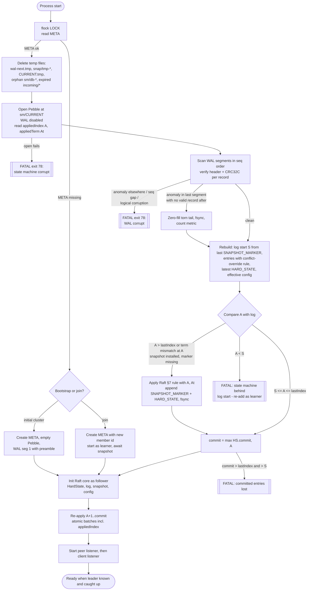

# RaftKV Storage Design

Status: Draft v0.1. This doc depends on [design-decisions.md](design-decisions.md), which is binding. Decision IDs (`D-xx`) are cited where this doc relies on them.
Related docs: [architecture.md](architecture.md), [system-design.md](system-design.md), [api-design.md](api-design.md), [testing-benchmarks.md](testing-benchmarks.md), [implementation-roadmap.md](implementation-roadmap.md), [WBS.md](WBS.md).

Each RaftKV member has three durable artifacts:

| Artifact | Role | Owner package | Decision |
|----------|------|---------------|----------|
| **WAL** (segmented files) | Source of truth for the Raft log and Raft hard state | `internal/wal` | D-03 |
| **State machine** (Pebble, WAL disabled) | Materialized KV state + `appliedIndex` + membership + sessions | `internal/storage` | D-02, D-04 |
| **Snapshots** (Pebble checkpoints + metadata) | Log compaction, follower catch-up | `internal/snapshot` | D-14 |

**Durability contract, in one sentence.** Everything Raft promises (votes, accepted entries, installed snapshots) is made durable by an **fsync of the WAL or the snapshot files before the corresponding RPC reply leaves the node**. Pebble never needs its own WAL, because any Pebble state lost in a crash can be rebuilt by re-applying WAL entries above the durable `appliedIndex` (D-03, D-04).

No performance numbers appear in this document. Every tunable value is a starting point to be benchmarked in M7 on the reference hardware (D-20, still Open). See [testing-benchmarks.md](testing-benchmarks.md).

---

## 1. Write-ahead log (WAL)

### 1.1 Segments

* The WAL is a sequence of **segment files**, each **preallocated to 64 MiB** with `fallocate(2)` (D-03). The logical size grows inside the preallocated extent, and the end of valid data is found by scanning (§1.6).
* Segments are append-only. A sealed segment is never modified. A segment's records may logically override records in earlier segments, for example when a conflicting suffix is replaced (§1.7).
* **Naming:** `wal-<seq:016x>-<firstIndex:016x>.seg`
  * `seq` is a monotonically increasing segment sequence number that starts at 1 and has no gaps.
  * `firstIndex` is the Raft index of the first `ENTRY` record the segment may contain, which is the WAL's `lastIndex + 1` at creation time.
  * Example: `wal-000000000000002a-00000000004c4b41.seg`.
  * Lexicographic order equals `seq` order. Recovery checks that `seq` values are contiguous, and a gap is fatal (§4).
* **Pre-creation.** A background goroutine always keeps the *next* segment ready as `wal-next.tmp`: preallocated, header written, and fsynced. That keeps `fallocate` and file creation off the commit path, and if the disk is full the failure shows up early (§6.1).
* **Rotation.** Rotation is triggered when the next record batch would push the active segment past 64 MiB. A single record batch is never split across segments. Steps:
  1. fsync the active segment. It is now sealed.
  2. `rename(wal-next.tmp → wal-<seq+1>-<firstIndex>.seg)`, after patching `firstIndex` and the header CRC in the header with `pwrite` and fsyncing.
  3. fsync the `wal/` directory, so the rename is durable.
  4. Write the **segment preamble** (§1.4) into the new segment.
  5. Ask the background goroutine to create the next `wal-next.tmp`.

  A crash at any point leaves either the old segment as last, with a stray `wal-next.tmp` that recovery deletes, or the new segment with a possibly empty or torn preamble, which tail-truncation handles.

### 1.2 Segment header (64 bytes, at offset 0)

All integers are little-endian.

| Offset | Size | Field | Description |
|--------|------|-------|-------------|
| 0 | 8 | `magic` | ASCII `RKVWAL01` |
| 8 | 4 | `format_version` | `1` |
| 12 | 4 | `flags` | reserved, `0` |
| 16 | 8 | `seq` | segment sequence number (must match file name) |
| 24 | 8 | `first_index` | must match file name |
| 32 | 8 | `cluster_id` | must match `META` |
| 40 | 8 | `member_id` | must match `META` |
| 48 | 12 | `reserved` | zero |
| 60 | 4 | `header_crc` | CRC32C over bytes `[0, 60)` |

Any header mismatch is treated as corruption (§1.6). A header mismatch in a stray `wal-next.tmp` just means the file is deleted.

### 1.3 Record format

Records start at offset 64 and are **8-byte aligned**.

| Offset (rel.) | Size | Field | Description |
|---------------|------|-------|-------------|
| 0 | 4 | `length` | `uint32` payload length in bytes (`L`). Must be ≤ `MaxRecordPayload` = 8 MiB (sanity cap > the 4 MiB batch limit in D-11). A larger value is corruption. |
| 4 | 4 | `crc` | CRC32C (Castagnoli, hardware-accelerated) over `length ‖ type ‖ flags ‖ reserved ‖ term ‖ index ‖ payload`, i.e. every record byte except this field and padding |
| 8 | 1 | `type` | Record type (§1.4). `0` is **invalid**, so a zero-filled preallocated region can never parse as a record. |
| 9 | 1 | `flags` | bit0 = `PAYLOAD_COMPRESSED` (reserved for future; must be 0 in format v1); others 0 |
| 10 | 2 | `reserved` | zero |
| 12 | 8 | `term` | Raft term (semantics per type) |
| 20 | 8 | `index` | Raft index (semantics per type) |
| 28 | `L` | `payload` | type-specific protobuf encoding |
| 28+`L` | 0–7 | `padding` | zero bytes up to the next 8-byte boundary |

The header is 28 bytes. Total record size is `align8(28 + L)`.

The `crc` covers `length`, so a bit flip in `length` is detected when the CRC check fails over the misread span. `term` and `index` live in the fixed header, which lets recovery and the conflict-truncation logic scan without decoding protobuf.

### 1.4 Record types

| `type` | Name | `term` / `index` header fields | Payload | Written when |
|--------|------|-------------------------------|---------|--------------|
| 1 | `ENTRY` | entry term / entry index | `raftkv.v1.Entry` ([api-design.md](api-design.md) §8.1) | Each log entry appended by the Raft `Ready` loop |
| 2 | `HARD_STATE` | `currentTerm` / `commitIndex` | `HardState{term, voted_for, commit}` | Whenever `term` or `voted_for` changes, and piggybacked whenever `commit` advanced in the same `Ready` (§2) |
| 3 | `SNAPSHOT_MARKER` | snapshot `last_included_term` / `last_included_index` | `SnapshotMarker{index, term, snapshot_id, config}` | After a snapshot is installed (§4.5), and after a local snapshot is taken and the log is compacted (§1.8) |
| 4 | `MEMBERSHIP` | `config_index`'s term / `config_index` | `raftkv.v1.ClusterConfig` | In every segment preamble. Membership is *also* carried by `ENTRY_CONF_CHANGE` entries. This record exists so that deleting old segments never loses the effective configuration (Raft uses the latest config in the log, committed or not, D-06). |
| 5 | `CRC_SEAL` | 0 / 0 | `{segment_seq, records, bytes}` | Last record of a sealed segment, optional. If present, it proves the segment ended cleanly. |
| 6–255 | reserved | | | An unknown type is fatal corruption, never skipped. |

**Segment preamble.** These are the first records of every new segment, written in one batch and fsynced with it: `SNAPSHOT_MARKER` (current log start), then `MEMBERSHIP` (latest config in the log), then `HARD_STATE` (current). Each segment is therefore **self-describing**, and all earlier segments can be deleted without losing state (§1.8).

### 1.5 Group commit and fsync policy (D-03, D-13)

The Raft core is a pure state machine (D-01). The node's **storage goroutine** handles each `Ready` as follows:

1. Encode all new `ENTRY` records, plus a `HARD_STATE` record if `term`, `vote` or `commit` changed, into one contiguous buffer.
2. Write it with one `write(2)` (or `pwritev`) to the active segment.
3. Call **one `fdatasync(2)`** for the whole buffer. fdatasync is sufficient because the file size and extent allocation do not change (preallocated). Writing into an unwritten extent still forces the extent-state metadata that fdatasync covers. On macOS dev boxes, `F_FULLFSYNC` is used, and macOS is not a production target.
4. Only after fdatasync returns: hand the persisted entries back to the Raft core (`Advance`). Responses that required durability (§2) are released.

**Natural batching.** While one fdatasync is in flight, new proposals and incoming `AppendEntries` keep accumulating in the next `Ready`. Under load, each fsync covers many entries automatically. Batch bounds:

| Knob | Starting value | Notes |
|------|----------------|-------|
| `wal.max_batch_bytes` | 4 MiB | Same as the Raft entry batch limit (D-11) |
| `wal.max_batch_entries` | 4,096 | Bound on per-batch work |
| `wal.group_commit_delay` | 0 (off) | Optional artificial wait (0–500 µs to be evaluated in M7) to grow batches at low concurrency. Off by default, because it adds latency at low load. |
| `wal.write_mode` | buffered + fdatasync | `O_DIRECT`/`O_DSYNC` variants to be evaluated in M7 as separate changes (D-13 rule: one optimization per change). |

**Leader parallel write (D-13, dissertation §10.2.1).** The leader may send `AppendEntries` for entries *before* its own fdatasync finishes. It counts **itself** toward the commit quorum only after its fdatasync completes. Followers always fsync before acking. Commit therefore always means "durable on a majority".

**Never ack before fsync.** There is no "fsync off" mode in production builds. A test-only `wal.unsafe_no_sync` flag exists for simulation (D-18). It is compiled out of release builds with a build tag.

### 1.6 Torn-write and corruption detection, tail truncation

Every segment is read sequentially from offset 64. For each position:

| Observation | Classification |
|-------------|----------------|
| `length == 0 && type == 0` and the rest of the segment (or at least the next 4 KiB page) is all zeros | **Clean end of data** |
| Fewer than 28 bytes remain, or `28+L` exceeds the remaining file | Truncated record |
| `length > MaxRecordPayload` or `type ∉ {1..5}` | Garbage header |
| CRC mismatch | Corrupt record |
| `ENTRY` index not equal to `prev_index + 1` and not ≤ `prev_index` (conflict rewrite, §1.7) | Logical corruption |
| `ENTRY` term lower than the previous `ENTRY` term at a higher index | Logical corruption |

**Tail-truncation rule (torn write).** An anomaly is a **recoverable torn tail** only if *all* of the following hold:

1. It is in the **last** segment (the highest `seq`).
2. No valid record exists after it in that segment. The scanner looks ahead at every 8-byte-aligned offset to the end of the preallocated extent or to a bounded lookahead of 4 MiB + 28 bytes (larger than any single batch), and finds no CRC-valid record.
3. It lies within the last unsynced write batch. Since we cannot know that exactly, condition 2 stands in for it: a torn write only affects the trailing batch.

When the rule applies, the WAL **zero-fills from the anomaly offset to the end of the segment**, fsyncs, and continues. Zero-filling, unlike `ftruncate`, keeps the preallocation. `raftkv_wal_tail_truncations_total` is incremented and the lost byte count is logged.

Losing these records is **safe**. A record in a torn tail was never fsynced, so no ack, vote or commit was ever based on it (§2). The leader will re-send any lost entries.

**Anything else is fatal corruption.** That covers a CRC failure in a sealed segment, a CRC failure followed by valid records, a header mismatch, a `seq` gap, and logical corruption. The node **refuses to start**: it exits with code `78` (EX_CONFIG-like "data corrupt") and logs the segment, offset, and reason. It must never truncate silently, because doing so could drop entries this node acknowledged and break the quorum durability guarantee. Recovery is an operator action. See the storage failure table (§7): remove the member, wipe its data, and re-add it as a learner (D-06).

### 1.7 Log conflict truncation

When a follower receives `AppendEntries` whose entries conflict with its own suffix (same index, different term), it **does not rewrite old segments**. It appends the new entries with their (lower) indexes to the active segment. On replay, an `ENTRY` with index `i` **discards all previously replayed entries with index ≥ i**. The in-memory log and the replay logic both apply this rule. Committed entries can never be conflict-truncated, by Raft's Log Matching property. Replay asserts `i > commitIndex` from the latest `HARD_STATE` seen so far, and a violation is fatal.

### 1.8 WAL truncation after snapshot

Segments are deleted whole, never partially. A segment `s` may be deleted when **all** of these hold:

* `s.lastIndex ≤ truncateIndex`, where
  `truncateIndex = min(snapshotIndex, durableAppliedIndex) − retain_entries`, and
  * `snapshotIndex` is the index of the newest **complete, fsynced** local snapshot (§4).
  * `durableAppliedIndex` is the `appliedIndex` that is durable in Pebble, i.e. as of the last completed Pebble flush (§2.3). Because Pebble runs without a WAL, unflushed applies are lost on crash and must be replayable from the WAL.
  * `retain_entries` is a catch-up buffer (starting value 50,000 entries) that lets briefly lagging followers catch up with `AppendEntries` instead of a full snapshot.
* `s` is not the active segment. Later segments carry a preamble, so state is never lost.
* The leader is not currently streaming entries from `s` to a follower. A reference count is held by the replication reader, and deletion is deferred until it drops.

The `durableAppliedIndex` term is the **critical invariant INV-TRUNC**. §2.4 specifies how it is tracked and enforced: a synchronous Pebble `Flush()` is made immediately before every truncation, and a bound assertion inside the WAL API fail-stops on violation.

Procedure:

0. `db.Flush()`, credit `durableAppliedIndex`, and compute `truncateIndex` (§2.4).
1. Write a `SNAPSHOT_MARKER{index = snapshotIndex}` to the active segment and fsync.
2. `unlink` the eligible segments in ascending `seq` order.
3. fsync `wal/`.

A crash midway leaves a prefix of segments deleted. Recovery tolerates a missing *prefix* and treats it as a `seq` gap only if it is not at the start.

The snapshot trigger is every 100k entries or 512 MiB of WAL, whichever comes first (D-14).

---

## 2. Raft hard state persistence

`HardState = {currentTerm, votedFor, commitIndex}` is stored as `HARD_STATE` records in the WAL, and the **last valid one wins**. It is written in the same fdatasync batch as the entries of the same `Ready`. Since there is no separate file, there is no ordering problem between files.

### 2.1 What must be durable before which reply

| Event / RPC | Must be fsynced **before** the reply or action | Why |
|-------------|------------------------------------------------|-----|
| Granting `RequestVote` (real vote) | `HARD_STATE{term, votedFor=candidate}` | If a voter crashed and forgot its vote, it could vote twice in one term, which allows two leaders. |
| Any reply or message carrying a **higher term** than previously persisted (vote reject, AppendEntries reject, heartbeat response) | `HARD_STATE{term, votedFor=0}` | The term must never go backwards after restart, or stale leaders could be accepted. |
| Becoming candidate (incrementing term, voting for self) | `HARD_STATE{term+1, votedFor=self}` before sending `RequestVote` | Same as above |
| `AppendEntries` `success=true` | All appended `ENTRY` records (and any term change) | The leader counts this ack toward commit. Commit requires a durable majority. |
| Leader counting itself in the commit quorum | Its own `ENTRY` records | Same as above (D-13 parallel write) |
| `InstallSnapshot` `installed=true` | Snapshot files + `sm/CURRENT` swap + WAL `SNAPSHOT_MARKER` + `HARD_STATE{commit ≥ snapshot index}` (§4.5) | The leader advances `matchIndex` to the snapshot index |
| `SnapshotProgress` offset | The staging file data up to that offset | The resume point must not be ahead of durable data |
| **Pre-vote** (grant or reject) | **Nothing.** PreVote must not change term or vote (D-08). | |
| `TimeoutNow` | Nothing. The resulting candidacy follows the "becoming candidate" row. | |
| Heartbeat with no entries and no term change | Nothing | |
| Client write `OK` | Nothing additional. The entry is already quorum-durable at commit. The leader's Pebble apply is `NoSync` (§2.3). | |
| Advancing `commitIndex` | **Not required** before anything. It is written lazily in the next batch. | After a restart commit is re-learned from the leader. Locally it is recovered as `max(persisted commit, durableAppliedIndex)`. |

### 2.2 Invariants checked on recovery

* `commitIndex ≤ lastLogIndex`, or `commitIndex ≤ snapshotIndex` when the log is empty. A violation means entries were lost, which is fatal.
* `durableAppliedIndex ≤ commitIndex` after recovery. If it is greater, recovery raises commit to it, since an index can only have been applied if it was committed.
* `votedFor` refers to a member in some known config, or is 0.

### 2.3 Apply durability: Pebble with WAL disabled (D-03, D-04)

* Pebble is opened with `DisableWAL = true`. Every apply batch is committed with `pebble.NoSync`.
* Pebble state becomes durable **only when a memtable flush completes**. Pebble fsyncs the sstables and the MANIFEST during flush and compaction.
* After a crash, Pebble reopens at the state of the last completed flush. That state is internally consistent, because every batch carried its own `appliedIndex` and was atomic (D-04). The node re-applies WAL entries `(durableAppliedIndex, commitIndex]`.
* Recovery time grows with the amount of unflushed state, so it is bounded by memtable size and an explicit **periodic flush** (`storage.flush_every_entries`, starting value 100,000, aligned with the D-14 snapshot cadence).

### 2.4 Critical invariant: WAL truncation never passes the durable appliedIndex

> **INV-TRUNC:** `WAL.firstIndex − 1 ≤ min(snapshotIndex, durableAppliedIndex)` at all times, **on disk**.

If this is violated, a crash loses applied-but-unflushed memtable state, and the entries needed to rebuild it are already gone from the WAL. Recovery would find `A < S`, a gap in the log, and the node could only be recovered by a full re-sync. Because Pebble's WAL is disabled (D-03), this invariant replaces the guarantee Pebble's WAL would otherwise give.

How it is enforced:

1. **`durableAppliedIndex` is tracked conservatively.** It is a monotonic in-memory value, credited **only** by two things:
   * **Startup:** the value is set to `m/appliedIndex` read right after Pebble opens. Whatever Pebble opened with is durable by definition.
   * **An explicit synchronous `db.Flush()` made by RaftKV itself:** before the call, read `a = lastCommittedApplyBatch.appliedIndex` in memory. Pebble's `Flush()` returns only after every memtable that existed at call time, which includes every batch committed before the call, has been written to sstables and the MANIFEST synced. After it returns, set `durableAppliedIndex = max(durableAppliedIndex, a)`.

   A snapshot creation (§4.1 step 2) is one such flush. Pebble's own background flushes are **not** credited. Mapping a background `FlushEnd` event to an exact `appliedIndex` would mean intercepting memtable rotation. That is possible, but it is an optimization deferred to M7, and it must be proven in the simulator first.
2. **The truncation routine computes its bound itself.** Truncation runs on the snapshot/compaction goroutine and always does `Flush()` → credit → compute `truncateIndex = min(snapshotIndex, durableAppliedIndex) − retain_entries` → delete segments (§1.8). The WAL's `Truncate(upTo)` API takes the durable bound as a required argument. It asserts `upTo ≤ durableAppliedIndex` and `upTo ≤ snapshotIndex`, and **panics (fail-stop) if either is violated**. That way a caller bug cannot silently delete needed entries.
3. **Snapshot install** sets both `snapshotIndex` and `durableAppliedIndex` to the installed index. The installed Pebble directory is fully on disk (fsynced sstables, no memtable), so this credit is exact.
4. **Detection as a backstop.** Recovery step 6 (§5) checks `A ≥ S`. A violation is fatal and points directly at an INV-TRUNC bug.
5. **Testing.** The deterministic simulator and the fault-injection suite (D-18) kill the process at random points around flush and truncation and assert that recovery never reaches the `A < S` branch. See [testing-benchmarks.md](testing-benchmarks.md).

---

## 3. Pebble state machine

### 3.1 Key encoding

The keyspace uses a single-byte prefix namespace. Client keys can never collide with internal keys, and `Range` only ever iterates within `0x75` (`'u'`).

| Prefix | Namespace | Key layout | Value layout |
|--------|-----------|------------|--------------|
| `0x00` | reserved | none | Never written. It sorts first, which keeps a sentinel slot free. |
| `0x6D` `'m'` | Internal metadata | `m` ‖ name (ASCII) | see below |
| `0x73` `'s'` | Sessions table (D-09) | `s` ‖ client_id (16 bytes) | `Session` proto: `last_sequence`, `last_active_unix_ms`, cached responses for `(acked, last]` |
| `0x74` `'t'` | Session expiry index | `t` ‖ last_active_unix_ms (8 B big-endian) ‖ client_id | empty. Lets apply evict expired sessions by scanning a prefix in order (deterministic, see [api-design.md](api-design.md) Q-A2). |
| `0x75` `'u'` | **User keyspace** | `u` ‖ user key (1–4096 bytes, raw) | `ValueHeader` + value bytes (below) |
| `0x76–0xFF` | reserved | none | For future namespaces such as MVCC or leases. Never used in v1. |

**User value layout** (fixed header, then raw bytes, so a `Get` does not unmarshal protobuf):

| Offset | Size | Field |
|--------|------|-------|
| 0 | 1 | `value_format` = 1 |
| 1 | 8 | `create_revision` (uint64 LE) |
| 9 | 8 | `mod_revision` (uint64 LE) |
| 17 | 8 | `version` (uint64 LE) |
| 25 | n | user value (0–1 MiB, D-11) |

**Metadata keys** (`m` namespace):

| Key | Value | Updated |
|-----|-------|---------|
| `m/appliedIndex` | uint64 LE | **Every apply batch** (D-04) |
| `m/appliedTerm` | uint64 LE | Every apply batch (needed for snapshot metadata) |
| `m/membership` | `ClusterConfig` proto | In the apply batch of an `ENTRY_CONF_CHANGE` |
| `m/clusterID` | uint64 LE | Once, at bootstrap |
| `m/formatVersion` | uint32 LE | At bootstrap. Migrations bump it in the same batch as the migration. |
| `m/clusterVersion` | string | Reserved for feature gating ([api-design.md](api-design.md) Q-A5) |

**Revision.** `mod_revision` is the Raft index of the entry being applied, which is how [api-design.md](api-design.md) defines a revision. A CAS that fails is still an applied entry. It advances `appliedIndex` but modifies no user key.

### 3.2 The atomic apply-batch invariant (D-04)

> **For every committed entry range `(a, b]` handed to the apply loop, exactly one Pebble batch is committed. It contains all user-key mutations, session-table updates, expiry-index updates, any membership update for entries `a+1..b`, and `m/appliedIndex = b`, `m/appliedTerm = term(b)`.**

Consequences:

* Pebble can never contain the effects of an entry without the matching `appliedIndex`, or the reverse. Replay starts exactly at `appliedIndex + 1`, with no double-apply and no gap. This is what makes the session table exactly-once across crashes.
* Apply must be **deterministic**: no local clock (session TTL uses the entry timestamp, see [api-design.md](api-design.md) Q-A2), no map-iteration order, no randomness, no dependence on Pebble iterator snapshots other than the batch's own reads. `pebble.Batch` with indexed reads (`NewIndexedBatch`) gives read-your-writes within a batch. CAS evaluation and session lookup depend on it.
* Any error building or committing the batch is **fail-stop** (§6.2). A partially applied batch is never acknowledged.
* Batch size is bounded by the committed range handed over. The apply loop splits at 4 MiB of mutations (D-11) or 1,024 entries, whichever comes first. Each split is still a complete batch with its own `appliedIndex`.

**Why Pebble's WAL is disabled (D-03).** Keeping it would fsync every apply a second time, doubling write amplification and fsync count on the hot path. It would buy nothing, because the Raft WAL already makes every committed entry durable, and the atomic batch plus `appliedIndex` (D-04) makes re-application exact. The cost is that Pebble's durable point lags, so WAL truncation must be bounded by `durableAppliedIndex` (§1.8). Recovery also replays the unflushed tail (§4).

### 3.3 Pebble tuning knobs to evaluate (M7)

None of these values are decided. Each is benchmarked as an isolated change ([testing-benchmarks.md](testing-benchmarks.md)).

| Knob | Starting point | What to measure |
|------|----------------|-----------------|
| `DisableWAL` | `true` (fixed, D-03) | none |
| `MemTableSize` | 64 MiB | Write stall frequency vs. recovery replay length |
| `MemTableStopWritesThreshold` | 4 | Stall behaviour under write bursts |
| `L0CompactionThreshold` / `L0StopWritesThreshold` | 4 / 12 | Write stalls, read amplification |
| `LBaseMaxBytes` | 64 MiB | Compaction churn |
| `MaxConcurrentCompactions` | `min(4, NumCPU/2)` | CPU contention with the Raft loop |
| `Levels[*].BlockSize` | 32 KiB | Point vs. range read cost |
| `Levels[*].FilterPolicy` | Bloom 10 bits/key | `Get` of absent keys (CAS `expect_absent`, health probe) |
| `Levels[*].Compression` | Snappy (L0–L2), Zstd (L3+) | CPU vs. disk footprint |
| `Cache` (block cache) | 25% of container memory limit | Read hit ratio |
| `TargetFileSize` | 64 MiB base | Snapshot file count (affects chunk manifest size) |
| `BytesPerSync` | 1 MiB | Smoothing of flush and compaction I/O vs. WAL fsync latency interference |
| `MaxOpenFiles` | 16,384 | FD limits in the container |
| `FormatMajorVersion` | Newest supported by the pinned Pebble release | Pinned per release. Never auto-ratcheted on a rolling upgrade (relates to [api-design.md](api-design.md) §9). |
| Rate limit on compaction | off | Tail latency of WAL fsync when WAL and Pebble share one PVC |

**WAL and Pebble placement.** Both live on the single PVC by default (D-16). An option to put `wal/` on a separate volume is kept, so that compaction I/O does not inflate WAL fsync latency. That option needs a decision on the K8s manifest (see New open questions Q-S4).

---

## 4. Snapshots (D-14)

### 4.1 Creation (local)

The trigger is every 100k applied entries since the last snapshot, or WAL > 512 MiB, whichever comes first (D-14). Snapshots also run on demand when a follower needs one and no sufficiently recent snapshot exists.

1. The apply loop finishes its current batch. Snapshotting never interleaves with a half-built batch.
2. `db.Flush()`: force the memtable to sstables. This is **required**, because with WAL disabled a Pebble checkpoint does not contain unflushed memtable data.
3. `db.Checkpoint(snap/tmp-<id>/, WithFlushedWAL)`. This hard-links immutable sstables and copies the MANIFEST and OPTIONS, so it is O(number of files) rather than O(data). It requires `snap/` and `sm/` to be on the **same filesystem**.
4. Open the checkpoint **read-only** and read `m/appliedIndex`, `m/appliedTerm` and `m/membership` *from the checkpoint itself*. Those values are authoritative and avoid any race with the live apply loop.
5. Compute the CRC32C of every file and write `snapshot.meta` (a `SnapshotMetadata` proto, [api-design.md](api-design.md) §8.1, plus `format_version=1`, creation time, and creator member ID).
6. fsync every file, the checkpoint directory, and `snap/`.
7. `rename(snap/tmp-<id> → snap/<index:016x>-<term:016x>)` and fsync `snap/`. The snapshot now exists.
8. Advance `snapshotIndex`. WAL truncation (§1.8) may now run. `durableAppliedIndex` is at least the snapshot index, because of the flush in step 2.

### 4.2 Snapshot metadata

| Field | Source |
|-------|--------|
| `last_included_index` / `last_included_term` | `m/appliedIndex` / `m/appliedTerm` in the checkpoint |
| `config` | `m/membership` in the checkpoint |
| `files[]` (name, size, crc32c) | Computed in step 5 |
| `total_bytes` | Sum of file sizes |
| `snapshot_id` | `<index>-<term>-<random64>` (unique per attempt; enables resume) |
| `format_version` | `1` = Pebble checkpoint layout + this key encoding |
| `cluster_id` | `META` |

### 4.3 Streaming chunk format

* The transport is `Raft.InstallSnapshot`, a client-streaming RPC ([api-design.md](api-design.md) §8.1).
* The first message is the full `SnapshotMetadata`, including the file manifest. Then come `SnapshotChunk{file_index, offset, data ≤ 1 MiB, crc32c, last}` messages (D-14). The order is `snapshot.meta` excluded, then files in manifest order, each from offset 0 sequentially. Every file is chunked independently, and a chunk never spans two files.
* For each chunk, the receiver checks that `file_index`/`offset` equal the expected next position (otherwise `INVALID_ARGUMENT` and the stream aborts) and that the chunk CRC matches (otherwise `DATA_LOSS` and the stream aborts). It then writes with `pwrite` at the offset.
* When a file completes, the receiver verifies its whole-file CRC32C against the manifest, fsyncs it, and records progress in `snap/incoming/<snapshot_id>/PROGRESS`, which holds `(next_file_index, next_offset)` and is written with tmp + rename + fsync. Inside a large file, progress is also checkpointed every 64 MiB after an fsync of the partial file.
* **Resume.** After a broken stream the sender calls `SnapshotProgress(snapshot_id)`, reopens the stream with an identical metadata message, and resumes at the reported `(file, offset)`. If `snapshot_id` is unknown to the receiver, or the metadata differs, the receiver wipes the staging dir and starts from zero.
* The sender holds a reference on `snap/<index>-<term>` for the whole transfer, including resumes. GC skips referenced snapshots (§4.6).

### 4.4 On-disk snapshot layout

```
snap/
  0000000000186a00-0000000000000007/      # complete local snapshot (index 0x186a00, term 7)
    snapshot.meta                          # SnapshotMetadata proto (with file CRCs)
    MANIFEST-000412                        # Pebble checkpoint contents
    OPTIONS-000414
    000398.sst
    000405.sst
    ...
  tmp-5f2c.../                             # in-progress local creation (deleted on recovery)
  incoming/
    0000000000249f00-0000000000000009-a1b2c3d4e5f60718/   # in-progress inbound transfer
      PROGRESS
      snapshot.meta
      MANIFEST-000107
      000101.sst ...
```

### 4.5 Install procedure (follower / learner)

On receiving the `last=true` chunk with every file verified:

1. **Stale check.** If `last_included_index ≤ commitIndex`, reply `installed=true` without installing (Raft §7) and delete the staging dir.
2. Pause the apply loop and stop serving local reads. Reads return `UNAVAILABLE / NOT_LEADER` or `LEADER_NOT_READY` with a hint ([api-design.md](api-design.md) §6).
3. Write `snapshot.meta` into the staging dir, fsync all files and the directory, then `rename(snap/incoming/<id> → sm/db-<index:016x>-<rand>)` and fsync `sm/`.
4. **Atomic swap.** Write `sm/CURRENT.tmp` with the new db directory name, fsync it, `rename(sm/CURRENT.tmp → sm/CURRENT)`, and fsync `sm/`. **This rename is the commit point of the install.**
5. Close the old Pebble instance and open the new one. Verify that `m/appliedIndex == last_included_index` and that `m/clusterID` matches. Any mismatch is fail-stop.
6. Append `SNAPSHOT_MARKER{index, term, config}` and `HARD_STATE{term, votedFor, commit = max(commit, index)}` to the WAL, then fsync.
7. Reset the in-memory log. If the WAL has an entry at `index` with term `== last_included_term`, keep the entries after it (Raft §7). Otherwise discard the whole log. Discarded entries become unreachable by replay because of the marker (§4.7 step 5).
8. Reply `installed=true`. Resume apply and reads.
9. Asynchronously delete the old `sm/db-*` directory.

**Crash windows:**
* Before step 4: the old db is still current. The staging data is left in `incoming/` (resumable) or GC'd.
* Between step 4 and step 6: on restart the state machine's `appliedIndex` is ahead of the WAL's log start. Recovery (§5 step 6) detects this and writes the missing marker by applying the same rule as step 7.
* After step 6: the install is complete.

### 4.6 Retention and GC

* Keep the **2 newest** complete local snapshots (`snapshot.retain_count = 2`). Delete older ones unless an outgoing transfer holds a reference on them.
* `snap/tmp-*` is always deleted on startup.
* `snap/incoming/*` is kept across restarts for at most `snapshot.incoming_ttl` (starting value 1 h) to allow resume, and deleted after that. A newer `snapshot_id` from the leader replaces any older incoming one.
* `sm/db-*` directories other than the one named by `sm/CURRENT` are deleted on startup.
* Because snapshot sstables are hard links, the real disk cost of a snapshot is only the files that have since been compacted away in the live db. `raftkv_snapshot_bytes_exclusive` must be monitored.

---

## 5. Crash recovery algorithm

1. **Lock and identity.** Take `flock(LOCK)`, so two processes can never share a data dir. Read and validate `META` (`cluster_id`, `member_id`, `data_format_version`).
   * If `META` is missing: run bootstrap (initial cluster) or join (learner) according to config.
   * An empty data dir **must never** reuse a member ID that has already voted (§7, Q-S2).
2. **Clean up temp files.** Delete `wal/wal-next.tmp`, `snap/tmp-*`, `sm/CURRENT.tmp`, expired `snap/incoming/*`, and every `sm/db-*` not named in `sm/CURRENT`.
3. **Open the state machine.** Open Pebble at `sm/<CURRENT>` with WAL disabled. Read `A = m/appliedIndex`, `At = m/appliedTerm`, and `Cfg_sm = m/membership`. Pebble may fail to open because of MANIFEST or sstable corruption. That is fatal (exit 78).
4. **Scan the WAL.** Open the segments in `seq` order and validate headers, contiguous `seq`, and `first_index` continuity. Replay the records:
   * `ENTRY` applies the conflict rule (§1.7).
   * `HARD_STATE` sets the latest hard state.
   * `SNAPSHOT_MARKER` sets the log start (`S`, `St`) and drops entries ≤ S.
   * `MEMBERSHIP` sets the base config.

   The torn-tail rule (§1.6) applies to the last segment only. Any other anomaly is fatal.
5. **Derive the log.**
   * `firstIndex = S + 1` and `lastIndex` is the last surviving `ENTRY`.
   * The effective config is the last `ENTRY_CONF_CHANGE` in the log if one exists, otherwise the latest `MEMBERSHIP`/`SNAPSHOT_MARKER` config.
   * `HS` is the latest `HARD_STATE`.
6. **Reconcile the state machine and the WAL.**
   * If `A > S` and `A > lastIndex`, or the entry at `A` has a term other than `At`: a snapshot was installed but its marker is missing (§4.5 window). Apply the Raft §7 rule with `(A, At)`, then append and fsync `SNAPSHOT_MARKER{A, At, Cfg_sm}` plus `HARD_STATE{commit = max(HS.commit, A)}`.
   * If `A < S`: the entries `(A, S]` are no longer in the WAL. This **should be impossible**, because truncation is bounded by `durableAppliedIndex` (§1.8). Fail-stop with a "state machine behind log start" error. The operator recovers by re-adding the member as a learner (Q-S2).
7. **Fix up commit.** Set `commit = max(HS.commit, A)`. If `commit > max(lastIndex, S)`, committed entries were lost, which is fatal.
8. **Initialise the Raft core** with `HardState{HS.term, HS.vote, commit}`, the log entries `[firstIndex, lastIndex]`, the snapshot `(S, St)`, and the effective config. The node starts as a follower (D-01).
9. **Catch up the apply loop.** Re-apply `(A, commit]` in atomic batches (§3.2). The session table makes this exact, with no double effects.
10. **Start serving.** Start the peer listener, then the client listener. The readiness probe passes once the node knows a leader and `appliedIndex ≥` the leader's commit as of the first heartbeat, or immediately for STALE-only endpoints (see [system-design.md](system-design.md)).



---

## 6. Disk-full and fsync-failure handling

### 6.1 Disk full (`ENOSPC`)

Space is reserved and failures are pushed off the commit path wherever possible:

| Mechanism | Detail |
|-----------|--------|
| Segment preallocation | The *next* segment is preallocated in the background (§1.1). If its `fallocate` fails, the condition is detected while the current segment still has room. |
| Ballast file | `reserved.space` (starting value 1 GiB, fallocated at bootstrap). Deleting it frees room for a flush, snapshot, and WAL truncation, so the node can recover space without an operator. |
| Disk-pressure thresholds | Free-space checks run every 5 s. **Soft** (< 15% free or < 2× segment size + ballast): raise alarm `DISK_PRESSURE`, force a snapshot + WAL truncation, and alert. **Hard** (next-segment `fallocate` failed or < 5% free): stop accepting new proposals. |
| Leader under hard pressure | Rejects proposals with `UNAVAILABLE / DISK_PRESSURE` ([api-design.md](api-design.md) §6), attempts `TransferLeadership` to the healthiest voter, and keeps serving reads. |
| Follower under hard pressure | Rejects `AppendEntries` that would need a new segment. It falls behind and is caught up later by snapshot once space is freed. Quorum is preserved while ≤ 2 of 5 nodes are affected. |
| `ENOSPC` from `fallocate`, segment creation, snapshot creation/staging, or the free-space monitor | **Degraded mode, not a crash.** Enter hard `DISK_PRESSURE` as above: refuse new proposals / appends that need space, keep the process up, keep serving reads and heartbeats, release the ballast, and run snapshot + WAL truncation to reclaim space. When free space returns above the soft threshold, the node leaves degraded mode automatically. This matches [system-design.md](system-design.md). |
| `ENOSPC` returned by `write`/`pwrite` **into the preallocated active segment** | Should be impossible, since the extent is already allocated. It can still happen on thin-provisioned or CoW volumes. The partial-write state of the page cache is then unknown, which makes it an I/O error, so the node takes the **fail-stop** path (§6.2). It restarts in degraded mode if space is still short, because startup checks free space before accepting appends. |
| Pebble flush or compaction `ENOSPC` | Pebble surfaces it as a background error. Because unflushed applies are covered by the WAL (INV-TRUNC, §2.4), the safe response is the same as the row above: fail-stop, release the ballast on restart, replay from the WAL, and come up in degraded mode. |

**Summary of the error policy** (consistent with [system-design.md](system-design.md)):

* An **fsync or write I/O error** crashes the node (fail-stop, §6.2).
* **Running out of space** (`ENOSPC` detected ahead of the commit path) moves the node into **degraded mode**. It keeps running, refuses writes that need space, and recovers on its own when space is freed.
* A **torn final record** is truncated during recovery.
* **Corruption anywhere else** in the log stops the node from starting (§1.6, §5).

Whether `DISK_PRESSURE` should be a cluster-wide replicated alarm (etcd `NOSPACE`-style, which blocks writes everywhere) or stay node-local is open (Q-S3).

### 6.2 fsync / write I/O errors: fail-stop

**Rule:** any error from `fdatasync`/`fsync`, `write`/`pwrite` to the WAL, a directory fsync, a Pebble batch commit, or a Pebble background flush or compaction makes the process **log the error, increment `raftkv_storage_fatal_errors_total`, and exit immediately with code 75**. It never retries the fsync. It never sends any further RPC replies.

**Why (fsyncgate, 2018).** PostgreSQL developers found that on Linux, when writeback of dirty pages fails, the kernel may report the error to **one** `fsync` caller and then **mark the pages clean** or drop them. A retried `fsync` then returns success even though the data never reached the disk. Depending on kernel version and filesystem, the error can also be consumed by another file descriptor, or lost if the file was closed. PostgreSQL's response was to PANIC on fsync failure and recover from its WAL, and other databases took the same approach. For RaftKV, a "successful" retry would mean acknowledging Raft votes or entries that are not durable. That silently breaks election safety (double votes) and commit durability (a committed entry could exist on fewer than a quorum of disks). The only state we can trust after an I/O error is what a **fresh process re-reads from disk**, so we exit and let recovery (§5) rebuild from durable data.

**After exit:**
* Kubernetes restarts the pod. Recovery truncates any torn tail.
* If the disk is persistently failing, the pod crash-loops. `raftkv_storage_fatal_errors_total` and the CrashLoopBackOff alert page an operator, who replaces the PVC and re-adds the member as a learner (§7).
* The cluster keeps working with 4 of 5 nodes (quorum 3).

---

## 7. Data directory layout

```
/var/lib/raftkv/                         # PVC mount (one per pod, D-16)
├── LOCK                                 # flock; prevents two raftkvd on one dir
├── META                                 # {cluster_id, member_id, data_format_version}; written once, CRC'd, fsynced
├── reserved.space                       # ballast file (§6.1)
├── wal/
│   ├── wal-0000000000000027-00000000004a1c21.seg   # sealed (64 MiB, preallocated)
│   ├── wal-0000000000000028-00000000004b9e7f.seg   # sealed
│   ├── wal-0000000000000029-00000000004c4b41.seg   # active
│   └── wal-next.tmp                                 # pre-created next segment
├── sm/
│   ├── CURRENT                          # name of the live Pebble dir (atomic-swap pointer)
│   └── db-0000000000186a00-9f3e/        # live Pebble instance (DisableWAL=true)
│       ├── MANIFEST-000412
│       ├── OPTIONS-000414
│       ├── 000398.sst  000405.sst  ...
│       └── (no *.log WAL files)
└── snap/
    ├── 0000000000186a00-0000000000000007/   # newest complete snapshot
    ├── 0000000000124f80-0000000000000006/   # previous (retain_count = 2)
    ├── tmp-*/                               # in-progress creation (startup GC)
    └── incoming/<snapshot_id>/              # resumable inbound transfer
```

`sm/` and `snap/` **must** share a filesystem, because checkpoints and installs use hard links and rename. `wal/` may be moved to a separate volume (Q-S4).

---

## 8. Storage failure scenarios

| # | Scenario | Detection | Automatic handling | Data-safety outcome | Operator action |
|---|----------|-----------|--------------------|---------------------|-----------------|
| 1 | Power loss / kill -9 mid-WAL-write | Recovery scan finds a CRC or length anomaly at the tail of the last segment | Zero-fill the torn tail (§1.6) | Safe: unsynced records were never acknowledged | None |
| 2 | Crash during segment rotation | Stray `wal-next.tmp`, or new segment with torn preamble | Delete tmp / torn-tail rule | Safe | None |
| 3 | Crash between Pebble apply and flush | `appliedIndex` in Pebble < commit | Re-apply `(A, commit]` from the WAL (§5 step 9) | Safe and exact (D-04) | None |
| 4 | Crash mid-snapshot creation | `snap/tmp-*` present | Deleted on startup | Safe. The previous snapshot is still valid. | None |
| 5 | Crash mid-snapshot install, before the `CURRENT` swap | Staging dir in `incoming/` | Old db stays live, and the transfer resumes or restarts | Safe | None |
| 6 | Crash after the `CURRENT` swap, before the WAL marker | `A > lastIndex` or term mismatch at `A` | Reconcile (§5 step 6) | Safe | None |
| 7 | Bit rot / corruption in a sealed WAL segment | CRC mismatch not at the tail | **Refuse to start** (exit 78) | Node data untrusted. The cluster is unaffected (quorum 3/5). | Remove member, wipe PVC, `member add-learner`, promote |
| 8 | Pebble sstable corruption | Pebble block checksum error on read or compaction | Read returns `DATA_LOSS`, then fail-stop | Same as #7 | Same as #7 |
| 9 | fsync / write `EIO` | Syscall error | **Fail-stop** (exit 75), restart, recovery | Safe: nothing was acknowledged after the error | If it repeats: replace the disk or PVC (as #7) |
| 10 | Disk full | Free-space monitor, preallocation `ENOSPC` | `DISK_PRESSURE`, forced snapshot + truncation, ballast release, leader transfer, proposals refused (§6.1) | Safe (writes rejected, not lost) | Expand the PVC or investigate snapshot retention |
| 11 | Slow disk (high fsync latency) | `raftkv_wal_fsync_duration_seconds` p99 alert | None in v1. A slow leader keeps leading but with high commit latency. | Safe, but degraded | Transfer leadership away and investigate the node |
| 12 | PVC lost; pod restarts with an empty dir under the same StatefulSet identity | `META` missing while config says "existing member" | **Refuse to auto-bootstrap.** Exit with a clear message. | Prevents vote amnesia: a member that forgot its vote could vote twice | Remove the old member ID, then re-add as a learner (Q-S2) |
| 13 | Data dir from another cluster or member mounted | `META` or segment header `cluster_id`/`member_id` mismatch | Refuse to start | Prevents cross-cluster log mixing | Fix the volume binding |
| 14 | Lying disk (fsync returns success without persisting) | Undetectable locally. Shows up as lost acknowledged entries after a power loss. | None | Raft safety is violated only if a **majority** lies at once | Hardware qualification. Use the disk-flush tests in [testing-benchmarks.md](testing-benchmarks.md) (D-18 disk faults). |
| 15 | Two raftkvd processes on one dir | `flock(LOCK)` fails | Second process exits | Safe | Fix the deployment |

---

## 9. Tradeoffs

### 9.1 Separate WAL vs. Raft log stored in Pebble

| Aspect | Dedicated segmented WAL (chosen, D-03) | Raft log as Pebble keys (e.g. `l/<index>`) |
|--------|----------------------------------------|--------------------------------------------|
| fsync path | One sequential append + one fdatasync per batch. Predictable latency. | Goes through Pebble's WAL, so every log write is in the Pebble WAL, then a memtable, then flushed and compacted again. |
| Write amplification | ~1× for log data. Segments are deleted whole after a snapshot. | Log entries are written ≥ 2× (WAL + L0 flush), more with compaction, and become tombstones after truncation. |
| Truncation | `unlink` whole segments, O(1) per segment | `DeleteRange`: tombstones and compaction debt, which can hurt read latency |
| Interference | Isolated from compaction stalls, and can live on a separate volume (Q-S4) | Log appends stall when Pebble stalls on L0 |
| Pebble WAL | Can be disabled (D-03), so the state machine skips the double fsync | Must stay enabled for the log, so state-machine writes share its fsync cost (or need a second Pebble instance) |
| Atomic "log + hard state" | Same file, same fdatasync | Same Pebble batch (simple) |
| Implementation cost | We own the format, CRC, recovery, torn-write rules, and fuzzing (this doc) | Little custom code |
| Risk | Bugs in our own durability code. Mitigated by D-18 fault injection and WAL fuzz tests. | Fewer custom bugs, but performance is coupled to compaction |

### 9.2 Pebble vs. RocksDB (D-02, Decided)

| Aspect | Pebble (chosen) | RocksDB (via cgo, e.g. grocksdb) |
|--------|-----------------|----------------------------------|
| Build / deploy | Pure Go. Static binary, simple cross-compilation, `-race` works across the whole stack. | cgo plus a C++ toolchain. Larger images, slower builds, and `-race` / pprof are blind inside C++. |
| Runtime | No cgo call overhead. Go scheduler-friendly. | Each cgo call adds overhead, and blocking calls pin OS threads |
| Features | The subset CockroachDB needs: batches, indexed batches, checkpoints, `DisableWAL`, range deletes, bloom filters | A superset (column families, transactions, BlobDB, many compaction styles) |
| Observability | Go-native metrics and `EventListener` hooks map directly to Prometheus (D-17) | Statistics via C API. More plumbing. |
| Maturity | Production at CockroachDB scale | The most widely deployed LSM |
| Fit | Everything RaftKV needs, including checkpoints for D-14 | Features we would not use, at a high operational cost |

### 9.3 Physical checkpoint vs. logical snapshot

| Aspect | Pebble checkpoint (chosen, D-14) | Logical snapshot (iterate KVs → serialized stream) |
|--------|----------------------------------|-----------------------------------------------------|
| Creation cost | O(files): hard links plus a memtable flush. Near-instant, no full read of the data. | O(data): full scan, so CPU and read I/O on the serving node |
| Consistency | Point-in-time by construction. `appliedIndex` read from the checkpoint itself. | Needs a Pebble iterator snapshot held for the duration, which pins sstables |
| Transfer size | Physical files: includes LSM overhead (obsolete versions not yet compacted, tombstones) | Exactly the live data, compresses well |
| Install cost | Move files and swap the `CURRENT` pointer. No re-ingest. | Re-ingest: write all KVs or build SSTs and ingest them. Slow for large datasets. |
| Version coupling | Receiver must understand the sender's Pebble `FormatMajorVersion`. This constrains mixed-version rolling upgrades ([api-design.md](api-design.md) §9). | Format-independent of the storage engine |
| Disk cost on sender | Hard links keep compacted-away files alive while the snapshot exists (§4.6) | Temporary file or stream only |
| Resume | Natural: per-file offsets (§4.3) | Needs a key-based cursor |

---

## New open questions

| ID | Question | Proposed default | Affects |
|----|----------|------------------|---------|
| Q-S1 | **`retain_entries` after snapshot** (catch-up buffer before WAL truncation). Not covered by D-14. | 50,000 entries, tuned in M7 | D-03, D-14 |
| Q-S2 | **Empty-volume rejoin automation.** When a StatefulSet pod comes back with an empty PVC, should an operator/controller automatically `RemoveMember(old id)` + `AddLearner` + promote, or is it always a manual runbook step? Reusing the old member ID with an empty log is unsafe (vote amnesia). | Manual runbook in v1. A refusal to start is mandatory. | D-06, D-16 |
| Q-S3 | **Disk-pressure scope.** Node-local `DISK_PRESSURE` (as specified) or a replicated cluster-wide `NOSPACE` alarm that blocks writes on every node (etcd-style)? | Node-local in v1 | D-11, D-16 |
| Q-S4 | **Separate volume for `wal/`.** A second PVC per pod isolates WAL fsync latency from Pebble compaction I/O, at extra cost and manifest complexity. | Single PVC by default, measured in M7 | D-16, D-20 |
| Q-S5 | **Pebble `FormatMajorVersion` ratcheting vs. checkpoint snapshots in mixed-version clusters.** A node on a newer Pebble may produce checkpoints an older node cannot open. | Pin `FormatMajorVersion` per release. Ratchet only after the whole cluster is upgraded (ties to [api-design.md](api-design.md) Q-A5). | D-02, D-14 |
| Q-S6 | **Exit codes and restart policy.** Exit 75 (I/O fail-stop) and 78 (corruption) both crash-loop under K8s. Should 78 instead keep the pod running in a non-ready "quarantine" state for debugging, so it does not restart repeatedly? | Exit, with distinct codes and alerts, in v1 | D-16, D-17 |
| Q-S7 | **Session-TTL time source** (shared with [api-design.md](api-design.md) Q-A2). The `t/` expiry index assumes a leader-stamped timestamp in each `Command`. | See Q-A2 | D-09, D-24 |
