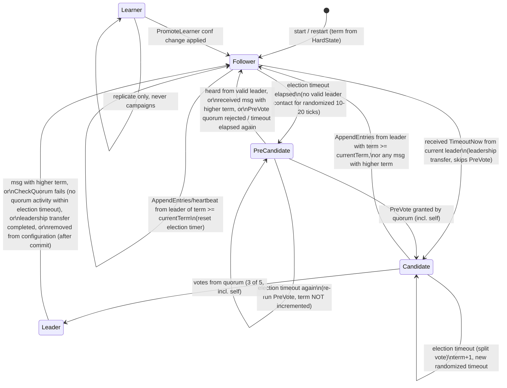
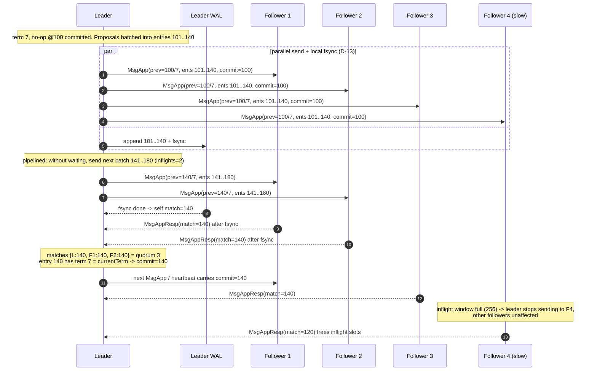
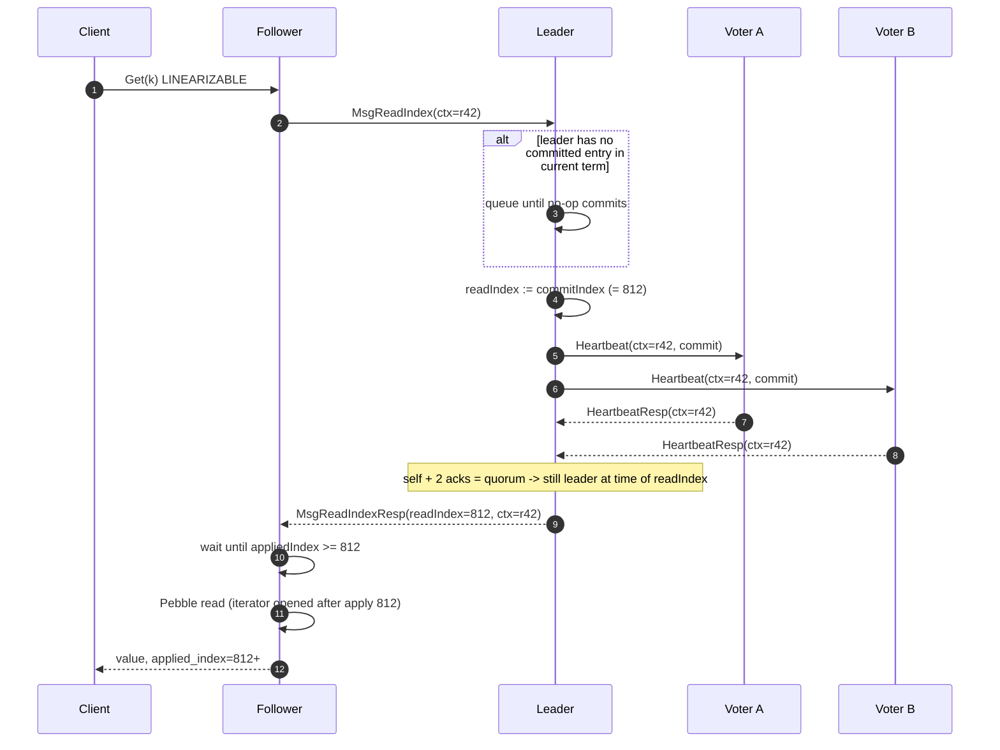
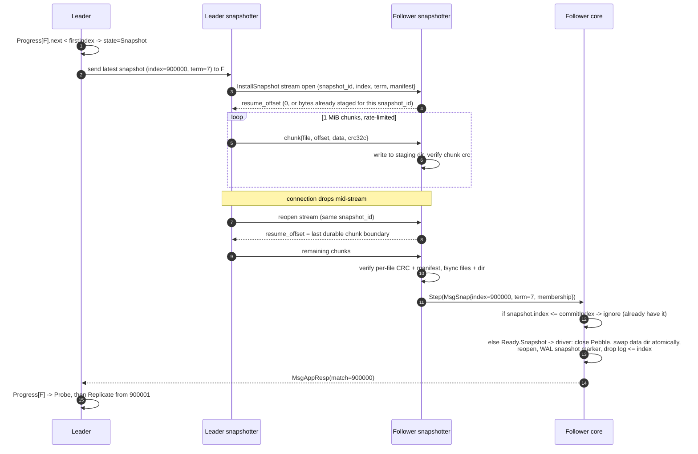
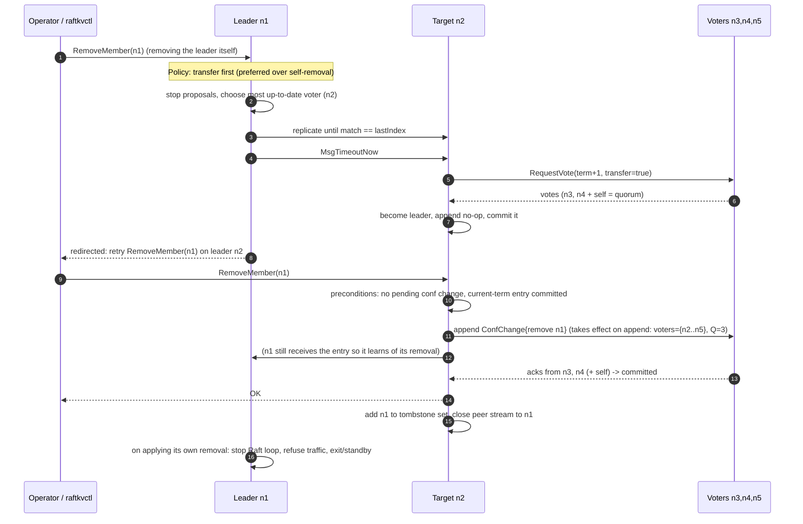

# RaftKV System Design: Protocol Behaviour

> Status: Draft v1. Baseline: [`design-decisions.md`](design-decisions.md) (`D-xx`). Component context: [`architecture.md`](architecture.md).
> On-disk formats (WAL record framing, Pebble key layout, snapshot manifest): [`storage-design.md`](storage-design.md).
> API/error codes: [`api-design.md`](api-design.md). Test harnesses referenced in §10: [`testing-benchmarks.md`](testing-benchmarks.md).
>
> Notation: `N = 5` voters, quorum `Q = 3`. One tick = 100 ms (D-08, D-24). Every timing value is a **default or target**, not a measurement.

---

## 0. Persistent and volatile state

| State | Where | Persisted when | Notes |
|-------|-------|----------------|-------|
| `currentTerm`, `votedFor` | WAL `HardState` record | **Before** sending any vote grant, and before acting on a higher term in any outbound message | Losing these lets a node vote twice in one term, which breaks Election Safety |
| `commitIndex` | WAL `HardState` | Lazily (piggybacks on the next fsync) | Lets restart replay up to a known-committed point without waiting for a leader. Never required for safety |
| Log entries | WAL segments | Before ack (`MsgAppResp`). Leader before self-counting toward quorum | CRC32C per record (D-03) |
| Snapshot metadata `{index, term, membership}` | Snapshot manifest + WAL snapshot marker | When a snapshot is created or installed | D-14 |
| `appliedIndex`, KV data, session table, applied membership | Pebble, same batch (D-04) | Atomically with each applied batch. **Not fsynced per batch** (Pebble WAL off, D-03). Durable after a memtable flush | See §6 for why this is safe |
| `nextIndex[]`, `matchIndex[]`, Progress state, inflights | Leader memory | Never | Re-initialized on election |
| Lease expiry, ReadIndex queue | Leader memory | Never | Cleared on step-down |
| Removed-ID tombstones | Pebble (system key), via applied conf changes | With conf-change apply | See Q-A4 in `architecture.md` |

---

## 1. Leader election

### 1.1 Roles and transitions



Learners are a separate role: they receive entries and snapshots, never vote, never start PreVote, and are not counted in any quorum (D-06).

### 1.2 Term rules (all roles)

| Rule | Behaviour |
|------|-----------|
| T1 | On receiving any message (other than PreVote / PreVote response, see T4) with `m.term > currentTerm`: set `currentTerm = m.term`, `votedFor = none`, become Follower. Persist before replying |
| T2 | Messages with `m.term < currentTerm` are dropped. Exception: if a stale leader or candidate sends one, reply with our term so it steps down. With CheckQuorum on, also respond to stale `MsgApp` so a node that was partitioned and has a higher term (rare with PreVote) can learn the leader's term. This follows etcd's handling |
| T3 | **Vote grant** (`RequestVote{term, lastLogIndex, lastLogTerm}`): grant iff `votedFor ∈ {none, candidate}` in this term **and** the candidate's log is at least as up-to-date: `(lastLogTerm, lastLogIndex) ≥ (ourLastTerm, ourLastIndex)` lexicographically |
| T4 | **PreVote** uses `term = currentTerm + 1` in the request but **does not change** the receiver's term or `votedFor`. Granted iff the log check passes **and** the receiver has not heard from a valid leader within the minimum election timeout (10 ticks) |
| T5 | **Leader lease rejection (CheckQuorum companion):** a voter that heard from the current leader within the minimum election timeout **ignores** `RequestVote` / PreVote for a higher term. Exception: messages tagged as a leadership transfer (`TimeoutNow`-triggered campaign) |
| T6 | A new leader immediately appends a **no-op entry** in its term. It cannot commit earlier-term entries, or serve ReadIndex, until that no-op commits (§2.4, §3) |

### 1.3 Timeouts

| Parameter | Value (default) | Rationale |
|-----------|-----------------|-----------|
| Heartbeat interval | 1 tick = 100 ms | D-08 |
| Election timeout | uniform random in [10, 20) ticks = 1.0–2.0 s, re-drawn on every transition to follower/pre-candidate/candidate | D-08. A spread of 10 ticks makes repeated split votes unlikely |
| CheckQuorum window | election timeout (min = 10 ticks) | Leader steps down if fewer than `Q-1` voters have responded in the last window |
| PreVote lease (T4/T5) | min election timeout = 10 ticks | |
| Leadership transfer timeout | 1 election timeout | Abort transfer and resume accepting proposals |
| Failover target | new leader elected ≤ ~3 s after leader crash (p99 target) | Detection ≤ 2 s + PreVote round + vote round + no-op commit. Target only |

### 1.4 Why PreVote + CheckQuorum (D-08)

- **PreVote** stops a node that rejoins after a partition from bumping the term and forcing a healthy leader to step down. While partitioned, the node cannot win a PreVote, so its term never advances.
- **CheckQuorum** makes a leader that has lost contact with a majority step down within one election timeout. This bounds how long a stale leader thinks it is leader. It is a prerequisite for safe lease reads (§3.2) and makes asymmetric partitions converge (F-05).
- Combined with T5, a single flaky follower cannot disrupt a leader that a majority can still reach.

---

## 2. Log replication and quorum commit

### 2.1 Leader per-follower progress

The leader keeps a `Progress` record per follower and learner:

| Field | Meaning |
|-------|---------|
| `match` | Highest index known to be durably replicated on that follower |
| `next` | Next index to send |
| `state` | `Probe`, `Replicate`, or `Snapshot` |
| `inflights` | Ring buffer of the last index of each unacknowledged `MsgApp` (window cap: 256 messages, see Q-S3) |
| `recentActive` | Set when any response arrives. Used by CheckQuorum, reset each window |
| `pendingSnapshot` | Snapshot index being sent, in `Snapshot` state |

State behaviour:

- **Probe**: send at most one `MsgApp` per heartbeat interval, then wait for the response. Used after election, after a rejection, or after the stream reconnects. On rejection with hint `(rejectHint index, term)`, jump `next` back using the conflict-term optimization (skip a whole term per round trip, not one entry).
- **Replicate**: optimistic pipelining. After sending entries `[next, last]`, set `next = last+1` immediately and add the batch to `inflights`. Keep sending until the inflight window or byte budget is full. A rejection drops the follower back to Probe.
- **Snapshot**: `next` is below the leader's first retained log index (compacted). Stream a snapshot (§5) and pause `MsgApp`. After a successful install, set `match = snapshot.index` and move to Probe.

### 2.2 Follower append rules

On `MsgApp{term, prevIndex, prevTerm, entries, leaderCommit}`:

1. Apply term rules T1/T2.
2. If the local log has no entry at `prevIndex` with `prevTerm`: reject with a hint `(conflictIndex, conflictTerm)`.
3. For each new entry: if an existing entry conflicts (same index, different term), **truncate** from that index onward and append. Never truncate entries at or below `commitIndex` (if this would be needed, it is a safety bug: **panic**).
4. Persist (fsync) and then reply `MsgAppResp{match = prevIndex + len(entries)}`.
5. `commitIndex = min(leaderCommit, index of last new entry)`.

### 2.3 Pipelining and flow control



Flow-control limits (defaults; see D-11, D-12):

| Limit | Default | Effect when reached |
|-------|---------|---------------------|
| Inflight `MsgApp` per follower | 256 | Leader stops sending new entries to that follower until acks free slots. Heartbeats still go out |
| Bytes per `MsgApp` | 1 MiB | Larger batches are split |
| Proposal batch | 4 MiB (D-11) | Router queues the rest for the next Ready |
| Uncommitted log tail on the leader | 64 MiB (target, Q-S3) | `Propose` returns `ErrProposalDropped` and the client gets `RESOURCE_EXHAUSTED` / retry. Protects leader memory when the quorum is slow |
| Transport per-peer queue | 4,096 messages | Overflow drops the message. The leader sees no ack and the follower falls back to Probe |

### 2.4 Commit rule: only current-term entries

The leader sets `commitIndex = N` for the largest `N` such that:

1. `matchIndex` (counting the leader's own **durable** last index) ≥ `N` on at least `Q = 3` voters of the current configuration, **and**
2. `log[N].term == currentTerm`.

Entries from earlier terms are committed only **indirectly**, when a later current-term entry commits (Raft §5.4.2, Figure 8). The no-op appended on election (T6) guarantees that a new leader commits its predecessor's tail promptly, even with no client traffic.

### 2.5 Heartbeats

Heartbeats (`MsgHeartbeat{term, commit = min(commitIndex, follower.match), ctx}`) go to every follower each tick. They serve three purposes: reset follower election timers, propagate `commitIndex` to idle followers, and carry the ReadIndex context (§3.1). Heartbeat responses mark `recentActive` for CheckQuorum.

---

## 3. Linearizable reads

### 3.1 ReadIndex (default, D-05)

Leader procedure for a read request with context `ctx`:

1. If the leader has **not yet committed an entry in its current term** (no-op still pending), queue the request until it has. Before then, the leader's `commitIndex` might be behind the true committed index.
2. Record `readIndex = commitIndex`.
3. Broadcast a heartbeat carrying `ctx` (concurrent reads share one heartbeat round; the latest `ctx` covers all earlier queued requests).
4. When `Q - 1 = 2` followers ack that `ctx` (or a later one), the leader knows it was still the leader when it recorded `readIndex`. Emit `ReadState{readIndex, ctx}`.
5. The serving node waits until `appliedIndex ≥ readIndex`, then reads Pebble with an iterator taken **after** that point.

Follower read (forwarding, D-05): the follower sends `MsgReadIndex{ctx}` to the leader. The leader runs steps 1–4 and replies `MsgReadIndexResp{readIndex, ctx}`. The follower then does step 5 locally. This moves read-serving CPU and I/O off the leader at the cost of one extra hop.



**Why it is linearizable:** any write acknowledged before the read began has `index ≤ commitIndex` on whichever leader was in charge. Because the confirmed leader is the only possible leader in its term (Election Safety) and has an entry committed in its term (Leader Completeness), its `commitIndex` covers every acknowledged write. The quorum heartbeat rules out a newer leader having existed at the moment `readIndex` was taken. Serving after `appliedIndex ≥ readIndex` means the read reflects all of those writes, and it can only see writes that were committed by the time of serving. Both are within the request's real-time interval.

### 3.2 Lease read (optional, D-05)

When `--lease-reads=true` and `--max-clock-drift=<d>` are configured:

- The leader records `heartbeatSentAt` (monotonic clock) for each heartbeat round. When a quorum acks a round, `leaseExpiry = heartbeatSentAt + electionTimeoutMin × (1 − ρ) − d_margin`, where `ρ` is the maximum relative clock **rate** drift and `d_margin` absorbs scheduling delay. Defaults (targets): `electionTimeoutMin = 1000 ms`, `ρ = 0.1`, `d_margin = 100 ms`, giving a lease of about **800 ms** after `heartbeatSentAt`. See Q-S1.
- While `now_monotonic < leaseExpiry` **and** the leader has committed an entry in its current term, it serves a read at `readIndex = commitIndex` with no network round trip.
- **Clock assumption:** followers do not grant a vote (T5) for at least `electionTimeoutMin` measured on their own clocks after they last heard from the leader. The lease is safe only if the leader's clock does not run slower than the followers' by more than `ρ` over that interval. This is a bound on clock **rate**, not on absolute offset. Wall-clock jumps (NTP step) do not matter because Go's monotonic clock is used. A **process pause** (GC, SIGSTOP, VM freeze) between checking the lease and serving the read is the real danger. To mitigate it, the lease is re-checked **after** the Pebble read completes and the response is discarded (falling back to ReadIndex) if the lease expired in between.
- The lease is invalidated immediately on step-down, on receiving a higher term, when a leadership transfer starts (the leader stops renewing and refuses lease reads from the moment it sends `TimeoutNow`), and on any conf change that alters the voter set until the next quorum round under the new config.

### 3.3 Stale reads

`consistency=STALE` reads local Pebble at the current `appliedIndex` on any node, including learners. The response carries `applied_index` and the node's `leader_term` so clients can reason about staleness. There is no linearizability guarantee. Monotonic reads within one client are guaranteed only if the client pins to one node (see `api-design.md`).

### 3.4 Range scans

`Range` uses the same read point as `Get`. A single Pebble iterator (implicit snapshot) opened after `appliedIndex ≥ readIndex` serves the whole page (≤ 1,000 keys, D-11), so each page is a linearizable point-in-time view. **Pagination across pages is not one atomic snapshot.** Each page gets its own read point. This is documented as such in `api-design.md`.

---

## 4. Client sessions and exactly-once semantics (D-09)

### 4.1 Model

- A client obtains a `client_id` (see Q-S2 on how it is assigned) and numbers its write requests with a strictly increasing `seq` starting at 1.
- Each write carries `(client_id, seq, ack_seq)`, where `ack_seq` is the highest seq for which the client has received a response and all lower seqs are complete. This lets clients pipeline several writes while still bounding server memory.
- The **state machine** (replicated, inside Pebble, included in snapshots) keeps per session: `{last_seq_applied, responses: map[seq]result for seq in (ack_seq, last_seq_applied], last_active_ts}`.

### 4.2 Apply logic (deterministic, runs on every replica)

```
apply(entry{client_id, seq, ack_seq, op, leader_ts}):
  s := sessions[client_id]
  if s == nil:                        -> result = SESSION_EXPIRED / UNKNOWN_SESSION (no side effect)
  s.discardResponses(upTo = ack_seq)
  if seq <= s.last_seq_applied:
      if r, ok := s.responses[seq]; ok -> return r                  // duplicate: replay cached result, NO re-execution
      else                            -> return SEQ_TOO_OLD           // response already acked/discarded
  result := execute(op)               // Put/Delete/CAS against Pebble batch
  s.responses[seq] = result; s.last_seq_applied = max(s.last_seq_applied, seq)
  s.last_active_ts = leader_ts
  expireSessions(now = leader_ts)     // TTL 10 min (D-09), uses ONLY the replicated timestamp
  write {kv mutation, session update, appliedIndex} in ONE Pebble batch (D-04)
```

Key properties:

- **Deterministic expiry.** TTL is evaluated against `leader_ts`, a timestamp the leader stamps into the entry when proposing, never against a replica's local clock. Every replica therefore expires the same sessions at the same log index. To keep `leader_ts` monotonic across leader changes, a new leader uses `max(own clock, last applied leader_ts)`.
- **Out-of-order seqs** (pipelined client, reordered across a leader change): allowed within a window of 64 outstanding seqs per session (target, Q-S2). Seqs above `ack_seq + 64` are rejected with `RESOURCE_EXHAUSTED`.
- **Router fast path:** before proposing, the leader's router may check the applied session table. If the response is cached it returns at once. This is only an optimization. Correctness comes from the apply-time check, because a duplicate may already be in the log but not yet applied.
- **Reads do not use sessions.** They are naturally idempotent.
- **Bound:** session count is capped (target 100k). New registrations beyond the cap evict the least-recently-active session (deterministically, by `last_active_ts`, then `client_id`). An evicted client gets `SESSION_EXPIRED` and must re-register. Exactly-once is guaranteed only **within a live session**, and the API documents this.

### 4.3 Failure cases

| Case | Outcome |
|------|---------|
| Leader commits a write, crashes before replying, client retries on new leader with same `(client_id, seq)` | New leader's log contains the entry (Leader Completeness). The retry is a new entry that applies as a duplicate and returns the cached result. **Applied once** |
| Leader crashes before the write was replicated to a quorum | Entry may be lost or may later commit. Either way the retry is deduplicated if the original committed, and executed once if it did not |
| Client retries after its session expired | `SESSION_EXPIRED`. Client must re-register and the outcome of the old request is unknown. Documented as an "indeterminate" result, which the Porcupine model treats as possibly applied |
| Two concurrent retries of the same seq | Both entries commit. The first executes, the second replays the cached result |

---

## 5. Snapshots and follower recovery (D-14)

### 5.1 Creation

Trigger: `appliedIndex − lastSnapshotIndex ≥ 100,000` entries **or** WAL bytes since last snapshot ≥ 512 MiB.

1. Snapshotter asks the applier to pause at a batch boundary, records `snapIndex = appliedIndex` and `snapTerm`, and takes the **applied membership** at that index.
2. Creates a Pebble checkpoint (flushes memtables, hard-links SSTs) into `snapshots/<term>-<index>.tmp/`. Because `appliedIndex`, sessions and membership live in Pebble, the checkpoint is self-describing.
3. Writes a manifest `{index, term, membership, file list, per-file CRC32C, total size, format version}`, fsyncs the directory, and renames to its final name.
4. Writes a snapshot marker to the WAL and calls `core`'s storage `ApplySnapshot`/`Compact` view so the leader knows `firstIndex`.
5. **Log compaction:** delete WAL segments whose last index ≤ `min(snapIndex, durablyFlushedAppliedIndex) − retainTail`. `retainTail` (default 10,000 entries, target) keeps a buffer so briefly lagging followers can catch up from the log instead of needing a snapshot. Segment deletion is the only log truncation.
6. Retain the 2 most recent snapshots.

### 5.2 InstallSnapshot streaming



Rules:

- `snapshot_id = (term, index)` of the snapshot. Resume is allowed only for the same id. If the leader has since produced a newer snapshot, it may abort and restart with the new id. The follower then discards the stale staging dir.
- At most one snapshot is in flight per follower. The cluster-wide concurrency cap defaults to 1 and the bandwidth cap to 64 MiB/s (targets). Replication `MsgApp` to other followers is never blocked by a snapshot send.
- The follower **never** applies a snapshot older than its `commitIndex`, and installs atomically: the old Pebble dir stays authoritative until a directory rename plus fsync commits the swap. A crash mid-install leaves either the old state or the new state.
- After install, `appliedIndex = commitIndex = snapshot.index` and the membership is set from the snapshot.

### 5.3 Slow and lagging followers

| Lag condition | Leader handling |
|---------------|-----------------|
| Follower slow but within inflight window | Replicate state. Fills its own window only, and other followers commit without it |
| Window full | Stop sending entries to it. Heartbeats continue (so it does not campaign) |
| `next ≤` leader's compacted index | Snapshot state (§5.2) |
| Follower restarts / stream reconnects | Probe. Find the match point using conflict hints |
| Snapshot repeatedly fails (e.g. follower disk full) | Exponential backoff (1 s → 60 s, targets). Metric `raftkv_snapshot_send_failures_total` and alert. The cluster keeps committing with the other 4 |

The leader's log retention is **not** held back for a lagging follower beyond `retainTail`. Holding it would let one broken node fill the leader's disk. A snapshot is always the fallback.

---

## 6. Crash recovery on restart

Durability model: the **WAL is the source of truth** (D-03). Pebble may lose its un-flushed memtable on crash because its own WAL is disabled. Since `appliedIndex` is written in the same batch as the data (D-04), whatever Pebble state survives is a **consistent prefix** of applied entries with an exact `appliedIndex`.

### 6.1 Procedure

```
startup(dataDir):
  1. Acquire flock on dataDir (prevents two processes on one PVC).
  2. Read node identity file (node_id, cluster_id). If missing and the data dir is empty → see §7.5 (empty-disk join).
  3. Open WAL:
       a. Scan segments in order; verify each record's CRC32C and length framing.
       b. TORN TAIL: if the LAST segment ends in a short/partial record or a CRC mismatch that
          lies entirely AFTER the last valid record, AND no valid record follows it
          → truncate the segment at the last valid record boundary, fsync, log WARN, metric
            raftkv_wal_torn_tail_repaired_total++.
       c. CORRUPTION ELSEWHERE (a bad record followed by valid records, or in a non-final
          segment) → refuse to start (exit non-zero, clear log message). Do NOT auto-truncate:
          truncating could discard entries this node already acknowledged (fsynced + acked),
          which can break quorum durability. The operator replaces the node (§7.5).
  4. Load latest valid snapshot manifest (verify CRCs). WAL snapshot marker must match one
     on disk; else fall back to older snapshot if its index ≥ WAL firstIndex − 1, otherwise fail-stop.
  5. Open Pebble. Read appliedIndex_p (the last batch that reached an SST, or 0).
       Invariant checks: appliedIndex_p ≥ WAL firstIndex − 1 (no gap between Pebble and WAL)
       and appliedIndex_p ≤ WAL lastIndex. Violation → fail-stop.
  6. Rebuild the raft core: HardState{term, vote, commit} from the last HardState record;
     log = snapshot + WAL entries (firstIndex = snapshot.index+1).
     commit = max(HardState.commit, snapshot.index).
  7. Replay: re-apply entries (appliedIndex_p, commit] from the WAL through the normal applier
     (sessions included), BEFORE serving any client traffic. Membership is restored from applied
     conf-change entries plus any appended-but-unapplied conf change (append-time rule, §7.2).
  8. Start transport and Ready loop as Follower in currentTerm with a fresh randomized timeout.
     Entries in (commit, lastIndex] stay in the log, uncommitted; the leader will confirm or
     overwrite them.
  9. Become Ready for client traffic (k8s readiness probe) once the node has heard from a leader
     and appliedIndex ≥ that leader's commit at join time (or lag < 1,000 entries, target).
```

### 6.2 Why replay is exact

- An entry is applied at most once into the surviving Pebble state: `appliedIndex_p` names the last entry included, and replay starts at `appliedIndex_p + 1`.
- Entries in `(appliedIndex_p, commit]` were applied before the crash, but that work was in the lost memtable, so it is redone. Apply is deterministic (no local clocks, §4.2), so the result is identical.
- **WAL compaction safety (critical, Q-S4):** the WAL must never drop an entry above Pebble's **durably flushed** `appliedIndex`. Otherwise step 7 would find a gap. The snapshotter therefore takes the checkpoint (which flushes) before compacting, and compacts only up to `min(snapIndex, flushedAppliedIndex)`.

### 6.3 Torn writes

| Scenario | Detection | Action |
|----------|-----------|--------|
| Power loss mid-append of last record | Length or CRC mismatch at the very tail | Truncate to the last good record. The lost record was never fsynced, so it was never acked to anyone. Safe |
| Partial segment pre-allocation | Zero-filled tail after last record | Treated as end of log (zero length = end marker) |
| Bit rot in the middle of a segment | CRC mismatch followed by valid records | Fail-stop. Replace the node |
| HardState torn | Last HardState record invalid | Use the previous valid HardState. Its term/vote are ≤ the lost one only if the lost one was never fsynced, so nothing was acked based on it. Safe |
| Pebble SST corruption | Pebble checksum error on open or read | Fail-stop. Replace the node, or restore from a peer snapshot |

---

## 7. Membership changes (D-06, D-23)

### 7.1 Rules

1. **One change at a time.** The leader rejects a new conf change (`FAILED_PRECONDITION`) while a previous one is uncommitted.
2. **Current-term commit first.** The leader does not propose a conf change until it has committed an entry in its current term (the no-op). This is the fix for the single-server-change bug found after the dissertation was published (Ongaro, raft-dev 2015).
3. **Append-time effect.** A server uses the newest configuration **in its log** as soon as the entry is appended, whether or not it is committed (dissertation §4.1). If the entry is truncated, the node reverts to the previous configuration. See Q-S5 for the apply-time alternative.
4. **Single-server change:** each change adds or removes exactly **one voter**. Any majority of the old config and any majority of the new config then overlap.
5. **Learners never count** toward quorum, PreVote or CheckQuorum.

### 7.2 Adding a node: learner catch-up then promotion

| Step | API (D-23) | Effect | Quorum |
|------|-----------|--------|--------|
| 1 | `AddLearner(id, addr)` | Conf entry adds a learner. Leader starts replicating (usually by snapshot first) | Unchanged (voters only) |
| 2 | (automatic) | Learner catches up | — |
| 3 | `PromoteLearner(id)` | Leader checks the **catch-up criterion**: learner `match ≥ leader.lastIndex − 1,000` (target) **and** it stayed within that gap for one full election timeout. Otherwise reject with `FAILED_PRECONDITION` and a progress detail | After commit, voter count +1 |

Promoting before catch-up would add a voter that cannot ack, which in the worst case lowers fault tolerance (a 6-voter config needs 4 acks). The criterion prevents this.

**Replacing a node** in a 5-node cluster: `AddLearner(new)` → catch up → `PromoteLearner(new)` (6 voters, Q = 4) → `RemoveMember(old)` (5 voters, Q = 3). The window with 6 voters is short. Alternative order for a node that is already dead: `RemoveMember(dead)` first (4 voters, Q = 3, tolerates 1 failure) → add learner → promote. The runbook picks the order based on whether the old node is reachable.

### 7.3 Leadership transfer

1. `TransferLeadership(target)` on the leader (or forwarded to it). Target must be an up-to-date-capable voter.
2. Leader **stops accepting new proposals** (returns `UNAVAILABLE`, retryable) and stops issuing lease reads.
3. Leader replicates until `Progress[target].match == lastIndex`.
4. Leader sends `MsgTimeoutNow` to the target.
5. Target campaigns immediately: skips PreVote, `term+1`, and the vote request is flagged `transfer=true` so voters bypass the T5 lease rejection.
6. If no new leader appears within 1 election timeout, the old leader aborts the transfer and resumes.

### 7.4 Removing a member, including the leader



Fallback, when a leader removes itself directly (transfer impossible, e.g. all other candidates lagging): the leader appends `remove(self)`. Under the append-time rule it stops counting itself in quorums immediately and keeps replicating until the entry commits on a majority of the **new** config. Then it steps down and stops heartbeats. A remaining voter times out and is elected. This path is supported but not the default because it causes a full election-timeout gap.

### 7.5 Node replaced with an empty disk

A node that lost its disk **must not rejoin with its old identity**. It has forgotten `votedFor` and acknowledged entries, so it could double-vote in a term or make a "committed" entry under-replicated. Procedure:

1. On startup with an empty data dir and no identity file, the node generates a **fresh `node_id`** (random 64-bit) and starts in **join mode**. It does not campaign.
2. The operator (or an automated controller, Q-S6) calls `RemoveMember(old_id)` and then `AddLearner(new_id, addr)` → `PromoteLearner`.
3. The old ID is tombstoned. Any message that still uses it is rejected (Q-A4).

---

## 8. Failure scenarios

Test-harness legend: **SIM** = deterministic simulator over the pure core (`test/sim`). **E2E** = docker-compose 5-node with fault injection, run per PR. **CHAOS** = kind + Chaos Mesh, nightly (D-19). **LIN** = every E2E/CHAOS run records a history checked by Porcupine (D-18). **UNIT** = package-level tests including crash-point injection for WAL/storage.

| # | Scenario | Expected behaviour | Safety impact | Liveness impact | How it is tested |
|---|----------|--------------------|---------------|-----------------|------------------|
| F-01 | **Leader crashes before commit** (entry on leader + ≤ 1 follower) | Entry may survive (if the new leader has it, it commits with the new leader's no-op) or be overwritten. Client sees timeout/`UNAVAILABLE` and retries with the same seq. Dedup gives exactly-once | None. Uncommitted, never acked | Writes unavailable ≤ ~3 s (target) until the new leader is elected | SIM: crash leader at every step between propose and commit. E2E/CHAOS: `kill -9` leader under load + LIN |
| F-02 | **Leader crashes after commit, before reply** | Entry is on ≥ 3 nodes. Any electable leader has it (T3 up-to-date check). Retry returns the cached result | None (Leader Completeness) | As F-01 | SIM targeted case. LIN with retries. Porcupine marks the first attempt as indeterminate |
| F-03 | **Minority partition** (leader + 1 isolated from 3) | Old leader fails CheckQuorum within 1 election timeout and steps down. Majority side elects a new leader. Minority side: PreVote fails, so terms do not inflate. Minority rejects writes and linearizable reads with `UNAVAILABLE`. `STALE` reads still served | None. Old leader cannot commit (no quorum) or serve ReadIndex (no heartbeat quorum). Lease reads stop at lease expiry, which is before the majority can elect | Majority side available after ≤ ~3 s. Minority unavailable | SIM partition matrix. E2E iptables partition. CHAOS NetworkChaos partition |
| F-04 | **Majority partition** (no side has 3) e.g. 2/2/1 | No leader anywhere. All writes and linearizable reads fail with `UNAVAILABLE`. No term inflation (PreVote) | None | Total unavailability for writes/linearizable reads until healed. Expected (CAP) | SIM. CHAOS 3-way partition. Assert no committed write is lost after heal |
| F-05 | **Asymmetric partition** (leader can send but not receive; or one follower cannot reach leader but reaches others) | Case a: followers keep getting heartbeats, but the leader receives no acks, so CheckQuorum steps it down. It stops heartbeats, followers time out and elect a new leader. Case b: the isolated follower's PreVote is rejected by peers within their leader lease (T4/T5), so the leader is undisturbed | None | Case a: one election. Case b: none, except that the follower stays behind until healed | SIM one-way link drops. CHAOS one-direction NetworkChaos. Assert term does not increase in case b |
| F-06 | **Split vote** | Several candidates in the same term. No one reaches 3. Randomized timeouts (10-tick spread) re-draw and one candidate usually wins next round | None (one vote per term, persisted) | Extra election rounds (each 1–2 s). Repeated splits have low probability (target: < 1% of elections need > 2 rounds in SIM) | SIM forced simultaneous timeouts. Measure rounds-to-leader distribution |
| F-07 | **Slow disk** on one follower (fsync p99 ≫ normal) | That follower's acks lag and it drifts into window-full or snapshot. Commit proceeds with the other 3. **On the leader:** commit latency rises. In v1 the fsync is synchronous in the Ready loop, so an fsync stall longer than the election timeout blocks heartbeats and followers elect a new leader (acceptable: a leader with a stalled disk should lose leadership). Once D-13 moves fsync off the loop, a watchdog transfers leadership instead (Q-S7) | None | Follower: none to the cluster. Leader: latency/throughput drop, possible elections | E2E: dm-delay / `fsync` latency injection (FUSE or `LD_PRELOAD` shim, see testing-benchmarks.md). Alert on `raftkv_wal_fsync_seconds` p99 |
| F-08 | **Disk full** | WAL `ENOSPC` on a follower: it stops acking (rejects appends without advancing), so the leader treats it as lagging. On the leader: proposals fail with `RESOURCE_EXHAUSTED` and the leader transfers leadership to a healthy voter. Snapshot creation is skipped if space is insufficient. An `fsync` error (EIO) of any kind → **crash immediately** (fail-stop, no retry) | None. Never ack un-persisted data. Fail-stop on fsync errors avoids the "fsyncgate" silent-loss class | Cluster OK while ≥ 3 nodes have space | E2E: small tmpfs/loop-device PVC filled during load. UNIT: injected `ENOSPC` / `EIO` in WAL writer |
| F-09 | **Corrupted WAL tail** (torn last record after power loss) | Truncated to the last valid record on restart (§6.3). Node rejoins and catches up | None (lost record was never acked) | One node restart | UNIT: crash-point tests that truncate or garble the tail at every byte offset of the last record. E2E: `kill -9` during heavy write, then restart. Mid-log corruption → assert refusal to start |
| F-10 | **Clock jump** (NTP step ±minutes on any node) | No effect on elections or heartbeats (logical ticks, monotonic clock). Session TTL uses replicated `leader_ts` with a monotonic clamp, so a backward jump on a new leader cannot un-expire sessions. A forward jump on the leader may expire sessions early (Q-S2) | None for Raft. Lease reads use monotonic time, so they are unaffected by steps | None | SIM: inject skewed tick rates. E2E: `date -s` / libfaketime on the leader during lease-read load + LIN |
| F-11 | **Stale leader serving reads** (old leader paused by GC/SIGSTOP, wakes after new leader elected) | ReadIndex: the stale leader's heartbeat round gets a higher term back, so it steps down and the read fails/retries. Lease read: the lease expired during the pause, and the post-read re-check (§3.2) catches pauses that start mid-read | **None with ReadIndex.** Lease read is safe under the bounded-drift assumption plus the re-check. Violating ρ is the one documented way to break linearizability, which is why lease reads are opt-in | Brief read failures | SIM. CHAOS: SIGSTOP leader for 0.5–5 s with lease reads on and off + LIN. A dedicated test enables lease with a deliberately wrong ρ to show the checker catches violations (negative control) |
| F-12 | **Network flapping** (links up/down every few hundred ms) | PreVote + T5 lease rejection prevent term churn. Leader keeps leadership while it can reach a quorum within every CheckQuorum window. Transport reconnects with backoff. Probe re-syncs `next` | None | Degraded throughput. Elections only when quorum contact is genuinely lost for a full window | CHAOS: NetworkChaos loss 20–50% plus periodic partitions. Assert term growth stays within bounds (target ≤ 1 election per minute at 20% loss) |
| F-13 | **Follower far behind** (down for hours) | On return, `next < firstIndex`, so a snapshot is streamed (§5.2), then the log tail. The node is not ready for clients until caught up | None | No cluster impact (bounded snapshot bandwidth, concurrency cap 1) | E2E: stop a node, write > 100k entries, restart. Assert snapshot path is used and data matches |
| F-14 | **Snapshot transfer interrupted** (either side crashes or the network drops) | Resume from the last durable chunk with the same `snapshot_id`. If the leader made a newer snapshot, restart with the new id. A follower crash mid-install leaves the old state intact (atomic dir swap) | None. Partial snapshots are never applied (manifest + CRC check) | Recovery delayed | UNIT: kill at each install phase. E2E: drop the stream at random offsets. Assert resume offset > 0 and final checksum matches |
| F-15 | **Node replaced with empty disk** | Starts with a fresh ID in join mode, does not campaign. Operator removes the old ID and adds the new one as learner, then promotes (§7.5). If someone reuses the old ID on an empty disk, the identity file is missing, so the node refuses to auto-start as a voter | None if the procedure is followed. Reusing an old ID is blocked by the identity/cluster-id check | Degraded fault tolerance (4 voters, or 5 with one lagging) until catch-up | E2E: delete PVC and recreate pod. Assert it joins as a learner with a new ID. Negative test: forged identity is rejected by cluster_id mismatch |
| F-16 | **Two nodes down simultaneously** | 3 remain = quorum. If the leader was among them, a new election (≤ ~3 s). Cluster keeps serving, but **any third failure** stops availability. Alert at `voters_healthy < 4` | None | Available, zero remaining fault tolerance | CHAOS: kill 2 random pods (including the leader) under load + LIN. Kill a third and assert clean `UNAVAILABLE`, no lost acked writes after recovery |
| F-17 | **Removed node rejoining** (old pod comes back after `RemoveMember`) | Its PreVotes are ignored (sender not in config and tombstoned, Q-A4). It never receives heartbeats. Peers reply `REMOVED`, and it shuts down its Raft loop and reports not-ready | None. A non-member cannot disrupt or join a quorum | None | SIM: removed node keeps ticking. E2E: remove, then restart old pod with old disk. Assert leader term unchanged |
| F-18 | **Leader paused longer than election timeout** (SIGSTOP 5 s) | Majority elects a new leader. Old leader wakes, its messages carry the old term, it receives the higher term and steps down. Its uncommitted tail is truncated | None | One election | CHAOS PodChaos pause. SIM |
| F-19 | **Crash during membership change** (leader crashes after appending conf change, before commit) | New leader may or may not have the entry. If it does, it commits it along with its no-op. If not, nodes that appended it revert to the old config when their log is truncated (append-time rule). The operator retries the API call (idempotent: adding an existing member returns OK) | None (single-server overlap) | One election | SIM: crash at every step of AddLearner/Promote/Remove. E2E |
| F-20 | **Applier slower than commit** (Pebble compaction stall) | Applier queue fills, the driver stops accepting proposals (back-pressure `RESOURCE_EXHAUSTED`), but heartbeats continue, so no spurious election. ReadIndex reads wait for apply (deadline applies) | None | Throughput drop. No leadership churn | E2E: throttle Pebble via injected compaction delay. Assert no term change |

---

## 9. Safety invariants

These are the properties the system must never violate. Each is checked by assertions in the simulator after every step (SIM), and where marked, as runtime assertions in production builds that **panic** (fail-stop) rather than continue with divergent state.

| Invariant | Statement | How enforced | Checked by |
|-----------|-----------|--------------|------------|
| **Election Safety** | At most one leader can be elected in a given term | One vote per term, `votedFor` fsynced before the grant is sent (§0, T3). Quorum of 3 of the current config. Single-server changes keep old/new majorities overlapping (§7.1) | SIM: global map term → leader, assert unique. E2E: leader-term log scrape |
| **Leader Append-Only** | A leader never overwrites or deletes entries in its own log, it only appends | Core code path: the leader's `Propose` only appends. Truncation only runs in the follower `MsgApp` handler | SIM assertion. Runtime assertion |
| **Log Matching** | If two logs contain an entry with the same index and term, the logs are identical in all entries up to that index | `prevIndex/prevTerm` consistency check in `MsgApp` (§2.2). Each term has one leader, which creates at most one entry per index | SIM: pairwise log comparison after every step |
| **Leader Completeness** | If an entry is committed in a term, it is present in the logs of all leaders of higher terms | Up-to-date vote restriction (T3). Commit only current-term entries (§2.4). Never truncate at or below `commitIndex` (panic) | SIM: record committed entries, assert presence in each new leader's log at election |
| **State Machine Safety** | If a node has applied an entry at index i, no node ever applies a different entry at index i | Follows from the above, plus: apply strictly in order, `appliedIndex` atomic with data (D-04), deterministic apply (replicated `leader_ts`, no local clocks or randomness), snapshots installed only above `commitIndex`, atomic snapshot install | SIM: per-index applied-entry hash compared across nodes. E2E: periodic cross-node digest of `(appliedIndex, state hash)` at equal indices |
| **Durability** | An acknowledged write survives any failure of ≤ 2 nodes, including disk loss of ≤ 2 nodes followed by correct replacement | Ack only after commit on 3 fsynced logs. WAL fail-stop on mid-log corruption. Empty-disk nodes rejoin with a new ID (§7.5) | E2E/CHAOS + LIN |
| **Exactly-once** | Within a live session, a write with `(client_id, seq)` takes effect at most once, and once if acknowledged | Replicated session table checked at apply time (§4.2) | SIM/E2E with injected duplicate submissions. Porcupine model with sessions |
| **Linearizability** | Every completed operation appears to take effect atomically at some point between its invocation and response, consistent with real-time order | Writes: commit + apply before reply. Reads: ReadIndex (§3.1), or lease under ρ (§3.2). STALE mode is excluded by contract | Porcupine over recorded histories: ≥ 40M ops, ≥ 1,500 faults, 0 violations (D-18 target) |
| **Config safety** | At most one uncommitted conf change. No conf change before a current-term commit | Leader preconditions (§7.1) | SIM: assert. Fuzz conf-change API |

---

## 10. New open questions

Raised by this document. Each one needs a `D-xx` entry or an amendment in `design-decisions.md`. Recommendations are proposals, not decisions.

| ID | Question | Recommendation |
|----|----------|----------------|
| Q-S1 | **Lease parameters.** D-05 requires "a configured max clock drift" but gives no value or formula | Lease = `electionTimeoutMin × (1 − ρ) − margin` from heartbeat send time, `ρ = 0.1`, `margin = 100 ms`. Document that the guarantee depends on clock **rate**, not offset |
| Q-S2 | **Session ID assignment and window.** D-09 defines `(client_id, sequence)` and a 10-min TTL but not how IDs are assigned, how many outstanding seqs are allowed, the session cap, or which clock drives the TTL | Server-assigned `client_id` = log index of a replicated `RegisterSession` entry (dissertation §6.3). Window 64. Cap 100k with deterministic LRU eviction. TTL measured on leader-stamped `leader_ts` with a monotonic clamp |
| Q-S3 | **Flow-control constants.** D-12 says "bounded in-flight window" without a size. The uncommitted-tail cap is unspecified | 256 msgs × 1 MiB per follower, 64 MiB uncommitted tail. Tune in M7 on D-20 hardware |
| Q-S4 | **WAL compaction vs Pebble flushed state.** With Pebble WAL disabled (D-03), WAL truncation must not pass Pebble's flushed `appliedIndex`. The mechanism (explicit flush before compaction vs. tracking flushed index through Pebble event listeners) needs to be specified in `storage-design.md` | Compact only after a checkpoint (which flushes), and bound compaction by `min(snapIndex, flushedAppliedIndex)`. Add a startup invariant check |
| Q-S5 | **Config-change effect point.** D-06 cites dissertation §4.1 (append-time). etcd/raft uses apply-time with a single pending change. Which one? | Append-time (as written here) plus the current-term-commit precondition. Apply-time is easier to integrate with an async applier, so revisit if the implementation gets awkward. Either is safe with rules 1–2 of §7.1 |
| Q-S6 | **Automated replacement.** Should an operator or controller automate remove-old/add-learner/promote when a StatefulSet pod comes back with an empty PVC, or is it a manual runbook in v1? | Manual runbook plus `raftkvctl` helper in v1. Automation (Kubernetes operator) deferred |
| Q-S7 | **Synchronous fsync in the Ready loop (v1) can block ticks** under a stalled disk and cause the leader to miss heartbeats | Accept for v1, since a leader with a stalled disk should lose leadership anyway. Move fsync to a dedicated goroutine as part of D-13 and measure. Add a watchdog: if fsync > 0.5 × electionTimeoutMin, transfer leadership |
| Q-S8 | **Disk-full policy.** Fail-stop vs. degraded "no-space" mode on `ENOSPC` is not in the baseline (D-18 tests disk-full but does not specify behaviour) | `ENOSPC` → degraded mode (reject proposals/appends, transfer leadership, alert). Any fsync error → fail-stop |
| Q-S9 | **Range pagination consistency.** Should multi-page `Range` offer a consistent snapshot across pages (pinned read index / Pebble snapshot with TTL)? | No in v1: each page is linearizable on its own. Document it in `api-design.md` |
| Q-S10 | **Readiness semantics** for Kubernetes probes (when a restarted or caught-up node should receive client traffic) are not defined in D-16 | Ready = has a known leader and apply lag < 1,000 entries. Liveness = Ready loop heartbeat age < 5 s |
