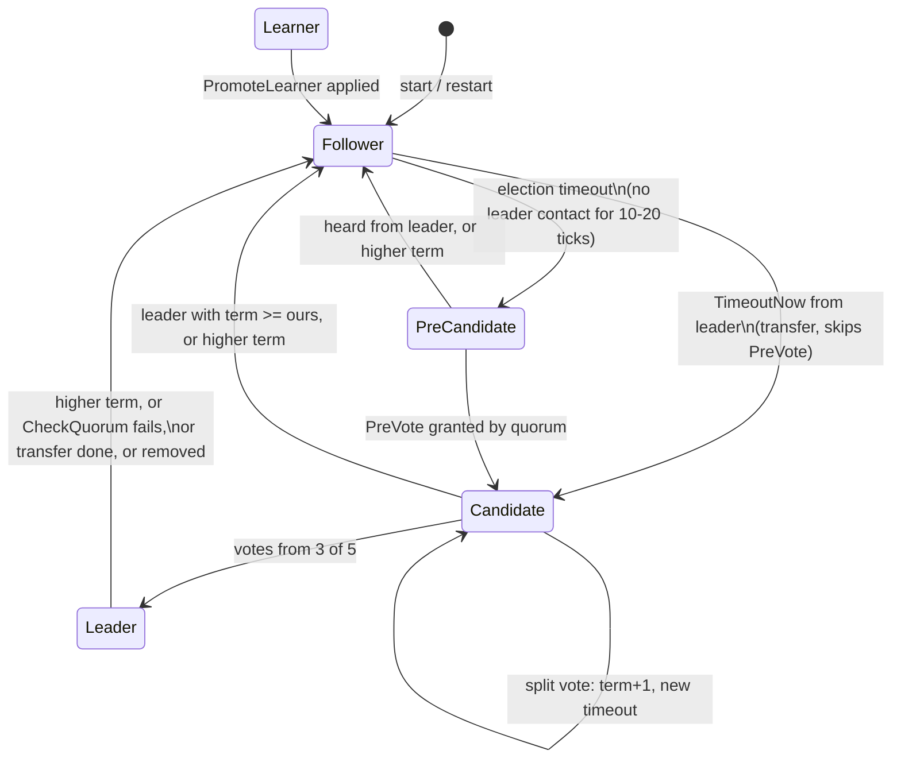
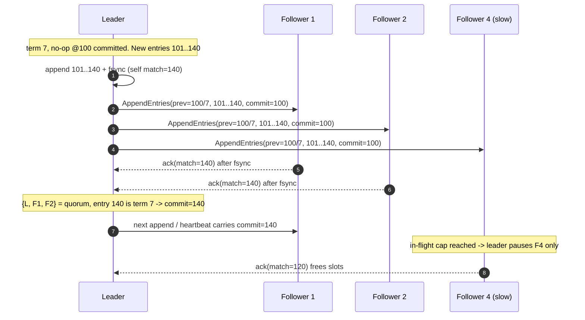
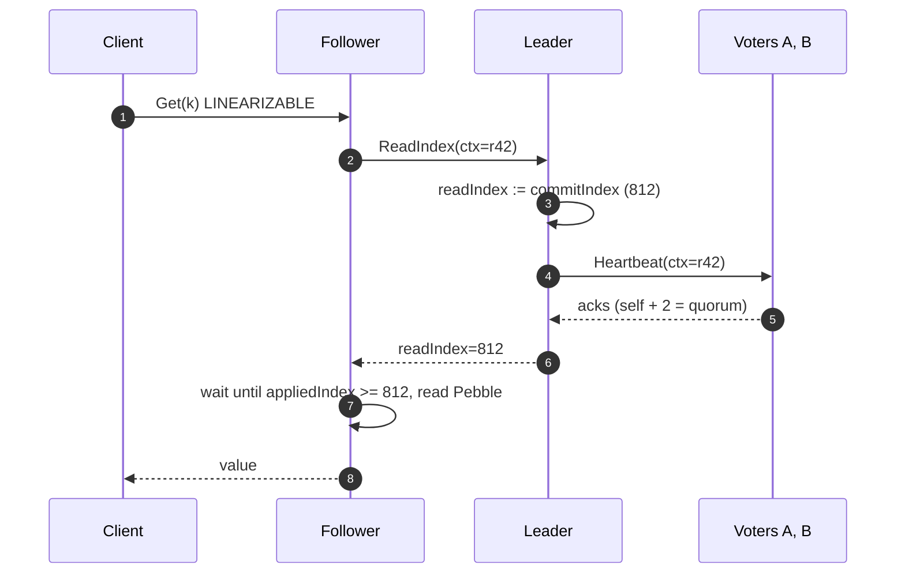
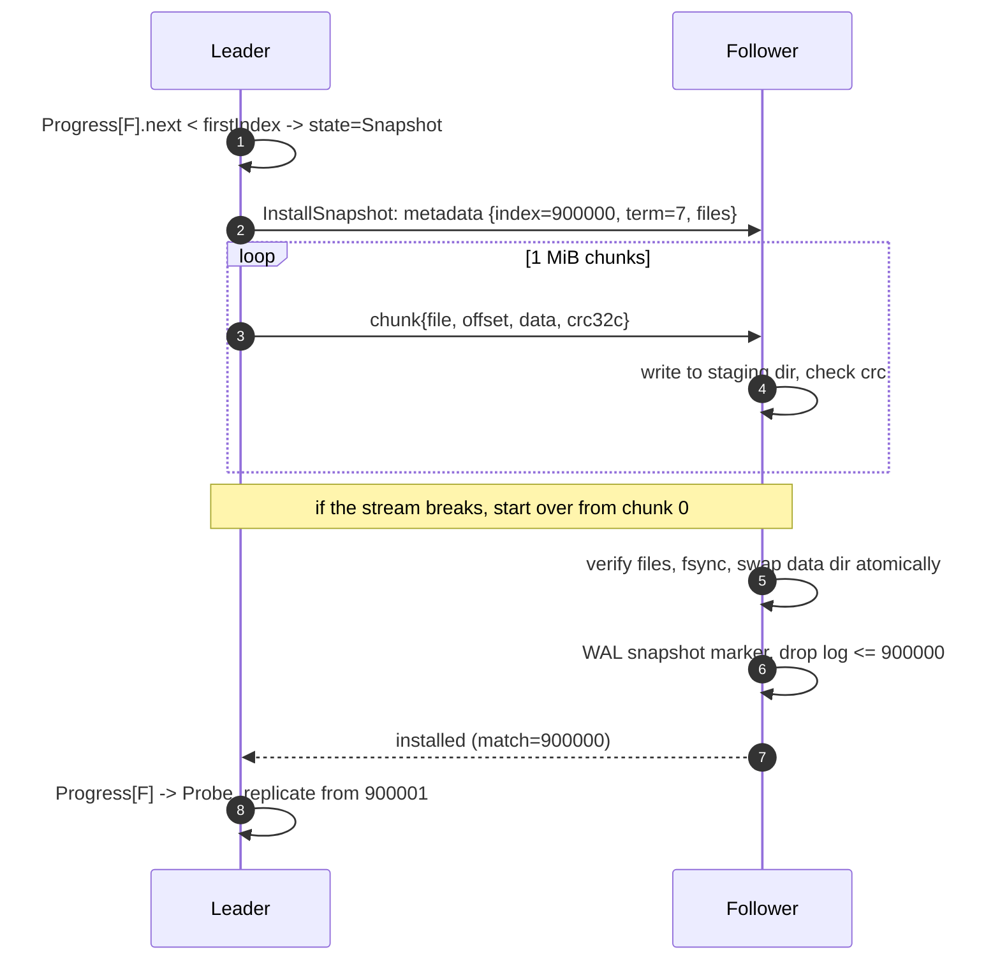
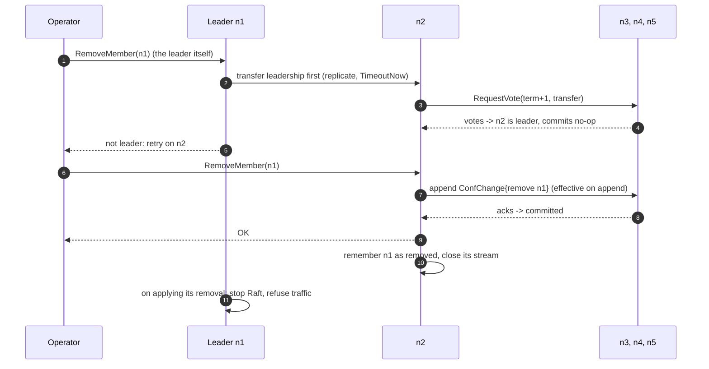

# RaftKV System Design: Protocol Behaviour

> Builds on [`design-decisions.md`](design-decisions.md) (`D-xx`). Components: [`architecture.md`](architecture.md).
> On-disk formats: [`storage-design.md`](storage-design.md). API and error codes: [`api-design.md`](api-design.md).
> Tests: [`testing.md`](testing.md).
>
> Notation: `N = 5` voters, quorum `Q = 3`. One tick = 100 ms (D-08, D-24). Timing values are defaults.

---

## 0. Persistent and volatile state

| State | Where | Persisted when | Notes |
|-------|-------|----------------|-------|
| `currentTerm`, `votedFor` | WAL `HardState` | **Before** sending a vote grant or any message with a higher term | Losing them lets a node vote twice in a term |
| `commitIndex` | WAL `HardState` | Lazily, with the next fsync | Not needed for safety |
| Log entries | WAL segments | Before acking an append; leader before counting itself | CRC32C per record (D-03) |
| Snapshot metadata `{index, term, membership}` | Snapshot dir + WAL marker | When a snapshot is created or installed | D-14 |
| `appliedIndex`, KV data, sessions, membership | Pebble, one batch (D-04) | With each apply batch, **not fsynced** (Pebble WAL off). Durable after a flush | See §6 |
| `nextIndex`, `matchIndex`, progress | Leader memory | Never | Reset on election |
| Lease, ReadIndex queue | Leader memory | Never | Cleared on step-down |
| Removed member IDs | Pebble, via applied conf changes | With the conf change | D-31, D-38 |

---

## 1. Leader election

### 1.1 Roles and transitions



Learners receive entries and snapshots but never vote, never campaign, and are not counted in any quorum (D-06).

### 1.2 Term rules

| Rule | Behaviour |
|------|-----------|
| T1 | Any message (except PreVote) with `m.term > currentTerm`: set `currentTerm = m.term`, `votedFor = none`, become follower. Persist before replying |
| T2 | Messages with `m.term < currentTerm` are dropped, but we reply with our term so a stale leader steps down |
| T3 | **Vote grant:** grant iff `votedFor ∈ {none, candidate}` this term **and** the candidate's `(lastLogTerm, lastLogIndex)` ≥ ours |
| T4 | **PreVote** asks with `term + 1` but **does not change** the receiver's term or vote. Granted iff the log check passes and the receiver has not heard from a leader within the minimum election timeout |
| T5 | A voter that heard from the leader within the minimum election timeout **ignores** votes and PreVotes for a higher term, unless the request is a leadership transfer |
| T6 | A new leader appends a **no-op entry**. It cannot commit older-term entries or serve ReadIndex until the no-op commits |

### 1.3 Timeouts

| Parameter | Default | Notes |
|-----------|---------|-------|
| Heartbeat | 1 tick = 100 ms | D-08 |
| Election timeout | random in [10, 20) ticks = 1–2 s, re-drawn each time | D-08. The spread makes repeated split votes unlikely |
| CheckQuorum window | min election timeout (10 ticks) | Leader steps down if fewer than `Q-1` voters responded |
| Transfer timeout | 1 election timeout | Then abort and resume |

A crashed leader is replaced after roughly one election timeout plus a PreVote round and a vote round.

### 1.4 Why PreVote + CheckQuorum (D-08)

- **PreVote**: a node coming back from a partition cannot win a PreVote, so it never bumps its term and forces a healthy leader to step down.
- **CheckQuorum**: a leader that loses contact with a majority steps down within one election timeout. This bounds how long a stale leader thinks it leads, and is required for safe lease reads.
- With T5, one flaky follower cannot disrupt a leader the majority can still reach.

---

## 2. Log replication and commit

### 2.1 Per-follower progress

| Field | Meaning |
|-------|---------|
| `match` | Highest index known durable on that follower |
| `next` | Next index to send |
| `state` | `Probe`, `Replicate`, or `Snapshot` |
| `inflights` | Unacknowledged appends (cap 256, D-29) |
| `recentActive` | Set on any response; used by CheckQuorum |

- **Probe**: one append per heartbeat, wait for the reply. Used after election, rejection, or reconnect. On rejection, use the conflict hint to skip back a whole term at a time.
- **Replicate**: send `[next, last]`, set `next = last+1` right away, keep sending until the in-flight cap. A rejection drops back to Probe.
- **Snapshot**: `next` is below the leader's first log index. Send a snapshot (§5), then Probe.

### 2.2 Follower append rules

On `AppendEntries{term, prevIndex, prevTerm, entries, leaderCommit}`:

1. Apply T1/T2.
2. No entry at `prevIndex` with `prevTerm`: reject with a hint `(conflictIndex, conflictTerm)`.
3. If an existing entry conflicts (same index, different term), truncate from there and append. Truncating at or below `commitIndex` is a safety bug: **panic**.
4. fsync, then reply `match = prevIndex + len(entries)`.
5. `commitIndex = min(leaderCommit, last new index)`.

### 2.3 Replication example



Flow control (D-29): at most 256 in-flight appends per follower; at most 64 MiB of uncommitted log on the leader. Past that, `Propose` returns `ErrProposalDropped` and the client gets `RESOURCE_EXHAUSTED`.

### 2.4 Commit rule: only current-term entries

The leader sets `commitIndex = N` for the largest `N` where:

1. `match ≥ N` on at least 3 voters (counting the leader's own **durable** log), **and**
2. `log[N].term == currentTerm`.

Older-term entries commit only indirectly, when a later current-term entry commits (Raft §5.4.2, Figure 8). The no-op (T6) makes this happen right after an election.

### 2.5 Heartbeats

Every tick the leader sends `Heartbeat{term, commit, ctx}`. Heartbeats reset follower timers, carry `commitIndex` to idle followers, and carry the ReadIndex context (§3.1). Replies mark `recentActive`.

---

## 3. Linearizable reads

### 3.1 ReadIndex (default, D-05)

1. If the leader has **not committed an entry in its current term**, queue the read until it has. Before that its `commitIndex` may be behind.
2. `readIndex = commitIndex`.
3. Send a heartbeat carrying `ctx`. Concurrent reads can share one round: at most one round is in flight, and reads that
   arrive during it wait together for the next round, which starts as soon as the current one completes. (A read may not
   join a round already in flight: that round's `readIndex` was taken before the read started.) Heartbeat ticks resend the
   in-flight round's `ctx`, so a lost heartbeat costs one tick.
4. When 2 followers ack that `ctx`, the leader knows it was still leader when it took `readIndex`.
5. The serving node waits until `appliedIndex ≥ readIndex`, then reads Pebble.

**Follower reads:** the follower sends `ReadIndex{ctx}` to the leader, which runs steps 1–4 and replies with `readIndex`. The follower does step 5 locally.

**Implementation notes (M4).** `RawNode.ReadIndex(ctx)` queues the request; answers come back as `Ready.ReadStates`.
`MsgReadIndex` / `MsgReadIndexResp` are term-less: they never change the receiver's term or role (the quorum round, not
the message term, makes the answer safe). A non-leader rejects a forwarded request, and a leader that steps down rejects
every queued and in-flight read, so callers retry at once instead of waiting for a deadline. The node retries rejected
reads with backoff until the request deadline. The simulator checks every read against READ-1 (the read index is at
least the highest commit index any node had when the read started) and READ-2 (a leader's read index is an entry of its
own term, i.e. after its no-op), in every seed of every profile.



**Why it is linearizable:** every write acknowledged before the read started is at or below the commit index of the leader in charge. The quorum heartbeat proves no newer leader existed when `readIndex` was taken. Serving after `appliedIndex ≥ readIndex` means the read sees all those writes, and nothing that committed after the response.

### 3.2 Lease read (optional, D-25)

- When a quorum acks a heartbeat sent at time `t`, `leaseExpiry = t + (ElectionTick − 1) × tick × (1 − ρ) − margin`. Defaults: 10 ticks of 100 ms, `ρ = 0.1`, 100 ms margin → **710 ms**. Only `ElectionTick − 1` ticks count because a follower may tick right after it resets its timer on the heartbeat. Uses the monotonic clock. The node renews the lease with one ReadIndex round per tick (`t` = when the round was requested).
- While the lease is valid and the leader has committed an entry this term, it reads at `commitIndex` without a round trip.
- **Why it is safe:** followers will not vote for anyone else for at least `electionTimeoutMin` after hearing from the leader (T5). That holds only if clock **rates** differ by less than `ρ`. A process pause between the lease check and the read is the real danger, so the lease is checked again after the read and the result is discarded if it expired.
- The lease ends on step-down, on a higher term, when a transfer starts, and on any voter-set change.
- **Restarts break it too:** a restarted voter has forgotten it heard from the leader and may vote at once. That is
  another reason lease reads are off by default; the simulator's `lease` profile has no crashes for this reason. The
  simulator shows both sides of the drift bound (WBS 4.2.5): with clocks within about 5% there is no violation, and with
  the leader's clock 5× slow a stale read is found.

### 3.3 Stale reads

`STALE` reads local Pebble at the current `appliedIndex` on any node, including learners. No linearizability guarantee.

### 3.4 Range scans

`Range` uses the same read point as `Get`. One Pebble iterator serves the whole page (D-11), so each page is linearizable. **Pages are not one snapshot** (D-34): each page gets its own read point.

---

## 4. Client sessions and exactly-once (D-09)

### 4.1 Model

- The client calls `RegisterSession`, a replicated entry. Its log index becomes the `client_id` (D-26).
- Each write carries `(client_id, seq, ack_seq)`. `seq` increases by 1 per logical write; retries reuse it. `ack_seq` is the highest seq the client has a reply for (with all lower ones done), so the server can drop old cached replies.
- The state machine stores per session: `{last_seq, responses for seq in (ack_seq, last_seq], last_active}`.

### 4.2 Apply logic (runs the same on every replica)

```
apply(entry{client_id, seq, ack_seq, op, leader_ts}):
  s := sessions[client_id]
  if s == nil:                 return SESSION_EXPIRED          // no side effect
  s.dropResponses(upTo = ack_seq)
  if seq <= s.last_seq:
      if r, ok := s.responses[seq]: return r                 // duplicate: replay, do NOT re-execute
      else:                         return SEQUENCE_STALE
  result := execute(op)                                      // Put / Delete / CAS
  s.responses[seq] = result; s.last_seq = seq; s.last_active = leader_ts
  expireSessions(now = leader_ts)                            // TTL 10 min, replicated time only (D-27)
  write {kv change, session change, appliedIndex} in ONE Pebble batch (D-04)
```

- **Deterministic expiry.** The leader stamps `leader_ts` into each entry (D-27). Replicas never use their own clock, so all expire the same sessions at the same index. A new leader uses `max(own clock, last applied leader_ts)`.
- **Out-of-order seqs** within a window of 64 are allowed. Beyond that: `SESSION_WINDOW_EXCEEDED`.
- **Reads do not use sessions.** They have no side effects.
- Exactly-once holds only **within a live session**.

### 4.3 Failure cases

A leader that crashes after commit but before replying is covered by F-02 (§8): the retry applies as a duplicate and returns the cached result. A retry after the session expired gets `SESSION_EXPIRED`, and the old request's outcome is unknown (indeterminate). Two concurrent retries of the same seq both commit; the first executes and the second replays the cached result.

---

## 5. Snapshots and follower catch-up (D-14)

### 5.1 Creation

Trigger: every 100,000 applied entries.

1. Pause the applier at a batch boundary.
2. Create a Pebble checkpoint (flush, then hard-link SSTs) in a temp dir. `appliedIndex`, sessions and membership are inside Pebble, so the checkpoint describes itself.
3. Write metadata `{index, term, membership, files + CRC32C}`, fsync, rename to the final name.
4. Write a WAL snapshot marker so the core knows its new first index.
5. **Trim the WAL** up to `min(snapIndex, flushedAppliedIndex) − retainTail` (D-30). `retainTail` (10,000 entries) lets briefly lagging followers catch up from the log.
6. Keep the 2 newest snapshots.

### 5.2 Sending a snapshot



- An interrupted transfer starts over from the beginning; there is no resume (D-14).
- One snapshot in flight per follower. Replication to others continues.
- The follower **never** installs a snapshot at or below its `commitIndex`. The old Pebble dir stays live until an atomic rename commits the swap, so a crash leaves either old or new state.
- After install, `appliedIndex = commitIndex = snapshot.index` and membership comes from the snapshot.
- The core carries only `{index, term}` in `MsgSnap`; the driver streams the files out of band and reports the outcome with `ReportSnapshot` (success or failure both return the follower to Probe; a failure starts over, D-14). The follower acknowledges with a `MsgAppResp` at the snapshot index.
- **Wiped follower (same ID).** A follower whose disk was replaced comes back empty while the leader still holds its old `match`. The follower ignores a heartbeat commit index beyond its last index, and rejects the next append at the index it had acknowledged; the leader takes that (responses arrive in order) as lost state, resets `match` to 0 and probes from scratch, which leads to a snapshot. Lowering `match` never uncommits anything. Re-joining under the same ID is still unsafe if the node had voted in the current term (D-32); M6 replaces it with a learner and a new ID.

### 5.3 Lagging followers

A slow follower only fills its own in-flight window; the others commit without it. Once `next` falls below the leader's first log index it gets a snapshot. The leader never keeps extra log for a lagging follower beyond `retainTail`, and a failing snapshot is retried with backoff while the other 4 keep committing.

---

## 6. Crash recovery

The **WAL is the source of truth** (D-03). Pebble can lose its unflushed memtable on a crash. Because `appliedIndex` is in the same batch as the data (D-04), whatever survives is a consistent prefix with an exact `appliedIndex`.

### 6.1 Procedure

```
startup(dataDir):
  1. flock dataDir (no two processes on one volume).
  2. Read identity (node_id, cluster_id). Missing + empty dir -> §7.5.
  3. Open WAL: check every record's CRC32C.
       - Bad record at the very end of the last segment, nothing valid after it -> torn tail:
         cut it off, fsync, log a warning.
       - Bad record anywhere else -> refuse to start (D-33). Never auto-truncate: that could drop
         entries this node already acknowledged.
  4. Load the newest valid snapshot metadata.
  5. Open Pebble, read appliedIndex_p. Check WAL firstIndex - 1 <= appliedIndex_p <= WAL lastIndex,
     else fail-stop.
  6. Rebuild the core: HardState from WAL, log = snapshot + WAL entries,
     commit = max(HardState.commit, snapshot.index).
  7. Re-apply (appliedIndex_p, commit] through the normal applier BEFORE serving clients.
  8. Start as follower with a fresh random timeout. Entries above commit stay; the leader
     will confirm or overwrite them.
  9. Ready for clients once it knows the leader and has caught up (D-46).
```

### 6.2 Why replay is exact

- `appliedIndex_p` names the last entry in Pebble. Replay starts at the next one, so nothing is applied twice.
- Entries in `(appliedIndex_p, commit]` were applied before the crash but lost with the memtable. Apply is deterministic, so redoing them gives the same result.
- **WAL trim rule (D-30):** the WAL must never drop an entry above Pebble's **flushed** `appliedIndex`, or step 7 would find a gap. So the snapshotter flushes first and trims only to `min(snapIndex, flushedAppliedIndex)`.

### 6.3 Torn writes and corruption

| Scenario | Detection | Action |
|----------|-----------|--------|
| Power loss mid-append | Bad length or CRC at the tail | Cut to the last good record. It was never fsynced, so never acked |
| Bit rot mid-segment | CRC mismatch followed by valid records | Refuse to start. Replace the node |
| Torn `HardState` | Last `HardState` invalid | Use the previous one; the torn one was never fsynced, so never acted on |
| Pebble SST corruption | Pebble checksum error | Fail-stop. Replace the node |

---

## 7. Membership changes (D-06, D-23)

### 7.1 Rules

1. **One change at a time.** A second change while one is uncommitted gets `FAILED_PRECONDITION`.
2. **Current-term commit first.** No conf change until the leader's no-op commits (fix for the single-server-change bug, Ongaro, raft-dev 2015).
3. **Takes effect on append** (D-31). If the entry is later truncated, the node goes back to the previous config.
4. **One voter added or removed per change**, so old and new majorities always overlap.
5. **Learners never count** toward any quorum.

### 7.2 Adding a node

| Step | API | Effect |
|------|-----|--------|
| 1 | `AddLearner(addr)` | Leader assigns a random 64-bit ID (D-38) and starts replicating (often a snapshot first) |
| 2 | (automatic) | Learner catches up |
| 3 | `PromoteLearner(id)` | Allowed only if the learner's `match ≥ leader.lastIndex − 1,000`. Else `FAILED_PRECONDITION` |

Promoting a learner that cannot ack yet would make quorum harder to reach (6 voters need 4 acks).

**Replacing a node:** `AddLearner(new)` → catch up → `PromoteLearner(new)` (6 voters, Q = 4) → `RemoveMember(old)`. If the old node is already dead, remove it first (4 voters, Q = 3), then add and promote.

### 7.3 Leadership transfer

1. `TransferLeadership(target)` on the leader.
2. Leader stops taking proposals and stops lease reads.
3. Leader replicates until the target's `match == lastIndex`.
4. Leader sends `TimeoutNow`.
5. Target campaigns at once: skips PreVote, `term+1`, marked as a transfer so voters skip T5.
6. No new leader within one election timeout → abort and resume.

### 7.4 Removing a member, including the leader



### 7.5 Node with an empty disk (D-32)

A node that lost its disk **must not rejoin under its old ID**: it forgot its vote and its acked entries.

1. With an empty data dir and no identity file, the node gets a **new random ID** and starts in join mode. It does not campaign.
2. The operator runs `RemoveMember(old_id)`, then `AddLearner` → `PromoteLearner` for the new ID.
3. Messages from the old ID are ignored from then on (D-31).

---

## 8. Failure scenarios

Legend: **SIM** = deterministic simulator. **E2E** = docker-compose 5-node with faults. **CHAOS** = kind + Chaos Mesh (D-47). **LIN** = Porcupine check over the recorded history (D-18). **UNIT** = package tests with crash points.

| # | Scenario | Expected behaviour | Safety | Tested by |
|---|----------|--------------------|--------|-----------|
| F-01 | **Leader crashes before commit** | Entry survives (committed by the next leader) or is overwritten. Client retries with the same seq; dedup gives exactly-once | Safe: never acked | SIM crash at every step; E2E `kill -9` + LIN |
| F-02 | **Leader crashes after commit, before reply** | Entry is on ≥ 3 nodes, so every electable leader has it (T3). Retry returns the cached result | Safe (Leader Completeness) | SIM; LIN marks first attempt indeterminate |
| F-03 | **Minority partition** (leader + 1 cut off) | Old leader fails CheckQuorum and steps down. Majority elects a new leader. Minority rejects writes and linearizable reads; PreVote stops term inflation | Safe: old leader cannot commit or confirm reads | SIM; E2E; CHAOS partition |
| F-04 | **No majority anywhere** (2/2/1) | No leader. Writes and linearizable reads fail with `UNAVAILABLE` until healed | Safe | SIM; CHAOS; no acked write lost after heal |
| F-05 | **One-way partition** | (a) Leader can send but not receive: CheckQuorum steps it down, new election. (b) One follower cut off from the leader only: its PreVotes are refused (T4/T5), leader undisturbed | Safe | SIM one-way drops; CHAOS; term unchanged in (b) |
| F-06 | **Split vote** | No one gets 3. Random timeouts re-draw; someone usually wins next round | Safe: one persisted vote per term | SIM forced simultaneous timeouts |
| F-07 | **Disk write or fsync error** (including disk full) | The node crashes at once (D-33). It never retries the fsync. Cluster runs on the rest | Safe: never acks unpersisted data | UNIT injected `EIO`/`ENOSPC`; E2E small volume |
| F-08 | **Torn WAL tail** after power loss | Cut to the last valid record on restart, then catch up | Safe: lost record was never acked | UNIT tears at every byte offset; mid-log corruption → refuse to start |
| F-09 | **Stale leader serving reads** (paused, wakes after a new election) | ReadIndex: its heartbeat round sees a higher term, it steps down. Lease: the lease expired during the pause; the post-read check catches mid-read pauses | Safe with ReadIndex. Lease relies on bounded drift | SIM; CHAOS pause + LIN, lease on and off |
| F-10 | **Follower far behind** | `next < firstIndex` → snapshot, then log tail. Not ready for clients until caught up | Safe | E2E: stop a node, write > 100k entries, restart |
| F-11 | **Snapshot transfer interrupted** | Transfer starts over (D-14). A crash mid-install leaves the old state (atomic swap) | Safe: partial snapshots never installed | UNIT kill at each install phase; E2E drop stream |
| F-12 | **Node replaced with empty disk** | New ID, join mode, no campaigning. Operator removes old ID, adds and promotes new one | Safe if followed; old-ID reuse is blocked | E2E: delete PVC, recreate pod |
| F-13 | **Two nodes down** | 3 remain = quorum. New election if the leader was one of them. A third failure stops availability | Safe | CHAOS kill 2 (incl. leader) + LIN, then a third |
| F-14 | **Removed node comes back** | Its messages are ignored (D-31). It never gets heartbeats and shuts down its Raft loop | Safe | SIM; E2E restart old pod with old disk, term unchanged |
| F-15 | **Crash during a membership change** | New leader may or may not have the entry. If not, nodes that appended it revert. Operator retries (idempotent) | Safe (one-server overlap) | SIM crash at every step; E2E |

---

## 9. Safety invariants

Checked after every simulator step, and as runtime assertions that **panic** rather than continue with divergent state.

| Invariant | Statement | How enforced | Checked by |
|-----------|-----------|--------------|------------|
| **Election Safety** | At most one leader per term | One vote per term, fsynced before the grant. Quorum 3. One-server changes keep majorities overlapping | SIM: term → leader map |
| **Leader Append-Only** | A leader never overwrites or deletes its own entries | Only the follower append path truncates | SIM; runtime assert |
| **Log Matching** | Same index and term ⇒ identical logs up to that index | `prevIndex/prevTerm` check (§2.2); one leader per term | SIM: pairwise log compare |
| **Leader Completeness** | A committed entry is in every later leader's log | Up-to-date vote check (T3), current-term commit (§2.4), never truncate committed entries | SIM: check each new leader |
| **State Machine Safety** | No two nodes apply different entries at the same index | Above, plus in-order apply, atomic `appliedIndex` (D-04), deterministic apply, atomic snapshot install | SIM: per-index hash; E2E state digest |
| **Durability** | An acked write survives any 2 node failures, including disk loss with correct replacement | Ack only after commit on 3 fsynced logs; refuse to start on corruption; new ID on empty disk | E2E/CHAOS + LIN |
| **Exactly-once** | Within a live session, a `(client_id, seq)` takes effect at most once | Session table checked at apply time | SIM/E2E duplicates; Porcupine with sessions |
| **Linearizability** | Each operation appears to happen at one instant between call and reply | Writes: commit + apply before reply. Reads: ReadIndex or lease. `STALE` excluded | Porcupine: zero violations |
| **Config safety** | At most one uncommitted conf change; none before a current-term commit | Leader preconditions (§7.1) | SIM; fuzz the admin API |
