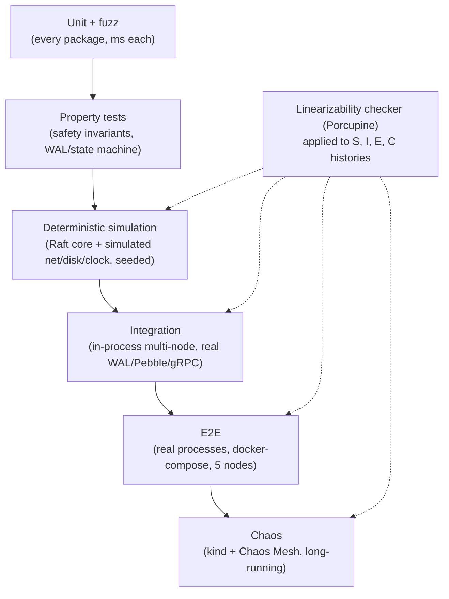

# Testing, Correctness Validation & Benchmark Methodology

Status: **Draft design**. No code exists yet. This document defines how RaftKV is tested and benchmarked. It builds on
`design-decisions.md`, mainly **D-18** (correctness testing), **D-19** (E2E CI), **D-20** (benchmark reference hardware,
**Open**) and the *Performance targets* section.

> **No results here.** Every number in this document is a **target**, **threshold** or **parameter**. Nothing has
> been measured yet. Results tables are left empty on purpose. Each parameter that is a proposal (not a D-xx baseline) is
> marked *(param)* and may be tuned. The tuned value is recorded in the run manifest.

Related documents: `architecture.md`, `system-design.md`, `api-design.md`, `storage-design.md`,
`implementation-roadmap.md`, `WBS.md`, `ci-e2e.md` (CI wiring of everything below).

---

## 1. Goals and principles

1. **Safety first, performance second.** A benchmark number from a build that has not passed the correctness gates is
   invalid and is not reported.
2. **Everything reproducible.** Every randomized test takes a seed. Every run writes a manifest (git SHA, config,
   seed, environment, tool versions). A failure is only "understood" once it can be replayed from its artifacts.
3. **Deterministic where possible, real where necessary.** The Raft core is a pure state machine driven by `Tick()`
   (D-01, D-24), so most consensus bugs should be found in deterministic simulation. Real processes, disks and networks
   (e2e, chaos) are there to catch what simulation cannot model: fsync semantics, gRPC behaviour, OS scheduling, and
   Kubernetes lifecycle.
4. **Fail loud, never retry correctness.** A safety failure is a bug until shown otherwise. Blind retries are not
   allowed (see `ci-e2e.md` §7).
5. **Count honestly.** The validation counts (ops, faults) are defined precisely in §5 so that "≥ 40M ops,
   ≥ 1,500 faults, 0 violations" cannot be met by stretching the definitions.

---

## 2. Test pyramid



| Layer | Location (per repo layout in `design-decisions.md`) | Scope | Runs in | Budget per run *(param)* |
|---|---|---|---|---|
| Unit + fuzz | `internal/**/..._test.go` | Pure functions, codecs, per-package logic | Every PR (`-race`) | Whole suite ≤ 5 min |
| Property | `internal/raft`, `internal/wal`, `internal/storage` | Invariants over generated inputs | Every PR | ≤ 5 min |
| Simulation | `test/sim/` | Raft core (+ simulated KV state machine), many nodes, faults | PR: fixed seeds. Nightly: random seeds | PR ≤ 10 min. Nightly ≤ 3 h |
| Integration | `internal/server/..._test.go`, `test/integration/` *(proposed dir)* | Real Raft + WAL + Pebble + gRPC in one process | Every PR | ≤ 10 min |
| E2E | `test/e2e/` | 5 `raftkvd` containers, docker-compose, fault injection + Porcupine | Every PR (short). Nightly (long) | PR ≤ 15 min of workload |
| Chaos | `test/chaos/` | kind cluster, StatefulSet from `deploy/k8s/`, Chaos Mesh | Nightly + validation campaign | 2–6 h |
| Linearizability | `test/linearizability/` | Recorder + Porcupine models | Wherever a history is produced | Checker timeout per partition: 60 s *(param)* |

### 2.1 Unit tests

- Table-driven tests per package. `go test -race -count=1 ./...` must pass. `-shuffle=on` is used so tests do not
  depend on order.
- **Go native fuzzing** (`testing.F`) for anything that decodes untrusted or on-disk bytes: WAL record and segment
  header decoding (D-03), snapshot metadata (D-14), Protobuf request validation against D-11 limits, and key-range
  encoding. PRs run each fuzz target for a short time (`-fuzztime=30s` *(param)*). Nightly runs them longer and keeps the
  corpus as a CI cache plus checked-in `testdata/fuzz/` regressions.
- Coverage is reported but not gated globally. Gates: `internal/raft` and `internal/wal` line coverage ≥ 85%
  *(param threshold)*. Coverage is a hint, not proof. The simulation and checker are the real safety evidence.

### 2.2 Deterministic simulation of the Raft core (D-18)

The Raft core does no I/O and is advanced by `Step(msg)`, `Tick()` and `Ready()`/`Advance()` (D-01, D-24). The
simulator owns everything else.

**Simulator components**

| Component | Behaviour |
|---|---|
| **Seeded scheduler** | Single goroutine, discrete-event queue ordered by `(virtual_time, seq)`. Every random choice comes from one `math/rand/v2` PCG source seeded by `SEED`. No goroutines, maps iterated only after sorting, no wall clock. Running the same seed on the same commit must produce a byte-identical event trace. CI checks this by running a sample seed twice and diffing trace hashes. |
| **Simulated clock** | Virtual time. Each node gets `Tick()` at its own rate with configurable jitter and drift, so randomized election timeouts (D-08: 1000–2000 ms, heartbeat 100 ms, expressed in ticks) interact realistically. Lease-read logic (D-05) reads a per-node simulated wall clock whose skew the scheduler controls. |
| **Simulated network** | Per-link queue with configurable latency distribution, **drop** probability, **duplicate** probability, **reorder** (random extra delay), **partition** (symmetric, asymmetric/one-way, minority/majority, bridge/"cut the leader off from all but one"), and **bandwidth caps** for snapshot streams (D-14). Messages are Protobuf-encoded and decoded at the boundary, so serialization bugs show up too. |
| **Simulated disk** | Models the WAL (D-03) and state machine storage. Writes go to a volatile buffer until `fsync`. **Crash** throws away un-synced data, and can optionally keep a random prefix of un-synced bytes (torn write). Also supports injected `EIO`/`ENOSPC` on write or fsync, and fsync latency distributions. The applied-index-in-same-batch rule (D-04) is modelled atomically. |
| **Fault scheduler** | Per seed, picks a fault plan: crash/restart, pause (node stops receiving ticks/messages but keeps state), partitions, link degradation, disk faults, clock skew, membership changes (D-06: add learner → promote → remove; D-23), leadership transfer (`TimeoutNow`), snapshot triggers (D-14 thresholds lowered for sim). |
| **Client model** | Simulated clients issue KV ops (D-10) with client sessions (D-09) against whichever node they believe is leader, including retries with the same `(client_id, sequence)`. Clients record a history in the same format as real runs (§3.1), so the same Porcupine checker applies. |

**Invariants checked after every event** (assertion failure stops the run and dumps the trace):

| ID | Invariant |
|---|---|
| INV-1 Election Safety | At most one leader per term (across all nodes, including those that later crash). |
| INV-2 Leader Append-Only | A leader never overwrites or deletes entries in its own log during its term. |
| INV-3 Log Matching | If two logs contain an entry with the same index and term, the logs are identical up to that index. |
| INV-4 Leader Completeness | Every entry committed in term T is present in the log of every leader of a term > T. |
| INV-5 State Machine Safety | No two nodes apply different commands at the same index. Each node's applied sequence is a prefix of a single global sequence. |
| INV-6 Monotonicity | `commitIndex` and `appliedIndex` never go backwards on a node, including across crash/restart (the recovered `appliedIndex` comes from Pebble per D-04). `applied ≤ committed ≤ lastIndex`. |
| INV-7 Durability | An entry acknowledged as committed to a client is never lost, under any crash pattern that leaves a quorum's synced disks intact. |
| INV-8 Membership | At most one uncommitted configuration change in the log at a time (D-06 single-server changes). Learners never count toward quorum. |
| INV-9 Exactly-once | With sessions (D-09), a `(client_id, sequence)` is applied at most once. |
| INV-10 Read safety | ReadIndex reads (D-05) observe a state at least as new as the commit index at the time the read was received. |
| LIVE-1 Liveness (bounded) | After all faults heal and a majority is connected, a leader is elected and a no-op committed within `N` ticks (`N` = 10 × max election timeout *(param)*). PreVote/CheckQuorum (D-08) must not cause endless elections. A liveness failure is reported separately from safety failures. |

At the end of each run, the recorded client history is checked by Porcupine (§3).

**Reproduction.** Every failure prints `make sim SEED=<seed> SIM_PROFILE=<profile> GIT_SHA=<sha>`. Profiles
(`pr`, `nightly`, `membership`, `disk`, `snapshot`) fix the fault mix and run length. Each seed must run under a
deterministic run-time cap. Failing seeds are added to `test/sim/seeds/regressions.txt`, which runs on every PR.

**Shrinking** *(stretch)*: the simulator can replay a failing seed with the fault plan reduced step by step (drop one
fault at a time, keep it dropped if the failure persists) to give a minimal reproducer.

### 2.3 Property-based tests

The library is an open question (see §10, Q-3). `pgregory.net/rapid` is recommended because it shrinks
automatically.

| Target | Property |
|---|---|
| Raft core (single node / small clusters without simulator) | Random message sequences never violate INV-1..INV-6. `Ready` never asks to send messages that depend on un-persisted entries in a way that breaks the persistence-before-send rule, except where D-13 parallel leader WAL writes explicitly allow it (leader only). |
| WAL (D-03) | For any sequence of appends/fsyncs/truncations followed by a crash at any byte offset, recovery returns exactly the synced prefix (plus possibly whole un-synced records), never a corrupted record. CRC32C detects every single-bit flip in the payload. Segment rollover at 64 MiB boundaries keeps order. |
| State machine (D-04, D-09) | Applying the same committed entries to a fresh Pebble instance, with crashes injected between batches, always produces the same state and `appliedIndex`. Duplicate session entries are no-ops. |
| KV semantics vs model | Random op sequences on the real state machine match a pure in-memory reference map (Put/Get/Delete/CAS/Range including limit, D-10/D-11). |
| Snapshot (D-14) | install(create(state)) == state. Interrupted chunked transfer resumes to an identical result. |

### 2.4 Integration tests (in-process multi-node)

- 3- and 5-node clusters in one test process using real `internal/raft`, `internal/wal`, `internal/storage`, real
  gRPC servers on loopback (or `bufconn`), and real temp directories.
- A test-only transport wrapper can drop, delay or partition peer streams (D-12) and close a node (simulated crash:
  close without flushing, then reopen from disk).
- Scenarios: leader failover under write load. Follower catch-up via log and via snapshot (D-14). Learner add/promote/
  remove and leadership transfer (D-06, D-23). Session dedup across leader change (D-09). ReadIndex from followers
  (D-05). Limit enforcement (D-11). Stale reads only when `consistency=STALE` is requested.
- The history recorder runs here too. Short histories are checked with Porcupine.

### 2.5 End-to-end tests (real processes, docker-compose)

- `test/e2e/docker-compose.yml` *(to be created)*: 5 `raftkvd` containers on a user-defined bridge network, each with its
  own volume, `NET_ADMIN` capability (for in-container `iptables`/`tc`), plus one `raftkv-e2e` harness container running
  the workload clients, recorder, fault injector (via Docker API socket) and checker.
- A size-limited tmpfs or loop device can be mounted as the data dir for disk-full tests (§4).
- Harness exit codes (shared with chaos and sim, used by CI to classify failures, see `ci-e2e.md` §7):

| Code | Meaning |
|---|---|
| 0 | Pass: history linearizable, invariants held, cluster healthy at end |
| 1 | **Correctness violation** (linearizability, invariant, data-loss check) |
| 2 | Infrastructure error (container failed to start, image pull, Docker API) |
| 3 | Checker inconclusive (Porcupine timeout on a partition). **Not a pass** |
| 4 | Liveness failure (cluster did not recover within the bound after faults healed) |

- End-of-run checks beyond Porcupine: every node converges to the same `appliedIndex` and the same state-machine digest
  (hash over a full Range scan) after a quiescent period. Each node's data directory passes the WAL/Pebble consistency
  checker (`raftkvctl debug verify` *(proposed)*).

### 2.6 Chaos tests (kind + Chaos Mesh)

- kind cluster with ≥ 5 worker nodes *(param)* so pod anti-affinity (D-16) can be honoured. The RaftKV StatefulSet,
  Services and PDB come from `deploy/k8s/` (same manifests as production, with test overlays).
- Chaos Mesh experiments live in `test/chaos/` as `Schedule`/`Workflow` CRDs (§4). The workload and recorder run as a
  **single** client pod so the history has one monotonic clock (see §3.1).
- kind shares one host's disk and CPU. **Chaos runs produce no performance numbers**, only correctness evidence.
- Kubernetes-specific scenarios: rolling restart under load with PDB `maxUnavailable: 1`. Pod rescheduled to another
  node with the same PVC. DNS changes for the headless Service. Liveness/readiness probes not flapping during elections.

---

## 3. Linearizability checking

### 3.1 History recording format

Each client writes **JSON Lines**, one event per line. The recorder buffers events in memory and flushes them to
`history-<run_id>-<client>.jsonl`. All clients of one run live in one process (or one pod) and timestamp with the same
monotonic clock (`time.Now()` monotonic reading, stored as ns since run start). Cross-host clients are not allowed in a
checked run because their clocks are not comparable (see §10, Q-6).

```jsonc
// design sketch: one event per line
{"run":"e2e-20261121-a1b2","proc":17,"op":904211,"type":"invoke","f":"cas","key":"k-0042",
 "expect":"v-17-903998","value":"v-17-904211","session":{"client_id":"c17","seq":5531},
 "t":81234567890,"node":"raftkv-2","trace_id":"4bf92f3577b34da6"}
{"run":"e2e-20261121-a1b2","proc":17,"op":904211,"type":"ok","f":"cas","key":"k-0042",
 "result":{"swapped":true},"t":81236001234,"node":"raftkv-2"}
```

| Field | Meaning |
|---|---|
| `proc` | Logical process (a client goroutine that runs **one op at a time**). Porcupine needs this. |
| `op` | Unique per run. Pairs `invoke` with its completion. |
| `type` | `invoke`, `ok` (definitely happened, result known), `fail` (definitely did **not** take effect), `info` (indeterminate) |
| `f` | `put`, `get`, `delete`, `cas`, `range` |
| `value` | Values are unique per write (`v-<proc>-<op>`) so any read can be traced to exactly one write. |
| `session` | D-09 `(client_id, seq)`. Retries of one logical op reuse it. The recorder logs **one logical op** spanning from the first attempt's invoke to the final outcome. |
| `node`, `trace_id` | For debugging only (link to OTel traces, D-17). Ignored by the checker. |

Separately, the fault injector writes `faults-<run_id>.jsonl` (`{"fault_id","kind","target","t_start","t_end","tool",
"params"}`) using the same clock, so a visualization can overlay faults on the history.

### 3.2 Classifying outcomes (`ok` / `fail` / `info`)

This is where checkers usually go wrong, so the rules are explicit. The final gRPC status mapping is owned by
`api-design.md`. The table states what the checker needs.

| Client observation | Classification | Rationale |
|---|---|---|
| Success response | `ok` | |
| CAS response "not swapped" (value mismatch) | `ok` with `swapped:false` and the observed current value if the API returns it | It is a successful read of the current state |
| Rejected before proposal (validation error D-11, `NOT_LEADER` returned before the entry was proposed, client-side rate limit) | `fail` | Provably not in the log. Requires the server to only return these codes when it is sure. `api-design.md` must guarantee this (Q-4). |
| Deadline exceeded, connection reset, `UNAVAILABLE` after send, leader lost after proposal | `info` | May or may not have been applied |
| Any read that is indeterminate | **dropped from the history** | Reads have no side effects. Dropping them is sound and keeps Porcupine fast. |

**Indeterminate writes**: for Porcupine, an `info` op gets **return time = +∞** (it may take effect at any point after
invoke), and its output is "unknown", which the model accepts for any state. Because values are unique, a later read
that sees the value pins it. The client **retires** that `proc` after an `info` write and continues as a fresh `proc` ID
(standard Jepsen practice), because the process can no longer be considered sequential.

**Cap on indeterminacy** *(threshold)*: if more than 5% of write ops in any key partition are `info`, the run is
marked *degraded*. It is still checked, but it is flagged in the report because high indeterminacy makes the check weaker.

### 3.3 Porcupine model (KV with CAS)

Uses `github.com/anishathalye/porcupine` with a **partitioned model** (`Model.Partition` / `PartitionEvent`) that splits
the history by key. Linearizability is *local* (compositional per object), so checking each key independently is sound
for single-key ops.

```text
design sketch (not code):
  State per key:   absent | present(value)
  Init:            absent
  Step(state, input, output) -> (ok, newState)
    put(v):        ok always;                       new = present(v)
    delete:        ok always;                       new = absent
    get:           ok iff output matches state      (absent ↔ not_found); new = state
    cas(e, v):     if state matches e:  ok iff output.swapped == true;  new = present(v)
                   else:                ok iff output.swapped == false; new = state
                   (output == unknown, i.e. info): accept both branches -> model is
                    nondeterministic; implemented via NondeterministicModel
                    returning {state, present(v) if match}
    put/delete with unknown output: same as known (they always succeed if applied);
                    the +∞ return time handles "maybe not applied".
  Equal:           value equality
  DescribeOperation/State: for the HTML visualization
```

- **CAS "expected absent"** semantics (create-if-not-exists) depend on `api-design.md`. The model supports
  `expect = absent` if the API offers it (Q-5).
- **Range** (D-10) is a multi-key op and cannot be partitioned by key. Options: (a) check Range only in short,
  low-concurrency histories with an unpartitioned model over a small keyspace, (b) check that each Range is consistent
  with per-key point-in-time states (weaker). Proposed: (a) for e2e/integration, and Range excluded from the 40M count
  (Q-7).
- **Stale reads** (`consistency=STALE`, D-05) are not linearizable by design. They are recorded but **excluded** from
  the linearizable check. A separate *staleness checker* verifies only that the value read was written at some point
  and is not newer than the read's completion (monotonic-prefix check per session). They do not count toward the 40M.
- **Lease reads** (D-05, flag) are checked as linearizable reads. They have dedicated campaigns with clock skew inside
  and outside the configured max drift (§4, F-15/F-16).

### 3.4 Tractability

Porcupine's search grows exponentially with concurrency per partition. Workload parameters for checked runs:

| Parameter | Value *(param)* | Why |
|---|---|---|
| Keyspace for checked workloads | 1,000–10,000 keys | Spread ops so per-key histories stay short |
| Key choice | Uniform, plus a "hot set" of 10 keys getting 10% of ops | Hot keys stress contention/CAS. Uniform keeps most partitions cheap |
| Max ops per key partition per history | 20,000 | Above this, split the run into time windows ending at quiescent points (all ops complete, no faults active) |
| Concurrency per key | ≤ 16 procs | Bounded search width |
| Checker timeout per partition | 60 s | Timeout → exit code 3 (inconclusive) |
| Checker parallelism | One goroutine per partition, `GOMAXPROCS` workers | Partitions are independent |

**Quiescent windowing**: the workload pauses for a short period *(param: 2 s)* every *N* minutes *(param: 5)* with no
faults active. The history is cut at these points and each window is checked independently, with the state at the end of
window *i* being the known initial state for window *i+1* (taken from a linearizable full read at the barrier). This
keeps checking time linear in run length.

**Checker self-test (mutation canary)**: each campaign and the nightly run include at least one run against a test-only
build with a known safety bug turned on (e.g. followers serve "linearizable" reads locally without ReadIndex, or a skipped
fsync), behind a build tag that is never in release builds. The checker **must** report a violation. If it does not, the
campaign is invalid. This proves the pipeline can see violations. Those runs are excluded from counts (Q-8).

---

## 4. Fault-injection catalogue

D-18 requires kill, SIGSTOP pause, partition, packet loss/latency and disk-full. The catalogue extends these. "Layer"
says where the fault is available: **S** = simulation, **I** = integration, **E** = docker-compose e2e, **C** = kind
+ Chaos Mesh.

| ID | Fault | Tool / mechanism | Layer | What it validates |
|---|---|---|---|---|
| F-01 | **Leader kill** (hard) | E: `docker kill -s KILL <leader>` (leader found via `raftkvctl` / `ListMembers`). C: Chaos Mesh `PodChaos action: container-kill` with a label selector updated to the current leader by the harness. S: crash event | S I E C | Failover. No acknowledged write lost (INV-7). Election under D-08 timing. Session dedup on client retry (D-09) |
| F-02 | **Follower kill** (hard) | `kill -9` / `docker kill -s KILL` / `PodChaos container-kill` | S I E C | Quorum maintained with 4/5. Restart recovery from WAL + Pebble (D-03, D-04) |
| F-03 | **Pod deletion / reschedule** | `PodChaos action: pod-kill`, `kubectl delete pod` | C | StatefulSet identity + PVC reattach. Peer DNS re-resolution (D-16) |
| F-04 | **Process pause** (GC-like / VM stall) | `kill -STOP` … `kill -CONT` (E: `docker pause/unpause` cgroup freezer). C: `PodChaos action: pod-failure` is **not** equivalent; use a `kill -STOP` via an ephemeral debug container or a privileged DaemonSet *(see Q-9)* | S E C | Deposed leader comes back after a pause and must not serve stale reads or accept writes (CheckQuorum, D-08; ReadIndex D-05). Lease safety (D-05) |
| F-05 | **Rolling multi-kill** (2 nodes, within quorum loss bound) | Harness script | S E C | 3/5 quorum still progresses. Quorum loss (3 killed) → unavailability but **no** safety violation, and recovery after restart |
| F-06 | **Symmetric partition (minority/majority)** | E: `iptables -A INPUT/OUTPUT -s/-d <peer> -j DROP` inside containers, or `docker network disconnect`. C: `NetworkChaos action: partition direction: both` | S I E C | Minority leader steps down (CheckQuorum). Majority elects. No split-brain (INV-1) |
| F-07 | **Asymmetric / one-way partition** | `iptables` OUTPUT-only drop. `NetworkChaos direction: to` | S E C | PreVote prevents disruption from a node that can send but not receive (D-08) |
| F-08 | **Leader isolation with bridge** (leader reaches only one follower) | iptables rules per peer pair. `NetworkChaos` with `target` selectors | S E C | Classic partial-partition cases. Commit only with a true majority |
| F-09 | **Packet loss** | `tc qdisc add dev eth0 root netem loss 5%..30%` *(param)*, or Toxiproxy `timeout`/`limit_data` toxics on peer links. `NetworkChaos action: loss` | S E C | gRPC stream reconnection. Pipelining window recovery (D-12) |
| F-10 | **Latency + jitter** | `tc netem delay 50ms 20ms distribution normal` *(param)*. Toxiproxy `latency`. `NetworkChaos action: delay` | S E C | Election stability under timing (D-08). Heartbeat vs timeout margins |
| F-11 | **Duplicate / reorder / corrupt packets** | `tc netem duplicate 5% reorder 25% corrupt 0.1%` *(param)*. `NetworkChaos duplicate/corrupt`. S: duplicate & reorder at message level | S E C | Idempotent message handling. TCP+gRPC framing integrity (corrupt should be caught by TCP checksum/TLS. Mostly a transport-robustness check) |
| F-12 | **Bandwidth limit during snapshot** | `tc tbf rate 1mbit` *(param)*. `NetworkChaos action: bandwidth` | S E C | Chunked snapshot resume (D-14). Replication continuing alongside snapshot |
| F-13 | **Disk full (ENOSPC)** | E: data dir on a size-limited tmpfs (`--tmpfs /data:size=256m` *(param)*) or a loop device (`fallocate` + `mkfs.ext4` + `mount -o loop`). Fill with a filler file. C: small PVC via a dedicated StorageClass, or `IOChaos action: fault errno: 28`. S: injected ENOSPC | S E C | WAL append/fsync error handling: node must stop accepting writes (fail-stop or read-only, per `storage-design.md`) and **never** ack an unpersisted entry. Recovery after space is freed |
| F-14 | **Disk I/O errors / latency** | `IOChaos action: fault errno: 5 (EIO)` and `action: latency delay: 100ms` *(param)* on the data volume. Linux `dm-delay` / `dm-flakey` on a loop device for E *(optional)* | S C (E optional) | fsync latency tail effects on group commit (D-13). EIO on fsync → fail-stop (no retry of fsync after failure) |
| F-15 | **Clock skew, within bound** | E: `libfaketime` (`FAKETIME="+200ms"` / drift rate) via `LD_PRELOAD` on one node. C: `TimeChaos timeOffset`. S: per-node simulated wall clock | S E C | Tick-driven election logic unaffected (D-24). Lease reads (D-05) safe while skew ≤ configured max drift |
| F-16 | **Clock skew, beyond bound** (negative test) | Same tools with offset > configured max drift | S E C | With lease reads **off** (default): still 0 violations. With lease reads **on**: documents the expected unsafety. These runs are labelled *expected-unsafe*, excluded from the validation count, and used to confirm the drift guard / docs |
| F-17 | **Clock jump** (NTP step back/forward) | `TimeChaos` large offsets. `date -s` in privileged container | S C | Monotonic time used for timeouts. No wall-clock dependence outside D-05/metrics |
| F-18 | **CPU starvation / noisy neighbour** | `StressChaos stressors.cpu`. `docker update --cpus=0.2` | C E | Heartbeat delivery under starvation. Spurious elections bounded |
| F-19 | **Memory pressure / OOM kill** | `StressChaos stressors.memory`. Low memory limit → OOMKilled | C | Same as hard kill (F-02), triggered by the kernel |
| F-20 | **Membership change under fault** | `raftkvctl cluster add-learner/promote/remove/transfer` (D-23) combined with F-01/F-06 | S I E C | D-06 single-server change safety (INV-8). Leadership transfer during partitions |
| F-21 | **Torn write / un-synced loss** | S: simulated disk. E: `kill -9` immediately after high write rates (best effort; the OS page cache usually survives process kill). Real power-loss simulation would need `dm-log-writes` or a VM hard reset *(stretch)* | S (E partial) | WAL recovery truncates torn tail records (CRC32C). Never acks before fsync |
| F-22 | **Client-side faults** | Client deadline expiry, connection drops (Toxiproxy on client port) | I E C | `info` classification correctness. Session retry exactly-once (D-09) |

**Fault-type mapping to the validation target** ("leader kill, process kill/pause, partition" from the Performance
targets): F-01 → *leader kill*. F-02/F-03/F-04/F-05/F-19 → *process kill/pause*. F-06/F-07/F-08 → *partition*.
Others are **additional** and are counted under "other" (see §5.2).

---

## 5. Reaching the correctness-validation target

Target (from `design-decisions.md`, a **target, not a result**): **≥ 40M operations checked, ≥ 1,500 injected faults
(leader kill, process kill/pause, partition), 0 linearizability violations.**

### 5.1 What counts as an "operation checked"

An operation counts toward the 40M only if **all** of these hold:

1. It is a single-key `put`, `get` (linearizable: ReadIndex or lease), `delete` or `cas` op in a history recorded by
   the e2e (§2.5) or chaos (§2.6) harness, i.e. **real processes**. Simulation ops are reported **separately** and are
   **not** part of the headline count (Q-1).
2. Its completion is `ok` or `fail`, or it is an `info` **write** (included in the check with +∞ return). Dropped
   indeterminate reads do **not** count.
3. Its key partition (or quiescent window) got a definite **linearizable** verdict from Porcupine. Partitions that time
   out (exit code 3) count **zero** ops and are listed in the report.
4. The run was against the **validation SHA** (see §5.4) and was not a mutation-canary or expected-unsafe run.

### 5.2 What counts as an "injected fault"

- One fault = one injection action with a recorded `t_start` and `t_end` (heal / restart) in `faults-<run>.jsonl`. A
  partition held for 15 s is **one** fault. A Chaos Mesh `Schedule` firing 40 times is **40** faults. The count comes
  from the harness log and is cross-checked against Chaos Mesh event records (`kubectl get events` / experiment status).
- A fault counts only if **client traffic was in flight during it** (at least one op invoked in `[t_start, t_end]`), and
  the run it occurred in passes the check (§5.1.3).
- Quotas *(param, proposed)* so the 1,500 is not dominated by one cheap fault kind:

| Category | Catalogue IDs | Minimum count |
|---|---|---|
| Leader kill | F-01 | ≥ 300 |
| Process kill / pause (non-leader or any node) | F-02, F-03, F-04, F-05, F-19 | ≥ 450 (of which pause F-04 ≥ 150) |
| Partition | F-06, F-07, F-08 | ≥ 450 |
| Other (loss/latency/disk/clock/membership…) | F-09..F-22 | not required for the 1,500. Reported separately |
| **Headline total (first three rows)** | | **≥ 1,500** |

### 5.3 Campaign design

Two engines contribute: **E** (docker-compose, cheap, dense faults) and **C** (kind + Chaos Mesh, Kubernetes
realism). Planning arithmetic below uses parameters only. It is sizing, not a measurement:

| Parameter *(param)* | E campaign run | C campaign run |
|---|---|---|
| Run length | 30 min | 4 h |
| Checked-client offered rate | 2,000 ops/s (well below the throughput target. Checking, not benchmarking) | 1,500 ops/s |
| Workload mix | 40% get, 30% put, 10% delete, 20% cas | same |
| Fault cadence | 1 fault every 20 s, mean hold 10 s, randomized | 1 fault every 60 s |
| Ops per run (if rate is sustained) | 2,000 × 1,800 s = 3.6M | 1,500 × 14,400 s = 21.6M |
| Faults per run (if cadence is sustained) | 90 | 240 |

With these parameters, a campaign of **8 E runs + 2 C runs** would plan for about 72M offered ops and about 1,200 faults,
so the fault total is the constraint. The proposed campaign is therefore **12 E runs + 2 C runs** (planning: about
1,560 faults and 86M offered ops, a margin that covers lost windows, dropped reads and inconclusive partitions). Actual
counts come only from the ledger (§5.5). The campaign continues until the ledger shows all thresholds met.

**Schedule.** Milestone mapping is owned by `implementation-roadmap.md` / `WBS.md`. Proposal:

| Phase | When | Content | Counts toward target? |
|---|---|---|---|
| Continuous | Every PR / night (see `ci-e2e.md`) | Short E runs, nightly C run | Only once a validation SHA is frozen |
| Pre-validation soak | After M6 (membership) features land | Full fault mix, fix bugs, tune checker parameters | No |
| **Validation campaign** | Release-candidate freeze (before M8 release) | §5.3 runs on the validation SHA, executed by nightly + dispatched runs | **Yes** |
| Regression | Each later release | Reduced campaign (e.g. 25% of the target) *(param)* | Reported per release |

### 5.4 Validation SHA and count resets

- The campaign is bound to one **validation SHA** (tag `validation/vX.Y.Z-rcN`).
- Proposed rule (Q-2): changes to `internal/raft`, `internal/wal`, `internal/storage`, `internal/snapshot`,
  `internal/transport` or the read/write path in `internal/server` **reset** the count. Changes to docs, CLI, metrics or
  deploy manifests do not. A reset is recorded in the ledger.
- **Any** linearizability violation or invariant failure, on any SHA in the release line, stops the campaign until
  root-caused. If the fix touches the reset paths, the count restarts.

### 5.5 Counting, reporting and artifacts

**Ledger**: `validation-ledger.jsonl`, one row per run, appended by the harness and uploaded as a CI artifact (and to
long-term storage, Q-10):

```jsonc
// design sketch
{"run_id":"...","engine":"E|C|S","git_sha":"...","validation_tag":"...","seed":123,"started":"...","duration_s":1800,
 "config_digest":"sha256:...","ops":{"invoked":0,"ok":0,"fail":0,"info_writes":0,"dropped_reads":0,"checked":0},
 "faults":{"leader_kill":0,"proc_kill_pause":0,"partition":0,"other":0,"discarded_no_traffic":0},
 "checker":{"verdict":"linearizable|violation|inconclusive","partitions":0,"inconclusive_partitions":0,
            "max_partition_s":0},
 "invariants":{"state_digest_converged":true,"verify_ok":true},
 "artifacts":"<uri>"}
```

All zeros above are field placeholders, not values. **Report generator** (`raftkv-validate report` *(proposed)*)
aggregates the ledger into the campaign report (§9.3 template): totals per category, per engine, inconclusive and
degraded runs, and violations (must be 0).

**Artifacts kept per run** (retention in `ci-e2e.md` §6):

| Artifact | Always | On failure |
|---|---|---|
| Run manifest (SHA, config, seed, tool versions, image digests) | ✓ | ✓ |
| Ledger row | ✓ | ✓ |
| Compressed histories (`history-*.jsonl.zst`) + fault log | ✓ (campaign runs) | ✓ |
| Porcupine HTML visualization of the failing partition | | ✓ |
| Node logs (slog JSON, D-17), Prometheus snapshot (TSDB dump or `/metrics` scrapes) | | ✓ |
| Data directories (WAL segments + Pebble) of all nodes, tarred | | ✓ |
| Sim event trace + seed + profile | | ✓ |
| OTel traces for the violating ops (by `trace_id`) | | ✓ if collector enabled |

---

## 6. Benchmark methodology

### 6.1 Reference environment (D-20 is **Open**)

**No benchmark result is official until D-20 is resolved.** The placeholder below is the D-20 example, kept only so the
methodology can be written. It is not a decision.

| Item | Placeholder (to be replaced by D-20) |
|---|---|
| Server nodes | 5 × VM, 8 vCPU / 32 GiB, local NVMe for WAL + Pebble, same AZ |
| Load-generator nodes | ≥ 2 × VM of the same class, same AZ, **separate** from servers |
| Network | Same placement group / low-latency network. Record measured RTT and bandwidth in the manifest *(environment characterization, not a result)* |
| OS / kernel | To be pinned: distro, kernel version, filesystem (ext4/xfs), mount options (`noatime`), I/O scheduler (`none` for NVMe) |
| CPU settings | Governor `performance`. Turbo policy recorded. SMT state recorded |
| Go | Version per D-21. `GOMAXPROCS` = vCPU count. `GOGC`/`GOMEMLIMIT` recorded |
| RaftKV config | Defaults from D-08/D-11/D-13/D-14 unless the benchmark varies them. Full config digest in manifest |
| Security | mTLS on/off per D-15 (**Open**). Benchmarks run both modes once D-15 is decided. Headline mode TBD |

**Environment characterization** before each campaign (recorded, not compared to targets): `fio` sync-write latency
(`--rw=write --bs=4k --fsync=1`), `fio` random read, `iperf3` between all node pairs, `ping` RTT. This catches a "noisy"
VM before it wastes a campaign. Threshold *(param)*: if a node's fio fsync p99 differs from the fleet median by > 25%,
replace the node.

### 6.2 Workloads

Driven by `cmd/raftkv-bench` (to be created).

| ID | Workload | Ops | Read consistency | Notes |
|---|---|---|---|---|
| W1 | Write-only | 100% Put | — | **Headline write target** at 256 B |
| W2 | Read-only linearizable | 100% Get | ReadIndex (D-05 default) | **Headline read target** at 256 B. Reads spread across all nodes (follower ReadIndex forwarding) *and* leader-only, reported separately |
| W3 | Read-only stale | 100% Get | `STALE` | Upper bound of local read cost |
| W4 | Mixed 50/50 | 50% Get / 50% Put | ReadIndex | YCSB-A-like |
| W5 | Mixed 95/5 | 95% Get / 5% Put | ReadIndex | YCSB-B-like |
| W6 | CAS contention | 100% CAS on a small hot set (e.g. 16 keys *(param)*) | — | Measures conflict and success rate. Reports CAS success ratio |
| W7 | Lease reads | 100% Get | Lease (D-05 flag) | Only if lease reads are enabled for the release |

**Dimensions** (full cross product for W1, W2, W4, W5. Reduced set for others):

| Dimension | Values |
|---|---|
| Value size | 64 B, **256 B** (headline), 4 KiB |
| Key size | 16 B fixed *(param)* |
| Key distribution | Uniform. Zipfian (θ = 0.99 *(param)*, YCSB default) |
| Keyspace / preload | 10M keys *(param)* preloaded before measurement, so reads hit existing keys and Pebble has realistic depth |
| Client connections | Fixed pool per loadgen *(param: 64 conns × N loadgens)*. Recorded |

### 6.3 Load generation: open loop, no coordinated omission

- **Open-loop** scheduler: each worker gets a precomputed send schedule (constant-rate or Poisson arrivals at the
  offered rate `R`). Latency = `completion_time − intended_send_time`, **not** `− actual_send_time`. If the system
  stalls, queued requests accumulate the latency they really experienced (no coordinated omission).
- Outstanding-request cap per worker *(param: 1,024)*. If exceeded, the run is marked **saturated** (offered load not
  sustainable) instead of silently throttling.
- Latencies are recorded in **HdrHistogram** (`github.com/HdrHistogram/hdrhistogram-go`), range 1 µs–60 s, 3
  significant digits. Per-interval (1 s) histograms are logged (HdrHistogram log format) so tail behaviour over time can
  be plotted and the steady state verified. Loadgens' histograms are **merged** (never averaged percentiles).
- Errors and timeouts are counted per status code. A run with error rate > 0.1% *(threshold)* is invalid for throughput
  claims.
- Loadgen health: loadgen CPU must stay < 70% *(threshold)* and its GC pauses are recorded. Otherwise add loadgens.

**Finding maximum sustainable throughput (for the ops/s targets)**: step the offered rate `R` up (e.g. +10% steps
*(param)*). The **max sustainable throughput** is the highest `R` at which (a) achieved throughput ≥ 99% of `R`,
(b) the run is not saturated, (c) the error rate is within threshold, and (d) p99 latency ≤ a latency ceiling. The
latency ceiling for the throughput target is **not yet defined** (Q-11). Proposed: write p99 ≤ 50 ms, read p99 ≤ 20 ms
*(param)*.

### 6.4 Durations, repetitions, statistics

| Phase | Duration *(param)* |
|---|---|
| Cluster reset | Fresh data dirs, preload, then `sync` + drop page cache on all nodes |
| Preload | Until keyspace written. Wait for compactions to settle (Pebble L0 file count below threshold) |
| Warmup | 60 s at target rate (discarded) |
| Steady state (measured) | 300 s |
| Cooldown | 30 s (discarded) |
| Repetitions | N = 5 independent runs per configuration (fresh cluster each), order **interleaved** across configurations (ABAB…) to spread time-of-day drift |

- **Reported value** = median of the N runs, with a **95% confidence interval** of the median from a percentile
  bootstrap (10,000 resamples) over per-run values. For N = 5 the CI is wide. If the CI width exceeds 10% of the median
  *(threshold)*, increase N to 10.
- **Steady-state check**: per-second throughput coefficient of variation in the measured window ≤ 5% *(threshold)*, and
  no Pebble write stall events. Otherwise the run is invalid and repeated.
- A target is "met" only when the **median** meets it on D-20 hardware. The CI is always published next to it.

### 6.5 Metrics captured

| Category | Metrics | Source |
|---|---|---|
| Client | Throughput (achieved vs offered), latency p50/p95/p99/p99.9/max, error counts by code, CAS success ratio | HdrHistogram in `raftkv-bench` |
| Raft | Proposals/s, entries per `Ready` batch (histogram), AppendEntries per second, in-flight window occupancy, commit latency (propose → commit), apply latency, elections/term changes (must be 0 in a clean run) | Prometheus (D-17), names in `system-design.md` |
| WAL | fsyncs/s, fsync latency histogram, bytes written/s, entries per fsync (group-commit size), segment rollovers | Prometheus. Cross-checked with OS tracing |
| Storage | Pebble batch commit latency, compactions, L0 files, write amplification, stall count/time | Pebble metrics exported to Prometheus |
| Network | Peer bytes/s sent/received per link, gRPC stream reconnects | Prometheus + node_exporter |
| Host | CPU (user/sys/iowait) per node, memory RSS, Go GC pause and CPU fraction, disk IOPS/throughput/await, context switches | node_exporter, Go runtime metrics |

A Prometheus instance on a separate monitoring host scrapes every 5 s *(param)* during runs. Its TSDB snapshot for the
measured window is kept as an artifact.

### 6.6 Profiling procedure

Profiling runs are **separate** from measured runs because profiling adds overhead.

1. **CPU**: `go tool pprof http://<node>:<admin>/debug/pprof/profile?seconds=30` on the leader and one follower during
   steady state. Save the raw profiles. Produce flame graphs.
2. **Block and mutex**: enable at runtime only for profiling runs (`runtime.SetBlockProfileRate(10_000)`,
   `runtime.SetMutexProfileFraction(100)` *(param)*, via an admin endpoint or flag). Collect `/debug/pprof/block` and
   `/debug/pprof/mutex`.
3. **Execution trace**: `curl .../debug/pprof/trace?seconds=5` → `go tool trace`. Look at goroutine scheduling around
   the `Ready` loop, WAL writer, gRPC send loops, GC.
4. **Heap / allocs**: `/debug/pprof/heap` and `allocs` to find allocation-heavy paths (per-entry allocations).
5. **fsync tracing**: (a) the WAL's own fsync latency histogram. (b) OS level: `bpftrace -e 'tracepoint:syscalls:sys_enter_fdatasync, tracepoint:syscalls:sys_enter_fsync { @[comm] = count(); }'`
   and BCC `biolatency` / `ext4slower` (or `xfsslower`) to correlate fsync latency with device latency. (c) `perf trace -e fsync,fdatasync -p <pid>`
   as a fallback. Confirm fsync counts from metrics and from the OS agree.
6. **Off-CPU**: `offcputime` (BCC) for time blocked on I/O and locks.
7. The admin/pprof endpoint must be on a separate port, not exposed through the client Service (D-15/D-16 security
   note to be reflected in `system-design.md`).

### 6.7 A/B attribution of the D-13 optimizations (p99 target)

Target: **p99 write latency improved by ≥ 30% vs the M3 unoptimized baseline, same hardware and workload**
(Performance targets section). D-13 requires each optimization to be a separate change. Attribution method:

**Variants**

| Variant | Description |
|---|---|
| B0 | **M3 baseline**: tag `bench/m3-baseline` (to be created when M3 is done). No D-13 optimizations |
| O1 | B0 + proposal batching |
| O2 | B0 + group-commit fsync |
| O3 | B0 + leader WAL write in parallel with AppendEntries (dissertation §10.2.1) |
| O4 | B0 + pipelined replication (bounded in-flight window, D-12) |
| ALL | B0 + O1..O4 |
| C1..C4 | Cumulative stack in the order they land: B0+O1, +O2, +O3, +O4 |

Implementation guidance: each optimization should be both its own commit/PR **and** switchable by a config flag on the
final build. The flag lets B0..ALL run from **one binary**, so compiler and unrelated changes do not confound the results.
A cross-check run of the real B0 tag against the flags-all-off final build confirms the two behave the same (their CIs
overlap). If they don't, the flags-off build is not a valid baseline (Q-12).

**Fixed workload for the p99 comparison**: W1 (write-only), 256 B, uniform keys, at a **fixed offered rate** equal to
70% *(param)* of B0's max sustainable throughput (§6.3), so B0 is not saturated and the comparison is about latency, not
queueing collapse. A second comparison at 70% of ALL's max throughput is reported as a secondary view (Q-13).

**Procedure**

1. Same D-20 cluster, same day, fresh cluster per run, N ≥ 10 runs per variant, **randomized interleaved order**
   (block randomization: each block runs every variant once in random order).
2. Per run, record p99 over the measured window (merged HdrHistogram).
3. **Isolated effect** of Oi = (p99(B0) − p99(Oi)) / p99(B0), median across runs, with a 95% bootstrap CI on the
   ratio of medians.
4. **Incremental effect** via the cumulative stack Ci vs Ci−1. Because optimizations interact (batching and group
   commit both amortize fsync), isolated effects are **not** expected to add up. Both views are published.
5. **Target met** when ALL's median p99 improvement vs B0 is ≥ 30% **and** the lower bound of its 95% CI is > 0. The
   result is reported with its CI either way.
6. Also report p50/p99.9, throughput, fsyncs/s and entries-per-fsync for each variant, so the *mechanism* is visible
   (e.g. group commit should lower fsyncs/s at the same offered rate).

---

## 7. Performance targets (copied from `design-decisions.md`, **targets, not results**)

| Metric | Target | Workload in this doc | Status |
|---|---|---|---|
| Sustained writes (5 nodes, 3-of-5 quorum, 256 B values, fsync on) | ≥ 38,000 ops/s | W1, 256 B, uniform, §6.3 max-sustainable procedure | Not measured |
| Sustained linearizable reads (ReadIndex, 256 B values) | ≥ 92,000 ops/s | W2, 256 B, uniform, all-node ReadIndex | Not measured |
| Correctness validation | ≥ 40M operations checked, ≥ 1,500 injected faults (leader kill, process kill/pause, partition), **0** linearizability violations | §5 campaign | Not run |
| p99 write latency improvement from D-13 optimizations | ≥ 30% relative to the M3 unoptimized baseline, same hardware and workload | §6.7 | Not measured |

All four targets assume D-20 reference hardware (Open).

---

## 8. Acceptance criteria: "test & bench complete"

The test and benchmark work is complete for a release when **all** of the following hold:

**Correctness infrastructure**
- [ ] Simulator implements every component in §2.2. Same-seed determinism check passes in CI.
- [ ] Invariants INV-1..INV-10 and LIVE-1 are implemented and each has at least one **negative test** (a deliberately
      broken core variant in tests that the invariant catches).
- [ ] Porcupine KV+CAS model (§3.3) implemented with partitioning. Checker mutation canary (§3.4) detects the injected
      bug in every campaign.
- [ ] Fault catalogue: every row tagged for E or C in §4 is implemented and has run in at least one passing run
      (F-21's power-loss variant may stay *stretch*).
- [ ] Property tests and fuzz targets in §2.1/§2.3 exist and run in CI.

**Validation campaign**
- [ ] Ledger for the validation SHA shows ≥ 40M checked ops (§5.1), ≥ 1,500 headline faults meeting the §5.2 quotas,
      **0** violations, and inconclusive partitions ≤ 1% of partitions *(threshold)*, each listed.
- [ ] Campaign report (§9.3) published with artifacts linked. Mutation-canary and expected-unsafe runs listed separately.

**Benchmarks**
- [ ] D-20 resolved. Environment characterized (§6.1).
- [ ] All workloads W1–W6 (W7 if lease reads ship) × dimensions in §6.2 run with N ≥ 5, with valid steady state.
- [ ] Results report (§9.1) filled with medians, CIs and raw artifacts (HdrHistogram logs, Prometheus snapshots,
      manifests). Every target row states met / not met, without rounding up.
- [ ] D-13 A/B report (§9.2) filled with isolated and cumulative effects.
- [ ] Profiles (CPU, block, mutex, trace, fsync tracing) archived for W1 and W2 headline configurations.

**CI**
- [ ] Workflows in `ci-e2e.md` running. Required checks enforced. `make test / sim / e2e / chaos / bench` reproduce CI
      locally.

---

## 9. Report templates (empty, to be filled only with measured data)

### 9.1 Benchmark results report

Header: release/SHA ____ · D-20 environment ID ____ · date ____ · config digest ____ · mTLS ____ · N runs ____

| Workload | Value size | Key dist. | Max sustainable ops/s (median) | 95% CI | p50 | p95 | p99 | p99.9 | fsyncs/s | Entries/fsync | Leader CPU % | Target | Met? |
|---|---|---|---|---|---|---|---|---|---|---|---|---|---|
| W1 write-only | 256 B | uniform | | | | | | | | | | ≥ 38,000 ops/s | |
| W1 write-only | 64 B | uniform | | | | | | | | | | — | |
| W1 write-only | 4 KiB | uniform | | | | | | | | | | — | |
| W1 write-only | 256 B | zipfian | | | | | | | | | | — | |
| W2 read lin. (all nodes) | 256 B | uniform | | | | | | | | | | ≥ 92,000 ops/s | |
| W2 read lin. (leader only) | 256 B | uniform | | | | | | | | | | — | |
| W3 read stale | 256 B | uniform | | | | | | | | | | — | |
| W4 50/50 | 256 B | zipfian | | | | | | | | | | — | |
| W5 95/5 | 256 B | zipfian | | | | | | | | | | — | |
| W6 CAS contention | 256 B | hot set | | | | | | | | | | — (CAS success ratio: ) | |

### 9.2 D-13 A/B attribution report

Fixed offered rate: ____ ops/s (= 70% of B0 max sustainable) · N per variant ____ · run order seed ____

| Variant | p50 | p99 (median) | p99 95% CI | p99.9 | Δp99 vs B0 | Δp99 CI | Δp99 vs previous (cumulative) | fsyncs/s | Entries/fsync | Throughput |
|---|---|---|---|---|---|---|---|---|---|---|
| B0 (M3 baseline) | | | | | — | — | — | | | |
| O1 batching | | | | | | | n/a | | | |
| O2 group commit | | | | | | | n/a | | | |
| O3 parallel WAL write | | | | | | | n/a | | | |
| O4 pipelining | | | | | | | n/a | | | |
| C1..C3 (one row each) | | | | | | | | | | |
| ALL | | | | | | | | | | |

Target ≥ 30% p99 improvement (ALL vs B0): Met? ____

### 9.3 Correctness campaign report

Validation SHA ____ · campaign window ____ · ledger URI ____

| Engine | Runs | Ops checked | `info` writes | Inconclusive partitions | Leader kill | Proc kill/pause | Partition | Other faults | Violations |
|---|---|---|---|---|---|---|---|---|---|
| E (docker-compose) | | | | | | | | | |
| C (kind + Chaos Mesh) | | | | | | | | | |
| **Total (headline)** | | | | | | | | | |
| S (simulation, reported separately) | | | — | | | | | | |
| Mutation canary (must detect) | | — | — | — | — | — | — | — | (expected ≥ 1 per run) |

---

## 10. New open questions

| ID | Question | Recommendation | Relates to |
|---|---|---|---|
| Q-1 | Do simulation-checked ops count toward the ≥ 40M target? | No. Headline counts only real-process runs (E, C). Sim reported separately | D-18, Perf targets |
| Q-2 | Which code changes reset the validation count? | Changes under raft/wal/storage/snapshot/transport and read/write path in server (§5.4) | D-18 |
| Q-3 | Property-testing library? | `pgregory.net/rapid` (shrinking). Alternative `testing/quick` (no shrinking) | D-18 |
| Q-4 | Can the server guarantee that some error codes mean "definitely not applied"? Without it, every error must be `info`, which weakens checking | `api-design.md` to define a "not proposed" status/detail | D-09, D-10 |
| Q-5 | CAS semantics for "expected absent" and whether CAS returns the current value on mismatch | Support both. Simplifies model and gives stronger checks | D-10 |
| Q-6 | Chaos histories need one clock: is a single client pod enough load for C runs, or do we need multi-pod clients with per-pod independent histories over disjoint key sets? | Single pod first. If load is insufficient, multiple pods on **disjoint key ranges** (still sound per-key) | D-18 |
| Q-7 | How are Range ops validated, and are they counted? | Unpartitioned checks on small histories only. Excluded from the 40M | D-10 |
| Q-8 | Are test-only build tags for mutation canaries (deliberately unsafe code paths) acceptable in the main repo? | Yes, behind `//go:build raftkv_mutation`, with a CI check that release builds don't include them | D-18 |
| Q-9 | How to do SIGSTOP-style pause in Kubernetes (Chaos Mesh has no direct "pause process" action)? | Privileged chaos DaemonSet or ephemeral container issuing `kill -STOP/-CONT`. Needs security review for the test cluster only | D-18, D-19 |
| Q-10 | Long-term storage for histories and ledgers beyond GitHub artifact retention | Object storage bucket (S3/GCS) written via OIDC from nightly. Owner/budget TBD | D-19 |
| Q-11 | Latency ceiling that qualifies a throughput number as "sustained" | Write p99 ≤ 50 ms, read p99 ≤ 20 ms (param). Needs sign-off | Perf targets |
| Q-12 | Should D-13 optimizations stay behind runtime flags in production builds? | Keep the flags (default on) for at least one release for A/B and emergency rollback | D-13 |
| Q-13 | At which fixed offered load is the 30% p99 improvement judged? | 70% of B0's max sustainable throughput (primary) | D-13, Perf targets |
| Q-14 | Is IOChaos (FUSE-based) workable on kind in CI? | Spike early. Fallback: disk faults only in E via loop/dm devices | D-19 |
| Q-15 | Headline benchmark mode with mTLS on or off? | Depends on D-15. Report both | D-15, D-20 |
| Q-16 | Are reads served by followers (ReadIndex forwarding) part of the 92k reads/s target, or leader-only? | Target measured with reads spread across all nodes. Leader-only reported as secondary | D-05 |
