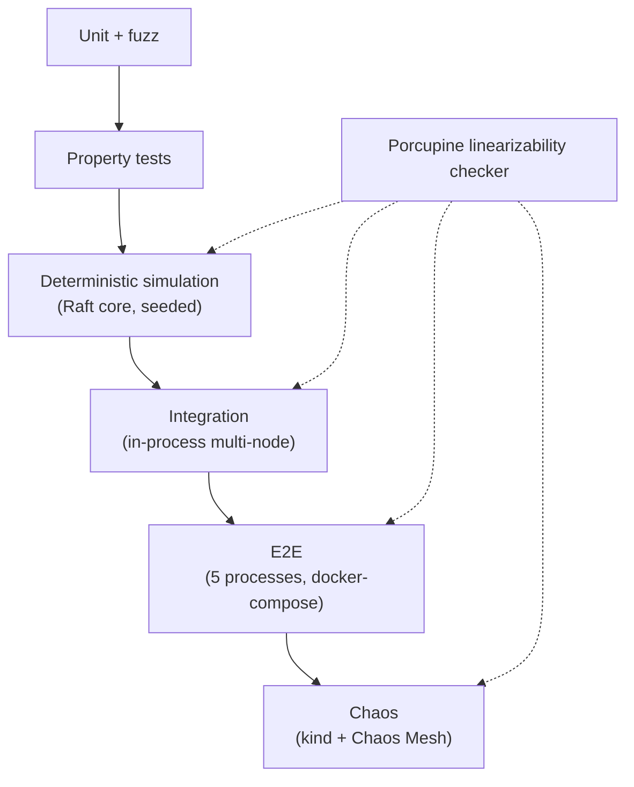

# Testing & Correctness

Status: **Draft design**. No code exists yet. This document says how RaftKV is tested and how we show it is correct.
It builds on `design-decisions.md`, mainly **D-18** (correctness testing) and **D-19** (CI). CI wiring is in
`ci-e2e.md`.

RaftKV is a learning project. There are **no performance targets and no benchmarks**. The goal of testing is to
find consensus bugs and to show, with evidence, that the store stays linearizable when nodes crash, pause and get cut
off from each other. Every number below is a starting parameter that can be tuned.

---

## 1. Principles

1. **Everything is reproducible.** Every randomized test takes a seed and prints it. A failure is only understood
   once it can be replayed from its seed or saved history.
2. **Deterministic where possible, real where necessary.** The Raft core is a pure state machine driven by `Tick()`
   (D-01, D-24), so most consensus bugs should show up in the deterministic simulator. Real processes (e2e, chaos)
   catch what the simulator can't model: real fsync, gRPC, OS scheduling and Kubernetes behaviour.
3. **Never retry a correctness failure.** A failed safety check is a bug until proven otherwise (see `ci-e2e.md`).
4. **Test the tests.** The checker must catch a deliberately broken build (§3.4). If it can't, a green run proves
   nothing.

---

## 2. Test layers



| Layer | Location | What it covers | Runs |
|---|---|---|---|
| Unit + fuzz | `internal/**/..._test.go` | Per-package logic, codecs | Every PR (`-race`) |
| Property | `internal/raft`, `internal/wal`, `internal/storage` | Invariants over generated inputs | Every PR |
| Simulation | `test/sim/` | Raft core with simulated network, disk and clock | PR: fixed seeds. Nightly: random seeds |
| Integration | `internal/server/..._test.go` | Real Raft + WAL + Pebble + gRPC in one process | Every PR |
| E2E | `test/e2e/` | 5 `raftkvd` containers, faults, Porcupine | PR: short. Nightly: longer |
| Chaos | `test/chaos/` | kind StatefulSet from `deploy/k8s/`, Chaos Mesh | Nightly |

### 2.1 Unit tests and fuzzing

- Table-driven tests. `go test -race -shuffle=on -count=1 ./...` must pass.
- Go native fuzzing (`testing.F`) for anything that decodes bytes from disk or the network: WAL records and segment
  headers (D-03), snapshot metadata (D-14), request validation against the D-11 limits. PRs fuzz briefly
  (`-fuzztime=30s`); nightly fuzzes longer. Crashers are kept in `testdata/fuzz/`.
- Coverage is reported but not gated. The simulator and checker are the real safety evidence.

### 2.2 Deterministic simulator (D-18)

The Raft core does no I/O. It is driven by `Step(msg)`, `Tick()` and `Ready()`/`Advance()`. The simulator owns
everything else.

| Component | Behaviour |
|---|---|
| **Scheduler** | One goroutine and an event queue ordered by `(virtual_time, seq)`. All randomness comes from one `math/rand/v2` source seeded by `SEED`. No wall clock, no unsorted map iteration. Same seed + same commit = identical event trace (CI checks this by running one seed twice and comparing trace hashes). |
| **Clock** | Virtual time. Each node gets `Tick()` at its own slightly jittered rate, so randomized election timeouts (D-08) interact realistically. |
| **Network** | Per-link queues with delay, drop, duplicate, reorder and partitions (symmetric, one-way, "leader can reach only one follower"). Messages are Protobuf-encoded at the boundary so encoding bugs show up too. |
| **Disk** | Writes stay in a volatile buffer until `fsync`. A crash throws away un-synced data, optionally keeping a torn prefix. Can inject `EIO`/`ENOSPC`. The D-04 "applied index in the same batch" rule is modelled atomically. |
| **Fault plan** | Per seed: crash/restart, pause, partitions, lossy links, disk errors, membership changes (D-06), leadership transfer, snapshots (thresholds lowered so they happen often). |
| **Clients** | Simulated clients send KV ops (D-10) with sessions (D-09), retry with the same `(client_id, sequence)`, and record a history in the same format as real runs (§3.1). |

**Invariants checked after every event** (a failure stops the run and dumps the trace):

| ID | Invariant |
|---|---|
| INV-1 Election Safety | At most one leader per term. |
| INV-2 Leader Append-Only | A leader never overwrites or deletes entries in its own log during its term. |
| INV-3 Log Matching | Two logs with an entry of the same index and term are identical up to that index. |
| INV-4 Leader Completeness | An entry committed in term T is in the log of every leader of a later term. |
| INV-5 State Machine Safety | No two nodes apply different commands at the same index. |
| INV-6 Monotonicity | `commitIndex` and `appliedIndex` never go backwards, even across restart. `applied ≤ committed ≤ lastIndex`. |
| INV-7 Durability | A write acknowledged to a client is never lost while a quorum's synced disks survive. |
| INV-8 Membership | CONF-1 "no two disjoint majorities": on every leader, the configuration at the highest known commit index and every configuration appended after it pairwise have intersecting voter majorities (so at most one voter change is in flight, D-06). CONF-2: a leader of term T holds no conf change of term T before its commit index reaches its first entry of term T (the single-server-change bug). Checked per leader, not across all nodes: a stale node may hold a doomed configuration two servers away from the leader's, but it cannot win an election with it. |
| INV-9 Exactly-once | A `(client_id, sequence)` is applied at most once (D-09). |
| INV-10 Read safety | A ReadIndex read (D-05) sees state at least as new as the commit index when the read arrived. In the simulator: READ-1 (read index ≥ the highest commit index any node had when the read started) and READ-2 (a leader's read index is an entry of its own term, i.e. after its no-op). |
| LIVE-1 Liveness | Once faults heal and a majority is connected, a leader is elected within 10 × max election timeout. Reported separately from safety failures. |

At the end of each run the client history goes through Porcupine (§3).

**Membership profile (WBS 6.3.1).** `-faults=membership` mixes crashes, partitions and lossy links with an operator
that asks the leader for a random single-server change every 0.2–1.2 s (add a learner with a fresh ID and an empty
disk, promote, remove a voter, the leader itself a third of the time, remove a learner, or transfer leadership), often
twice in a row and right after an election, so the "one pending change" and "current-term commit first" refusals are
exercised all the time. Snapshots are on, so learners usually catch up by InstallSnapshot. A node whose removal commits
is either stopped for good or left running and ignored (D-31). LIVE-1 is judged on the members of the newest committed
configuration. The planted-bug tests switch the two rules off (`raft.Config.Unsafe`) and require CONF-1 and CONF-2 to
fire (`test/sim/membership_test.go`).

**Reproducing.** Every failure prints `make sim SEED=<seed> SIM_PROFILE=<profile>`. Profiles (`pr`, `nightly`,
`membership`, `disk`, `snapshot`) set the fault mix and run length. Failing seeds are added to
`test/sim/seeds/regressions.txt`, which runs on every PR.

### 2.3 Property tests

Using `pgregory.net/rapid` (D-43), which shrinks failing inputs automatically.

| Target | Property |
|---|---|
| Raft core | Random message sequences never break INV-1..INV-6. |
| WAL (D-03) | For any sequence of appends, fsyncs and truncations followed by a crash at any byte, recovery returns exactly the synced records, never a corrupted one. CRC32C catches every single-bit flip. |
| State machine (D-04, D-09) | Replaying the same committed entries into a fresh Pebble, with crashes between batches, always gives the same state and `appliedIndex`. Duplicate session entries are no-ops. |
| KV vs model | Random op sequences on the real state machine match a plain in-memory map (Put/Get/Delete/CAS/Range, D-10/D-11). |
| Snapshot (D-14) | `install(create(state)) == state`. An interrupted transfer that starts over gives the same result. |

### 2.4 Integration tests

- 3- and 5-node clusters in one test process with real Raft, WAL, Pebble and gRPC on loopback, in temp directories.
- A test transport wrapper can drop, delay or partition peer streams, and a node can be "crashed" (closed without
  flushing, then reopened).
- Scenarios: leader failover under writes, follower catch-up via log and via snapshot, learner add/promote/remove and
  leadership transfer (D-06, D-23), session dedup across a leader change, follower ReadIndex reads, limit enforcement.
- Short histories are checked with Porcupine.

### 2.5 End-to-end tests (docker-compose)

- `test/e2e/docker-compose.yml`: 5 `raftkvd` containers, each with its own volume and `NET_ADMIN` (for `iptables`/
  `tc` inside the container), plus one harness container that runs the clients, history recorder, fault injector
  and checker.
- Harness exit codes (shared by sim, e2e and chaos; CI uses them, see `ci-e2e.md`):

| Code | Meaning |
|---|---|
| 0 | Pass: history linearizable, invariants held, cluster healthy at the end |
| 1 | **Correctness violation** (linearizability, invariant, data loss) |
| 2 | Infrastructure error (container didn't start, Docker API failed) |
| 3 | Checker timed out. **Not a pass** |
| 4 | Liveness failure (cluster didn't recover after faults healed) |

- After the workload stops, every node must reach the same `appliedIndex` and the same state digest (a hash over a
  full Range scan).

### 2.6 Chaos tests (kind + Chaos Mesh)

- A kind cluster runs the StatefulSet from `deploy/k8s/` (D-16). Chaos Mesh injects `PodChaos` (kill) and
  `NetworkChaos` (partition, delay, loss) only (D-47).
- The workload and recorder run in **one** client pod, so the whole history uses one clock (§3.1).
- kind runs on one machine, so chaos runs give correctness evidence only, never timing numbers.
- Kubernetes-specific checks: a killed pod comes back with the same identity and PVC, peers re-resolve its DNS name,
  and readiness probes (D-46) don't flap during elections.
- Pieces: `make kind-up` / `make kind-down` (cluster `raftkv`, image `raftkvd:kind`, overlay
  `deploy/k8s/overlays/kind`), `make chaos-up` (kind-up plus the pinned Chaos Mesh chart), `make chaos-apply
  FAULT=<name>` for one manifest from `test/chaos/manifests/` (`pod-kill`, `pod-kill-two`, `network-partition`,
  `network-delay`, `network-loss`), `make chaos-clear`, and `make chaos-down` (deletes the cluster).
- The node ID is 1 + the pod ordinal (`--node-id-from-ordinal=$(POD_NAME)`), so a restarted pod keeps its ID and PVC.
  A pod whose PVC is lost must not come back under the same ID (D-32); replacing a disk waits for membership
  changes (M6).

---

## 3. Linearizability checking

### 3.1 History format

Each client writes **JSON Lines**, one event per line. All clients of a run live in one process (or pod) and use the
same monotonic clock (ns since run start). Clients on different hosts are not allowed in a checked run because their
clocks can't be compared.

```jsonc
{"proc":3,"op":9042,"type":"invoke","f":"cas","key":"e0/g1/k2","value":"v-3-9042","t":81234567890,"cmp":"value","expect":"v-5-8998"}
{"proc":3,"op":9042,"type":"ok","f":"cas","key":"e0/g1/k2","value":"v-5-9001","found":true,"t":81236001234,"swapped":false}
{"proc":4,"op":9043,"type":"invoke","f":"range","key":"e0/g1/","t":81236100000,"end":"e0/g10"}
{"proc":4,"op":9043,"type":"ok","f":"range","key":"e0/g1/","t":81236900000,"kvs":[{"k":"e0/g1/k0","v":"v-2-9020"}],"more":true}
```

| Field | Meaning |
|---|---|
| `proc` | A client that runs one op at a time (Porcupine needs this). |
| `op` | Unique per run. Pairs an `invoke` with its result. |
| `type` | `invoke`, `ok` (happened), `fail` (definitely did **not** happen), `info` (unknown) |
| `f` | `put`, `get`, `delete`, `cas`, `range` |
| `key` | The key; for `range`, the first key of the page's span |
| `value` | On a write: the value written, unique per write (`v-<proc>-<op>`), so every read traces back to exactly one write. On a `get` / `cas` result: the value read |
| `found` | `get` / `cas` result: whether the key existed (for `cas`: after the swap, or when the compare failed) |
| `deleted` | `delete` result: whether the key existed (optional; checked when present) |
| `cmp`, `expect`, `rev`, `del` | `cas` invoke: compare kind `value` / `absent` / `rev`, the expected value, the expected mod revision (`rev` only: `expect` then holds the value read with that revision), and whether the action deletes |
| `swapped` | `cas` result |
| `end`, `kvs`, `more` | `range`: exclusive end of the requested span (`""` = no end), the pairs the page returned, and whether it stopped at its limit |

The recorder is `test/linearizability` (`Recorder`, `ConvertEvents`). Retries of one logical op reuse the same
session `(client_id, seq)` and are recorded as **one** op, from the first attempt to the final outcome. Each Range
**page** is recorded as its own op (D-34); a continuation page's `key` is the first key after the previous page's last
key. The e2e fault driver writes `fault-log.txt` (wall clock) next to `history.jsonl` so faults can be lined up with
the history.

### 3.2 Classifying results

| What the client saw | Recorded as | Why |
|---|---|---|
| Success | `ok` | |
| CAS "not swapped" | `ok` with `swapped:false` | It's a successful read of the current value |
| Rejected before being proposed (bad request, D-11 limit, "not leader" before proposing) | `fail` | Provably not in the log. `api-design.md` must only use these codes when that's certain |
| Timeout, connection reset, `UNAVAILABLE` after sending, leader lost after proposing | `info` | May or may not have been applied |
| An indeterminate **read** | dropped | Reads change nothing, so dropping them is safe |

**Indeterminate writes** (the client's `OUTCOME_UNKNOWN` / `INDETERMINATE` outcome, api-design 6.1, including a
`cas`): an `info` op gets return time = +∞ (it may take effect any time after it was sent) and an unknown output that
the model accepts in any state. Linearizing it last is the same as "never applied", so it is modelled as
may-or-may-not-have-happened. Because values are unique, a later read that sees the value pins it down. After an
`info` write the client retires that `proc` and continues under a new one, since it is no longer sequential (standard
Jepsen practice). In the workloads most clients use sessions (D-09), so the client retries an unknown write with the
same sequence and it rarely ends `info`; one or two workers write without a session so that `info` writes do occur.

### 3.3 Porcupine model (KV with CAS and Range)

Uses `github.com/anishathalye/porcupine` (`test/linearizability/model.go`, `KVModel`).

```text
State per key:  absent | present(value)
Init:           absent
put(v):         always ok;                 new = present(v)
delete:         always ok;                 new = absent; if `deleted` was recorded it must equal "state was present"
get:            ok iff output matches state (absent = not_found)
cas(cmp, act):  matches = (cmp absent: state absent | cmp value e: state == present(e))
                matches:  ok iff swapped == true  and the returned key == the new state; new = act applied
                          (act = set v: present(v); act = delete: absent)
                else:     ok iff swapped == false and the returned current value == state; new = state
                          (a failed compare is an ordinary linearizable read)
                unknown output (info): new = matches ? act applied : state, any output accepted;
                          the +∞ return time covers "never applied"
range page:     ok iff the keys present in the page's span, with their values, in order, are exactly `kvs`
put/delete with unknown output: same as known; the +∞ return time covers "maybe never applied"
```

- **Revision compares.** `cas` with `expected_mod_revision = r` is checked as a value compare against the value the
  client read together with revision `r`. That is exact, not an approximation: every write stores a unique value, a
  revision names exactly one write, and a failed CAS changes nothing, so "the key's mod revision is `r`" holds iff
  "the key's current value is the one written at `r`".
- **Range pages (D-34).** Each page is linearizable on its own; a multi-page scan is not one snapshot. So each page is
  one operation: a single atomic read of every key in its **span**. The span is the requested `[start, end)` (prefix
  scans: `[prefix, prefixEnd)`) for the last page, and `[start, lastKey]` for a page that stopped at its limit
  (`more`), since it claims nothing about keys after its last key. Within the span the page must return exactly the
  present keys with their current values (so a missing key, a deleted key, a stale value, a key outside the span, or a
  page that mixes two points in time are all violations). Forward scans only; the workload does not issue reverse
  scans.
- **Partitioning.** Linearizability is compositional: a history is linearizable iff each independent sub-history is.
  Single-key ops touch one key, so without ranges every key is its own partition. A range page joins all keys its span
  covers (among the keys that appear anywhere in the history; a key never written or returned is absent throughout)
  into one partition, by union-find, and is checked against all of them at one point. The workload keeps every scan
  inside one small key group (`e<epoch>/g<n>/k0..k2`), so partitions stay at one group. This is sound (no false
  alarms) and complete for page atomicity, unlike checking a page as separate per-key reads, which would miss a page
  that is not one cut (see the `page is not one atomic cut` known-bad history in `model_test.go`).
- **Stale reads** (`consistency=STALE`, D-05) are not linearizable by design. They are not part of checked workloads.
- **Lease reads** (optional, D-25) are checked as normal linearizable reads.

Known-bad histories that each model must reject live in `test/linearizability/model_test.go` (CAS: swap on a
non-matching compare, no swap on a matching one, stale current value, lost update between two CASes, swap on a
superseded revision, invisible swap, indeterminate CAS observed although its compare never matched; Range: missing
key, deleted key, ghost value or key, stale page, key outside the span, limited page skipping a key, non-atomic page)
next to good histories the models must accept (failed compares, concurrent CASes, indeterminate CAS applied, never
applied and applied late, paged scans that see newer state on later pages).

### 3.4 Keeping the check tractable, and testing the checker

Porcupine's search grows quickly with concurrency. Checked workloads use a small key space with few keys per
partition and a few concurrent clients per key, and the checker gets a 60 s timeout (timeout = failure, exit code 3).
For longer runs the e2e workload moves every client to fresh keys at the start of each fault cycle
(`Workload.NextEpoch`): operations of different epochs never share a partition, so each cycle is checked separately,
which has the effect of cutting the history at quiet points.

**The checker must catch a deliberately broken build.** `internal/server/mutation_on.go` (`//go:build
raftkv_mutation`, never in a normal build) makes every member serve "linearizable" Get and Range from local state
without ReadIndex. `TestCheckerCatchesBrokenReadPath` isolates a follower, overwrites a key and a key group on the
majority (put, CAS, delete), then reads them through the isolated follower: in a normal build the reads fail or time
out (dropped) and the history is linearizable; with the tag the checker **must** report a violation for the Get and for
the Range page, or the test fails. `make mutation` runs it; the PR `check` job and the nightly `e2e-long` job run it
before the e2e runs count as evidence.

---

## 4. Fault catalogue

**S** = simulator, **I** = integration, **E** = docker-compose e2e, **C** = kind + Chaos Mesh.

| Fault | How | Layers | What it checks |
|---|---|---|---|
| **kill -9 leader** | E: `docker kill -s KILL <leader>`. C: `PodChaos` targeting the current leader. S: crash event | S I E C | Failover, no acknowledged write lost (INV-7), client retries deduplicated (D-09) |
| **kill -9 follower** | `docker kill -s KILL`, `PodChaos` | S I E C | 4/5 keeps quorum; recovery from WAL + Pebble on restart (D-03, D-04) |
| **Pause (SIGSTOP / SIGCONT)** | E: `docker pause` / `unpause` (or `kill -STOP` / `-CONT`). S: node stops getting ticks and messages | S E | A deposed leader that wakes up must not serve stale reads or accept writes (CheckQuorum D-08, ReadIndex D-05) |
| **Network partition** | E: `iptables` DROP rules inside containers (symmetric, one-way, leader isolated). C: `NetworkChaos action: partition` | S I E C | Minority leader steps down, majority elects, no split brain (INV-1); PreVote stops a one-way-cut node disrupting the cluster |
| **Packet delay / loss** | E: `tc qdisc ... netem delay 50ms 20ms loss 10%`. C: `NetworkChaos action: delay` / `loss` | S E C | Elections stay stable, gRPC streams reconnect, replication recovers |
| **Node restart** | Clean stop + start (`docker restart`, `PodChaos pod-kill` so the StatefulSet recreates it) | S I E C | Rejoin with the same identity and PVC, catch-up via log or snapshot (D-14) |
| **Disk full** *(optional)* | E: data dir on a small tmpfs (`--tmpfs /data:size=256m`), then fill it. S: injected `ENOSPC` | S (E optional) | Node crashes on write/fsync error (D-33) and never acks an unpersisted entry; recovers once space is freed |

The simulator also covers things the real layers don't (duplicate/reordered messages, torn writes, membership
changes during faults).

---

## 5. What "passing" means

- **Every e2e and nightly chaos run must report 0 linearizability violations** (exit code 0). Exit code 3
  (checker timeout) is not a pass.
- **Failing seeds and histories are saved as CI artifacts**: the seed and repro command, the history and fault log,
  the Porcupine HTML visualization of the failing key, node logs and data directories (see `ci-e2e.md`).
- A failing simulator seed becomes a regression seed in `test/sim/seeds/regressions.txt` as part of the fix.

---

## 6. Acceptance criteria

Testing is "done" for v1.0 (M7) when:

- [ ] The simulator has every component in §2.2 and the same-seed determinism check passes in CI.
- [ ] INV-1..INV-10 and LIVE-1 are implemented, and each has a test showing it catches a deliberately broken core.
- [ ] The Porcupine KV+CAS model (§3.3), including indeterminate ops, is implemented and catches the deliberately
      broken build (§3.4).
- [ ] Every fault in §4 marked for E or C has run in a passing run (disk-full is optional).
- [ ] Property tests and fuzz targets exist and run in CI.
- [ ] `pr.yml` and `nightly.yml` from `ci-e2e.md` run green, with 0 violations, and `make test / sim / e2e / chaos`
      reproduce CI locally.
